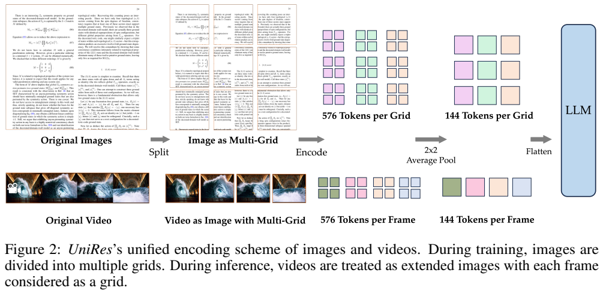
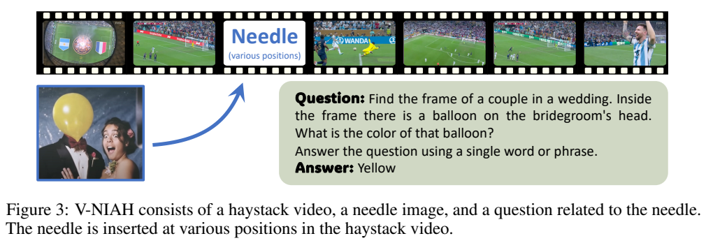
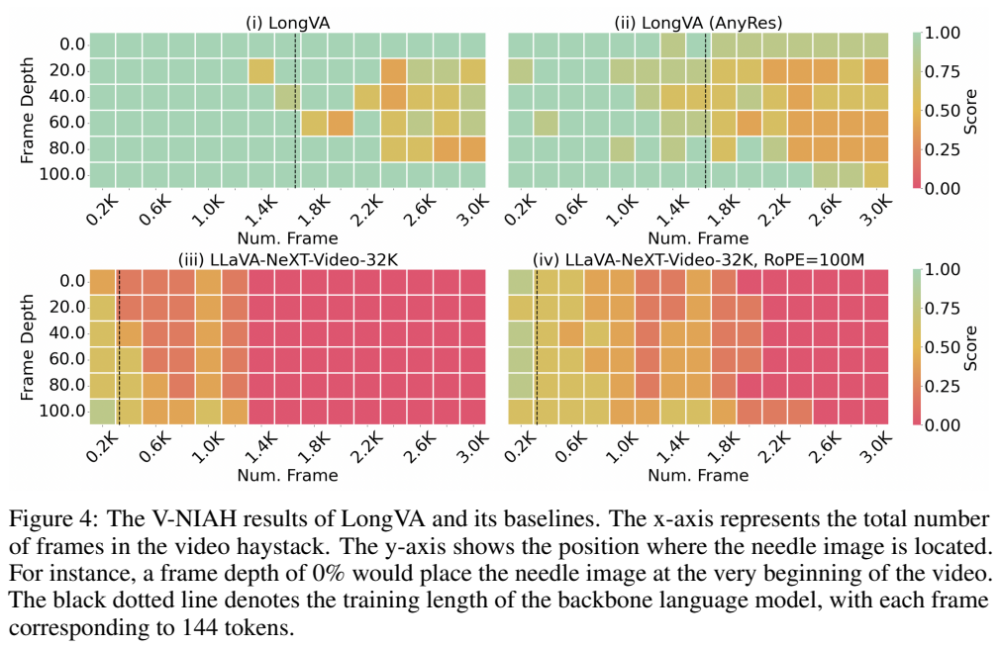
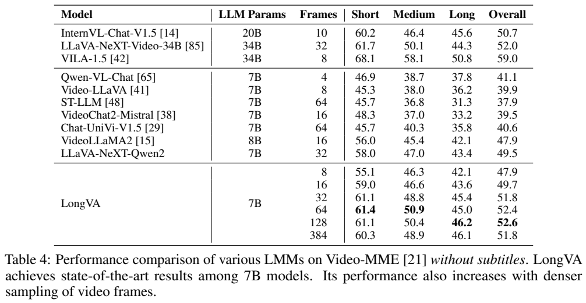
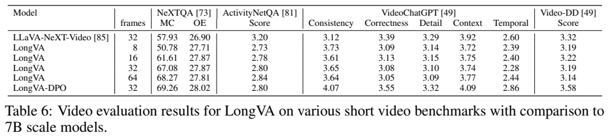
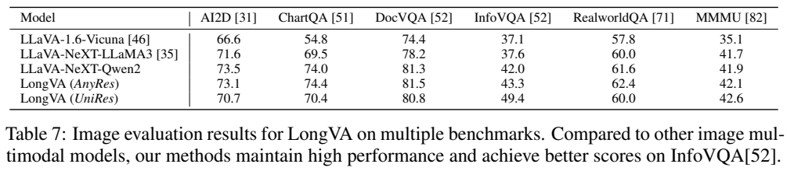
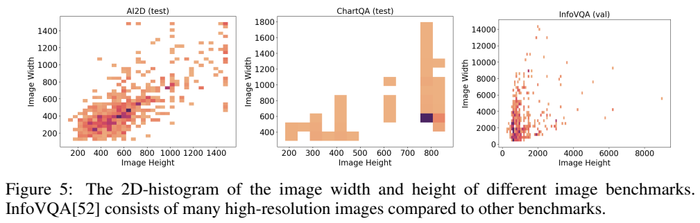

<!-- article-header:start -->
[项目首页](../../../README.md) › [模型系列](../../../reports/model-family-index.md) › [LongVA](../README.md)
<!-- article-header:end -->

# LongVA：把语言模型的长上下文能力迁移到长视频

<!-- article-toc:start -->

**本篇目录** · [论文定位](#paper-info) · [快速概览](#overview) · [整体架构](#architecture) · [核心原理](#principles) · [数据构建](#data) · [训练流程](#training) · [实验结果](#experiments)
<!-- article-toc:end -->

## 1. 论文信息与模型定位

《Long Context Transfer from Language to Vision》提出 Long Video Assistant（LongVA），由 Peiyuan Zhang、Kaichen Zhang、Bo Li 等作者完成，机构包括 LMMs-Lab、南洋理工大学及新加坡科技设计大学。本文依据 [arXiv 2406.16852v1](https://arxiv.org/pdf/2406.16852v1)（2024 年 6 月 24 日）；代码为 [EvolvingLMMs-Lab/LongVA](https://github.com/EvolvingLMMs-Lab/LongVA)。

LongVA 的问题是：视觉 token 很长时，瓶颈是否也来自语言骨干的上下文长度？作者先只用文字扩展 Qwen2-7B-Instruct，再用图像数据对齐视觉，测试时输入长视频。主模型用这个设计研究“训练短视觉输入、测试长视觉输入”的迁移；另外的 LongVA-DPO 使用视频相关偏好数据，需与主模型区分。

## 2. 快速概览

| 设计 | 具体处理 |
| --- | --- |
| 扩展语言上下文 | 224K 长度继续预训练，RoPE base 设为 1B |
| 视觉输入 | CLIP ViT-L-336px 与两层 MLP |
| 图像/视频统一 | UniRes 把图像块与视频帧作为同类网格 |
| 每帧成本 | 576 个 patch 特征经 2×2 池化变成 144 token |
| 长视觉检索 | V-NIAH 在长背景视频中插入五类问答针帧 |
| 真实视频评价 | Video-MME 无字幕设置，采样 8 至 384 帧 |

论文的“超过 200K 视觉 token”和约 2000 帧能力主要来自合成检索实验，真实 Video-MME 的分析最高使用 384 帧。检索成功、完整视频推理和实用生成速度属于不同评价问题，不能互相替代。

## 3. 整体架构

Figure 2 上半是图像：拆成 336×336 网格，每格编码为 576 个特征，池化到 144 个，再送给语言模型。下半是视频：把每帧当作一个网格，采用同样处理。图像对齐中见过的“多个网格”形式因此可延伸到“多个视频帧”，核心不是增加一个单独的时序视频编码器。

AnyRes 通常在局部网格之前加入缩小的整体图，并把各网格合为大特征图后跨边界展平。UniRes 移除整体基准图，在每个网格内按栅格顺序展平，对图像和视频都应用 2×2 平均池化。这样网格边界与帧边界有一致表示，避免训练时图像展平规则与测试时视频帧串联规则差异过大。

单图最高允许 49 个网格，更大的图像先缩放。N 帧视频被视为尺寸为 $`336\times(336N)`$ 的扩展图像，有 N 个网格。视觉编码和投影后生成 $`144N`$ 个视觉 token，与问题文字一起输入长上下文 Qwen2。主文未单独披露新的时间编码模块；顺序信息来自序列排列，不能由“视频理解”反推已经加入时间戳嵌入。[PDF 第 4、17 页](https://arxiv.org/pdf/2406.16852v1#page=17)

| 模块 | 输入与输出 | 公开机制 |
|---|---|---|
| 长上下文 Qwen2-7B | 长文字历史 → 可承载长序列的主干 | 纯文字224K继续训练，RoPE base1B；不靠长视频训练建立基础长度能力 |
| UniRes 视觉组织 | 图像网格或视频帧 → 一致边界的网格序列 | 去整体基准图，每网格内展平；图像最多49格、视频逐帧视为一格 |
| CLIP-ViT-L-336px | 336×336 网格 → 576 视觉特征 | 同一视觉编码路径服务图像和视频，无单独时序视频编码器 |
| 两层 MLP 与2×2池化 | 网格视觉特征 → 144 个语言视觉 token | 投影到LM维度后池化；N帧合计144N，再和问题一起输入长主干 |

## 4. 核心创新与数学原理

### 4.1 先延长语言上下文再用短视觉数据对齐

实验刻意采用 train short/test long：语言继续训练阶段接触长文字，视觉对齐阶段只接触图像，测试才换成长视频。这样能较清楚地检验承载长度迁移，而不把长视频数据学习的效应混入。结果支持特定配置的迁移现象，仍不能推出长程动作关系或任意视觉任务自动获得同等泛化。[原文 §3.1–3.2，PDF 第 3–5 页](https://arxiv.org/pdf/2406.16852v1#page=4)

作者将“减少单帧 token”与“提高语言模型承载长度”视为可结合的方向。长上下文继续训练只发生在文字上，随后视觉对齐让点状的图像特征成为语言模型能读取的输入嵌入，长序列处理能力随之迁移。这个命题通过长视觉检索和真实视频评测验证，不是对所有模态任务成立的数学定理。

RoPE 把位置关系编码为旋转。为解释增大 base 的作用，可写常见频率形式 $`\omega_j=\theta^{-2j/d}`$：较大 $`\theta`$ 使部分维度随位置变化得更慢，缓和长位置范围中的旋转变化。该式是本文的机制解释，报告本身主要给出把 base 调至 1B 的训练选择；它并没有证明只改 base 就足以获得相同迁移效果。其基线的免训练 RoPE 外推收益明显有限。

### 4.2 统一网格边界降低图像到视频的接口差异

AnyRes 跨图像网格展平与视频逐帧拼接的边界不同，UniRes 改为每格内部展平，让图像网格与视频帧在语言端具有相同局部组织。它移除全局缩略图后对某些低分辨率图像任务略有退化，这是统一接口的权衡。没有新时间模块不等于没有顺序：序列位置仍提供读取次序，但不能替代真实时间间隔。[原文 §3.2，PDF 第 4–5 页](https://arxiv.org/pdf/2406.16852v1#page=5)

视觉长度的计算直接来自 UniRes：每个 336 网格有 24×24=576 patch，经 2×2 池化变成 12×12=144；于是 $`T_v=144N`$。若将 224K 粗略按 224,000 token 计算，约对应 1555 帧视觉 token，仍需给问题与回答留位置。2000 帧约为 288K token，属于超出训练长度的测试；不能写作“2000 帧刚好等于 200K”。

### 4.3 检索评测与自由生成性能分开解释

预存视觉嵌入避免评估时反复编码，同一次前向用正确答案前缀检查逐 token 最大分布。这样适合检验长输入中能否找到目标信息，却没有测完整在线生成的KV存储、逐步延迟或答案采样稳定性。长视觉检索结果应作为迁移证据的一部分，并与真实视频任务结果共同阅读。[原文 §4；本节保留原评测条件出处](https://arxiv.org/pdf/2406.16852v1#page=5)

V-NIAH 采用一次前向评估而非完整在线生成。预存帧嵌入后，将视觉、问题和正确答案串联，在正确答案条件前缀下检查答案区每个位置的最大 logit token 是否一致。可用 $`\forall t,\ \arg\max p(w_t\mid V,q,w_{\lt t}^{*})=w_t^{*}`$ 表示这个判定，这是对原文流程的解释式。它避免 KV cache 的大量存储，但属于有正确答案前缀的 token 级检验，不能当作已测得数千帧输入后的自由生成延迟。[PDF 第 3–7 页](https://arxiv.org/pdf/2406.16852v1#page=5)

## 5. 数据构建与处理

长文本训练采用 SlimPajama，增加超过 4096 token 文档的采样，同时保留领域混合比例；多个文档以 BOS 分隔拼成单一长序列。报告给出总训练量约 900M token，另给约一百万 token 的 batch、1000 步；这些是公开概略配置，本文不强行把它们算成精确一致的总量，也不以此推导独立文档数。

视觉对齐明确采用 LLaVA-1.6 的数据配方与两阶段方式，只使用 image-text，不使用长视频文字对。原文没有在本报告完整重列各来源样本量和采样比例，因此本文不从其他版本借出数字当作 LongVA 单独披露的配置。

V-NIAH 使用五个针帧：便签大学名、婚礼气球颜色、瓶上剂量文字、反常识动物科学家、地标上的玩具熊。针帧来自已有 VQA 或生成图像，置入长背景视频的不同位置，按 1 FPS 抽帧。部分反常识构造减少仅靠语言常识猜答案的机会，但已有 VQA 来源不意味着全部测试内容都严格没有公开训练接触。[PDF 第 5、15–16 页](https://arxiv.org/pdf/2406.16852v1#page=16)

文字 NIAH 则把随机城市关联七位数字插入 Paul Graham 文章，改变长度和深度，并加入三或五个干扰城市；每个位置与长度重复五次。它检验精确读取长上下文的能力，不衡量跨整部视频的因果叙事理解。

## 6. 训练流程与目标

| 流程 | 已公开配置 |
| --- | --- |
| 语言长上下文训练 | Qwen2-7B-Instruct；224K 长度；base=1B；常数学习率 1e−5；1000 步 |
| 训练系统 | FlashAttention-2、Ring Attention、激活检查点、参数 offload、zigzag 序列分片 |
| 视觉对齐 | LLaVA-1.6 两阶段配方，仅图像文字；UniRes 编码 |
| 报告资源 | 8×A100 80GB；长文本约 2 天；视觉对齐约 1.5 天；合计约 3.5 天 |

长文本阶段没有采用 LoRA 或近似注意力方法。Ring Attention 将长序列分片在设备间计算，zigzag 分片改善因果注意力不同位置计算量不均衡的问题；系统处理超长序列的存储与负载，而不改变视觉监督来源。

报告没有完整重列视觉两阶段的冻结模块、优化器、batch、学习率、步骤数和精度，因此只保留“遵循 LLaVA-1.6 两阶段”的来源描述，不把其他论文配置自动当成本模型确认值。上下文继续训练沿用语言序列学习，视觉对齐采用回答预测流程，论文没有提出新的专门长视频损失。

额外 LongVA-DPO 在 LLaVA-Hound-DPO 上做轻量偏好优化，改善开放视频回答的评判分数。它属于另一个检查点，含视频偏好训练信息；“完全无视频训练”应限定用于研究迁移的基础 LongVA。报告没有提供该 DPO 的完整超参或新增数据条数。[PDF 第 3–5、8 页](https://arxiv.org/pdf/2406.16852v1#page=8)

## 7. 实验设置与主要结果

Figure 4 横轴为总帧数，纵轴是针帧的相对位置，绿色较高、红色较低，虚线对应语言骨干训练长度。基础 LongVA 在约 2000 帧以内多数位置接近完美检索；更长区间变黄、橙，不能说 3000 帧所有位置均为 100%。AnyRes 版本较弱，32K 视频基线和仅改 RoPE 的基线更早失效。图支持语言长度及统一表示共同影响视觉读取。

| LongVA 采样帧数 | 短视频 | 中视频 | 长视频 | 总体 |
| --- | ---: | ---: | ---: | ---: |
| 8 | 55.1 | 46.3 | 42.1 | 47.9 |
| 32 | 61.1 | 48.8 | 45.4 | 51.8 |
| 64 | 61.4 | 50.9 | 45.0 | 52.4 |
| 128 | 61.1 | 50.4 | 46.2 | 52.6 |
| 384 | 60.3 | 48.9 | 46.1 | 51.8 |

相同 32 帧下 LLaVA-NeXT-Qwen2 总体为 49.5，LongVA 为 51.8。128 帧达到表内最好总体 52.6，384 帧反而降到 51.8；长视频子集也不是随采样帧数严格单调。与 34B VILA 的 59.0 比，仍有差距。作者的同期领先主张限定于小规模模型与这套无字幕评测，而非所有时间、所有模型的最新排名。

短视频 NeXTQA 的多选分从 8 帧 50.78 增到 64 帧 68.27，但 ActivityNetQA 从 32 帧 2.80 到 64 帧 2.84 的增益较小，开放描述指标不稳定。LongVA-DPO 在 32 帧下 Video-DD 为 3.58，基础模型为 3.19；这是带额外偏好训练的结果。报告认为回答形式会影响 GPT 判分，这是作者解释，不是已经单独证实模型推理完全不变。

图像比较中 UniRes 的 InfoVQA 为 49.4，高于 AnyRes 的 43.3；AI2D 为 70.7，低于 73.1，ChartQA 为 70.4，低于 74.4。Figure 5 显示 InfoVQA 有更多高分辨率图，UniRes 的 49 网格上限有机会保留更多局部信息；较小图像却可能主要承受池化的细节损失。结果展现图像细节与长序列能力的权衡。以上来自论文原图原表核验，没有运行模型，也没有据检索实验声称实测实时长视频服务。

<!-- article-footer:start -->
---

[← 上一篇：Cambrian-1](../../cambrian-1/arxiv-2406.16860/README.md) · [按发表时间浏览](../../../reports/paper-reading-guide.md#year-2024) · [下一篇：OMG-LLaVA →](../../omg-llava/arxiv-2406.19389/README.md)

[返回本篇目录](#article-toc) · [返回模型系列](../README.md)
<!-- article-footer:end -->
