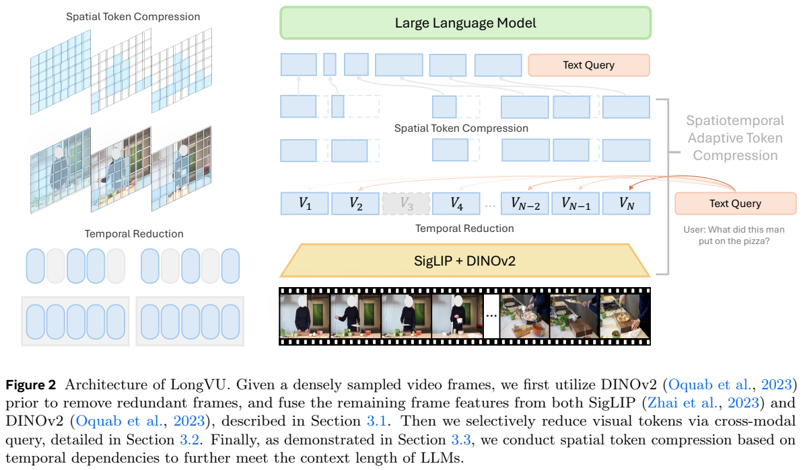
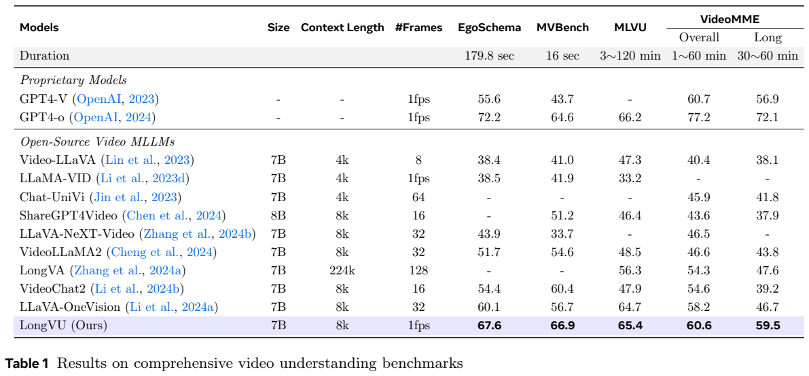
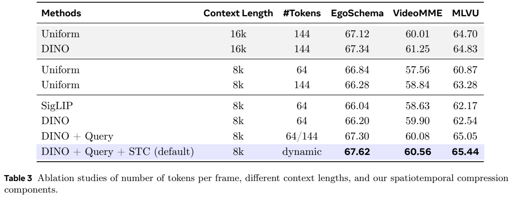
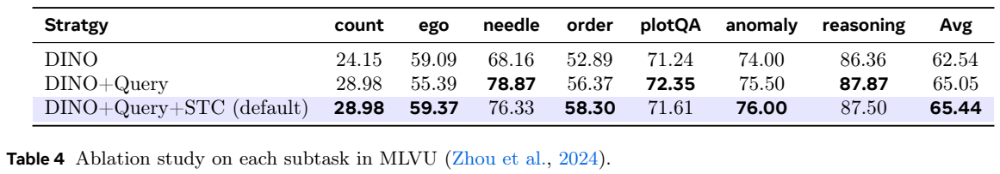
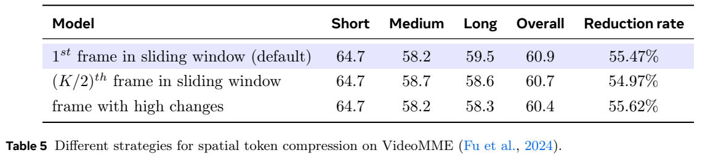
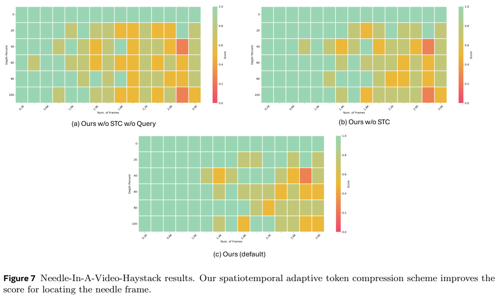
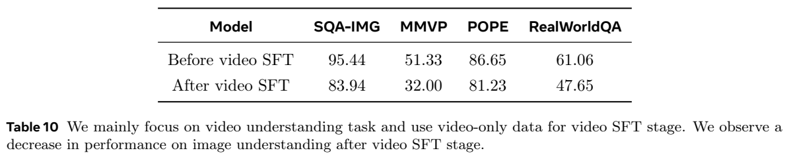

# LongVU：在有限上下文中自适应压缩长视频

## 1. 论文信息与模型定位

**LongVU: Spatiotemporal Adaptive Compression for Long Video-Language Understanding**，Xiaoqian Shen、Yunyang Xiong 等，来自 Meta AI、KAUST 与韩国大学。本文依据 [arXiv 2410.17434v1](https://arxiv.org/abs/2410.17434v1)（2024 年 10 月 22 日，17 页）整理。[代码](https://github.com/Vision-CAIR/LongVU)与[项目页](https://vision-cair.github.io/LongVU)见原文。

LongVU 是视频理解模型及其视觉 token 压缩方法。语言骨干分别为 Qwen2-7B、Llama3.2-3B；视觉端结合 SigLIP 与 DINOv2。它希望在约 8K 上下文中读取按 1 fps 采样的长视频，通过有选择地保留信息回答问题。论文没有设计音频编码器，不能把它描述成同时听取音轨的原生音视频模型。

## 2. 快速概览

- **时间去冗余**：先按 DINOv2 特征相似度剔除高度重复的帧。
- **问题引导分配**：与问题更相关的帧保留较多空间 token，其他帧降分辨率。
- **跨帧空间压缩**：长视频仍超预算时，删除相邻帧中与锚帧重复的空间位置。
- **结果边界**：7B 在 VideoMME 长视频子集明显优于表内多个开源对照，但并未全面超过 GPT-4o；视频专用微调会牺牲单图能力。

## 3. 整体架构

Figure 2 从下到上依次展示帧编码、时间去冗余、问题引导与空间压缩。DINOv2 先编码原始 1 fps 帧序列，对每个不重叠的 8 帧窗口计算帧间相似度，去除重复帧。只有保留下来的帧再由 SigLIP 编码，减少第二个视觉编码器的工作量。

两种特征经 Cambrian 的 Spatial Vision Aggregator（SVA）融合。DINOv2 提供视觉细节与差异信息，SigLIP 提供语言对齐的语义，两者的互补作用属于模型设计依据，不意味着任意视觉任务中前者都更好。融合特征通过 MLP 对齐到语言模型空间，再用用户问题的语言嵌入决定空间 token 分配。

视频帧的高分辨率表示为 $12\times12=144$ 个 token，低分辨率为 $8\times8=64$ 个。低分辨率仍无法满足预算时，额外应用空间 token 压缩。最终视觉 token 与文本送入语言模型生成答案。该流程依赖具体问题，同一视频面对不同问题可能保留不同视觉细节；它不是将视频一次性无损压缩后支持所有未知问题。

## 4. 核心创新与数学原理

时间压缩为窗口内第 $i$ 帧计算平均相似度：

$$
s_i=\frac{1}{J-1}\sum_{j\ne i}\operatorname{sim}(V^i_{\rm dino},V^j_{\rm dino}),\qquad J=8.
$$

高相似度帧更冗余。原文未给出这一阶段完整的固定保留率或统一阈值规则，不能将实验中的平均压缩比例写成每个窗口的硬约束。

问题引导阶段对帧与问题计算匹配分数（式 1）：

$$
a_i=\frac{1}{H_hW_hL_q}\sum_{h,w,l}\langle F(V^i_{h,w}),Q_l\rangle,
\qquad
N_h=\max\!\left(0,\frac{L_{\max}-L_q-TH_lW_l}{H_hW_h-H_lW_l}\right).
$$

这里 $T$ 是保留帧数，$F$ 为 MLP，$L_q$ 是问题长度。最高分的 $N_h$ 帧保留高分辨率，其余空间池化。预算式先扣掉全部帧的低分辨率表示，再计算还能升级多少帧；论文为简洁省略系统提示开销。实际帧数必须取整数并受 $T$ 约束，但原文式 1 没有显式写出取整和截断规则。$N_h=0$ 时跳过匹配计算，全部池化。

空间压缩在 8 帧窗口内保留首帧的空间 token，其他帧只保留与首帧对应位置余弦相似度不超过 $\theta=0.8$ 的 token（式 2）。这利用静态背景的重复性，不是基于光流匹配物体轨迹，因此镜头运动或短暂事件仍可能挑战其压缩判断。

附录研究了按原始时刻添加正弦帧位置编码，但默认模型**不使用**这项附加编码，因为不同基准的收益不稳定。训练目标仅为答案文本的自回归交叉熵，没有额外压缩重建损失，也未证明压缩后的视觉信息可逆。

## 5. 数据构建与处理

附录 Table 6 报告图文阶段使用 LLaVA-OneVision 单图数据 **3.2M** 条，将常见的对齐与单图指令训练合并为一个阶段。视频阶段包含描述 **43K**、分类 **1K**、VQA **424K**、指令 **85K**，合计约 **553K** 条；这是按表中四类样本数相加的统计，不能当作去重视频总数。

视频数据来自 VideoChat2-IT 的子集，包括 TextVR、YouCook2、Kinetics-710、NExTQA、CLEVRER、EgoQA、TGIF、WebVidQA 等，Table 6 的 VQA 来源还列出 DiDeMo。ShareGPT4Video 提供指令数据，MovieChat 补充长视频。不同数据集覆盖阅读、动作、因果问答和长视频叙事，并非全部一小时视频。

输入按 1 fps 采样，随后动态减少帧和 token。正文未完整给出各源的清洗阈值、去重协议或训练测试污染审计，本文不补写。视频微调阶段只用视频数据，这一选择也是后文单图退化的重要实验条件。

## 6. 训练流程与目标

视觉编码器使用 SigLIP so400m-patch14-384 与 DINOv2，语言端采用上述 7B/3B 骨干。图文阶段训练 1 个 epoch，全局批量 128，每图 576 token；视频阶段同为 1 个 epoch，全局批量 64，每帧初始最多 144 token，再应用动态压缩。

两阶段均使用 AdamW、学习率 $10^{-5}$、余弦调度、warmup 比例 0.03；训练使用 **64 张 NVIDIA H100**。论文没有充分披露每阶段所有模块的冻结清单、总 GPU 小时与显存峰值，不宜依据其他模型训练惯例补齐。三级压缩配合训练与推理，不是在增加语言模型上下文长度后简单塞入更多帧。

评测使用贪心解码，`num_beams=1`。8K 是该模型主要实验配置，支持一小时视频时平均每原始采样帧只分到少量 token，是压缩效果与内容冗余共同决定的现象，不能理解成每帧固定保留两个 token。

## 7. 实验设置与主要结果

Table 1 的指标为各基准准确率，VideoMME 的 Long 子集为 30–60 分钟，MLVU 视频约 3–120 分钟。表列帧预算与上下文不同，横向结果不是同一输入成本下的严格比较。该版本未明确说明 VideoMME 是否使用字幕，因此这里保留“原表未注明”的限定。

| 模型 | EgoSchema | MVBench | MLVU | VideoMME 总体 | VideoMME Long |
|---|---:|---:|---:|---:|---:|
| LLaVA-OneVision 7B，32 帧 | 60.1 | 56.7 | 64.7 | 58.2 | 46.7 |
| LongVU 7B，1 fps、动态压缩 | 67.6 | 66.9 | 65.4 | 60.6 | 59.5 |
| GPT-4o，原表 1 fps | 72.2 | 64.6 | 66.2 | 77.2 | 72.1 |

LongVU 相对 OneVision 的 Long 提升 **12.8 个百分点**，总体提升 2.4 点；对 GPT-4o 只在这里的 MVBench 高 2.3 点，其他四项更低。小模型 Table 2 中，LongVU 3B 的 VideoMME 总体/Long 为 **51.5/47.2**，Phi-3.5-Vision 为 **50.8/43.8**。这些数据支持小骨干上的压缩效果，但并非所有基准都存在对应小模型对照。

Table 3 在 8K 下，DINO 时间压缩的 VideoMME/MLVU 为 **59.90/62.54**；加入 Query 为 **60.08/65.05**；再加 STC 为 **60.56/65.44**。完整 8K 配置的 VideoMME 仍低于 16K DINO 配置 **61.25**，不能把“接近更长上下文”写成在每项都超过它。Table 4 中 STC 将针帧检测从 78.87 降到 76.33、plotQA 从 72.35 降到 71.61，虽提升均值，也存在任务折损。

Table 5 和附录 Table 7 的总体值为 **60.9**，与 Table 1 的 **60.6** 不完全一致；本文分别引用，不自行选择一个数字统一全文。压缩分析的抽样视频平均保留约 45.9% 帧，空间阶段平均减少约 40.4% token；Table 5 的 55.47% reduction 来自另一策略评测，不能混成统一总压缩率。

Figure 7 的横轴为输入帧数、纵轴为插入深度，展示问题引导与 STC 对长视频检索的影响。实验在选取的一小时 MLVU 视频中插入 VQA 图像，并不等同于自然视频中所有短暂事件都能检索。

Table 10 显示视频 SFT 前后，SQA-IMG **95.44→83.94**、MMVP **51.33→32.00**、POPE **86.65→81.23**、RealWorldQA **61.06→47.65**。所以这个版本更适合被理解为专门优化长视频的模型；统一图像、视频能力需要更合理的数据混合，原文将其留作后续工作。本文整理的是论文报告结果，未运行模型或复现实验。
