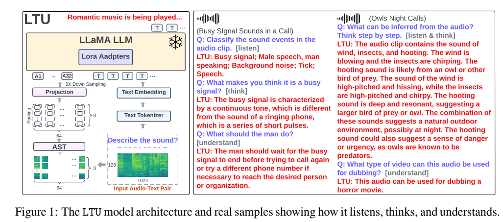
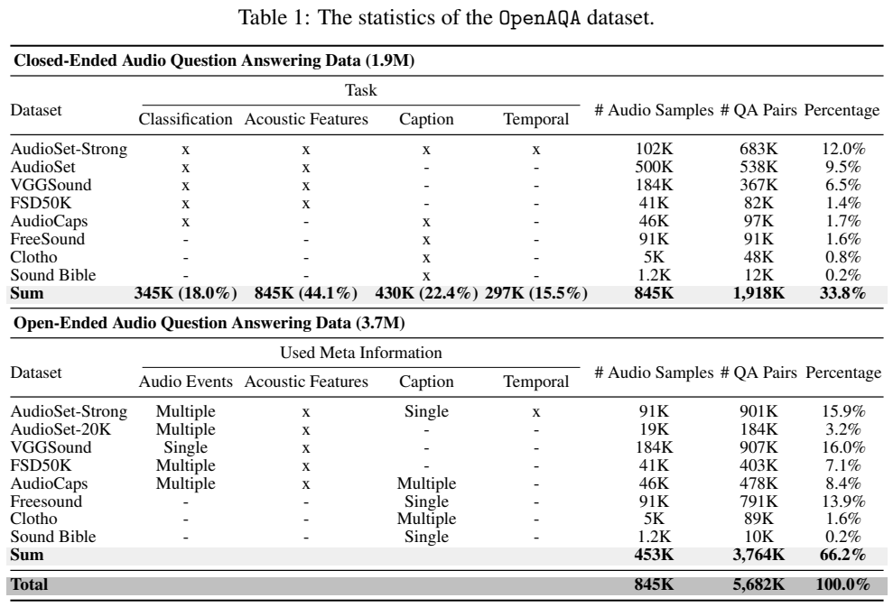
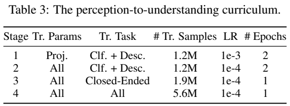
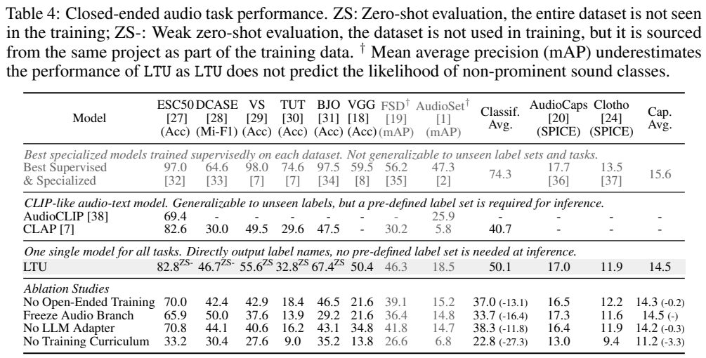
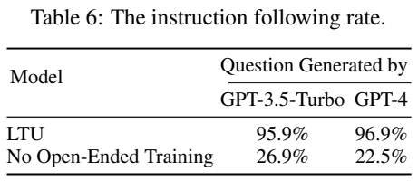

<!-- article-header:start -->
[项目首页](../../../README.md) › [模型系列](../../../reports/model-family-index.md) › [LTU](../README.md)
<!-- article-header:end -->

# LTU：让语言模型从识别声音走向开放音频问答

<!-- article-toc:start -->

**本篇目录** · [论文定位](#paper-info) · [快速概览](#overview) · [整体架构](#architecture) · [核心原理](#principles) · [数据构建](#data) · [训练流程](#training) · [实验结果](#experiments)
<!-- article-toc:end -->

## 1. 论文信息与模型定位

| 项目 | 信息 |
|---|---|
| 原文 | Listen, Think, and Understand |
| 作者 | Yuan Gong、Hongyin Luo、Alexander H. Liu、Leonid Karlinsky、James Glass |
| 机构 | MIT CSAIL、MIT-IBM Watson AI Lab |
| 版本与来源 | arXiv:2305.10790v1，2023 年 5 月 18 日；[13 页原文](https://arxiv.org/pdf/2305.10790v1) |
| 模型定位 | 以一般环境声音为主要输入的音频语言模型，生成文字分类、描述、解释与建议 |

LTU 将 Audio Spectrogram Transformer（AST）的声音感知与 Vicuna 版本 LLaMA-7B 的语言能力连接起来。传统声音分类器给出固定标签，LTU 则允许用户询问声音特征、事件的时间关系以及可能场景。它的核心贡献包括统一成音频问答的 OpenAQA 数据和先感知后理解的训练课程。

这是环境音理解而不是完整语音系统。原文明确说其理解语音内容的能力有限，不是自动语音识别模型；它也不生成音频。名称中的 Listen、Think、Understand 表达任务愿景，不代表三个彼此独立的推理网络。

## 2. 快速概览

| 要点 | 实际方案 |
|---|---|
| 输入 | 约 10 秒音频与文字问题 |
| 音频接口 | AST 网格经频率均值与时间下采样，变成 32 个连续音频嵌入 |
| 语言模型 | Vicuna 指令训练的 LLaMA-7B，基础权重冻结 |
| 适配方式 | 音频投影 768→4096；注意力 Q、K 的 LoRA，rank 8、α 16 |
| 数据 | Table 1 为 845K 独立音频、5.682M 问答；“5M”为数据集简称 |
| 课程 | 分类与声学特征→全部闭合任务→加入开放问答 |
| 关键结果 | 分类汇总 50.1；开放问题指令遵循 95.9/96.9%，后者不是音频事实正确率 |

模型直接输出语言，不要求用户预先给定所有声音类别。不过，为与传统分类基准比较，实验仍将生成文本映射回该基准的标签集合。这一评测后处理与模型自身的开放输出接口应区分。

## 3. 整体架构

*原文 Figure 1，PDF 第 2 页图表区域裁切；保留架构、32 个音频嵌入与完整示例。*

音频首先转换成 128 维 log-Mel filterbank，使用 25ms Hanning 窗和 10ms 步长，原文给出固定的 1024×128 时频输入。16×16 的不重叠块进入 AST；音频主干此前以 CAV-MAE 目标预训练并在 AudioSet-2M 微调。这个已有预训练不是本报告从零完成的所有计算。

原文将 512 个块写成“64×16”，存在算术问题。1024/16=64，128/16=8，应为 64×8=512；Figure 1 也实际标为 64×8。本文按图与维度计算解释，不复述不相容的 64×16。每块输出 768 维特征，频率维做均值，保留时间上的 64 个表示，再两倍时间下采样成为 32，约每秒 3.2 个音频嵌入。

投影层将每个嵌入转换为 LLaMA 的 4096 维空间，与文字嵌入拼接后进入语言模型。它是连续特征前缀，不是先用分类器生成标签再把标签交给 LLM。AST 接收真实音频，因此理论上可以利用训练标签未完全概括的细节；但大量时频信息被池化，不能将其解释成原始波形的无损表示。

所有 LLaMA 自注意力层的 query 与 key 投影加入 LoRA，rank=8、α=16，共约 4.2M 可学习参数。4.2M 仅指 LoRA，并非后续阶段全部训练参数，因为音频编码器和投影器也会更新。基础 LLaMA 权重始终冻结；AST 则只在第一阶段冻结。

## 4. 核心创新与数学原理

### 用语言任务统一音频感知与理解

原文 Eq. (1) 以音频 $A$ 和已有文字 token 为条件预测下一个 token：$P(x_t\mid x_{1:t-1},A)$。其交叉熵训练可按标准形式理解为：

$$
\mathcal L=-\sum_t\log P(x_t\mid x_{<t},A).
$$

同一模型不需要为分类、描述和时间问答更换任务头，文字问题决定任务，目标回答决定输出形式。这里的损失为 Eq. (1) 的常规负对数解释，原文没有进一步说明所有问题和回答 token 的标签掩码，因此本文不假定具体 masking 实现。

### LoRA 让音频接口适配语言主干

以标准 LoRA 记号表示某个被适配矩阵：

$$
W'=W+\frac{\alpha}{r}BA,\qquad r=8,\quad\alpha=16.
$$

$W$ 冻结，低秩矩阵 $A,B$ 可学习；这里只用于解释原文采用的 LoRA，不是报告的新编号公式。低秩更新帮助语言网络解释输入的音频嵌入，控制需要更新的语言参数，也降低全量微调改变语言能力的风险。它不意味着零遗忘保证；43.2% 的文字偏好结果也不能证明完全保持所有原有能力。

### 先强制使用声音，再学习开放推断

若一开始只给复杂开放问题，语言模型容易凭常识生成听起来合理的答案，绕过尚未对齐的音频特征。课程先用声音类别和声学特征等具有固定答案的任务，让忽略音频的回答受到监督惩罚，再逐步引入描述、时间关系与开放问答。这是数据和优化顺序的设计，不是额外的隐藏“思考损失”。

闭合任务对真实事件有较强约束，开放任务扩展解释空间。两者结合比只有闭合数据或直接混合训练更好，是该报告最有力的实证之一。但“能够给解释”不等于解释必定来自真实音频证据，Figure 1 的猫头鹰场景推断也包含常识联想，应与直接可听见的事件区分。

## 5. 数据构建与处理

*原文 Table 1，PDF 第 3 页图表区域裁切；保留全部数据源、闭合/开放任务字段和总计。*

OpenAQA 复用已有公共声音数据，不新录制音频。八行来源为 AudioSet-Strong、AudioSet、VGGSound、FSD50K、AudioCaps、FreeSound、Clotho、Sound Bible；只使用标为 train 与 validation 的样本，排除 test/evaluation。数据集之间有音频重叠，总计 845K 独立片段，不应把各行简单相加为去重数量。

Table 1 闭合问答为 1.918M，开放为 3.764M，总计 5.682M。正文有“3.6M”以及阶段表“5.6M”的近似/不一致表述，本介绍使用详细表数值说明数据集规模，不把简称当成恰好五百万。

闭合任务包括四类。分类答案由原标签组成；声学特征由 GPT-3.5-Turbo 为每个**类别名称**生成十种简短特征描述，再按片段事件标签组合；caption 使用 AudioCaps、Clotho 的人工描述以及 WavCaps 对 FreeSound、Sound Bible 的辅助标注；时间问答利用 AudioSet-Strong 的起止时间，以规则生成事件区间、先后与重叠关系。

声学特征描述不是教师逐条听音频后测出的声学属性，而是类别层面的文字知识。它可能帮助模型理解音色，也可能把类别的典型特征过度套到每个实例。时间答案有明确标注来源，比由语言模型猜测时间戳更有约束。

开放问答采用 Audio Instruction Tuning：先把事件名、类别声学描述、caption 和时间信息整理成文本，再让 GPT-3.5-Turbo 产生多种问题及答案。教师**不听音频**；信息丰富的样本产生更多问答。约 6.5% 问题被标为无法根据现有信息确定，训练模型表达不确定性。这个比率是合成数据中不可回答问题占比，不是模型最终拒答率。

元信息只用于合成问答，不输入 LTU；训练和推理时 LTU 接收音频与问题。因而这是利用文字代理生成监督的方案，不是直接蒸馏一个原生音频 GPT。教师生成的场景和动作建议仍可能包含合理但未经音频证实的推断。

## 6. 训练流程与目标

*原文 Table 3、Table 4，PDF 第 6 页图表区域裁切；保留阶段参数、指标类型、全部对照与消融行。*

| 阶段 | 更新参数 | 任务与样本 | 学习率 / 轮数 |
|---|---|---|---|
| 1 | 仅音频投影 | 分类+声学特征，1.2M | 1e-3 / 2 |
| 2 | AST、投影、LoRA | 同上，1.2M | 1e-4 / 2 |
| 3 | 同上 | 全部闭合任务，1.9M | 1e-4 / 1 |
| 4 | 同上 | 闭合与开放，阶段表为 5.6M | 1e-4 / 1 |

Table 3 的“All”明确排除基础 LLaMA 参数，不能写成全模型微调。各阶段 batch 为 256，线性学习率衰减并采用 warmup，文字截断长度 108 token，在四张 RTX A6000 上约三天。原文未给 warmup 比例、优化器、权重衰减和各数据源采样权重，本文不借用其它 LLaVA 模型的超参数补齐。

推理统一 temperature=0.1、top-k=500、top-p=0.95、重复惩罚 1.1。它不是贪心解码。作者刻意不为不同任务分别调生成参数，但分类后处理仍使用外部文本嵌入。108 是报告的训练文字截断配置，不是 AST 音频长度，也不是 LLaMA 网络在结构上的全部上下文上限。

## 7. 实验设置与主要结果

分类任务将 LTU 生成的文本与数据集类别名用 `gpt-text-embedding-ada` 编码，按余弦相似度匹配。单标签选最高分，多标签把相似度作为 mAP 排序分数；它不是直接由 AST 分类头输出每个标签的概率。作者最终使用“描述声音”的提示做分类基准，因为得到的句子更适合该文本嵌入评测。

| Table 4 指标 | LTU | CLAP / 专门监督模型 |
|---|---:|---|
| ESC50 accuracy（弱零样本） | 82.8 | CLAP 82.6；专门模型 97.0 |
| DCASE micro-F1（弱零样本） | 46.7 | CLAP 30.0；专门模型 64.6 |
| VocalSound accuracy（零样本） | 55.6 | CLAP 49.5 |
| TUT accuracy（零样本） | 32.8 | CLAP 29.6 |
| BJO accuracy（零样本） | 67.4 | CLAP 47.5 |
| VGGSound accuracy | 50.4 | 表中 CLAP 缺失；专门模型 59.5 |
| FSD50K / AudioSet mAP | 46.3 / 18.5 | CLAP 30.2 / 5.8；专门模型 56.2 / 47.3 |
| AudioCaps / Clotho SPICE | 17.0 / 11.9 | 专门模型 17.7 / 13.5 |

LTU 的分类汇总为 50.1，CLAP 表中为 40.7，作者据此报告约 23.1% 相对改善，而不是提升 23.1 个百分点。Table 4 的 CLAP 缺少 VGGSound，汇总口径也没有充分展开，不能称为八个完整的逐项配对比较。零样本和弱零样本分别表示整个数据集未见、或未见该数据集但训练音频来自相同项目，不等同于完全无相关数据的泛化。

作者认为只生成显著声音的文字会使 mAP 低估模型，但这仍是对现象的解释，不能把 AudioSet 18.5 改写为已经达到专门模型 47.3。音频描述 SPICE 接近当时专门系统，但并未全面超过它们。

消融中，移除开放训练使分类汇总 50.1→37.0，冻结音频分支为 33.7，去掉 LoRA 为 38.3；取消课程则降到 22.8，caption 汇总 14.5→11.2。无课程模型使用相同总迭代量，较能说明训练顺序的作用。开放训练并非每个单项都提高，例如 Clotho SPICE 12.2→11.9，但整体感知与自由回答受益。

*原文 Table 6，PDF 第 7 页图表区域裁切，保留问答生成与判分方式。*

GPT-3.5-Turbo 和 GPT-4 分别基于未见 AudioSet-Strong evaluation 元信息生成 1000 个问题，LTU 用音频回答，再由 GPT-4 判断回答是否回应问题。结果为 95.9% 和 96.9%；仅闭合训练则为 26.9% 和 22.5%。裁判的输入是问题和回答，其任务是判断“有没有回答”，不是实际听音频逐项验证事实。所以这个高遵循率不能称为 96.9% 音频推理正确率。

纯文字测试以 500 个 Alpaca 问题，让 GPT-4 比较 LTU 与参考回答，LTU 获胜率 43.2%。它说明模型仍能回答文字指令，不提供完整语言能力无损的证据。Table 5 的细节追问、解释和场景建议为定性样例，也未给出这些能力的独立准确率。

LTU 展示了用较短连续音频前缀、少量语言适配参数和大量问答监督，将环境声音分类扩展为开放对话的路线。报告最扎实的证据是课程与混合问答数据的消融；开放推断的真实性、长音频和语音内容理解仍有明显边界。本文没有运行模型或独立复测原文成绩。

<!-- article-footer:start -->
---

[← 上一篇：PMC-VQA](../../pmc-vqa/arxiv-2305.10415/README.md) · [按发表时间浏览](../../../reports/paper-reading-guide.md#year-2023) · [下一篇：VisionLLM →](../../visionllm/arxiv-2305.11175/README.md)

[返回本篇目录](#article-toc) · [返回模型系列](../README.md)
<!-- article-footer:end -->
