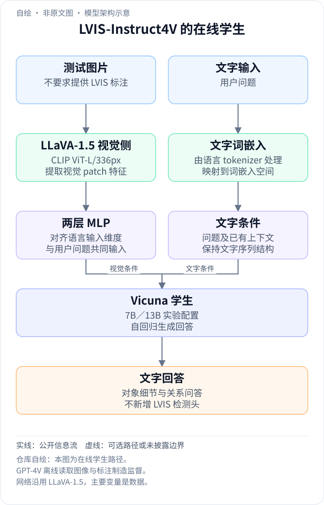
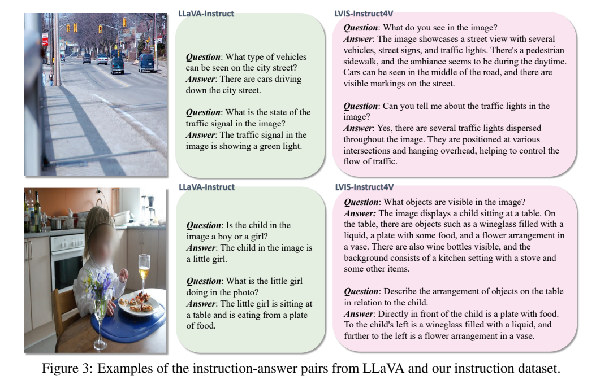
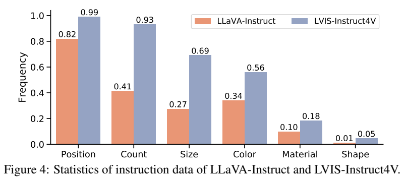
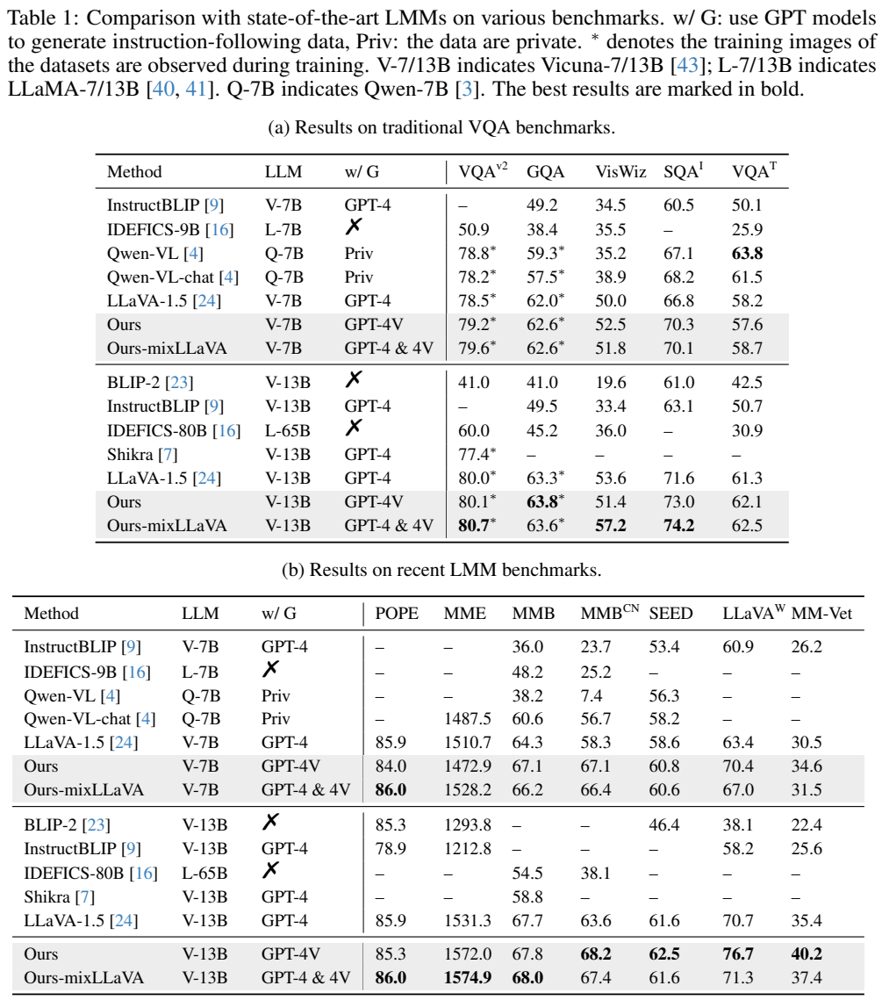
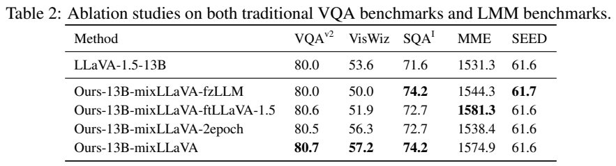
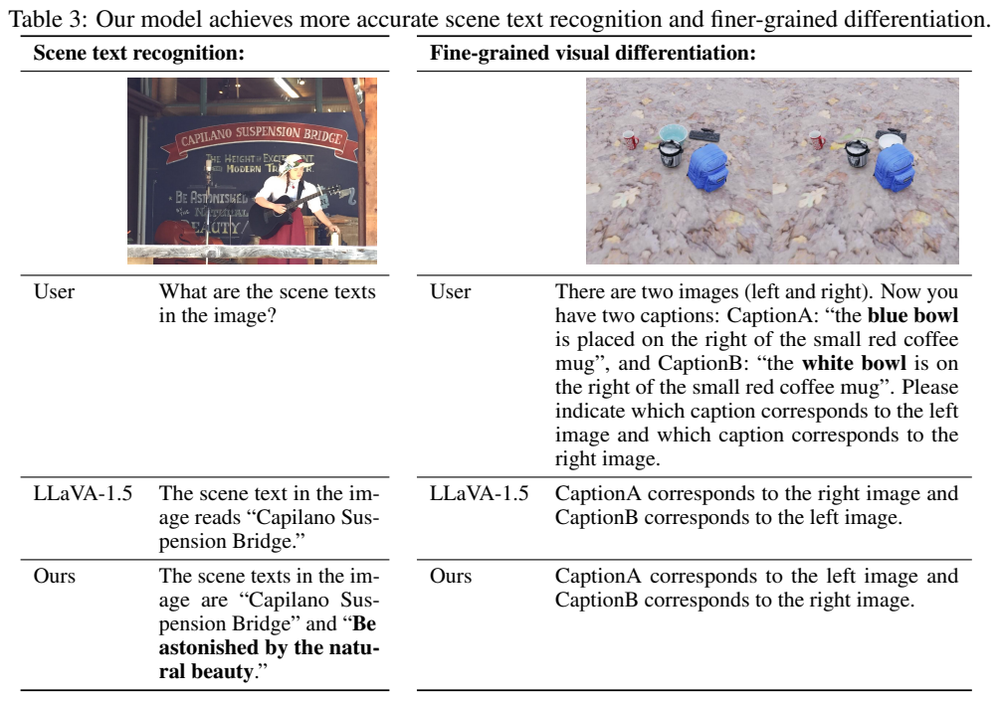

<!-- article-header:start -->
[项目首页](../../../README.md) › [模型系列](../../../reports/model-family-index.md) › [LVIS-INSTRUCT4V](../README.md)
<!-- article-header:end -->

# LVIS-Instruct4V：让数据生成模型真正看图，改善细粒度视觉指令监督

<!-- article-toc:start -->

**本篇目录** · [论文定位](#paper-info) · [快速概览](#overview) · [整体架构](#architecture) · [核心原理](#principles) · [数据构建](#data) · [训练流程](#training) · [实验结果](#experiments)
<!-- article-toc:end -->

## 1. 论文信息与模型定位

论文为 **To See is to Believe: Prompting GPT-4V for Better Visual Instruction Tuning**，由复旦大学与马里兰大学的 Junke Wang、Lingchen Meng、Zejia Weng、Bo He、Zuxuan Wu、Yu-Gang Jiang 提出。本介绍依据 **arXiv 2311.07574v1，2023 年 11 月 13 日**，共 11 页。[固定版本 PDF](https://arxiv.org/pdf/2311.07574v1)；[官方数据与模型仓库](https://github.com/X2FD/LVIS-INSTRUCT4V)。

本文主要贡献是数据集 **LVIS-Instruct4V**，不是新视觉编码器或新语言模型架构。它用 GPT-4V 直接观察 LVIS 图像，并结合框标注生成 **220K 视觉指令数据**，随后用与 LLaVA-1.5 相同的结构验证数据收益，语言底座为 Vicuna-7B/13B。

适合把它归为“视觉指令数据建设与微调配方”。GPT-4V 是生成训练监督的教师，而不是部署时必须调用的回答模块；最终微调后的 LLaVA 系模型独立推理。

## 2. 快速概览

原始 LLaVA 用纯语言 GPT-4 根据文字描述和物体标注生成对话。文字信息没有包含的颜色、位置、细节，教师可能自行补出，导致训练答案与真实图片不一致。LVIS-Instruct4V 改为同时提供**真实图片和细粒度对象框信息**，使问题与回答更贴合可观察的视觉内容。

数据使用 **110K LVIS 图片**，生成两类内容：上下文相关的多轮问答，以及框引导的密集描述。LVIS 图片本身来自 COCO，标注体系更细；它不是新增 110K 完全不同来源的图像。

在 13B 模型中，仅替换指令来源，LLaVA-in-the-Wild 从 **70.7 到 76.7**，MM-Vet 从 **35.4 到 40.2**。但混入旧 LLaVA 指令后，二者反而变为 **71.3、37.4**。数据互补对某些任务有帮助，却不是数据越多、每个能力越强。

## 3. 整体架构

<!-- derived-architecture:start -->

*自绘模型架构示意（非原文图）。依据下述公开资料归纳；方框表示功能组件，不代表逐层实现。*

依据：[§3、§4.1，PDF pp.3–5；LLaVA-1.5基线 §3、Figure 1](https://arxiv.org/pdf/2311.07574v1)；[基线 §3、Figure 1，PDF pp.1–3](https://arxiv.org/pdf/2310.03744v1)。
<!-- derived-architecture:end -->

需要分开理解两个系统。**数据生成端**是 GPT-4V：输入图片、框类别/位置及生成提示，输出对话或描述。**学生训练端**沿用 LLaVA-1.5 的视觉输入、投影接口和 Vicuna 生成框架；作者声明图像分辨率、batch 和训练计划沿用基线，以突出数据来源的作用。

原文没有另画一个新的学生骨干，也没有新增检测头来输出 LVIS 分割标签。LVIS 框信息主要用来限制教师的数据生成：最终回答以自然语言表达对象数量与空间关系，不要求暴露原始框坐标。

**Figure 3，PDF 第 4 页** 左侧是图像，中间是旧 LLaVA 指令，右侧是 LVIS-Instruct4V。街道案例的新数据讨论车辆、标识、交通灯与整体布局；餐桌案例增加物体及相对位置。应观察监督包含的视觉信息密度，而不能仅凭回答变长认定所有细节都正确。

同页 **Figure 4** 的蓝柱是新数据，橙柱是旧数据。它反映按词表测量的细粒度线索增加，不是学生模型的准确率，也不是生成答案已经经过人工逐项验证的比例。

学生的一次推理只需要测试图片与用户问题：LLaVA-1.5 的视觉编码、投影和 Vicuna 依次把图像条件转成文字回答，GPT-4V 教师不在这条在线路径中。LVIS 类别与框用于离线构建更细致的监督，并不要求用户在每次问答前提供 LVIS 标注。这里需区分“离线教师生成数据／在线学生回答”的职责；学生模块沿用基线，数据质量是本篇考察的主要变量。[原文 §3、§4.1，PDF 第 3–5 页](https://arxiv.org/pdf/2311.07574v1#page=4)

## 4. 核心创新与数学原理

关键改变可以写成教师条件分布的差别：旧方法主要依据文本标注 $`A`$ 生成 $`p_T(q,a\mid A)`$，新方法加入图像 $`I`$，学习样本来自 $`p_T(q,a\mid I,A)`$。**这个表达是本文对数据管线的解释，原论文没有提出新的概率损失。** 视觉输入减少仅靠语言先验猜测的空间，框信息又限定关注区域。

多轮对话提示要求覆盖对象类型、数量、动作、位置和相互关系；只提出能够从图片确定的问题，或能够确定目标不存在的问题。复杂请求可以涉及背景知识和解释，但仍须紧密联系视觉内容。反事实问题应给出否定回答，避免编造不存在的内容。

描述提示接受 $`(x_1,y_1,x_2,y_2)`$ 的框，坐标归一化到 **0–1**，依次表示左上和右下角。教师需整合一组框中的对象，而不是每个对象写独立短句；根据图片解释关系，避免引入框外无关对象。提示允许无法准确描述时返回 `[failed]`。这是提示层面的约束，原文没有披露 `[failed]` 的发生率或完整自动过滤流程，不能把提示等同于质量已保证。

词汇分析把位置、计数、尺寸、颜色、材料、形状各自定义为一组词，统计出现次数并按指令总数归一。概念上可写成

$$
f_c=\frac{\text{类别 }c\text{ 的词汇出现次数}}{\text{指令总数}}.
$$

这同样是统计方法的解释式。原图位置线索为 **0.82→0.99**、计数 **0.41→0.93**、颜色 **0.34→0.56**。不能把 0.99 解读为 99% 的指令位置正确，也不能忽略更长回答本身会增加词汇出现次数。

## 5. 数据构建与处理

**[Algorithm 1，PDF 第 10 页](https://arxiv.org/pdf/2311.07574v1#page=10)** 分成 conversation 和 detail 两个提示。conversation 规定问题种类和可确定性要求，detail 规定框格式、组内对象联合描述、自然语言关系及失败标记。图片和提示作为用户消息交给 GPT-4V；本文只解释其思路，不将伪代码的接口写法视为当前可直接执行的 SDK 示例。

110K 图片生成 220K 指令条目，包含多轮对话和详细描述。220K 是作者给出的数据集规模，不应直接当作所有单轮问答的总数；多轮记录内部可有多个问题。固定版本没有详细提供对话轮数分布、总 token、调用成本、去重率或人工审核覆盖率。

默认训练数据是 **LVIS-Instruct4V 加学术任务数据**。作者替换的是原配方的 LLaVA-Instruct 部分，并没有删除其他所有 VQA 数据。额外的 mixLLaVA 实验再混入旧指令，用来考察数据扩展。不能把主要结果说成学生仅训练 220K 样本，也不能把全部增益归为“有无学术训练集”。

论文图表把某些 VQAv2/GQA 成绩加星号，表示相关训练图片已在训练时被观察。因此这是带明确学术监督的模型比较，不是所有基准严格零样本迁移。

## 6. 训练流程与目标

学生采用与 LLaVA-1.5 相同的结构和常规训练计划，主要变量是视觉指令来源。正文明确常规指令训练为 **1 epoch**，并比较 2 epoch；batch、图像分辨率等仅通过引用基线说明，没有在本篇逐项列数。本文不从记忆补入学习率、GPU 数、上下文长度或 step。

生成式指令训练可概括为 $`-\sum_t\log p_\theta(y_t\mid y_{<t},I,q)`$。它解释图像条件下的目标回答生成，**不是论文新增的蒸馏 KL、框回归或对比损失**。GPT-4V 通过生成文本监督发挥教师作用，而不是公开了教师 logits 后进行概率蒸馏。

Table 2 还测试三种设置：冻结语言模型、在已有 LLaVA-1.5 上继续微调，以及将混合配方训练两轮。冻结 LLM 的模型仍在 ScienceQA、MME、SEED 上超过基线，但 VizWiz 从 53.6 降到 50.0；因此不能推断语言模型无需更新也能保留全部收益。

2 epoch 的 MME 为 **1538.4**，低于常规一轮的 **1574.9**；VQAv2 为 **80.5 / 80.7**。这提示增加训练时间并不自动改善泛化。原文未给出足够日志证明原因是过拟合还是不同任务分布冲突，本文不自行指定因果解释。

## 7. 实验设置与主要结果

**Table 1，PDF 第 5 页** 包括传统 VQA 与 POPE、MME、MMBench 英文/中文、SEED、LLaVA-in-the-Wild、MM-Vet。下表按本论文 13B 行摘录，避免用其他 LLaVA 报告的略有差异数字替代。

| 指标 | LLaVA-1.5-13B | 仅替换指令 | 再混入旧 LLaVA 指令 |
|---|---:|---:|---:|
| VQAv2* | 80.0 | 80.1 | 80.7 |
| VizWiz | 53.6 | 51.4 | 57.2 |
| ScienceQA image | 71.6 | 73.0 | 74.2 |
| POPE | 85.9 | 85.3 | 86.0 |
| MME | 1531.3 | 1572.0 | 1574.9 |
| MMBench 中文 | 63.6 | 68.2 | 67.4 |
| SEED | 61.6 | 62.5 | 61.6 |
| LLaVA-in-the-Wild | 70.7 | 76.7 | 71.3 |
| MM-Vet | 35.4 | 40.2 | 37.4 |

纯替换配方在复杂问答上有明显收益，但 VizWiz、POPE 下降；混合配方提升部分传统任务，却降低相对纯替换的中文 MMBench、SEED 与两个开放问答分数。7B 纯替换的 MME **1510.7→1472.9**、TextVQA **58.2→57.6** 也下降。因此原文“所有基准超过”不能按字面扩展为所有配方/指标都更好。

混合 13B 的 MME 比基线高 **43.6 分**，MM-Vet 37.4 相较 35.4 高 **2.0 分**；纯替换的 MM-Vet 高 **4.8 分**。本文据表计算，不沿用正文中与这些数值不一致的“3.6%”叙述。

**Table 2，PDF 第 6 页** 可核对冻结、继续微调和训练轮数的折中。**Table 3，同页** 展示招牌额外小字读取与两张图中碗颜色/位置的区分，说明更细的监督可能改善局部信息利用。它们是定性例子，不是对全部 OCR 和空间关系错误的消除证明。

本文价值在于把教师“看到什么”作为数据质量变量，并提供具体提示、词汇分析和基线对照。局限是依赖 GPT-4V 生成监督、缺少全面人工事实审计，以及不同任务收益不一致。本介绍核对正文、附录和四页原图，没有调用教师生成新数据，也没有运行学生模型。

<!-- article-footer:start -->
---

[← 上一篇：Monkey](../../monkey/arxiv-2311.06607/README.md) · [按发表时间浏览](../../../reports/paper-reading-guide.md#year-2023) · [下一篇：SPHINX →](../../sphinx/arxiv-2311.07575/README.md)

[返回本篇目录](#article-toc) · [返回模型系列](../README.md)
<!-- article-footer:end -->
