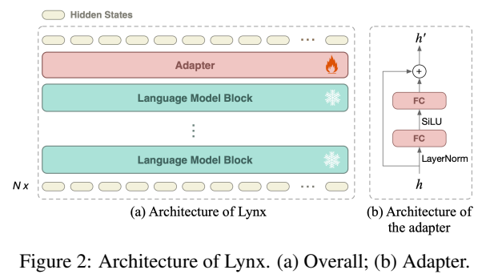
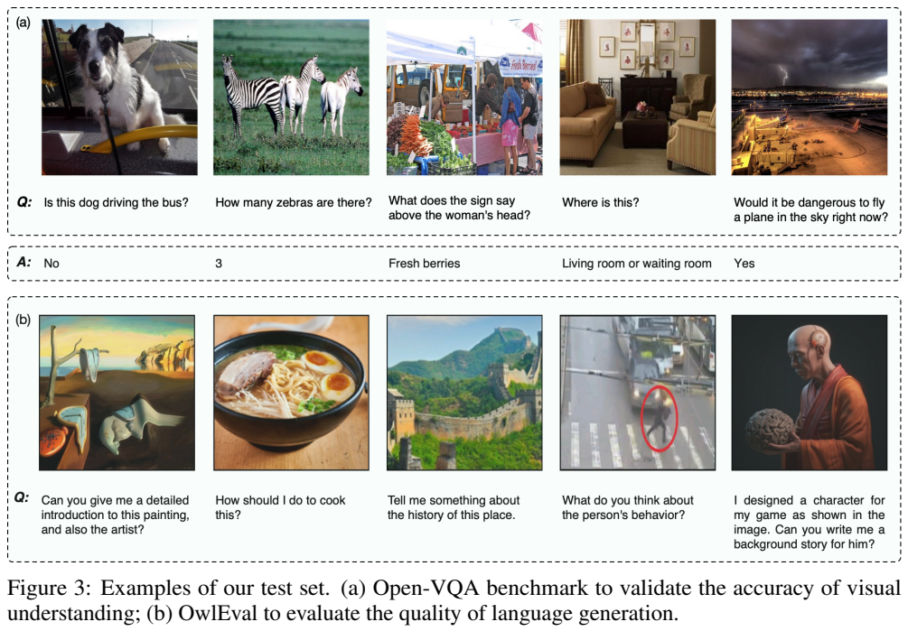
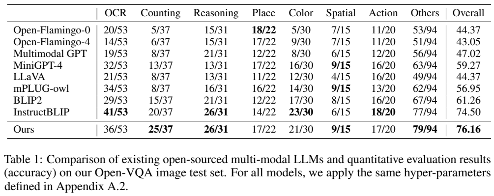
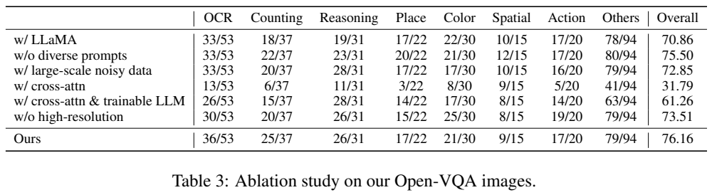
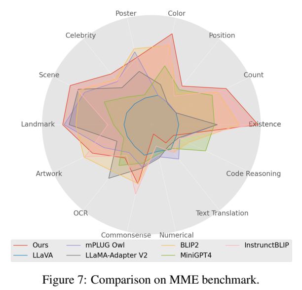
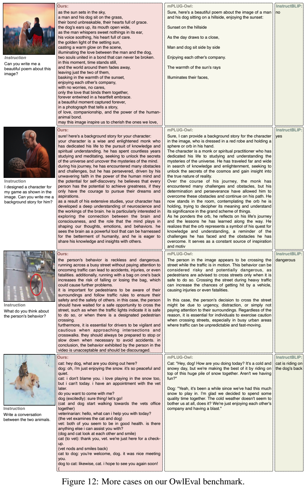

# Lynx：多模态输入语言模型的结构、数据与指令训练研究

## 1. 论文信息与模型定位

**What Matters in Training a GPT4-Style Language Model with Multimodal Inputs?**，作者 Yan Zeng、Hanbo Zhang、Jiani Zheng、Jiangnan Xia、Guoqiang Wei、Yang Wei、Yuchen Zhang、Tao Kong，来自 ByteDance Research。本文依据 [arXiv 2307.02469v1](https://arxiv.org/abs/2307.02469v1)（2023 年 7 月 5 日，32 页）整理；[项目页](https://lynx-llm.github.io)见原文首页。

论文通过约 20 个训练变体研究结构、语言骨干、数据质量与提示多样性，最终模型命名为 **Lynx**。它以 Vicuna-7B 为语言骨干，接受图像、视频并输出文本。标题中的“GPT4-Style”指多模态指令助手这一能力形态，不表示采用 GPT-4 权重或复现其未公开架构。论文中的“generation”主要是语言生成，不是图像或视频生成。

## 2. 快速概览

- **视觉前缀**：EVA-1B 编码视觉输入，Resampler 将表示压成 32 个 token，与文本拼接进入因果语言模型。
- **冻结语言骨干加适配器**：每个语言模型 block 后加入可训练瓶颈模块，让视觉输入影响回答而保留原语言权重。
- **分辨率与数据共同调整**：先低分辨率图文预训练，再短暂提高分辨率，最后混合图像、视频与文本指令训练。
- **评测同时看正确与好读**：Open-VQA 评答案正确性，OwlEval 由人工评长文本质量。作者强调二者需要平衡，而不是单看答案长度。

## 3. 整体架构

视觉编码器采用 EVA-1B，patch 下采样率为 14。原始图像的特征序列很长，Resampler 用可学习查询将它压缩为 32 个视觉 token，然后与指令 token 直接串联。语言模型在已有因果注意力中读取视觉前缀，再从左到右生成回答。这种 PT 结构使用普通输入 token 路径，与在语言层中额外加入跨注意力的 CA 对照不同。

Figure 2 中雪花表示冻结语言块，火焰表示可训练适配器。默认每个 block 后都有一个适配器（间隔 $M=1$）：LayerNorm 后将 4096 维降到 2048 维，经 SiLU 再升回 4096 维，并以残差连接加回隐藏状态。它不是 LoRA 的低秩权重增量，也不能仅凭“参数高效”就推断其训练参数只有几百万。

图像和视频共用视觉特征提取路径。原文没有充分说明统一视频帧预算、采样率或专门的时间编码，因此本文不把其他视频模型的做法补进 Lynx。

## 4. 核心创新与数学原理

原文式 2 表示视觉压缩：

$$
w_v=\Phi(\phi_v(x),w_v^q),
$$

其中 $\phi_v$ 为视觉编码器，$w_v^q$ 为可学习查询，$\Phi$ 为 Resampler。压缩减少语言模型输入长度，但只保留 32 个视觉向量也形成信息瓶颈；提高原始分辨率并不意味着最终视觉 token 数等比例增加。

式 1 的条件生成可以写成：

$$
p(y\mid w_v,w_l)=\prod_t p(y_t\mid w_v,w_l,y_{<t}),\qquad
\mathcal L=-\sum_t\log p(y_t\mid w_v,w_l,y_{<t}).
$$

适配器根据 Figure 2 可重述为 $h'=h+W_{\rm up}\operatorname{SiLU}(W_{\rm down}\operatorname{LN}(h))$；这是对原图运算的表达，不是论文新增的编号公式。训练学习的是词序列分布，因此网页中的碎片、HTML 残留或不自然文本有机会直接污染输出风格。作者据此解释高质量文本的重要性，但没有给出数据噪声与性能之间的普遍定理。

该研究的主要创新是可控实验与训练设计。PT 优于 CA 的结论针对本文的具体实现、初始化和训练条件：CA 变体在是否训练语言模型、是否加入纯文本指令等方面存在差异，不能据此证明所有跨注意力架构都不如视觉前缀。

## 5. 数据构建与处理

预训练使用约 120M 以上图文对，主体包括 BLIP CapFilt、CC12M、CC3M、SBU，并混入描述、问答与分类标注。附录 Table 9 给出实际可用规模与抽样比例，例如 BLIP CapFilt **102.8M**、CC12M **8.3M**、CC3M **2.9M**，与数据集名称中的原始规模不同。预训练消费约 **14B token**，指令阶段约 **3B token**；这些是训练 token 量，不是独立样本数。

指令数据覆盖 50 多项纯文本、图文与视频任务，分为指令遵循、视觉问答、描述、分类及图像条件对话五类。原文总览另用“20 个多模态任务”概括，范围与包含纯文本及细分类别的 50+ 统计不同。每项任务先人工写至少 3 个提示，再让 GPT-4 扩展同义表述，整体约 500 个提示。GPT-4 在这里扩展的是任务语言，不能等同于逐个看图生成视觉事实。

公开指令源包括 Flan、Alpaca、Baize、LLaVA、MiniGPT-4 等。Table 9 的权重具有明显重采样，例如微调 Flan V2 为 15%、Baize 为 10%、OCRVQA 为 12.349%、VGQA 为 10.880%，不是按数据集大小直接等比混合。Table 10 将问答附加短答要求，将对话拆为历史条件下的下一轮预测。作者试验加入 COYO700M/DataComp1B 的噪声数据后语言表现变差，结论适用于该组合，不能说这些数据对所有模型都无效。

## 6. 训练流程与目标

图文预训练先使用 $224\times224$ 图像训练 **100K 步**，再改为 $420\times420$ 训练 **10K 步**。提高分辨率有助于 OCR 等任务；原文明确说明高分辨率预训练之后冻结视觉编码器，默认语言骨干也冻结，新增层与适配器负责多模态适配。指令阶段进一步训练 **20K 步**。

附录 Table 5 给出三阶段峰值学习率 **$10^{-4}/10^{-5}/2\times10^{-5}$**，AdamW、$\beta=(0.9,0.999)$、$\epsilon=10^{-8}$、权重衰减 0.01、warmup 比例 0.05，使用线性衰减，并注明部分参数不采用衰减。三个阶段环境分别为 **32/32/24 张 A100**，默认 BF16，以 DeepSpeed 加速。论文未完整给出批量、总训练耗时与全部模块的逐阶段更新清单，不能据此推算精确算力成本。

两类训练都采用下一个词预测，没有另外设计视觉对比损失或 RLHF 阶段。推理通常先在“第 0 轮”要求详细描述图像，再回答问题；MiniGPT-4 和 mPLUG-owl 部分设置例外，因此比较协议并不是所有模型完全相同的单轮提示。

## 7. 实验设置与主要结果

Open-VQA 共 **450** 条，按 Table 1/2 的类别分母分为 302 条图像和 148 条视频。问题涵盖 OCR、计数、位置、颜色、推理、动作等，作者人工检查并改写问题和答案，再让 GPT-4 判断预测是否蕴含参考答案。与人工超过 95% 的一致率是在随机 **100 条、本模型输出**上检查的，不能推广为所有模型和所有问题的裁判准确率。

Table 1 的图像总体准确率：Lynx **76.16**，InstructBLIP **74.50**，BLIP-2 **61.26**，MiniGPT-4 **59.27**。Lynx 不是每类都领先：OCR 为 **36/53**，低于 InstructBLIP **41/53**；颜色 **21/30**，低于 **23/30**；动作 **17/20**，低于 **18/20**。视频 Table 2 总体 Lynx **66.22**，mPLUG-owl **56.76**、InstructBLIP **56.08**。消融 Table 4 把动作分母写为 109，与 Table 2 的 108 及总体统计存在不一致；本文保留总体报告值，不据此重算视频样本数。

Table 3 的图像总体结果如下，数字都是本文 Open-VQA 的百分比分数：

| 变体 | 总体 |
|---|---:|
| LLaMA 骨干 | 70.86 |
| 无多样提示 | 75.50 |
| 加入大规模噪声图文 | 72.85 |
| 跨注意力，冻结语言模型 | 31.79 |
| 跨注意力，训练语言模型 | 61.26 |
| 不提高分辨率 | 73.51 |
| 默认 Lynx | 76.16 |

提示多样性在图像总体仅提升 0.66 点，而视频总体从 **59.46** 提升到 **66.22**；不同任务收益不同。MME 的 Figure 7 与附录 Table 7 将分数归一化到 0–100，不能当作常见 MME 原始总分。Lynx 感知均分 **68.66**，认知均分 **26.96**，数值推理 **8.75**、翻译 **21.25**、代码推理 **22.50**，显示感知与认知能力不均衡。

OwlEval 为 50 张图、82 个问题，人工评分 1–5，先看正确再看内容丰富度，限制并列情况。作者还为图像添加 8 像素边框，试图降低原始评测图与模型展示图重合的影响；这并不能证明消除训练污染。Figure 12 展示诗歌、角色背景和对话，解释长文本评测为何有别于短答 VQA；这些创作中的细节也可能超出图像证据，不能当作全部视觉事实。

实验支持了本文设定下的视觉前缀、数据质量、提示与高分辨率训练选择。基准规模较小，部分认知任务仅约 20 个例子，且未报告重复训练方差；多语言仅有示例、并无系统评测。本文没有运行模型或复现作者实验。
