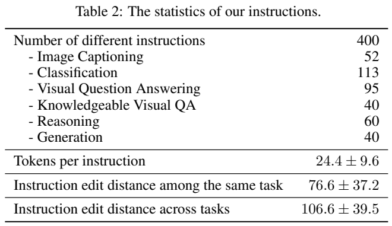
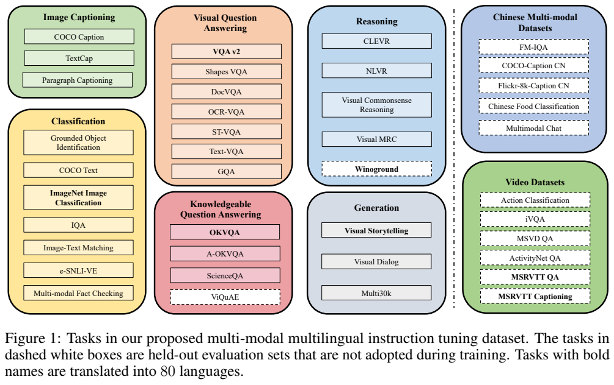
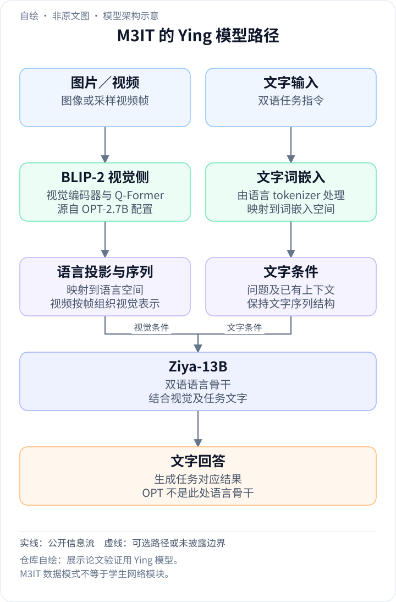
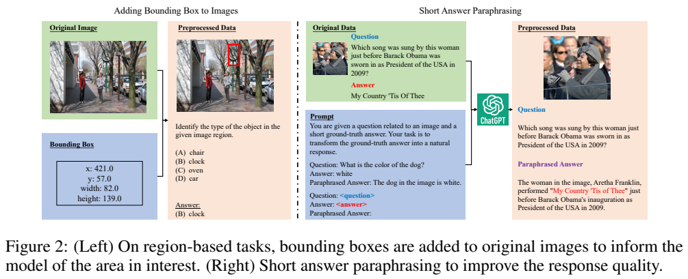
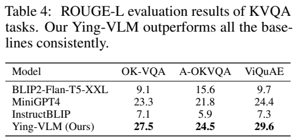
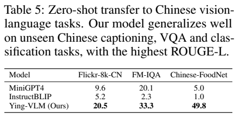
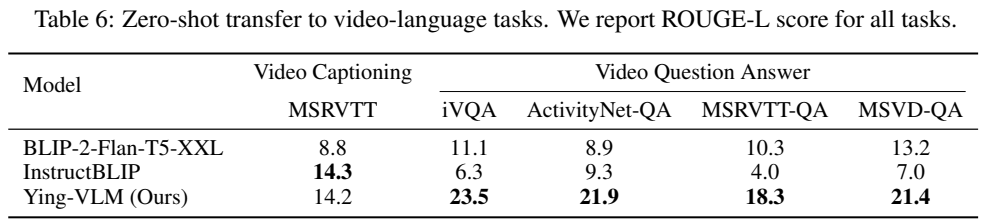
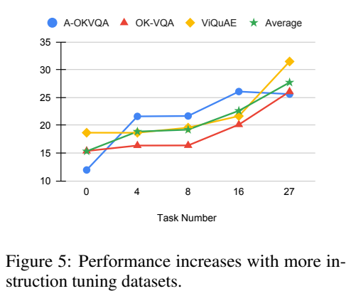
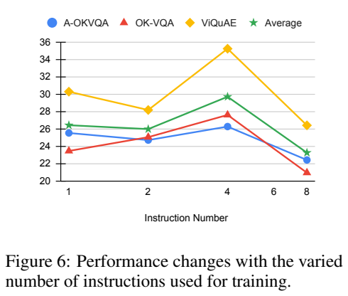
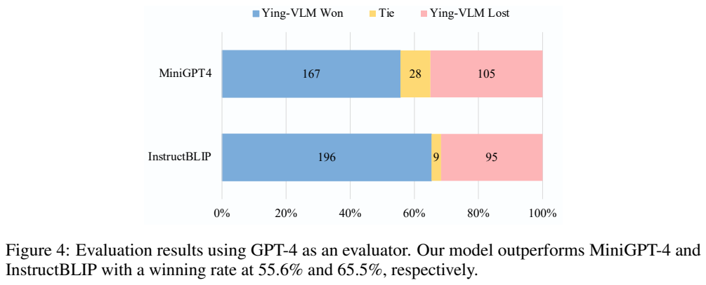

<!-- article-header:start -->
[项目首页](../../../README.md) › [模型系列](../../../reports/model-family-index.md) › [M3IT](../README.md)
<!-- article-header:end -->

# M3IT 与 Ying-VLM：多任务、多语言的视觉指令数据

<!-- article-toc:start -->
<a id="article-toc"></a>

**本篇目录** · [论文定位](#paper-info) · [快速概览](#overview) · [整体架构](#architecture) · [核心原理](#principles) · [数据构建](#data) · [训练流程](#training) · [实验结果](#experiments)
<!-- article-toc:end -->

<a id="paper-info"></a>

## 1. 论文信息与模型定位

| 项目 | 内容 |
|---|---|
| 论文 | [M3IT: A Large-Scale Dataset towards Multi-Modal Multilingual Instruction Tuning](https://arxiv.org/abs/2306.04387) |
| 作者 | Lei Li、Yuwei Yin 等；香港大学、北京大学、上海人工智能实验室 |
| 固定来源 | arXiv **2306.04387v1**，2023 年 6 月 7 日，18 页 |
| 主要贡献 | 40 个数据集／任务的统一视觉到文本数据、400 条人工任务指令、多语言评测资源 |
| 验证模型 | Ying-VLM：BLIP-2 视觉编码器与 Q-Former，连接双语 Ziya-13B |
| 数据入口 | [MMInstruction/M3IT](https://huggingface.co/MMInstruction/M3IT) |

M3IT 首先是一项数据与方法研究，Ying-VLM 是验证它的模型。作者希望在图像描述、分类、问答、知识问答、推理和生成等任务中学习自然语言指令，再检验中文和视频的迁移能力。它的“多语言”不能直接解读成 Ying-VLM 已在 80 种语言上训练并证明能力：翻译数据主要用于评测，而本文模型指令微调只使用英文图像任务。

<a id="overview"></a>

## 2. 快速概览

数据集将 40 个来源整理成统一的 **Images、Instruction、Inputs、Outputs、Meta Data** 五字段，每个任务人工编写 10 条说明。总规模 **2,429,264 个实例**是训练、验证、测试以及翻译评测数据的合计，并非全部用于 Ying-VLM 训练。模型实际采用 27 个英文任务；中文、视频、ViQuAE 和 Winoground 等保留不用作指令训练。

两项数据处理直接影响模型接口：区域任务将红色矩形画在原图中，让视觉编码器看到目标区域；问答短标签用 ChatGPT 改写为完整句子，让监督目标更接近自然对话。模型先做视觉—文字对齐，再做指令微调，验证英文知识问答、中文跨语言迁移和从图像到视频的迁移。





**读图：** 虚线白框代表未用于模型训练的任务，右侧中文和视频任务全部属于这一范围；粗体任务被选作 80 语翻译资源。左侧 OK-VQA 和 A-OKVQA 是训练任务，只有 ViQuAE 被留出，所以三项知识问答结果不能全部称为未见任务零样本评测。Table 2 的 400 条指令是任务级模板数量，而不是 400 条训练样本。

<a id="architecture"></a>

## 3. 整体架构

<!-- derived-architecture:start -->


*自绘模型架构示意（非原文图）。依据下述公开资料归纳；方框表示功能组件，不代表逐层实现。*

依据：[§4.1、视频实验，PDF pp.6–7](https://arxiv.org/pdf/2306.04387v1)。
<!-- derived-architecture:end -->

Ying-VLM 使用 **BLIP2-OPT-2.7B 的视觉编码器及 Q-Former**提取图像特征，再经语言投影接入 **Ziya-13B**。这里 OPT-2.7B 指被借用的 BLIP-2 组件来源，实际语言模型是由 LLaMA 衍生、已有中英能力的 Ziya-13B，不能将两者的参数档位混写。本文没有单独列出完整视觉编码器层数、输入分辨率、查询 token 个数和投影尺寸，因此这些不从其他 BLIP-2 版本推定。

流程可以写成“图像→视觉特征→Q-Former 查询特征→语言空间前缀→语言模型生成”。Q-Former 负责从视觉特征抽取有限表示，投影负责匹配语言嵌入空间，Ziya 则结合任务说明与输入文字生成回答。输出统一为文字，因此分类也通过生成类别表达，数据中包含视觉故事、翻译和对话，但这个接口不生成图像像素。

视频评测不额外引入视频编码器：每段视频**均匀抽取 8 帧**，各帧独立提取 Q-Former 表示，然后按帧拼接为语言模型的视觉前缀。若一帧得到 $`m`$ 个查询特征，八帧前缀共有 $`8m`$ 个位置；这是长度关系解释，论文未披露本实验的 $`m`$。顺序拼接允许语言模型读到多帧信息，但它并不自动证明模型已学会连续运动建模、音频理解或长视频定位。

<a id="principles"></a>

## 4. 核心创新与数学原理

核心首先是将不同数据的监督关系转换为同一种条件生成形式。设图像为 $`I`$，任务说明为 $`s`$，任务输入如问题为 $`q`$，目标回答为 $`y`$。下式是本文对常见监督目标的解释，**不是原文编号公式**：


```math
\mathcal L=-\mathbb E_{(I,s,q,y)}
\sum_{j=1}^{\vert y\vert }\log p_\theta(y_j\mid y_{\lt j},z(I),s,q),
```


其中 $`z(I)`$ 是投影后的视觉前缀。任务字段和问句分开保存，使同一图像可以根据不同指令得到描述、类别或知识答案。任务名不再只对应固定分类头，而是通过文字告诉模型应输出什么。不过统一格式没有自动消除任务分布、语言骨干和评测答案风格的差异。

第二项机制是**视觉提示**。原始坐标 $`(x,y,w,h)`$ 转成图上的红色框，任务说明再要求关注框内对象。这样图像缩放时框随像素一同变换，避免调用方必须将文本坐标重新标定。红框是加入图像的输入提示，不是模型预测的检测框；实验也不是借此实现新的定位损失。它是否会遮挡细小内容、是否依赖提示颜色，论文没有系统消融。

第三项是**回答风格转换**。例如一个实体名或短答案被改写为带语境的完整句子。改写模型接收原问题、正确答案，并在部分任务接收图片描述或 OCR 文字；正文没有说 ChatGPT 直接读取所有原图。监督目标由短标签变成长文本后，模型会学习更自然的句子，但也可能继承改写时额外加入的事实，不能将每个补充细节都视作原标注事实。

自动评测主要使用 ROUGE-L。作为标准指标解释，设生成文本 $`c`$、参考 $`r`$ 的最长公共子序列长度为 $`\ell`$，则 $`P=\ell/\vert c\vert`$、$`R=\ell/\vert r\vert`$，可按 $`F_\beta=(1+\beta^2)PR/(R+\beta^2P)`$ 汇合。它测量文字序列重合，而不直接测量看图是否正确，本文未公开具体 $`\beta`$ 等实现配置。尤其参考答案被改写为完整句子后，自然回应可能更适配该指标；更高分不能等价换成标准 VQA 正确率。

<a id="data"></a>

## 5. 数据构建与处理

八位熟悉相关论文的研究生作者参与标注。第一步阅读来源论文、数据和样例，为每个任务写 10 条不同表述；指令平均长 **24.4±9.6 token**，同任务说明的编辑距离平均 **76.6±37.2**。编辑距离反映字串差异，不能单独证明语义多样性或指令准确率。

第二步统一图片及文字格式，图片转为 base64 字串便于加载；base64 是文件编码方式，不是输入语言模型的视觉 token。区域任务画红框；问答由 ChatGPT 改写短答案。第三步由另一位标注者检查**各任务各划分的 10 个实例**，修复格式问题。检查样本中少于 3% 的改写不够成功，作者用启发式过滤并改用基本句式模板。这是抽查观察，不能推断整个 240 万实例的错误率已逐条验证。



**读图：** 左侧将坐标框画到图片，并输出被框对象的类别；右侧将已有正确短答案展开为自然句子。数据处理改变了输入可见内容和目标文本形式，模型表现的变化可能同时来自任务覆盖、视觉提示和回答风格。文章没有将三项因素全部分离，所以不能把提升完全归因于模板数量。

第四步挑选 OK-VQA、ImageNet、Winoground、VQAv2、VIST、MSRVTT 和 MSRVTT-QA，采用蒸馏 **NLLB-1.3B** 翻译说明和评测集。最初按 FLORES-101 范围尝试 100 种语言，再保留英语到目标语言在 FLORES-101 上 **BLEU>20** 的 80 种。这个阈值是按语言的既有翻译表现筛选，不是每条 M3IT 翻译逐句算 BLEU；也没有为所有目标语言安排母语人工审核。除 Winoground 全部 800 例外，每任务每划分最多翻译 500 个实例。

| 规模口径 | 数量／说明 |
|---|---|
| 全部实例 | 2,429,264，包含所有划分 |
| 多语言翻译 | 验证 240,000，测试 184,000；训练为 0 |
| 中文来源数据 | 192,076 个 train 字段实例，验证 77,306，测试 4,100；Ying-VLM 指令训练未使用 |
| 视频来源数据 | train 字段 20,868，验证 7,542，测试 9,294；同样未用于模型指令训练 |
| 实际英文指令训练 | Table 7 中 Used=Yes 的 27 个任务；按其 train 行相加为 **1,378,186**，是表内计数推导 |

拥有 train 字段与“用于本文训练”是两个不同概念。数据集还保留图像 ID 等元信息方便回查来源，不过报告没有给出涵盖预训练来源的完整去重审计。不同原始数据也有各自许可，不能把 M3IT 统一格式理解为统一取得了相同授权。

<a id="training"></a>

## 6. 训练流程与目标

第一阶段做视觉—文字对齐：使用 COCO 描述任务的指令，在 **LAION-400M** 上训练 **Q-Former 与语言投影**，可训练参数合计 **130M**。其他基础组件不在这项公开更新范围中。配置为 **AdamW、batch 256、300K 步、峰值学习率 $`5\times10^{-5}`$、前 2,000 步线性预热后余弦衰减、weight decay 0.05**。300K×256 对应 7,680 万次样本呈现，不能直接写成使用了 LAION 的全部 4 亿独立图片。

第二阶段在选定 M3IT 任务上训练 **3 epoch**，学习率降为 $`10^{-5}`$，预热 **1,000 步**，其他训练参数沿用第一阶段。作者称受 LoRA 启发，开放语言模型注意力中 **query 和 value 映射权重**学习；但没有披露低秩矩阵的 rank、alpha 或明确分解形式，本文不补造一套 LoRA 配置，也不把它写成全量更新 13B 参数。视觉侧详细冻结配置和第二阶段总可训练参数同样没有逐项表格。

两阶段实验使用 **8 张 80GB A100**；报告对齐约十天，指令训练约一天。该时长不包括 Ziya 与 BLIP-2 基础模型原来的预训练成本。推理默认采用 greedy decoding。损失机制按前述监督生成理解，论文没有引入 GPT-4 评分作为训练奖励，也没有进行本文所述的模型执行之外的工具调用。

<a id="experiments"></a>

## 7. 实验设置与主要结果







知识问答三项均报告 **ROUGE-L**：

| 模型 | OK-VQA | A-OKVQA | ViQuAE（任务留出） |
|---|---:|---:|---:|
| BLIP2-Flan-T5-XXL | 9.1 | 15.6 | 9.7 |
| MiniGPT4 | 23.3 | 21.8 | 24.4 |
| InstructBLIP | 7.1 | 5.9 | 7.3 |
| Ying-VLM | **27.5** | **24.5** | **29.6** |

按表中数值，Ying-VLM 相对 MiniGPT4 在 OK-VQA 高 **4.2** 点、A-OKVQA 高 **2.7** 点；正文将前一差值写为 3.2，与 Table 4 不一致，本文采用表内计算。结果支持这套模型与数据组合能生成更贴近参考答案的回应，但基线语言骨干和训练配方不同，不是仅改变数据集的严格控制实验。

中文测试前，各模型均加入中文对话上下文，鼓励用中文回答。Ying-VLM 在 Flickr8k-CN 描述、FM-IQA 问答、Chinese-FoodNet 分类上的 ROUGE-L 为 **20.5、33.3、49.8**，MiniGPT4 为 9.6、20.1、5.0。这个迁移依赖 Ziya 已有中英语言能力，以及测试提示的语言引导；它证明三个中文任务的表现改善，并未对 80 语翻译集逐语给出模型结果。分类的 49.8 也不是分类准确率。

视频评测使用前述八帧拼接，Ying-VLM 在 iVQA、ActivityNet-QA、MSRVTT-QA、MSVD-QA 的 ROUGE-L 分别为 **23.5、21.9、18.3、21.4**，高于表中两种 BLIP 基线。然而 MSRVTT 描述为 **14.2**，略低于 InstructBLIP 的 **14.3**，所以不能写成所有视频任务都最好。图像训练迁移到视频的结果有价值，但没有测定对帧顺序打乱、时间间隔或运动方向的鲁棒性。







**读图：** Figure 4 在随机选取的 300 个知识问答样本上，Ying-VLM 对 MiniGPT4 是 **167 胜／28 平／105 负**，对 InstructBLIP 是 **196 胜／9 平／95 负**。胜例占比分别约 55.7% 和 65.3%；图注写 55.6% 和 65.5%，与计数略有差异，本文以计数为准。GPT-4 只接收问题、参考答案和两种回答，**不接收原始图像**，所以这个裁判不能独立检验回答是否忠实于图片。附录协议交换回答顺序，每种顺序在 temperature=1 下取三次评分，合计六次取均值，再判断胜负；这减轻顺序偏差，但不消除裁判与参考答案偏差。

Figure 5 的任务数消融用每任务最多 5K 实例、总共 5K 训练步、batch 64，比较 0、4、8、16、27 个任务，不能与主实验三 epoch 的训练预算混用。更多任务整体提高三项知识问答的平均表现。Figure 6 比较指令多样性，四条模板时平均表现较好，八条时下降，因此它并没有证明模板越多越好，也没有为 400 条指令直接给出全部最优组合。

M3IT 的实际贡献是可回溯的多任务数据格式、人工任务说明及跨模态／跨语言评测资源。它也展示了回答风格、视觉提示和语言模型已有知识在指令学习中的作用；公开结果的边界是这些特定任务与指标。本文基于固定原文阅读和图表核验整理，没有重新训练 Ying-VLM 或执行模型。

<!-- article-footer:start -->
---

[← 上一篇：Video-LLaMA](../../videollama/arxiv-2306.02858/README.md) · [按发表时间浏览](../../../reports/paper-reading-guide.md#year-2023) · [下一篇：MIMIC-IT →](../../otter-398569/arxiv-2306.05425/README.md)

[返回本篇目录](#article-toc) · [返回模型系列](../README.md)
<!-- article-footer:end -->
