<!-- article-header:start -->
[项目首页](../../../README.md) › [模型系列](../../../reports/model-family-index.md) › [MA-LMM](../README.md)
<!-- article-header:end -->

# MA-LMM：用视觉与查询记忆库处理长视频

<!-- article-toc:start -->
<a id="article-toc"></a>

**本篇目录** · [论文定位](#paper-info) · [快速概览](#overview) · [整体架构](#architecture) · [核心原理](#principles) · [数据构建](#data) · [训练流程](#training) · [实验结果](#experiments)
<!-- article-toc:end -->

<a id="paper-info"></a>

## 1. 论文信息与模型定位

《MA-LMM: Memory-Augmented Large Multimodal Model for Long-Term Video Understanding》由 Bo He、Hengduo Li、Young Kyun Jang 等作者完成，机构包括马里兰大学、Meta 和中佛罗里达大学。本文依据 [arXiv 2404.05726v1](https://arxiv.org/pdf/2404.05726v1)（2024 年 4 月 8 日）；项目入口为 [MA-LMM](https://boheumd.github.io/MA-LMM/)。

它面向视频理解，用顺序读帧和可压缩记忆库替代把所有帧 token 同时交给语言模型。主要骨干是 EVA-CLIP ViT-G/14、InstructBLIP 预训练 Q-Former、冻结的 Vicuna-7B。研究涉及长视频分类、问答、描述与动作预测；主结果包含各下游数据集上的训练，不宜描述成单一零样本聊天检查点完成所有任务。

<a id="overview"></a>

## 2. 快速概览

| 组成 | 作用 |
| --- | --- |
| 逐帧视觉编码 | 顺序提取特征并加时间位置嵌入 |
| 视觉记忆库 | 保存原始视觉特征，提供给 cross-attention |
| 查询记忆库 | 保存 Q-Former 各层历史查询，提供给 self-attention |
| 记忆压缩 MBC | 合并最相似的时间相邻 token，而非删除最旧内容 |
| 最后时刻的 32 个查询 | 作为整个视频的语言模型输入，控制上下文长度 |

记忆长度固定意味着显存需求受控，不意味着视频信息无损保留或处理时间固定。模型仍需顺序处理所采样的每帧，极长视频会累积明显耗时。

<a id="architecture"></a>

## 3. 整体架构

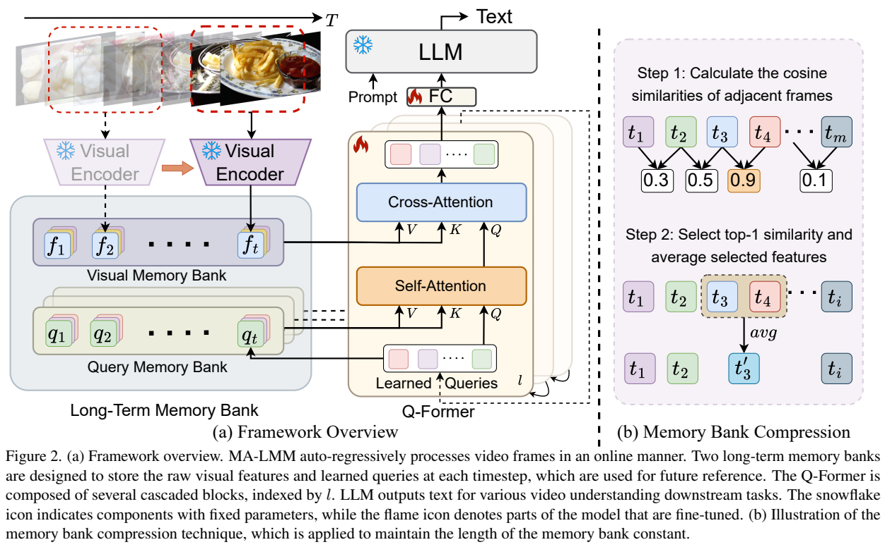

Figure 2 左侧蓝色库保存视觉特征，绿色库保存查询；中间的 cross-attention 读取视觉历史，self-attention 读取查询历史。视觉编码器与语言模型用雪花标示冻结，Q-Former 与连接 FC 层用火焰标示可训练。右侧示例把相似度最高的相邻条目合并，并保持其在时间序列中的位置。

每帧编码得到 $`v_t\in\mathbb R^{P\times C}`$，时间位置嵌入加入后为 $`f_t=v_t+PE(t)`$，对应原文式（1）。视觉库在压缩前为 $`F_t=\mathrm{Concat}(f_1,\ldots,f_t)`$。所有 Q-Former cross-attention 层共享这组原始视觉特征。

每层查询的抽象程度不同，因此 query memory 并不是一个所有层共享的静态表；每个 self-attention 层有自己的查询记忆库。当前查询与历史查询交互，再从视觉特征中读取有用信息。最后时刻的 Q-Former 输出经连接层送给语言模型，视觉输入从 T 帧各 32 个查询、总计 32T，变成最终 32 个查询。这些是连续视觉嵌入，不能理解成已生成的 32 个自然语言单词。[PDF 第 3–5 页](https://arxiv.org/pdf/2404.05726v1#page=4)

具体实现采用 **EVA-CLIP ViT-G/14、InstructBLIP 初始化的 Q-Former、Vicuna-7B**。视频帧顺次进入视觉编码器，Q-Former 在每一步读取当前帧与记忆；处理完已提供的视频后，最后时刻的查询表示通过全连接层交给 Vicuna，结合问题或任务提示生成文字。视觉/查询记忆库服务于 Q-Former 的视频汇总，不能直接等同于 Vicuna 解码时缓存历史文本的 KV cache，也不要求把全部历史帧的 patch 一次性放入语言上下文。（§3.3、§4.2，PDF 第4–5页）

| 模块 | 输入与输出 | 公开机制 |
|---|---|---|
| 冻结 EVA-CLIP | 当前视频帧 → patch 特征 | 加入时间位置后成为视觉记忆条目；不把全部帧直接交LLM |
| 共享视觉记忆 | 历史帧特征 → cross-attention key/value | Q-Former 各cross-attention层共享原始特征记忆 |
| 分层查询记忆 | 各层历史查询 → self-attention key/value | 每个self-attention层独立维护，保留不同抽象层处理状态 |
| MBC 压缩 | 超长记忆 → 相邻高相似条目平均 | 按空间位置分别选时间邻对，查询记忆也类似压缩 |
| Q-Former/FC/Vicuna | 最后时刻32查询与文字 → 答案 | 只把最终汇总前缀交给冻结Vicuna；训练更新Q-Former与接口 |


<a id="principles"></a>

## 4. 核心创新与数学原理

### 4.1 感知记忆与处理状态在不同注意力层读取

视觉库保留原始帧特征，查询库保留已经经过当前层处理的语义状态；前者帮助重新检查感知证据，后者帮助延续历史理解。查询在不同层表征不同，必须逐层维护；把所有层共用同一个查询表会抹去这个设计区别。它们服务视觉汇总，不是语言生成的文本KV缓存。[原文 §3.2、式 (2)–(4)，PDF 第 4 页](https://arxiv.org/pdf/2404.05726v1#page=4)

cross-attention 的原文式（2）令 $`Q=z_tW_Q`$、$`K=F_tW_K`$、$`V=F_tW_V`$，再使用式（3）：

```math
O=\mathrm{Softmax}\left(\frac{QK^T}{\sqrt C}\right)V.
```

当前查询通过 key-value 直接读取过去帧，不必把这些帧全部作为语言模型上下文。query memory 则把 K、V 来源换成历史查询 $`Z_t`$，对应式（4），把之前的语义处理结果也纳入当前更新。两种记忆提供原始感知与高层状态两类信息。

### 4.2 按空间位置合并时间冗余而非删除整帧

静态背景位置可能最适合合并早期相邻帧，运动物体位置则可能保留这些帧，因而不同空间列选中的时间对可以不同。这种 token 级规则更细，但合并后的时间槽不应再被理解为一张完整原始帧。平均保持了摘要却混合细节，尤其精确动作时刻仍可能损失。[原文 §3.2 MBC、式 (5)–(7)，PDF 第 4 页](https://arxiv.org/pdf/2404.05726v1#page=4)

如果不限制长度，视觉库为 tP 个位置，查询库为 tN 个位置，仍会随视频增长。MBC 在超过上限 M 时合并一对条目。原文式（5）至（7）的 token 级过程为：

```math
s_t^i=\cos(f_t^i,f_{t+1}^i),\quad k_i=\arg\max_t s_t^i,\quad \hat f_{k_i}^i=\frac{f_{k_i}^i+f_{k_i+1}^i}{2}.
```

i 表示同一空间位置；不同空间位置可能选择不同时间相邻对。它不是先给整帧算一个全局相似度再统一删除一帧，附录明确区分 token-level 和 frame-level 两种压缩。query memory 使用类似过程。

### 4.3 固定语言前缀把长期信息压力放在记忆更新

最终只有32查询进入LLM，长视频不会按帧数量直接扩大语言视觉前缀；相应地，模型必须在每次Q-Former更新和记忆合并中保留之后可能需要的信息。固定长度是预算约束，不是长期无损保证。若早期罕见事件被多次平均削弱，最后语言解码也无法重新访问已丢细节。[原文 §3.2–3.3，PDF 第 4–5 页](https://arxiv.org/pdf/2404.05726v1#page=5)

与 FIFO 丢弃最旧内容相比，MBC 尝试让早期信息经过合并继续存在。平均操作仍可能损失罕见细节、细微运动和精确事件时间，因此“保留历史”指持续维护压缩摘要，不能当作严格无损记忆定理。某些条目被多次合并时，原文也没有提供完整重建所有原帧的方法。[PDF 第 4、12 页](https://arxiv.org/pdf/2404.05726v1#page=12)

<a id="data"></a>

## 5. 数据构建与处理

研究使用既有下游视频数据，并没有披露一套全新百万级聊天指令集。LVU 含约 30K 段、来自约 3K 部电影的视频，时长一至三分钟，评价七个分类任务，包括关系、说话方式、场景、导演、类型、编剧与年份。模型直接生成标签文字，回归任务没有纳入这组比较。

Breakfast 有 1712 个早餐准备视频，平均约 2.7 分钟；COIN 有 11,827 个教学视频，涉及 12 个领域的 180 个任务，平均约 2.36 分钟。LVU 以 1 FPS 采样 100 帧，Breakfast 与 COIN 在完整视频上均匀采样 100 帧。这是稀疏抽样后的长视频理解，不是逐一处理原始视频中的每个帧。

问答使用 MSRVTT-QA、MSVD-QA、ActivityNet-QA，前两者多为十至十五秒，后者平均约两分钟。描述使用 MSRVTT、MSVD、YouCook2。在线动作预测使用 EpicKitchens-100，覆盖约 700 个烹饪长视频、100 小时，涉及 97 个动词、300 个名词和 3807 类动作。

数据中的问题、标签或 caption 转成文字目标。附录给出分类、问答、描述提示，例如问电影的某项类别，或以“Question: ... Short Answer:”约束简短回答。报告没有完整给出跨数据集统一混合比例、独立指令生成量和过滤阈值，因此不把每项数据集训练误写成某套统一 SFT 语料。[PDF 第 5、12–13 页](https://arxiv.org/pdf/2404.05726v1#page=13)

<a id="training"></a>

## 6. 训练流程与目标

原文式（8）为目标文字的平均交叉熵：

```math
\mathcal L=-\frac1S\sum_{i=1}^{S}\log P(w_i\mid w_{\lt i},V).
```

V 是视频，$`w_i`$ 为真实目标文字。视觉编码器与语言模型冻结，学习主要集中在 Q-Former 及图中的连接层。不同下游任务通过目标序列和提示表达，报告没有额外的记忆重建损失或强化学习目标。

| 数据任务 | epoch | 学习率 | batch | 采样帧数 | 记忆长度 |
| --- | ---: | ---: | ---: | ---: | ---: |
| LVU / Breakfast / COIN | 20 | 1e−4 | 64 | 100 | 20 |
| MSRVTT / MSVD / ActivityNet 问答 | 5 | 1e−4 | 128 | 20 | 10 |
| MSRVTT / MSVD 描述 | 10 | 1e−5 | 128 | 80 | 40 |
| YouCook2 描述 | 10 | 1e−4 | 128 | 80 | 40 |

共同使用 224 图像分辨率、AdamW β=(0.9,0.999)、权重衰减 0.05、余弦学习率衰减；解码 beam size=5。报告所有实验使用 4 张 A100，没有进一步给出显存规格、训练精度、完整步数或 GPU 小时，本文不从 epoch 推导未公开的精确成本。

另有不训练的 off-the-shelf 实验：把记忆机制加入既有模型后直接评价。它证明机制可以在未重新训练时带来改善，但分数明显低于数据集训练结果，不能把两者混为同一种部署能力。[PDF 第 5、7、13 页](https://arxiv.org/pdf/2404.05726v1#page=7)

<a id="experiments"></a>

## 7. 实验设置与主要结果

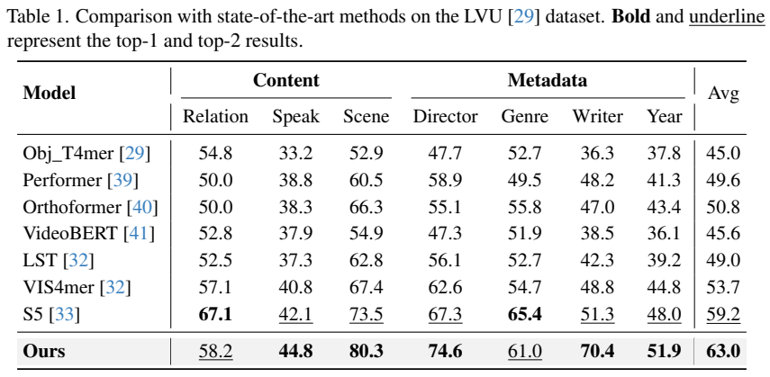

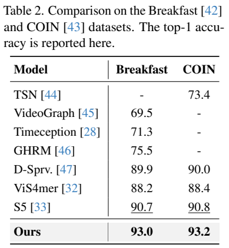

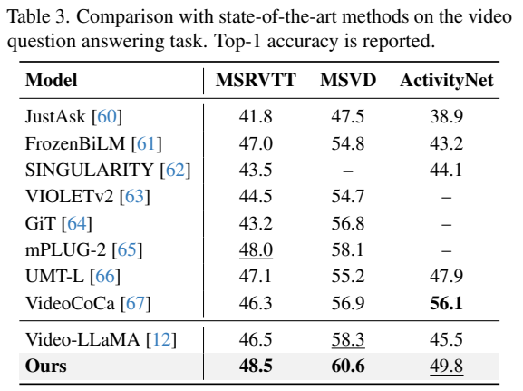

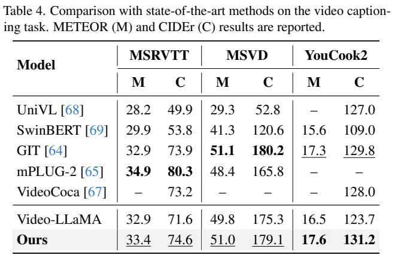

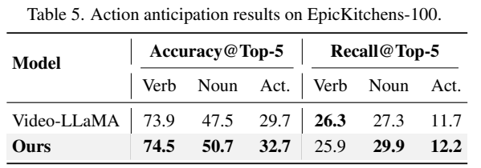

LVU 七项平均准确率为 63.0，S5 为 59.2，但关系任务为 58.2，低于 S5 的 67.1，类型为 61.0，低于 65.4。平均提高不等于每项领先。Breakfast 与 COIN 为 93.0、93.2，S5 为 90.7、90.8。

| 问答基准 | MA-LMM | Video-LLaMA | VideoCoCa |
| --- | ---: | ---: | ---: |
| MSRVTT-QA | 48.5 | 46.5 | 46.3 |
| MSVD-QA | 60.6 | 58.3 | 56.9 |
| ActivityNet-QA | 49.8 | 45.5 | 56.1 |

长问答 ActivityNet 仍落后 VideoCoCa。作者将差异部分归因于后者大规模视频文字预训练，这是来源中的解释，不是已控制所有变量的因果证明。

描述任务中 MA-LMM 的 MSRVTT METEOR/CIDEr 为 33.4/74.6，MSVD 为 51.0/179.1，YouCook2 为 17.6/131.2。METEOR 和 CIDEr 衡量生成文本与参考的对应，不是百分比准确率；YouCook2 表现较强，但 MSRVTT 仍低于 mPLUG-2 的 34.9/80.3。动作预测 Top-5 动作准确率 32.7，高于 Video-LLaMA 29.7；动词 recall 却从 26.3 降到 25.9，不能称所有指标提高。

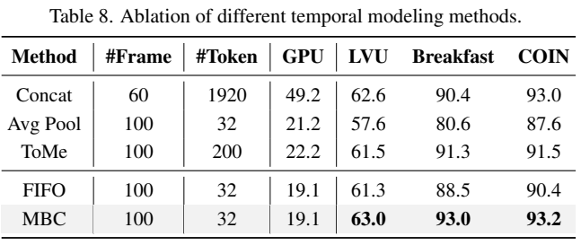

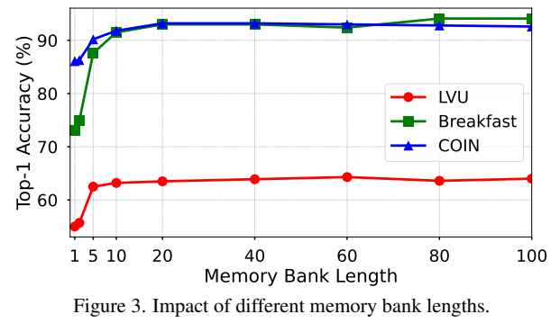

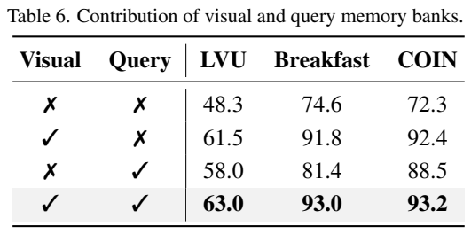

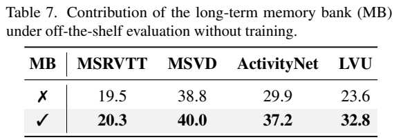

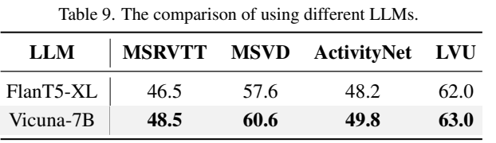

无记忆时 LVU/Breakfast/COIN 为 48.3/74.6/72.3，视觉记忆为 61.5/91.8/92.4，查询记忆为 58.0/81.4/88.5，两者结合为 63.0/93.0/93.2。该消融支持互补性。Table 8 中 MBC 在 100 帧输入下只向语言模型送 32 个嵌入，GPU 用量列为 19.1；拼接基线使用 60 帧、1920 个 token，用量为 49.2。需保留帧数不同的条件，不把它包装成完全相同输入规模的显存比。

FIFO 同样是 100 帧和 32 个嵌入，LVU 为 61.3，MBC 为 63.0；Breakfast 为 88.5 对 93.0。Figure 3 表明在这些 100 帧任务中记忆长度约 10–20 后收益趋于饱和，这不是任意复杂长视频只需 20 个记忆槽的保证。

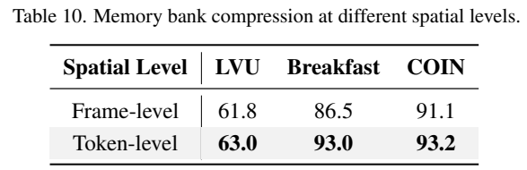

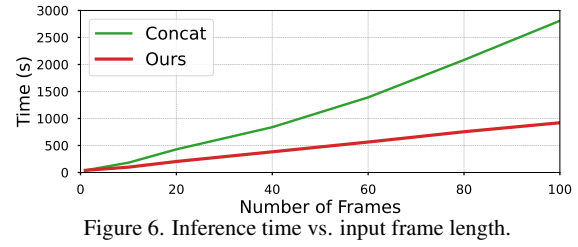

token 级相对整帧压缩的 Breakfast 准确率为 93.0 对 86.5，反映细粒度保留的价值。Figure 6 横轴为帧数、纵轴为秒，MA-LMM 随帧数仍大致线性变慢，100 帧时图中耗时接近千秒量级；它没有证明达到实时帧率。作者也明确指出极长视频的时间成本，并把分层处理和更强视频预训练列为后续方向。本文仅整理原文及检查所选原图，未运行模型。

<!-- article-footer:start -->
---

[← 上一篇：Ferret-UI](../../ferret/arxiv-2404.05719/README.md) · [按发表时间浏览](../../../reports/paper-reading-guide.md#year-2024) · [下一篇：InternLM-XComposer2-4KHD →](../../internlm-xcomposer/arxiv-2404.06512/README.md)

[返回本篇目录](#article-toc) · [返回模型系列](../README.md)
<!-- article-footer:end -->
