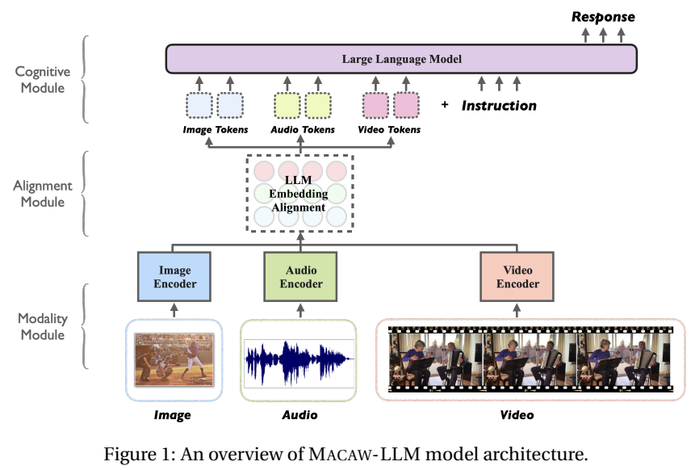
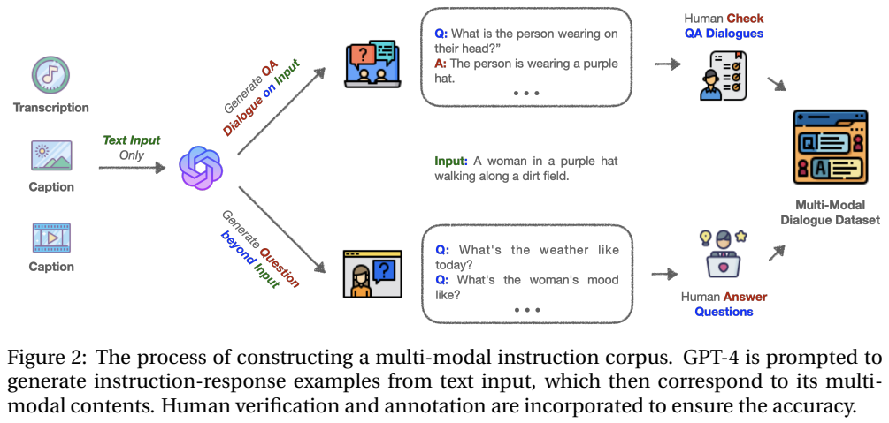
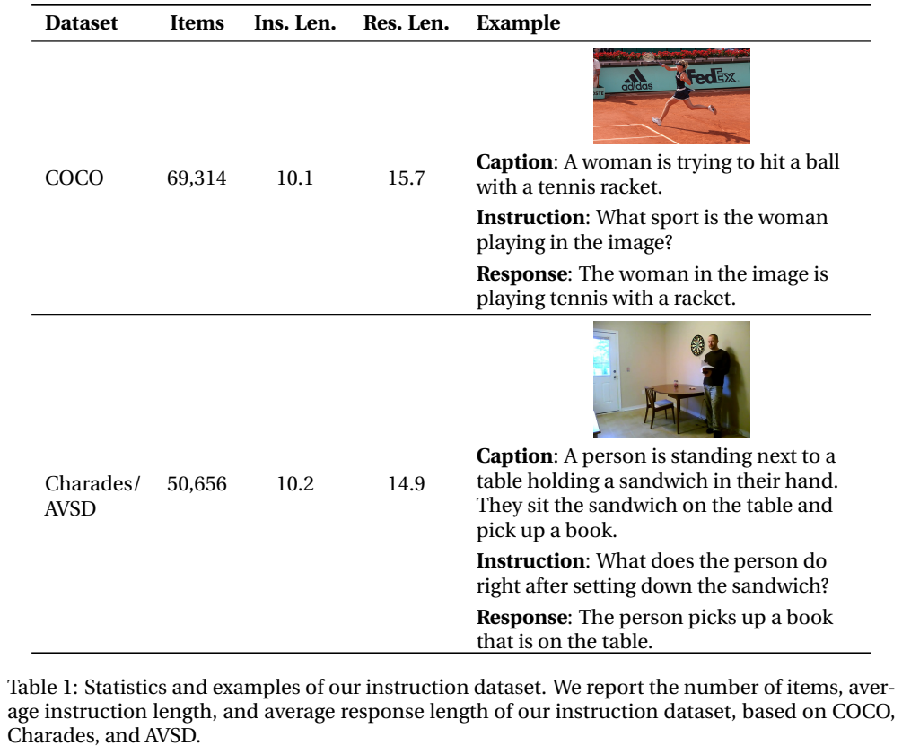
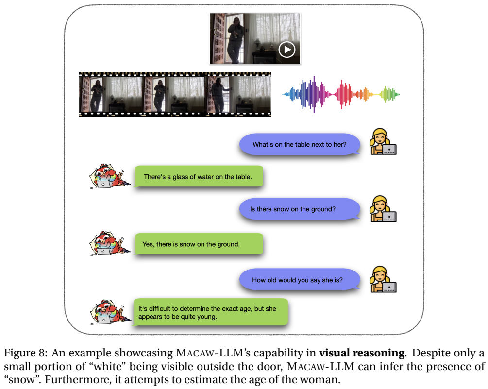
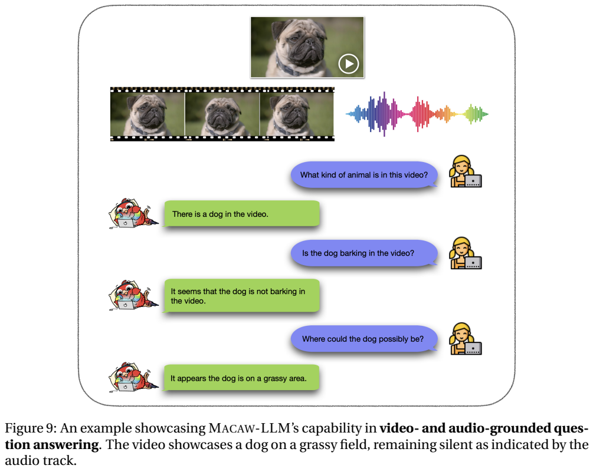

<!-- article-header:start -->
[项目首页](../../../README.md) › [模型系列](../../../reports/model-family-index.md) › [Macaw-LLM](../README.md)
<!-- article-header:end -->

# Macaw-LLM：通过词嵌入空间连接图像、音频与视频

<!-- article-toc:start -->
<a id="article-toc"></a>

**本篇目录** · [论文定位](#paper-info) · [快速概览](#overview) · [整体架构](#architecture) · [核心原理](#principles) · [数据构建](#data) · [训练流程](#training) · [实验结果](#experiments)
<!-- article-toc:end -->

<a id="paper-info"></a>

## 1. 论文信息与模型定位

**Macaw-LLM: Multi-Modal Language Modeling with Image, Audio, Video, and Text Integration**，Chenyang Lyu、Minghao Wu、Longyue Wang、Xinting Huang、Bingshuai Liu、Zefeng Du、Shuming Shi、Zhaopeng Tu，来自腾讯 AI Lab、Dublin City University 与 Monash University。本文依据 [arXiv 2306.09093v1](https://arxiv.org/abs/2306.09093v1)（2023 年 6 月 15 日，18 页，首页注明 work in progress）整理。[官方代码与数据仓库](https://github.com/lyuchenyang/Macaw-LLM)见原文首页。

Macaw-LLM 将图像、视频帧、音频及文字作为输入，以 LLaMA-7B 生成文本回答。它研究怎样让独立预训练的感知编码器适配语言模型；“认知模块”是论文对语言骨干的命名，不是一套另行定义的人类认知机制。该版本没有输出图像、视频或音频的生成解码器。

<a id="overview"></a>

## 2. 快速概览

- **模态编码**：CLIP ViT-B/16 提取图像与视频帧，Whisper-base 提取音频，LLaMA 自身负责文本。
- **接口特点**：先用一维卷积压缩特征序列，再让特征注意到语言模型的词嵌入矩阵，以其加权组合构成多模态软 token。
- **单阶段适配**：在同一个指令微调阶段更新全部模型参数，联合学习表示适配与回答生成。
- **数据与证据**：150K 条训练例子由文本、图像、视频各抽取 50K 构成；音频附着于视频样本。效果证据是案例展示，原文没有标准基准、对照分数或组件消融。

<a id="architecture"></a>

## 3. 整体架构



Figure 1 的下层为模态编码器，中间为对齐模块，上层为语言模型。图像与视频在图中画成不同分支，但正文明确二者使用 CLIP 视觉编码器；音频分支使用 Whisper-base。文字指令通过 LLaMA 的嵌入层进入模型，且在该方法中始终需要文字指令作为输入的一部分。

每类特征经 Conv1D 减少长度，再经线性层调整到语言嵌入维度。接着使用词表嵌入作为注意力的键和值，得到对齐表示。各模态软 token 与文字嵌入拼接，共同作为语言模型输入。图中没有外部工具规划器或先转写再问答的文本串联步骤；Whisper 在此作为特征编码器，并不说明模型必然先输出一份转写稿。

原文仅以符号 $`L'`$ 表示压缩后长度，没有报告所有模态的具体 token 数、卷积核/步长、视频帧数或音频分段参数。统一表示空间的叙述也不等于独立证明模型具有精确音画同步定位能力。

<a id="principles"></a>

## 4. 核心创新与数学原理

对任一模态 $`m`$，原文式 2–4 的处理为：

```math
h_m=\mathrm{Encoder}_m(x_m),\qquad
h'_m=\mathrm{Linear}(\mathrm{Conv1D}(h_m)),
```

```math
\tilde h_m=\mathrm{Attn}(h'_m,E,E)
=\mathrm{softmax}\!\left(\frac{h'_mE^\top}{\sqrt{d_e}}\right)E.
```

$`E\in\mathbb R^{V\times d_e}`$ 是 LLaMA 的词表嵌入矩阵。查询来自感知特征，键和值来自词嵌入，因此按原公式，每个输出向量是词表向量的加权组合。这样接口的数值落在语言嵌入所构成的空间中，而不只是把视觉向量直接线性投影到相同维度。它是连续软 token，不能把注意力最大的位置解释为已生成一个确定词语。

论文把注意力小节称为 MHSA，但式 4 的查询与键值来源不同；这里按公式说明跨来源匹配，不把该运算误解成仅在视觉序列内部自注意力。原文未详细披露多头投影及词表注意力的运行开销。每个压缩 token 都要与词表比较，压缩虽减少后续前缀长度，也引入了接口计算成本。

最终输入（式 5）为：

```math
x=[\tilde h_i;\tilde h_v;\tilde h_a;\mathrm{Embed}(x_t)].
```

训练最小化回答负对数似然（式 6）。原文公式省略了前面回答 token 的条件，按其语言模型生成含义可写为 $`-\sum_j\log p_\theta(y_j\mid x,y_{\lt j})`$。没有独立对齐回归、对比学习或强化学习损失。作者认为单阶段可减轻多阶段错误传播，这是一项方法动机；本版本没有对应消融来证明优势。

<a id="data"></a>

## 5. 数据构建与处理



文本数据采用 Alpaca，原始约 52K 条，来自 text-davinci-003 蒸馏。图像部分从 COCO 抽取 10,000 张图的描述；视频部分使用 Charades 与 AVSD，正文给出共 9,848 个带描述视频。生成教师读到的是描述文字，不是直接看到媒体。一轮请求拟生成 10 组指令与回答，再经过重复生成形成数据。

正文 §4、§5 和结论均将教师写为 **GPT-3.5-Turbo**，但 Figure 2/3 标题与图注写 **GPT-4**，二者不一致。本文采用正文明确的训练数据说明，并保留此来源冲突。Figure 2 还示意人工检查与为超出描述的问题人工作答，但未报告人工审核比例、人员协议与一致率，不能称全部例子都经过可靠人工认证。



Table 1 的图像数据实际为 **69,314** 条，平均指令/回答长度 **10.1/15.7**；视频为 **50,656** 条，平均长度 **10.2/14.9**。这是指令样本数而非媒体数量，短描述衍生多个问题可能共享同一媒体。最终从文本、图像、视频各随机抽取 **50K**，合并为 **150K** 训练例子。音频当前与视频数据绑定，独立音频指令集仍属后续计划。

摘要称多轮对话，但 §4 和限制明确当前主要为**单轮**指令，多轮数据正在扩展。因此不能把原版训练集写成已经包含 119K 段多轮对话。生成例子中对人物感受等内容的推测也可能超出原始描述，语言通顺不自动保证视觉事实正确。

<a id="training"></a>

## 6. 训练流程与目标

论文明确采用一次指令微调，更新 **Macaw-LLM 的全部参数**。它不采用“冻结感知编码器，只训练投影”的配方，也没有单独先训练连接器的阶段；各组件此前仍已接受各自的预训练，所以单阶段不等于所有模型从零训练。

训练在 **8 张 NVIDIA A100** 上进行，每设备批量 **4**，梯度累积 **3**，按这些设置计算有效全局批量为 **96**。训练 **5 个 epoch**，学习率 **$`3\times10^{-5}`$**，warmup 比例 **0.03**，余弦调度，最大序列长度 **512**；训练和推理均使用 FP16，采用 DeepSpeed。

原文没有明确给出优化器名称、权重衰减、总耗时或各模态截断细则，不能仅凭学习率调度器就补写 AdamW 等设置。512 是文本与前缀共同面对的长度限制，但论文未完整说明预算分配，因此无法据此准确计算最长支持视频或音频时长。

<a id="experiments"></a>

## 7. 实验设置与主要结果

该 v1 的实验部分报告训练配置，然后提供 Figures 4–9 的问答演示；**没有公开标准测试集准确率、人工偏好统计、其他模型定量对照或对齐模块消融**。因此本节以演示及其能支持的结论整理，不构造“主要成绩表”。Table 1 是数据统计，不是性能结果。





Figure 8 询问桌上的物品、室外是否有雪，以及人物年龄。原文把由少量白色区域推测雪当作视觉推理例子；这种解释仍可能依赖视觉猜测，图中并无多案例统计或核验协议。人物年龄回答也只是模糊推测，不是经过标注的年龄估计实验。

Figure 9 展示狗的视频与音轨：模型回答动物是狗、似乎没有吠叫、可能在草地上。该例说明系统的输入形式能够包含视频与音频，但单个“没有吠叫”的回答不能证明音频分支带来提升；需要关闭音频、替换音轨或相应测试集才能识别其贡献，本论文未报告这些实验。静态 PDF 配图中的波形也无法由本文整理工作重新验证原视频的声音内容。

Figures 4–7 还展示长颈鹿识别、颜色、光照、船数量及动作问答，属于案例级能力展示，不应折算成准确率。作者在限制中承认演示不足以全面反映能力，多轮上下文尚未充分优化，幻觉等问题没有系统评测。这个版本的价值在于词嵌入注意力接口、联合适配思路与公开指令数据；它能否胜过两阶段训练或其他助手，需要超出该稿证据范围的进一步验证。本文未运行模型或复现实验。

<!-- article-footer:start -->
---

[← 上一篇：LAMM](../../lamm/arxiv-2306.06687/README.md) · [按发表时间浏览](../../../reports/paper-reading-guide.md#year-2023) · [下一篇：KOSMOS-2 →](../../kosmos/arxiv-2306.14824/README.md)

[返回本篇目录](#article-toc) · [返回模型系列](../README.md)
<!-- article-footer:end -->
