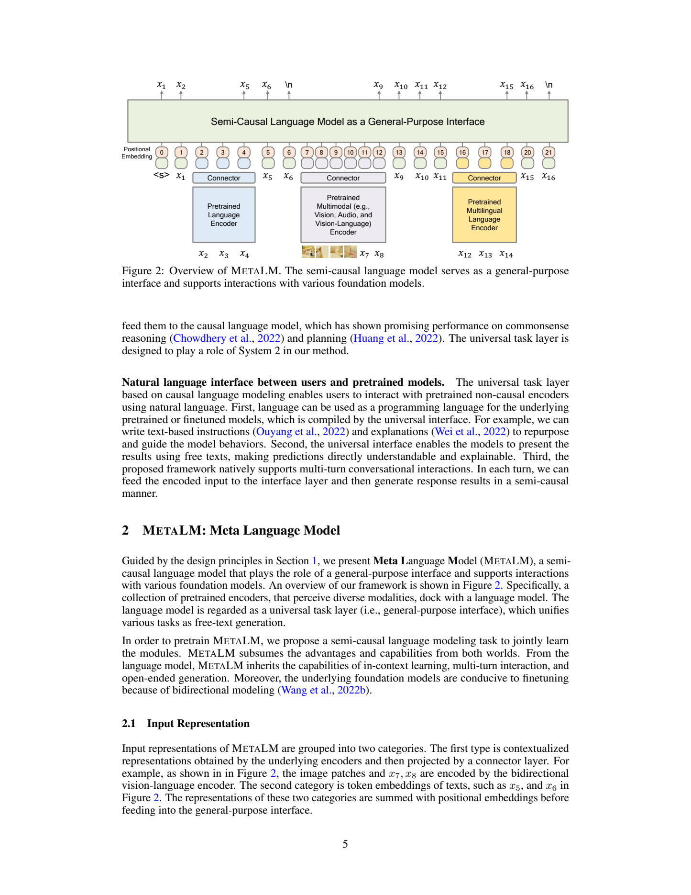
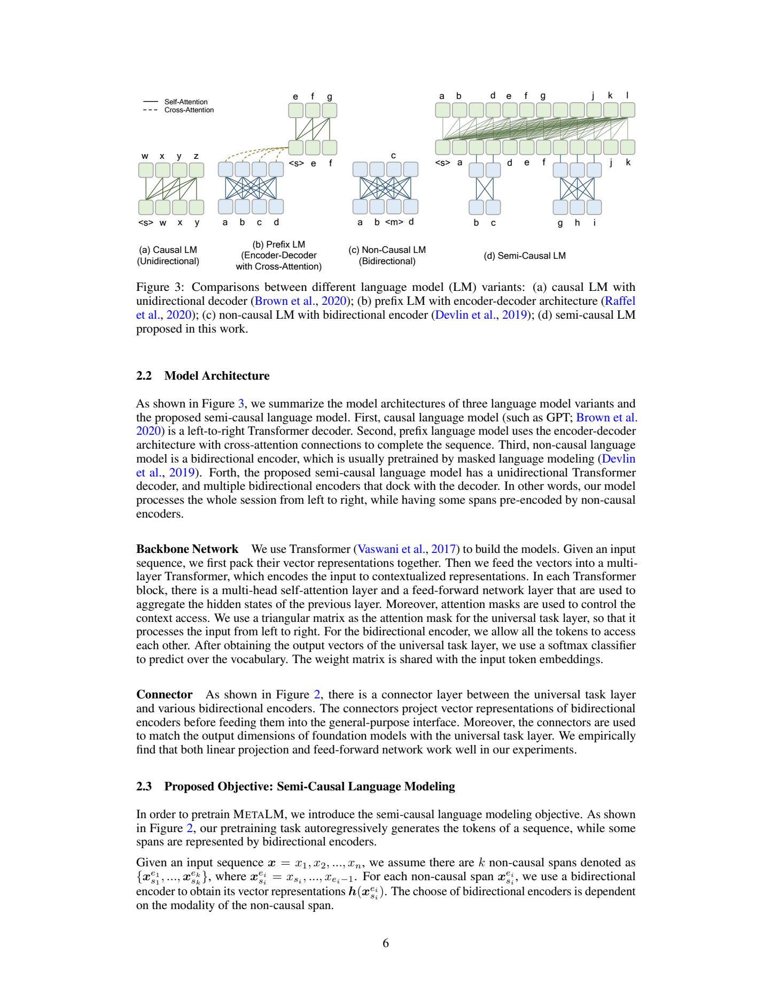
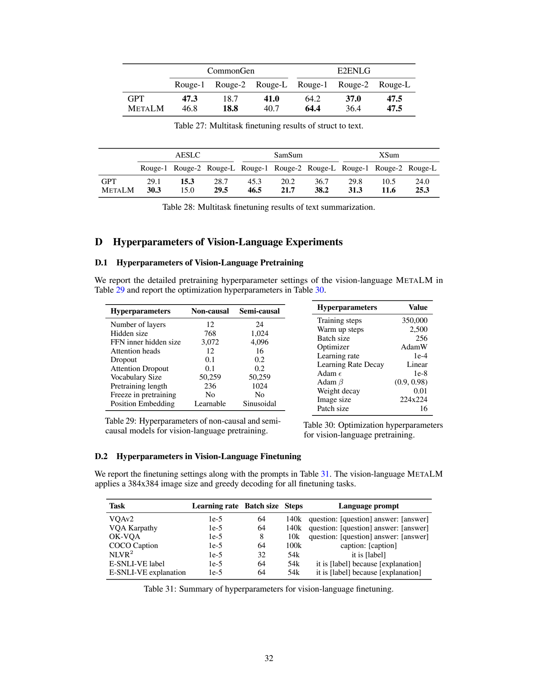
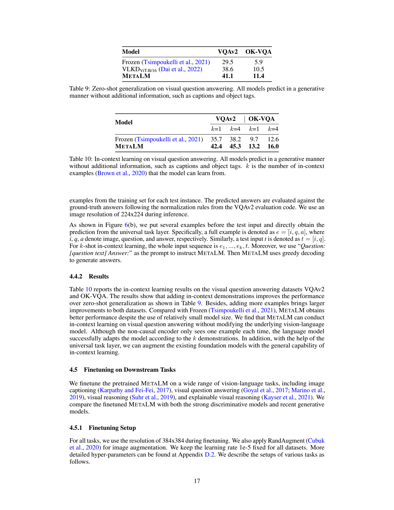

# MetaLM：以半因果语言模型连接双向感知编码器

## 1. 论文信息与模型定位

| 项目 | 信息 |
|---|---|
| 论文 | [Language Models are General-Purpose Interfaces](https://arxiv.org/abs/2206.06336) |
| 作者 | Yaru Hao、Haoyu Song、Li Dong 等；Microsoft Research，前三位共同一作 |
| 模型名 | Meta Language Model，**MetaLM** |
| 来源 | arXiv **2206.06336v1**，2022 年 6 月 13 日，32 页 |
| 工作定位 | 通用接口架构和半因果预训练；纯文本、视觉语言两类实验 |
| 项目 | [microsoft/unilm](https://github.com/microsoft/unilm) |

MetaLM 探索的是将预训练的双向编码器接到因果语言模型，让前者感知完整输入，后者统一以文字完成任务。这里 Meta 是模型名称，与厂商 Meta 的 Llama 家族无关。论文并非今天的视觉聊天产品报告：核心是架构、预训练目标，以及微调、零样本和上下文学习是否能兼容。

图示中包含多语、音频、多轮交互等设想，但正文的实证分为英文纯文本模型和视觉语言模型，结论末尾仍把多语、音频扩展列为未来工作。本文不把这些示意图当作已验证的全模态能力。

## 2. 快速概览

作者认为因果语言模型便于开放生成和上下文学习，双向编码器便于理解整个输入和监督微调，因此希望保留两者。具体做法是：用双向编码器提前处理序列中的一些片段，通过 Connector 把上下文化表示放进语言模型输入序列，其余部分仍按从左到右生成。

纯文本实验使用约 **1.3B** 的因果解码器和约 **366M** 的双向编码器；视觉语言实验则是约 **353M** 解码器与 **192M** 的 VLMo 风格图文编码器，再加 Connector。两组是不同配置，不能将它们相加当作同一个模型，也不能把 353M 当成整个视觉语言系统的精确总参数。

主要结果包括：多任务微调显著改善多项理解任务，MNLI 单任务微调可在冻结解码器时只更新编码器；视觉问答能直接零样本生成答案，并利用前置图文示例改善表现。模型输出文字，因此仍能处理候选分类、描述和解释等不同任务格式。

## 3. 整体架构

**读图：**下方不同编码器先将选定片段转成上下文化向量，Connector 投影到语言模型维度，再与普通文字 token 表示共同组成一条序列，上方解码器使用因果自注意力。上下文向量是序列中的输入位置，**没有单独的编码器—解码器跨注意力接口**。图中多类编码器描述的是可扩展框架；本报告实际分别训练文本和图文实例。

纯文本配置的因果网络为 **24 层、宽 2048、32 个头**，双向编码器为 **24 层、宽 1024、16 个头**。采用 DeepNorm，因果侧使用正弦位置嵌入；双向侧采用可学习位置嵌入和相对位置偏置；线性 Connector 对齐两侧维度。因果网络从头训练，双向网络由 replaced token detection 预训练模型初始化。纯文本预训练冻结编码器大部分参数，只开放最后两层。

图文配置的双向网络为 **12 层、宽 768、12 个头**，由 VLMo 风格预训练图文模型初始化；语言接口为 **24 层、宽 1024、16 个头**，结构配置参考 GPT-2。此处“参考 GPT-2”是结构说明，本文不据此认定必然加载了某个 GPT-2 解码器权重。Connector 为三层前馈网络。图像预训练输入为 224×224、patch 16，对应 14×14=196 个空间 patch，实际序列还可含文字前缀及特殊位置；附录给出的非因果最大长度为 236，不能把它全部理解成图像 patch。

## 4. 核心创新与数学原理

**读图：**传统因果模型每个位置只看过去；双向模型在感知片段内可看完整上下文；MetaLM 先双向编码某些片段，再将结果接回因果序列。图中这些片段不局限于整条序列的最左前缀，可穿插在会话中。这区别于仅把全部输入交给一个 encoder、再让 decoder 用 cross-attention 读取的常规结构。

用 \(x_1,\ldots,x_n\) 表示序列，双向片段为不重叠的 \([s_i,e_i)\)。片段中的向量 \(h(x_{s_i:e_i})\) 已包含片段内双向信息，再经 Connector 替换相应输入位置。第 7 页 **Equation (1)** 按这些片段划分求和，只对因果生成区间及边界目标计算下一 token 对数似然。为突出监督范围，本文用以下概念式解释它，**不作为原式的逐符号抄写**：

\[
\mathcal L_{\rm semi}=
-\sum_{t\in\mathcal G}\log p_\theta(x_t\mid\mathcal C_t),
\]

其中 \(\mathcal G\) 是需要生成的目标位置，\(\mathcal C_t\) 是此前可见的普通 token 与编码片段表示。经过双向编码的片段内部不被当作普通自回归生成目标；片段最后一个位置负责预测片段后的第一个 token。否则若一面让某位置通过双向编码看见片段内未来，一面又要求它预测同一未来 token，就会造成监督泄露。因果解码器自身仍然使用三角注意力掩码，半因果性来自输入片段的上下文化编码。

纯文本训练随机选择长度 **64–128** 的片段，总覆盖原序列的 **25%**，片段不重叠，也不跨文档边界。视觉语言训练则将图像和随机长度的文字前缀联合双向编码，解码器生成剩余文字。对于图像，这相当于将已观察到的视觉输入作为条件，而非预测图像像素。

上下文学习利用相同接口。每个示例的输入可独立双向编码，示例答案用普通文字 token，随后拼接测试输入，让解码器根据前面的示例生成目标。可以概念性写为 \(p(y\mid E_1,a_1,\ldots,E_k,a_k,E_*)\)，其中 \(E_i\) 是编码后的输入。**没有梯度更新**才是这里的 in-context learning。相比之下监督微调更新参数；先微调感知编码器、再用示例定制，是论文希望支持的两种能力组合，不是对任意任务组合均已给出证明。

## 5. 数据构建与处理

纯文本预训练使用 Pile，排除 GitHub、arXiv 和 PubMed Central 三个来源，保留 19 个来源。原始 Pile 约 800GB 的标称量不是排除后实际语料大小，本文不把它当作本模型使用的准确容量。保留数据涉及网页、百科、书籍、字幕、学术文本等。采用 SentencePiece，连续完整句子打包，加入序列、段落和文档边界标记，片段采样遵守这些边界。

视觉语言预训练采用 **Conceptual Captions、Visual Genome、COCO Caption、SBU Caption**，约 **4M 图片、10M 图文对**，同时混入 OpenWebText 纯文字。图片数和图文对数不同，350K 训练步也不能反推出全部唯一图片。原文未给出完整图文／文本采样比例、过滤阈值和跨来源污染审计。

文本多任务微调使用 34 个数据集、10 个类别，包括推断、情感、释义、共指、常识、阅读理解、闭卷问答、结构到文本和摘要等，每数据集最多 30K 实例。采用 FLAN 的手工模板；多任务微调仅使用每数据集第一套模板，指令微调则随机使用十套。检验指令零样本时排除目标任务所在的整个类别；评测推断与释义时还互相排除对应类别，避免明显的任务近邻。

图文下游覆盖 VQAv2、OK-VQA、NLVR2、COCO 描述和 E-SNLI-VE。NLVR2 的两图分别编码后拼接，以文字生成是／否；E-SNLI-VE 同时生成蕴含标签和解释。解释是监督目标，不是从隐藏推理中读取的忠实机制证据。COCO 也出现在图文预训练中，因此“零样本 COCO 描述”不等于 COCO 图像从未进入预训练。

## 6. 训练流程与目标

纯文本预训练 **300K 步**，学习率 \(6\times10^{-4}\)，Adam、\(\beta=(0.9,0.98)\)、\(\epsilon=10^{-6}\)、weight decay 0.01，线性衰减、附录预热 375 步。因果／双向最大长度为 **2048／512**，dropout 为 **0／0.1**。批量存在原文差异：第 9 页写 **1024**，Appendix Table 17 写 **512**，本文并列保留，不挑选一个值当作确定复现配方。

文本多任务微调为 **20K 步、batch 256、LR \(10^{-4}\)、预热 2K、长度 2048**；指令微调为 **30K 步、batch 512、同学习率、预热 3K、长度 1024**。MNLI 单任务微调单独采用 **3 epoch、batch 32、LR \(5\times10^{-5}\)**，冻结语言接口，仅更新非因果编码器和 Connector。这个冻结规则不能套到所有训练实验。

图文预训练 **350K 步、batch 256、AdamW、LR \(10^{-4}\)、预热 2,500 步、线性衰减、weight decay 0.01、\(\beta=(0.9,0.98)\)、\(\epsilon=10^{-8}\)**；**两侧网络都不冻结**。附录列非因果／因果 dropout 与 attention dropout 为 **0.1／0.2**，正文概述则写 0.1，本文按两处披露记录差异。词表 50,259，因果最大长度 1024。

图文微调分辨率改为 **384×384**，用 RandAugment、greedy decoding，所有任务学习率 \(10^{-5}\)：

| 任务 | batch | 预算 |
|---|---:|---:|
| VQAv2／VQA Karpathy | 64 | 各 140K 步 |
| OK-VQA | 8 | 10K 步 |
| COCO 描述 | 64 | 100K 步 |
| NLVR2 | 32 | 附录 54K 步，正文 5 epoch |
| E-SNLI-VE | 64 | 附录 54K 步，正文 7 epoch |

监督生成优化目标是正确文字序列的似然。COCO 没有采用 CIDEr 强化优化，没有用对象标签作为额外微调输入。报告没有给出完整硬件规模、总训练时长或部署吞吐，本文不补造这些成本。

## 7. 实验设置与主要结果

文本多任务 Table 2 中，MetaLM／同配置 GPT 基线的任务簇平均分为：推断 **79.1／65.0**、常识 **84.2／63.3**、阅读理解 **73.1／64.5**、摘要 **31.0／29.8**；结构到文本为 **44.1／44.2**，并非所有任务都改善。这些簇包含不同指标，不能将平均分全解释成同一准确率。GPT 使用相同解码器配置和训练语料，但 MetaLM 另外拥有预训练双向编码器，比较并非严格等总参数、等历史预训练成本。

MNLI 单任务三随机种子平均 matched／mismatched 准确率为 **91.1／91.0**，GPT 为 **87.7／87.6**。指令零样本按五套评测模板取平均，推断任务簇 **54.5 对 46.9**，阅读理解 **38.5 对 34.9**；其中 DROP 为 **13.7 对 18.1**，说明均值提升仍含个别退步。纯文本上下文学习九任务平均在 0、1、4 示范时为 **60.4、59.8、60.9**，GPT 为 59.9、59.4、60.2；不能将仅有的小幅平均优势写成任意任务随示例数严格上涨。

| MetaLM 图文设置 | VQAv2 | OK-VQA |
|---|---:|---:|
| 无示例 | 41.1 | 11.4 |
| 1 个示例 | 42.4 | 13.2 |
| 4 个示例 | 45.3 | 16.0 |

**读表：**模型在 224 分辨率下直接生成答案，依据 VQA 规范归一化评分，不用固定 3,129 答案分类头。示例从训练集随机选取，不是修改参数；四示例相对零示例分别提高 **4.2 和 4.6 个百分点**。绝对分数仍有限，尤其知识问答 16.0，结果证明接口能利用示例，而不意味着已经可靠解决知识密集场景。

零样本描述的 COCO CIDEr 为 **82.2**，NoCaps 为 **58.7**，Flickr30k 为 **43.3**，分别使用 COCO Karpathy 测试、NoCaps 验证与 Flickr30k 测试。下游微调后，VQAv2 test-dev／test-std 为 **74.4／74.5**，OK-VQA 为 **46.5**，NLVR2 test-P 为 **80.9**；COCO CIDEr 为 **126.6**。微调数据、384 分辨率与推理协议不同，不能把这些成绩直接当成零样本能力。

E-SNLI-VE 标签准确率为 **79.9**，不在标签后附解释为 **79.6**，差值仅 0.3 点；解释生成 CIDEr 为 **119.3**，但 METEOR 19.4 低于比较方法的 19.6，原文并非全部解释指标都最高。生成得更像参考解释，也不保证解释就是模型实际决策依据。

MetaLM 的研究价值是展示一种兼容双向感知与因果生成的接口：输入可被充分编码，输出保持文字生成，并允许微调和上下文示范两种适应方式。公开实验仍受历史预训练、任务预算和配置披露差异限制；本文未运行原模型，也不将设计图的音频、多语能力当作已完成实验。
