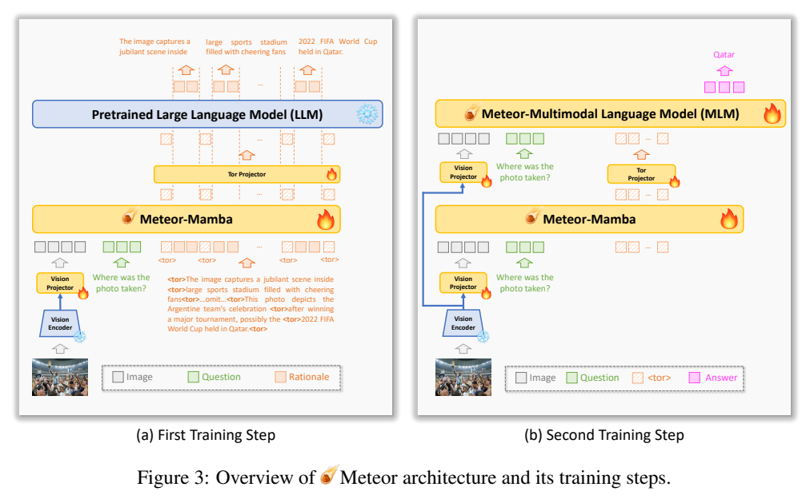
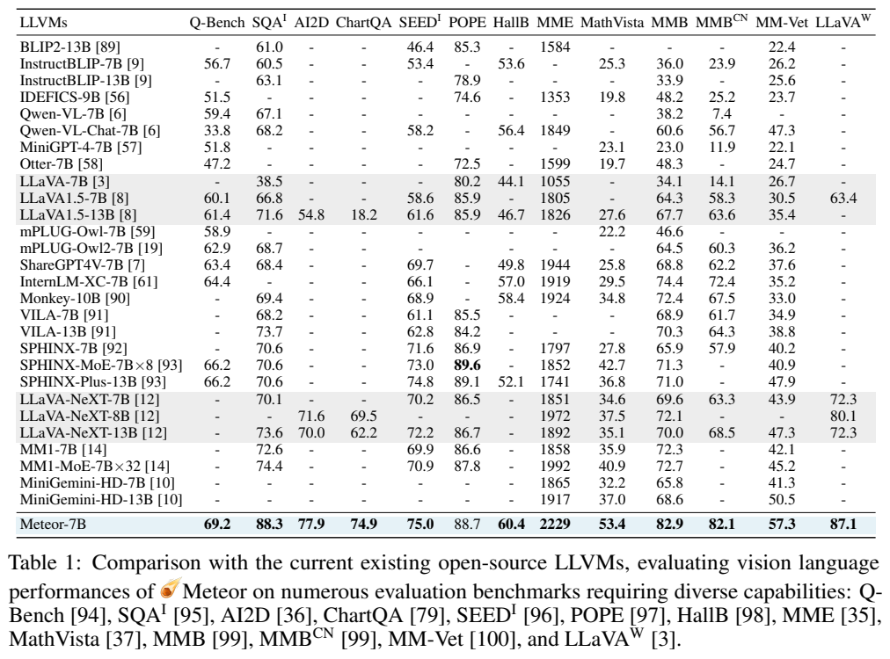
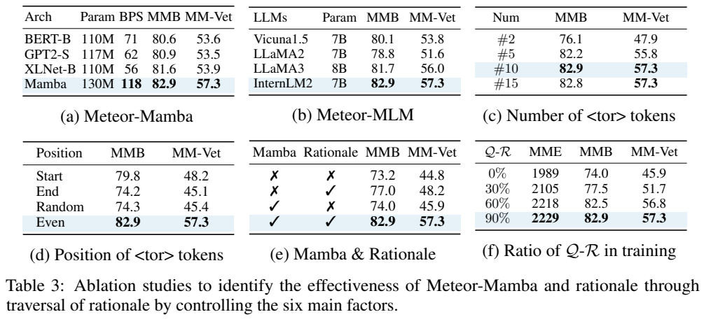

<!-- article-header:start -->
[项目首页](../../../README.md) › [模型系列](../../../reports/model-family-index.md) › [Meteor](../README.md)
<!-- article-header:end -->

# Meteor：用Mamba与遍历标记压缩多方面推理依据

<!-- article-toc:start -->
<a id="article-toc"></a>

**本篇目录** · [论文定位](#paper-info) · [快速概览](#overview) · [整体架构](#architecture) · [核心原理](#principles) · [数据构建](#data) · [训练流程](#training) · [实验结果](#experiments)
<!-- article-toc:end -->

<a id="paper-info"></a>

## 1. 论文信息与模型定位

**论文**：[Meteor: Mamba-based Traversal of Rationale for Large Language and Vision Models](https://arxiv.org/abs/2405.15574v1)，2024年5月24日v1，共31页。作者Byung-Kwan Lee、Chae Won Kim、Beomchan Park、Yong Man Ro，来自KAIST。[官方代码](https://github.com/ByungKwanLee/Meteor)。

Meteor研究如何利用教师生成的长解释增强视觉问答，同时避免每次推理都调用闭源教师或输出完整解释。它由CLIP视觉塔、130M Mamba辅助模块、两个投影器及InternLM2-7B语言主干组成。教师的多方面rationale涵盖图片理解、常识、图表文档、数学与解题步骤，训练时被压缩到少量特殊标记对应的隐藏特征，推理时主干据此作答。

“无需扩大模型规模”是相对直接把主LLM扩成几十B而言，实际仍增加了130M Mamba和投影层，也依赖教师生成、GPT-4V评分及人工筛选数据。本文不把它解释为没有新增参数或没有额外训练成本。[§1、§3，PDF第2—6页](https://arxiv.org/pdf/2405.15574v1#page=4)。

<a id="overview"></a>

## 2. 快速概览

| 项目 | 核心设置 |
|---|---|
| 视觉 | CLIP-L/14，输入490×490，位置嵌入由24×24插值到35×35 |
| 主干 | InternLM2-7B，32层、隐藏维度4096 |
| 辅助模块 | Mamba-130M，24层、隐藏维度768 |
| 压缩接口 | 10个均匀分布的`<tor>`，对应特征经MLP送给主干 |
| 数据 | 收集约2.1M QA，经教师解释与过滤形成约1.1M Q-R-A |
| 训练 | 先冻结主干学习解释；再用图像问题加遍历标记联合训练回答 |
| 主要结果 | MMBench82.9、MM-Vet57.3、MathVista53.4、MME2229 |

核心观察是：辅助模块和rationale联合使用的增益，比单独增加辅助模块或直接训练解释更大。本文没有对所有新模型、所有硬件和所有任务证明其推理速度或准确率都最佳。

<a id="architecture"></a>

## 3. 整体架构



**Figure 3怎么读。** 左图橙色是带`<tor>`分段的教师解释，蓝色主LLM有雪花，Mamba和投影器有火焰：先让解释信息进入辅助模型。右图输入只有图片、问题和`<tor>`标记，橙色自然语言解释不再出现；辅助模型在这些位置形成隐藏特征，投影后帮助主语言模型输出粉色答案。视觉塔两边都显示冻结。这个图说明推理时不是把标准答案对应的教师解释当输入。

图片经CLIP产生视觉特征，视觉投影器为两层全连接加GELU，把1024维视觉表示变成4096维主干表示。Mamba读入视觉、问题以及不同阶段的解释或遍历标记；tor projector把768维Mamba表示映射到4096维语言空间。主干同时接收视觉信息、问题和少量辅助表示，完成条件生成。[§3—4，PDF第4—7页](https://arxiv.org/pdf/2405.15574v1#page=5)。

辅助模块共享主干的tokenizer。第一阶段需要原始rationale监督，第二阶段及推理阶段只送入遍历标记对应特征。因此Meteor属于学习潜在解释表示的路线，不能把内部10个向量当成已经逐步验证、可直接审计的完整自然语言推理链。

| 模块 | 输入与输出 | 公开机制 |
|---|---|---|
| 视觉入口 | 图像 → 主干视觉表示 | 冻结CLIP-L/14，MLP含两层全连接与GELU。 |
| Meteor-Mamba | 图像、问题和遍历标记 → 辅助态 | 130M辅助模块，训练第一阶段学习分段解释，推理没有原解释文字。 |
| tor投影 | 10个标记状态 → 语言辅助向量 | 768维映射4096维，与视觉及问题一起供主干使用。 |
| InternLM2-7B | 辅助表示及问题 → 答案 | 主LLM负责最终生成；第二阶段联合适配辅助与主干。 |

[模块依据：v1 §3，PDF第4–6页](https://arxiv.org/pdf/2405.15574v1)。

<a id="principles"></a>

## 4. 核心创新与数学原理

### 4.1 长解释学习与短答案生成的分工

 平均rationale约213 token，普通答案平均约22 token；如果把所有解释都作为主LLM输出，训练与推理会多承担较长文本。Mamba以状态空间式递推处理序列，具有随序列长度线性扩展的辅助模块计算特点。可以用$`h_t=\bar A_t h_{t-1}+\bar B_t x_t`$、$`z_t=C_t h_t`$理解状态累计，这只是解释性递推，不是本文报告展开的完整Mamba实现公式。整体系统的主LLM依然含Transformer注意力，不能因此宣称整个Meteor都具有线性复杂度。

解释平均长度显著超过最终答案，辅助Mamba吸收解释监督，让主LLM不必在在线回答中逐字生成全部rationale。系统并未删除推理任务，只是把部分信息搬到隐藏表示路径；主干仍要从图像、问题和辅助态组织答案，因此不能用辅助模块的线性特性描述整套系统。 [§3，第5页](https://arxiv.org/pdf/2405.15574v1)

### 4.2 分段标记与无解释推理的条件差异

 给解释均匀插入10个`<tor>`。训练时模型在这些标记之后自回归学习相邻标记间的解释片段，鼓励不同位置捕获不同部分的信息。仅用一个标记可能压缩不足，把标记全放在头部或尾部又可能学习不均衡；均匀分段给辅助模块稳定的局部结构。

用本文解释性记号表示，两阶段分别近似学习


```math
\mathcal L_R=-\sum_t\log p(R_t\mid I,Q,R_{\lt t},\mathtt{\mathord{\lt}tor\mathord{\gt}}),
\qquad
\mathcal L_A=-\sum_t\log p(A_t\mid I,Q,Z_{\rm tor},A_{\lt t}).
```


$`Z_{\rm tor}`$是辅助模块在10个标记位置的输出，经tor projector投影后供主干使用。这两式解释“先监督解释、后监督答案”的条件生成关系；原文没有把它们写为一个带系数的联合损失，也未披露全部mask细节，不能补造目标权重。第一阶段冻结主干，第二阶段共同更新辅助模块与主干适配参数，有助于缩小训练时有解释、推理时无解释的条件差异。

第一阶段每个标记连接后面的解释片段，第二阶段只保留标记位置对应的辅助特征，迫使系统在缺少解释文字时利用已学表示。两阶段的输入条件有意不同，第二阶段正是为缩小这种差异，而非在推理时秘密调用教师解释API。分段位置稳定有助于各辅助位置承担不同信息，但不能保证每个位置对应一个正确逻辑步骤。 [§3、Figure3，第5–6页](https://arxiv.org/pdf/2405.15574v1)

### 4.3 表示相似性支持什么结论

 作者选择十组问题解释，分别在有rationale与无rationale条件下取得标记表示$`Z\in\mathbb R^{10\times768}`$，比较余弦相似度。Figure 4的匹配对角项高于非匹配项，支持模型学习了与对应解释关联的特征；但只有十个示例的表示分析，不能证明隐藏表示总能恢复全部解释、每步逻辑正确或不存在答案捷径。[§3、分析，PDF第5—6、9页](https://arxiv.org/pdf/2405.15574v1#page=9)。

有无解释条件的匹配表示更相近，说明辅助态带有与目标解释关联的信息；它不是逐步推理准确率，也没有检查全部可能的答案捷径。rationale构造先用自动分数过滤再人工判断，改善监督质量的同时仍可能继承教师错误，因此表示验证应与最终任务评测共同阅读。 [§3解释构造，第5页；原有Figure4分析保留](https://arxiv.org/pdf/2405.15574v1)

<a id="data"></a>

## 5. 数据构建与处理

原始QA池包括ShareGPT4V-Instruct 664K、选取的描述91K、MiniGemini中的文档图表问题27K、Doc-Downstream/Reason约574K/27K、G-LLaVA约177K、Math-Vision约3K，以及Math-Instruct/Plus约566K纯文字数学样本。报告按能力归纳约755K真实图片、627K文档图表等图片、747K数学样本，其中数学部分含约566.8K纯文字。这里总数约2.1M是QA样本，不等于2.1M张不同图片。[§3，PDF第4—5页](https://arxiv.org/pdf/2405.15574v1#page=4)。

Claude Haiku在**给定问题和答案**的条件下生成详细解释，GPT-4V再结合Q-R-A给0—10分，低于5分删除，剩余由人工Yes/No判断是否足以解释解法。最终约1.1M三元组，包括338K真实图片、379K文档图表等、342K数学，其中约165K带图、177K纯文字。分组和总数使用原文近似数，不强行补齐取整差异。


**[附录 A 的原始样本，PDF 第 18 页](https://arxiv.org/pdf/2405.15574v1#page=18)。** 算术题通过人天工作率推到目标长度，几何题把六边形与正方形角度关系展开；每个样本都分别展示 Question、Rationale 和 Answer。这里的 rationale 既可能是正式解题步骤，也可能评价既有答案“解释得很好”。给定答案生成的解释可补知识，但也存在事后合理化，自动高分和人工筛选不等于数学证明。

论文列出的提示模板主要是Q/A或Q/R/A文字字段，未详述每次教师调用如何附带图片、人工复核人数、分歧处理及全部去重规则。本文不据此断言教师对所有训练图片做过独立视觉校验。图表、文档和数学数据使用已有任务训练部分，报告也未给出系统污染审计结果。

<a id="training"></a>

## 6. 训练流程与目标

第一阶段使用1.1M Q-R学习解释嵌入，训练Mamba、视觉和tor投影器，冻结Meteor-MLM与图示视觉编码器。第二阶段使用对应Q-A，输入多个`<tor>`而不输入教师解释，训练Mamba、两个投影器以及主干适配参数；视觉塔仍冻结。正文的“jointly train”不能理解为主LLM全权重微调，因为实现细节明确采用QLoRA。

两阶段各一轮、约三天，硬件8张NVIDIA RTX A6000 48GB，CPU Xeon Gold6230、256GB内存。主LLM使用4-bit NF4、double quantization、bfloat16计算与梯度检查点；QLoRA rank=64、alpha=64。Mamba用float32，作者指出低精度训练存在不稳定。AdamW、cosine学习率每阶段从$`10^{-4}`$到$`10^{-6}`$，梯度累积6，阶段批量分别192和576。[实现细节，PDF第7页](https://arxiv.org/pdf/2405.15574v1#page=7)。

推理也采用4-bit量化、确定性beam search、beam数3，并使用FlashAttention2。论文未列出端到端毫秒延迟、每题能耗或完整服务费用。Table 3中的BPS是辅助架构实验里的batches-per-second，不能当作整个7B问答系统的输出token速度。教师API和人工数据成本也没有形成完整费用账单。

<a id="experiments"></a>

## 7. 实验设置与主要结果



**Table 1怎么读。** 每列有独立指标，MME是累计分，其余多为百分制；缺横线的项目不代表模型得0分。不同基座、分辨率、数据、训练规模的比较反映系统水平，不能单凭这一表把所有增益都归因于Mamba。主要数值为Q-Bench69.2、ScienceQA-image88.3、AI2D77.9、ChartQA74.9、SEED-image75.0、POPE88.7、HallusionBench60.4、MME2229、MathVista53.4、MMBench英文82.9/中文82.1、MM-Vet57.3、LLaVA-W87.1。

例如相对Table 1中LLaVA-NeXT-7B的MMBench69.6、MM-Vet43.9，Meteor提升明显；但POPE88.7仍低于SPHINX-MoE的89.6，不能写成所有列均第一。MathVerse总体21.7，比表中若干对照高，但依然有大量错误。报告中的闭源比较来自当时选定版本，不应作为今日所有模型的固定排名。[Table 1—2，PDF第6—7页](https://arxiv.org/pdf/2405.15574v1#page=6)。



**Table 3怎么读。** 六个小表分别控制辅助结构、主干、标记数量、标记位置、rationale与数据占比。没有Mamba也没有rationale时MMBench73.2/MM-Vet44.8；只用rationale77.0/48.2；仅Mamba74.0/45.9；两者结合82.9/57.3。结果支持辅助结构与解释监督的协同，而非单纯加130M参数。

标记数量2→5→10时MMBench76.1→82.2→82.9、MM-Vet47.9→55.8→57.3，15个为82.8/57.3，说明收益趋于饱和。均匀位置82.9/57.3，高于全部头部79.8/48.2或尾部74.2/45.1。BERT、GPT2、XLNet替代辅助模块的BPS分别71、62、56，Mamba118，但这是特定测量设置的吞吐数据。Q-R训练占比从0%到90%时MM-Vet45.9→57.3，仍未证明扩数据后的收益只来自解释数量而非样本构成变化。

附录提供识别、文档、数学和代码生成案例，但没有系统失败案例统计；其中作品介绍示例把不同画作名称并列，提示生成仍可能混淆事实。原文也承认不量化、不用LoRA时模型对显存要求较高。Meteor展示了潜在解释蒸馏的可行性，同时留下解释真实性、跨任务泛化与端到端成本验证问题。本文核对v1与原图，未运行或复现实验。

<!-- article-footer:start -->
---

[← 上一篇：ConvLLaVA](../../convllava/arxiv-2405.15738/README.md) · [按发表时间浏览](../../../reports/paper-reading-guide.md#year-2024) · [下一篇：MQT-LLaVA →](../../mqt-llava/arxiv-2405.19315/README.md)

[返回本篇目录](#article-toc) · [返回模型系列](../README.md)
<!-- article-footer:end -->
