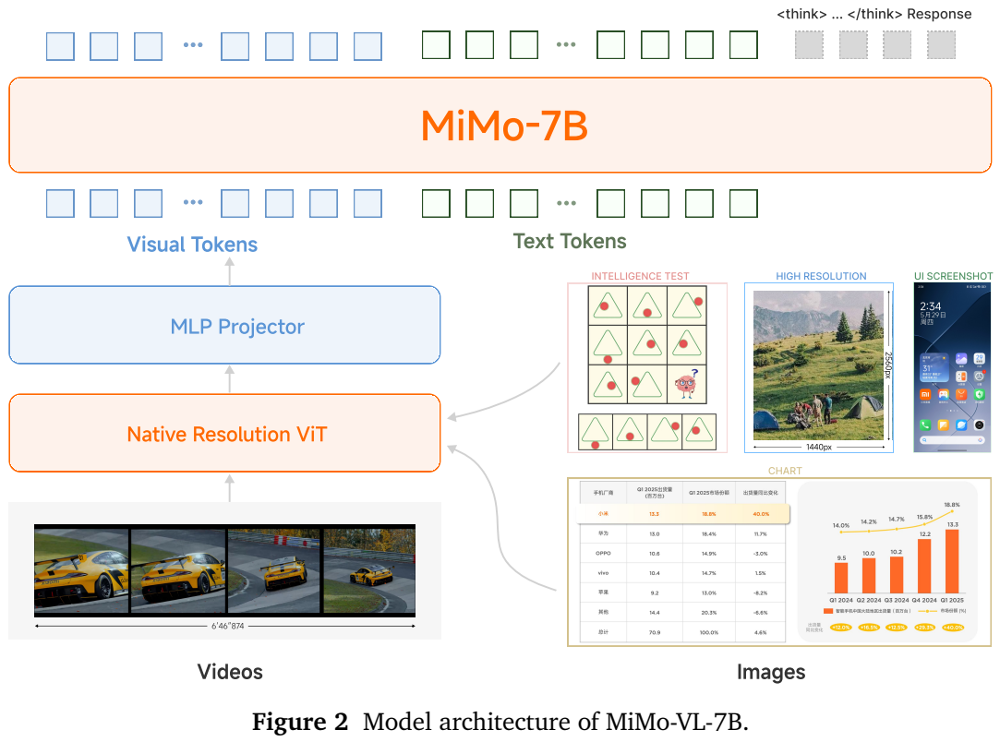
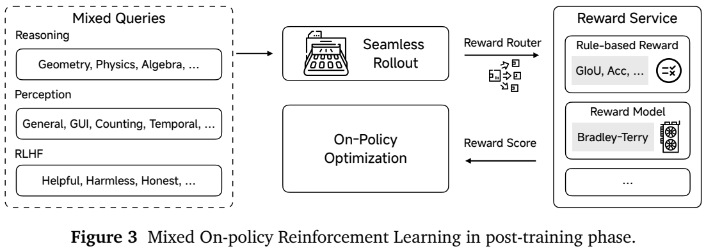
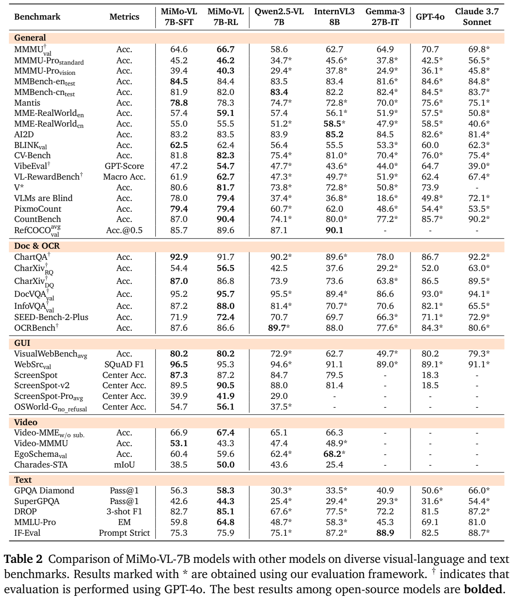
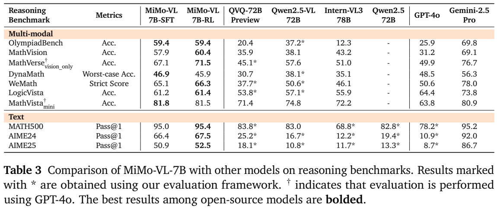
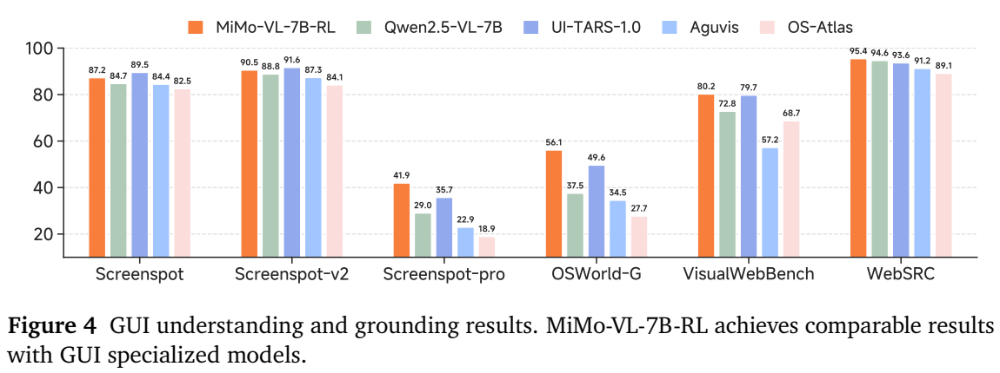

<!-- article-header:start -->
[项目首页](../../../README.md) › [模型系列](../../../reports/model-family-index.md) › [MiMo](../README.md)
<!-- article-header:end -->

# MiMo-VL：长推理预训练与混合在线强化学习

<!-- article-toc:start -->
<a id="article-toc"></a>

**本篇目录** · [论文定位](#paper-info) · [快速概览](#overview) · [整体架构](#architecture) · [核心原理](#principles) · [数据构建](#data) · [训练流程](#training) · [实验结果](#experiments)
<!-- article-toc:end -->

<a id="paper-info"></a>

## 1. 论文信息与模型定位

**MiMo-VL Technical Report**，署名 **LLM-Core Xiaomi**。本文依据 [arXiv 2506.03569v1](https://arxiv.org/abs/2506.03569v1)（2025 年 6 月 4 日，32 页）整理。[官方仓库](https://github.com/XiaomiMiMo/MiMo-VL)与[评测框架](https://github.com/XiaomiMiMo/lmms-eval)由报告提供。

报告发布 **MiMo-VL-7B-SFT** 与 **MiMo-VL-7B-RL**，结合 Qwen2.5 的视觉编码器和小米 MiMo-7B-Base 语言骨干，处理图像、文档、视频与 GUI，并生成文本及结构化定位/操作指令。它不是 MiMo-V2-Omni 的音视频模型；本文版本没有披露音频输入分支。

<a id="overview"></a>

## 2. 快速概览

- **四阶段训练**：从连接器预热到视觉对齐、通用多模态训练，再到 32K 长上下文 SFT，总计约 2.4T 训练 token。
- **推理数据前移**：将高质量长思维链大量加入后期预训练，而不是只在最后补少量推理微调。
- **混合奖励**：MORL 同时训练推理、计数、图像/GUI 定位、视频时间定位与偏好对齐。
- **条件与代价**：在线策略更新改善作者的训练曲线，但不同任务会相互干扰，RL 也会使部分基准下降；长回答提高了生成预算。

<a id="architecture"></a>

## 3. 整体架构



Figure 2 展示原生分辨率 ViT、随机初始化 MLP projector 与 MiMo-7B。视觉编码器采用 Qwen2.5-ViT，图像或视频的视觉 token 经 MLP 进入语言模型空间；模型生成思考段与回答。报告没有提出一套新的视觉 patch 自适应压缩算法，其重点在数据与训练。

附录 Table 4 给出视觉端 **32 层、16 头、隐藏维度 1280、FFN 3456、patch 14、2D RoPE**；语言端 **36 层、32 头、隐藏维度 4096、FFN 11008、MRoPE**。语言配置与 Qwen2.5-VL-7B 的 28 层、3584 隐藏维度不同，因此不能称只是给 Qwen2.5-VL 增加 RL。报告没有完整列出 projector 层宽、总参数拆分及所有视觉 token 合并细节。

GUI 输出统一成 click、scroll、input、drag、open、press 等结构，附录 Table 5 还包含 finished、longpress、hover、select、wait、appswitch。输出一个点击坐标与成功完成整项交互任务是不同能力；截图定位成绩不能直接当作网站操作成功率。

<a id="principles"></a>

## 4. 核心创新与数学原理



MORL 用任务类型决定奖励。数值/符号推理由 Math-Verify 检查最终答案；框定位用 GIoU，点定位检查点是否落在目标框；计数检查数量；时间定位用预测与真实区间的 IoU。偏好任务分别使用纯文本与多模态奖励模型，以 Bradley-Terry 目标训练。其标准形式可解释为 $`p(y^+\succ y^-\mid q)=\sigma(r(q,y^+)-r(q,y^-))`$；该表达用于解释报告提及的目标，并非论文另编号的新公式。

同题生成一组回答，原文式 2 定义组内优势：

```math
A_{i,j}=\frac{r_i-\mathrm{mean}(r_1,\ldots,r_G)}{\mathrm{std}(r_1,\ldots,r_G)}.
```

同一回答各 token 共享相对优势。它强调“比本题其他回答好多少”，而不是直接拿不同任务的奖励原始尺度混在一起。所有奖励先归一化到 $`[0,1]`$，没有额外格式奖励；报告未列出各任务映射细节及零方差组的完整数值处理。

在线 GRPO 变体在每轮新生成回答之后只作单步更新，不重复复用旧策略样本，因此取消 clipped surrogate；同时移除 KL 项，并采用动态采样、容易样本过滤和重采样。**需要留意原文式 1 的表达不完整**：它只写优势的期望求和，没有显式给出 log-probability 或策略比率，不能照抄成一个直接对固定优势反向传播的可运行损失。

为说明意图，常见在线策略梯度会包含 $`A_i\nabla_\theta\log\pi_\theta(o_{i,j}\mid q,o_{i,\lt j})`$；这是对策略优化原理的解释，不是对作者代码的逐项核验。报告也未提供足以完全复现 MORL 的批量、组大小、学习率与各域比例。

奖励路由器将规则及模型评分统一为 HTTP 服务，语言任务与多模态任务调用不同奖励模型。文中称 RLHF，但偏好对由高级 VLM 排序生成，不能将全部训练偏好描述为真实用户逐条人工打分。

<a id="data"></a>

## 5. 数据构建与处理

图文描述先以 phash 和文字过滤去重，再结合原始描述重新 caption，按语言一致性和重复模式筛选；借鉴 MetaCLIP 构造中英元数据平衡长尾。交错图文从网页、书籍、论文提取，偏向教材、百科、手册等知识内容，过滤小图、异常比例与信息量低的装饰图，并按图文相关性和互补性筛选。

OCR 数据涵盖文档、表格、场景、包装、公式，以及手写、变形、遮挡文字，部分同时带框标注。Grounding 使用绝对坐标与复杂指代表达。视频重描述为带开始/结束时间的事件级文本，再构建时长平衡的时间定位样本、全局分析及问答。GUI 数据覆盖移动、网页、桌面，包括元素/指令定位、前后截图预测中间操作及长操作轨迹，并增加中文界面合成数据。

推理合成先选多域问题，调用大型推理模型生成长 CoT，检查答案、逻辑清晰度、冗余与格式；后期训练显著提高其比例。论文描述图像 phash 排除评测重叠，但没有公布所有清洗阈值、分项规模和去污染统计，不能据此声称完全没有污染。

RL 视觉推理集为 **80K** 题：删除证明题，将合适选择题改为数值/符号自由回答，过滤先进模型无法解答的题及 MiMo rollout 通过率超过 90% 的容易题，并剔除不看图也能解答的题。文本推理另外加入更难数学题。偏好查询平衡中英与不同要求，经嵌入聚类扩充覆盖；同一查询集合用于奖励模型与 RLHF。

<a id="training"></a>

## 6. 训练流程与目标

原文 Table 1 给出四阶段：

| 阶段 | 更新组件 | token 消费量 | 上下文 | 学习率 |
|---|---|---:|---:|---:|
| 1：projector 预热 | 仅 projector | 300B | 8K | $`10^{-3}`$ |
| 2：视觉语言对齐 | ViT、projector，LLM 冻结 | 167B | 8K | $`10^{-4},10^{-5}`$ |
| 3：通用多模态 | 全部 | 1.4T | 8K | $`10^{-5}`$ |
| 4：长上下文 SFT | 全部 | 550B | 32K | $`2.5\times10^{-5}`$ |

表中相加约为 2.417T，报告以 **2.4T** 概括；这是消费的训练 token 量，不是唯一文字数据大小。第二阶段两个学习率的组件分配未在表中直接标清，本文不猜测。第三阶段少量纯文本保留语言能力，第四阶段加入长文档、高分辨率图、长视频与长推理，并利用长序列 packing 调整学习率。四阶段产出 SFT 版，随后 MORL 产出 RL 版。

报告没有充分披露预训练优化器、批量、GPU 数量或完整算力成本。评测配置更明确：图像最大像素为 **$`4096\times28\times28`$**，不是 $`4096^2`$；视觉回答采用贪心、最多生成 **32,768 token**。视频采样 **2 fps**、最多 **256 帧**、总 token 上限 **16,384**。文本评测最大新 token 同为 32,768，温度 0.6、top-p 0.95。长推理分数应连同这些预算一起阅读。

<a id="experiments"></a>

## 7. 实验设置与主要结果



Table 2 星号表示使用作者评测框架重测，剑号表示 GPT-4o 参与评测；其余结果不全来自同一协议。表内指标类型包括准确率、GPT 分数、F1 与 mIoU，不能直接求一个总能力均分。以下保留主要条件和原表尺度：

| 任务 | SFT | RL | Qwen2.5-VL-7B |
|---|---:|---:|---:|
| MMMU val | 64.6 | 66.7 | 58.6 |
| MMBench 英文 test | 84.5 | 84.4 | 83.5 |
| MMBench 中文 test | 81.9 | 82.0 | 83.4 |
| DocVQA val | 95.2 | 95.7 | 95.5* |
| OCRBench，原表百分尺度 | 87.6 | 86.6 | 89.7* |
| ChartQA | 92.9 | 91.7 | 90.2* |
| Video-MME，**无字幕** | 66.9 | 67.4 | 65.1 |
| Video-MMMU | 53.1 | 43.3 | 47.4 |
| Charades-STA，mIoU | 38.5 | 50.0 | 43.6 |

RL 提高 MMMU、时间定位，但 Video-MMMU 从 **53.1 降至 43.3**，OCRBench 与 ChartQA 也下降。因此“40 项中 35 项胜过 Qwen”不等于 RL 在全部任务优于自身 SFT。MMMU 的 RL **66.7** 仍低于表内 GPT-4o **70.7** 与 Claude 3.7 **69.8**。





Table 3 的 OlympiadBench 为 SFT/RL **59.4/59.4**，高于 Qwen2.5-VL-72B **37.2**，低于 Gemini-2.5-Pro **69.8**；MathVision **57.9→60.4**，MathVerse vision-only **67.1→71.5**。MathVista mini 却为 **81.8→81.5**，DynaMath worst-case **46.9→45.9**。文本 MATH500/AIME24/AIME25 的 RL 为 **95.4/67.5/52.5**，其中 AIME 两项仍明显低于 Gemini 的 **92.0/86.7**。这些是报告时期的指定模型与条件，不能解释成与所有后续模型比较的结论。

GUI 的 ScreenSpot-v2 RL **90.5**、Pro **41.9**，OSWorld-G **no_refusal、中心点准确率 56.1**。Figure 4 中 UI-TARS-1.0 对应 **91.6/35.7/49.6**，所以普通 ScreenSpot-v2 仍稍逊，困难定位更强。报告引言把 RL 的 OSWorld-G 写为 **54.7**，实际 Table 2 为 SFT 54.7、RL 56.1；这里以明确表列为准。Figure 4 的 WebSRC 95.4 与 Table 2 的 95.3 也有小差异，不混写。

Figure 6 的阶段四曲线支持持续训练中 MMMU、GUI 与推理提升，但同时改了数据与上下文，不能把所有收益单独归因于 CoT。Figure 7 的在线与 vanilla GRPO 比较只在**纯文本推理、AIME24-25 Avg@32**上进行，不是全部视觉任务的独立消融。偏好 Elo 来自作者中英内部集与 **GPT-4o 风格控制裁判**，并非真实用户投票；报告称 MORL 提升 22+ 点，但未提供可在本文重建的完整逐项评测。

作者指出推理倾向延长回答，定位/计数倾向缩短回答，混合 RL 难以达到各任务单独优化的最佳值。报告的主要贡献是详细的数据路线与跨奖励服务的训练框架；结果仍需按任务和成本评估。本文核对原文与图表，没有运行模型或复现实验。

<!-- article-footer:start -->
---

[← 上一篇：OpenUni](../../openuni/arxiv-2505.23661/README.md) · [按发表时间浏览](../../../reports/paper-reading-guide.md#year-2025) · [下一篇：Ego-R1 →](../../ego-r1/arxiv-2506.13654/README.md)

[返回本篇目录](#article-toc) · [返回模型系列](../README.md)
<!-- article-footer:end -->
