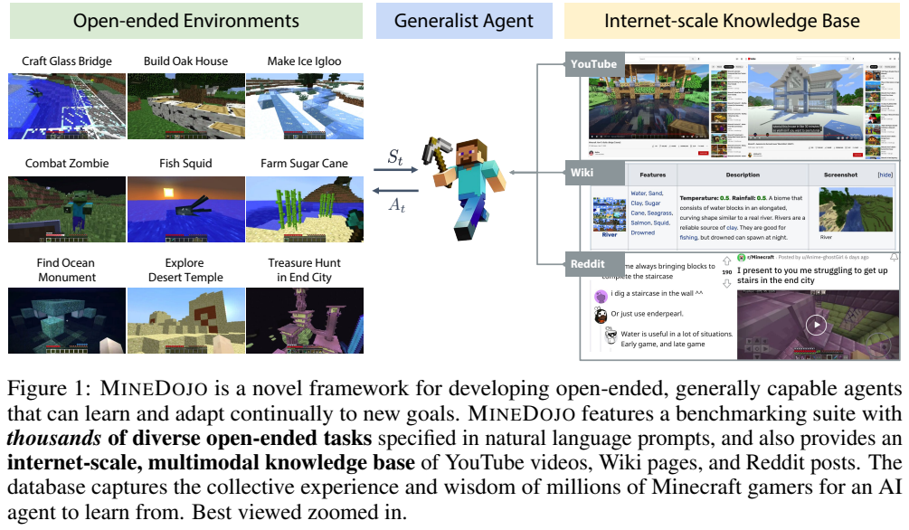
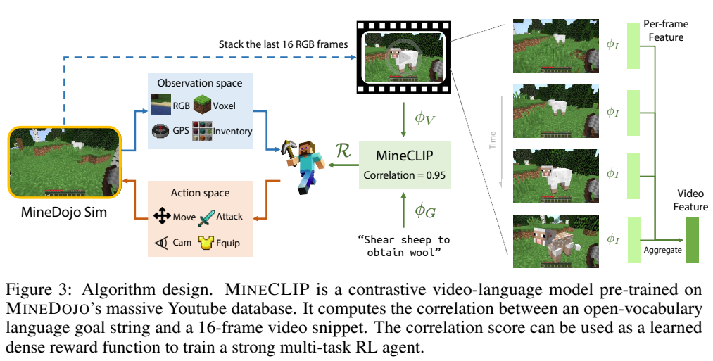
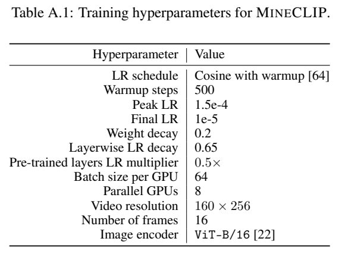
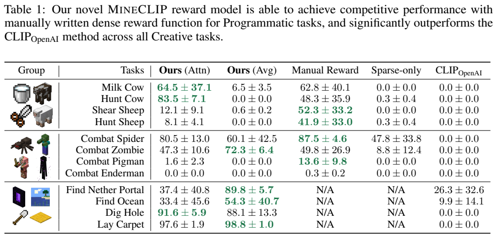

<!-- article-header:start -->
[项目首页](../../../README.md) › [模型系列](../../../reports/model-family-index.md) › [MineDojo](../README.md)
<!-- article-header:end -->

# MineDojo：用网络规模的多模态知识训练 Minecraft 具身智能体

<!-- article-toc:start -->

**本篇目录** · [论文定位](#paper-info) · [快速概览](#overview) · [整体架构](#architecture) · [核心原理](#principles) · [数据构建](#data) · [训练流程](#training) · [实验结果](#experiments)
<!-- article-toc:end -->

## 1. 论文信息与模型定位

| 项目 | 信息 |
|---|---|
| 原文 | [MineDojo: Building Open-Ended Embodied Agents with Internet-Scale Knowledge](https://arxiv.org/abs/2206.08853v1) |
| 本文依据版本 | arXiv:2206.08853v1，2022 年 6 月 17 日，36 页 |
| 作者 | Linxi Fan、Guanzhi Wang、Yunfan Jiang、Ajay Mandlekar、Yuncong Yang、Haoyi Zhu、Andrew Tang、De-An Huang、Yuke Zhu、Anima Anandkumar |
| 机构 | NVIDIA、Caltech、Stanford、Columbia、上海交通大学、UT Austin |
| 核心产物 | MineDojo 仿真平台、任务集与知识库；MineCLIP 视频语言奖励模型；语言条件强化学习智能体 |
| 输入输出 | 智能体接收游戏观测和自然语言任务，输出离散游戏控制；MineCLIP 接收视频片段和目标文字，输出匹配分数 |

MineDojo 的主要定位是具身学习基础设施和算法验证。它使用约 150M 参数的 MineCLIP 奖励模型，基于既有 CLIP 表征学习，而不是一个生成长篇回答的多模态聊天模型。GPT-3 在工作中用于生成部分任务和指导文字，也不是执行游戏动作的策略核心。

## 2. 快速概览

作者认为通用具身智能体需要丰富环境、可利用的先验知识和灵活学习架构。Minecraft 提供开放世界和大量可组合目标；玩家上传的视频、Wiki 与讨论则提供知识。论文用网络游戏视频与时间对齐字幕训练 MineCLIP，让模型评估一段智能体行为是否符合“挤牛奶”“挖洞”等语言目标，再把这个分数转成强化学习奖励。

**读图：** 左侧是环境任务空间，右侧是知识来源，中间智能体与环境交换观测和动作。图展示研究框架的目标，不表示论文训练的智能体已经完成图中全部任务，也不表示三个知识库全部用于同一次模型训练。

框架列出 **1,572 个程序化任务、1,558 个创造性任务**。知识库有 730K+ YouTube 视频、6,735 个 Wiki 页面、340K+ Reddit 帖子。算法实验实际选择 **12 个任务，分三组各训练一个智能体**；MineCLIP 预训练实际使用从视频库提取的 640K 视频字幕对。Wiki 和 Reddit 在本论文中主要是开放研究资源，其用于策略学习的方案仍属于后续方向。

## 3. 整体架构

**读图：** 智能体执行动作后，将最新 16 帧组成短视频，MineCLIP 结合任务文字计算匹配分数，奖励再指导策略训练。右侧说明视频编码器由逐帧视觉编码和时间聚合构成，这使滑动窗口中重叠帧的特征可以缓存。

MineCLIP 的视觉侧使用 OpenAI CLIP 初始化的 ViT-B/16，输入分辨率为 **160×256**，每帧输出 512 维特征。模型通过双三次插值适配位置嵌入。时间聚合有两个版本：Avg 对 16 帧做平均池化；Attn 使用两层 Transformer，宽度 512、8 个注意力头，采用 Swish 激活的门控线性单元变体。聚合后另有两层残差 CLIP Adapter，初始接近恒等映射。

文本编码器沿用 CLIP 的 12 层、宽度 512、8 头结构，最多接收 77 个 token。视觉和文本预训练骨干仅微调最后两层，其余骨干层保持冻结；新加入的聚合及适配模块参与学习。Avg 对帧置换不敏感，难以表达动作次序；Attn 有时间序列建模能力，但实验不支持“Attn 在所有任务上更好”。

策略网络和奖励网络承担不同职能。策略将当前 RGB、任务表征、朝向、GPS、周围 3×3×3 方块及上一动作编码后拼接，经融合 MLP 送入动作策略头和价值头。RGB 使用冻结的 MineCLIP 逐帧编码器。策略本身的 frame stack 为 1，奖励用 16 帧窗口，两者不能混为一个 16 帧策略输入。

平台 API 支持更丰富的背包、装备、生命状态等信息，也支持 LIDAR 特权观测，但论文实验采用的是观测和动作子集：RGB、朝向、GPS、周围方块，加移动、摄像机、使用与攻击，总计 **89 个离散动作选择**。因此论文实验策略不完全只靠 RGB；手工奖励基线还可使用特权 LIDAR。创造、合成、背包管理等平台能力没有在这 12 项实验中充分验证。

## 4. 核心创新与数学原理

**用视频字幕对学习目标匹配。** 视频和文本编码器把不同模态映射到可比较空间，InfoNCE 使匹配对相对同批负例具有更高分数。以下是标准单向 InfoNCE 的解释写法，原文正文描述使用 InfoNCE，没有给出这个编号公式：

$$
\mathcal L_{V\to G}=-\frac1B\sum_i
\log\frac{\exp(s(v_i,g_i)/\tau)}{\sum_j\exp(s(v_i,g_j)/\tau)}.
$$

其中 $`s`$ 表示匹配度，$`\tau`$ 为温度。该式帮助理解正负样本训练，不补充论文未披露的温度数值或完整双向损失权重。字幕是弱监督：它可能描述屏幕外的计划或背景信息，模型学习到的是行为与语言的统计关联。

**分数如何变成奖励，决定行为。** 附录 E.1 将目标 $`G`$ 与一组负目标共同输入，得到匹配概率 $`P_G`$。作者比较两种转换：

$$
r_t^{\rm DIRECT}=\max(P_{G,t}-1/N_T,0),\qquad
r_t^{\rm DELTA}=P_{G,t}-P_{G,t-1}.
$$

$`N_T`$ 是候选提示总数，$`1/N_T`$ 是随机匹配基线。DIRECT 去掉低于基线的信号，用于动物与怪物任务；未经处理的 $`P_G`$ 称为 DIRECT-Naive。DELTA 奖励匹配概率的增加，用于创造性任务。单纯奖励“目标出现在视野中”可能让智能体盯着静物，差分信号则鼓励朝更符合目标的状态变化。它不是论文证明具有策略不变性的势函数塑形：式中没有折扣因子，原文也没有这样的理论保证。

**PPO 与自我模仿互补。** 附录 E.3 给出 PPO 截断目标，整理符号如下：

$$
\max_\theta\mathbb E\left[\min\bigl(\rho_t A_t,
\mathrm{clip}(\rho_t,1-\epsilon,1+\epsilon)A_t\bigr)\right],
\quad \rho_t=\frac{\pi_\theta(a_t\mid s_t,G)}{\pi_{\rm old}(a_t\mid s_t,G)}.
$$

策略更新受比率截断限制，优势采用 GAE。自我模仿把成功或高回报的自身轨迹存入缓冲区，周期性最大化 $`\mathbb E_{(s,a)\sim D_{\rm SI}}\log\pi_\theta(a\mid s,G)`$。这里模仿的是智能体自己的好轨迹；YouTube 数据没有真实控制动作标签，不能直接当作相同的行为克隆监督。

为减少策略抖动，附录 F.3 还加入近期动作分布之间的 KL 平滑损失。它帮助维持连贯动作，并缩小跳动的仿真视频与较平稳玩家视频间的差异，但不是对任务成功的直接监督。

## 5. 数据构建与处理

| 资源 | 规模与处理 |
|---|---|
| YouTube | 730K+ Minecraft 视频，累计约 33 年时长，英文字幕约 2.2B 词；先找频道，再抓视频 ID，用游戏类别排除无关内容 |
| Wiki | 6,735 页；保存全文截图、文本、图像、动画帧、精灵图标和表格单元，记录约 2.2M 个视觉元素框，保留页面布局 |
| Reddit | 340K+ 帖子、6.6M 评论；保留讨论线程父节点和多模态链接，要求得票至少 5 且非 NSFW |
| MineCLIP 训练子集 | 640K 视频文字对，按实体、方块和物品关键词在字幕中匹配，再扩展文字及视频片段 |

YouTube 过滤规则包括播放少于 100、宽高比小于 1、时长不足一分钟、年龄限制等；偏好有英文字幕的视频，字幕既可能人工上传，也可能自动转写或翻译。Detoxify 根据标题和描述过滤任一类别毒性概率超过 0.5 的视频，Reddit 也用该工具清洗。它们是自动过滤，不能保证内容不存在噪声或偏差。

预训练片段在正文概括为 16 秒；附录更精确描述为在匹配字幕的起止时间内采样中心，扩展成 **8–16 秒**，文字扩展到 16–77 token，从片段均匀取 16 帧。视频采用时间一致的随机裁剪，避免各帧独立裁剪破坏动作连贯性。

程序化任务通过生存、采集、科技树、战斗模板及初始条件组合生成，并过滤不可能组合。创造性任务由 214 条人工构思、1,042 条 YouTube 教程挖掘、302 条 GPT-3 生成及去重的任务组成；教程挖掘包含人工筛选标题、观看视频和编辑目标。GPT-3 也生成部分步骤指导，但不代表该指导逐条验证可执行。

公开数据库形态应与实际媒体区分：论文披露 YouTube 发布视频 ID 和元数据，并不发布原始 MP4 与字幕文件；Reddit 发布帖子 ID、元数据与重建脚本。Wiki 则提供页面内容和布局。知识库采集发生于 2021 年 12 月至 2022 年 5 月。

## 6. 训练流程与目标

第一阶段在 640K 视频字幕对上训练 MineCLIP，使用对比目标，训练 **2 个 epoch**。第二阶段冻结奖励表征，用该模型给仿真轨迹评分，交替训练 PPO 与自我模仿。目标文字固定时提前缓存文本特征，滑动窗口缓存重叠帧的图像特征，减轻约 150M 参数奖励模型逐步调用的开销。

**读表：** 每 GPU 批大小 64、8 张卡对应总批大小 512；输入是 16 帧 160×256 图像。预训练权重的学习率乘 0.5，逐层学习率衰减为 0.65，不应把表中峰值学习率理解为所有参数统一学习率。

MineCLIP 用单节点 8×V100、FP16 混合精度，余弦学习率、500 步预热、峰值 **1.5×10⁻⁴**、末值 **10⁻⁵**、权重衰减 **0.2**。论文此处没有明确给出优化器名称，不能从表格的权重衰减项补断定为 AdamW。

强化学习用 Adam，学习率 **10⁻⁴**，余弦衰减到 **5×10⁻⁶**；折扣 0.99、GAE λ=0.95、PPO ε=0.2、价值损失权重 0.5、梯度裁剪 10。每 100K 环境步触发自我模仿，运行 10 epoch；其学习率从 10⁻⁴ 衰减至 10⁻⁶。平滑动作窗口为 3，权重 10⁻⁷。

Animal-Zoo 和 Creative 因并行仿真资源限制，各自把四任务分两阶段、每阶段并行两任务，沿用自我模仿缓冲区，第二阶段重置策略头以促进探索。实验虽称多任务，实际不是把全部任务从训练开始就同时并行。程序化任务还加入最终成功的二元奖励；只有创造性任务完全由 MineCLIP 奖励训练。

## 7. 实验设置与主要结果

**读表：** 前八项是可用程序状态判断的任务，后四项是创造性任务，其 Manual Reward、Sparse-only 两列为 N/A。两个 MineCLIP 版本互有优势；部分方差很大，不能只引用最高均值宣称训练稳定。

| 任务 | Attn | Avg | 手工奖励 | 仅稀疏奖励 |
|---|---:|---:|---:|---:|
| Milk Cow | 64.5±37.1 | 6.5±3.5 | 62.8±40.1 | 0.0±0.0 |
| Hunt Cow | 83.5±7.1 | 0.0±0.0 | 48.3±35.9 | 0.3±0.4 |
| Shear Sheep | 12.1±9.1 | 0.6±0.2 | **52.3±33.2** | 0.0±0.0 |
| Combat Zombie | 47.3±10.6 | **72.3±6.4** | 49.8±26.9 | 8.8±12.4 |
| Combat Enderman | 0.0±0.0 | 0.0±0.0 | 0.3±0.2 | 0.0±0.0 |
| Find Nether Portal | 37.4±40.8 | **89.8±5.7** | — | — |
| Dig Hole | **91.6±5.9** | 88.1±13.3 | — | — |
| Lay Carpet | 97.6±1.9 | **98.8±1.0** | — | — |

论文摘要中的“最高 73% 改善”对应 Hunt Cow 从 48.3 到 83.5 的约 **72.9% 相对增幅**，绝对增幅是 35.2 个百分点。模型没有在全部程序化任务胜过手工奖励：剪羊毛、猎羊、部分战斗仍明显更差，Enderman 几乎完全失败。创造性任务在这组设置中均超过未做 Minecraft 视频适配的 OpenAI CLIP 奖励。

Table A.2 的奖励消融进一步说明处理方式的重要性：Hunt Cow 的 DIRECT 为 83.5，DIRECT-Naive 和 DELTA 都为 0.0；Milk Cow 三者为 64.5、8.6、7.6。高匹配分数只有经过适当奖励构造，才可能促进有效行为；某一种奖励不能直接推广到全部任务。

创造性任务的评估用 MineCLIP-Attn 作为自动成功判据。作者先对每任务标注 100 条成功、100 条失败轨迹，平均逐步分数，再用 K=2 的 K-means 两中心均值设置分类边界。Table 2 报告的是对人工标签的 **二分类 F1**：Attn 四任务为 98.7、100.0、99.4、97.4，Avg 为 100.0、100.0、100.0、98.4。这里的“超过 97% 一致”不能重新命名为逐帧准确率或全部平台任务通过率。阈值建立于这批轨迹分布，论文未报告另一个严格独立阈值校准集。

训练奖励和创造性任务的自动评价来自同类模型，虽有人工标签验证，仍需要警惕奖励匹配与真实任务完成之间的偏差。论文尚未验证在 3,130 个任务、长科技树或击败末影龙等极长任务上的通用能力，也没有真实机器人迁移实验。其价值是展示：没有动作标签的网络视频可以先训练语言条件奖励，再通过环境交互学习策略，为开放任务提供一种可扩展起点。

<!-- article-footer:start -->
---

[← 上一篇：MetaLM](../../metalm/arxiv-2206.06336/README.md) · [按发表时间浏览](../../../reports/paper-reading-guide.md#year-2022) · [下一篇：VIMA →](../../vima/arxiv-2210.03094/README.md)

[返回本篇目录](#article-toc) · [返回模型系列](../README.md)
<!-- article-footer:end -->
