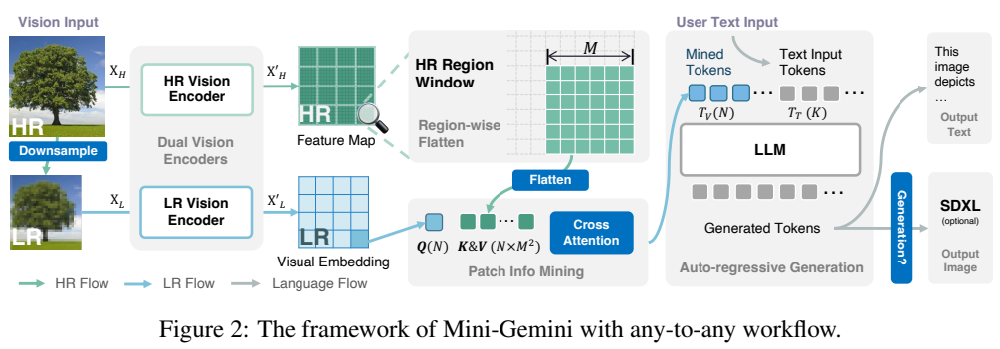
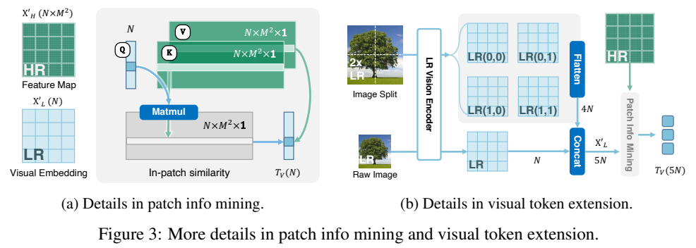
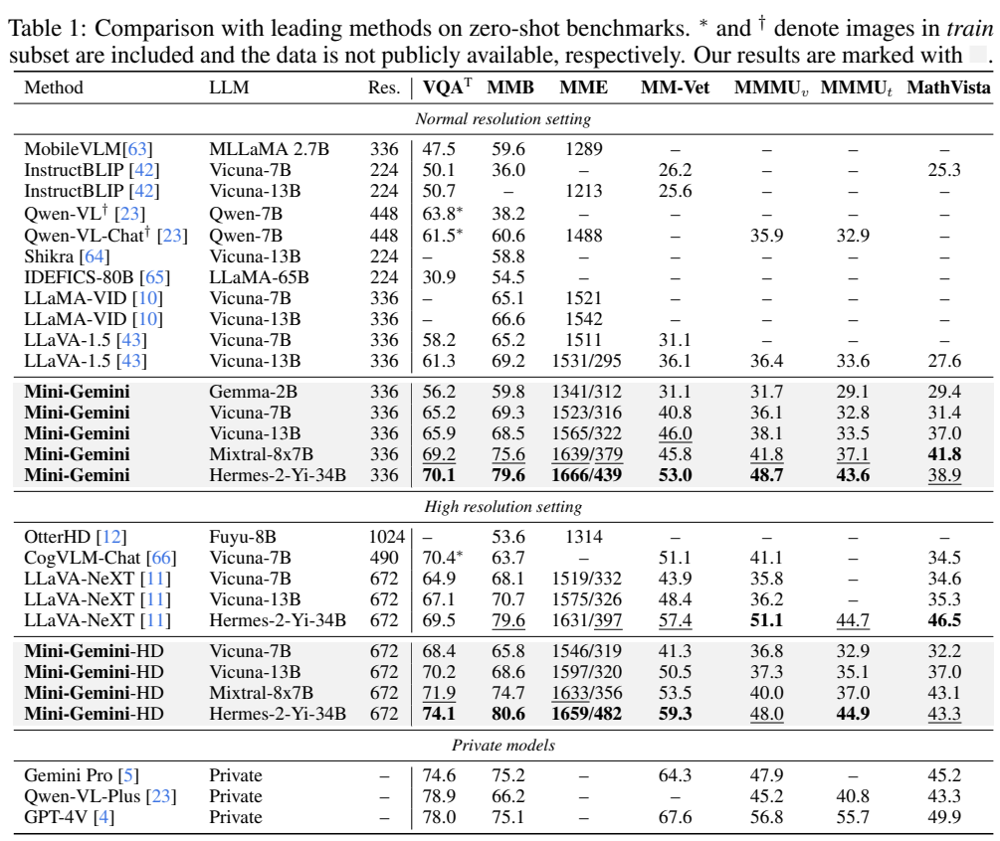
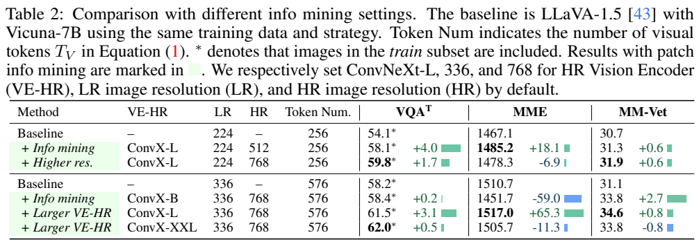
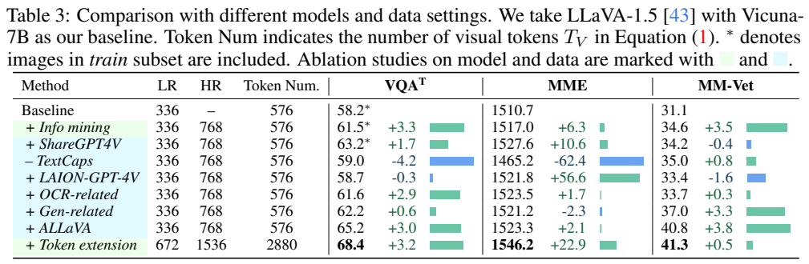

<!-- article-header:start -->
[项目首页](../../../README.md) › [模型系列](../../../reports/model-family-index.md) › [Mini-Gemini](../README.md)
<!-- article-header:end -->

# Mini-Gemini：双视觉编码器、局部信息挖掘与语言驱动生图

<!-- article-toc:start -->
<a id="article-toc"></a>

**本篇目录** · [论文定位](#paper-info) · [快速概览](#overview) · [整体架构](#architecture) · [核心原理](#principles) · [数据构建](#data) · [训练流程](#training) · [实验结果](#experiments)
<!-- article-toc:end -->

<a id="paper-info"></a>

## 1. 论文信息与模型定位

**论文**：*Mini-Gemini: Mining the Potential of Multi-modality Vision Language Models*；**作者**：Yanwei Li、Yuechen Zhang、Chengyao Wang、Zhisheng Zhong、Yixin Chen、Ruihang Chu、Shaoteng Liu、Jiaya Jia；**机构**：香港中文大学、思谋科技；**版本**：[arXiv:2403.18814v1](https://arxiv.org/abs/2403.18814v1)，2024 年 3 月 27 日；**项目**：[dvlab-research/MiniGemini](https://github.com/dvlab-research/MiniGemini)。本文依据首版 19 页报告。

Mini-Gemini 是研究团队提出的视觉语言框架，与 Google Gemini 系列不是同一个模型。它用低分辨率 ViT 与高分辨率卷积编码器协作，增强图像细节读取；通过多来源指令数据提升问答；再让语言模型写出适合扩散模型的提示，支持图文输出。报告实例涵盖 Gemma-2B、Vicuna-7B/13B、Mixtral-8×7B、Hermes-2-Yi-34B。[原文 §1、§3、Table 1](https://arxiv.org/pdf/2403.18814v1#page=1)

“any-to-any”在首版指图像和文字之间的输入输出流程，没有扩展到所有声音、视频模态。生图依赖外部 SDXL 等生成器，语言模型本身主要负责理解、推理和提示改写。

<a id="overview"></a>

## 2. 快速概览

| 要点 | 实际方案 |
|---|---|
| 低分辨率视觉路径 | CLIP ViT-L，生成用于语言模型的查询 token |
| 高分辨率路径 | LAION 预训练 ConvNeXt-L，多尺度特征提供局部细节 |
| 信息挖掘 | 低分辨率 patch 只向对应高分辨率窗口做交叉注意力 |
| 默认分辨率 | LR 336、HR 768；576 个视觉 token |
| HD 扩展 | LR 672、HR 1536；整图加四块子图，共 2880 token |
| 数据 | 约 1.2M 对齐 caption、1.5M 理解对话、13K 生图提示指令 |
| 参数更新 | 两个视觉编码器均冻结；投影层两阶段更新，语言模型在指令阶段更新 |
| 生图机制 | 生成并提取文字提示，再调用 SDXL，无额外像素生成头 |

框架提供一个实用权衡：将细密视觉特征留在编码与局部交互阶段，避免直接把全部高分辨率特征送入语言模型。但这不代表所有版本的 token 都固定；HD 为更多细节主动提高了语言序列长度。

<a id="architecture"></a>

## 3. 整体架构



**读图方式**：绿色路径读取高分辨率图像，蓝色路径读取下采样图像；局部交叉注意力把两者合成 mined tokens，再与文字一起输入 LLM。最右侧 SDXL 是可选外部组件，输入由 LLM 产生的文字提示，不是 LLM 输出的像素或图像离散 token。

高分辨率图像经双线性插值产生低分辨率副本。ViT-L 保留低分辨率 patch 间的关系，高分辨率 ConvNeXt-L 则从多层卷积特征中提取细节，将不同阶段上采样并拼接到输入的 1/4 尺度。每个低分辨率 patch 对应一个高分辨率局部窗口，形成查询、键、值的配对。[原文 §3.1，PDF 第 4 页](https://arxiv.org/pdf/2403.18814v1#page=4)

语言模型接收增强视觉 token 和文字指令，输出回答。如果指令要求图片，系统用 `<GEN>` 触发生成，目标图片描述包在 `<h>...</h>` 内，提取后交给 SDXL。这个接口通过文字连接两类模型，无须把 LLM 隐层额外对齐到扩散模型隐藏空间。它也保留了扩散模型自身的限制：提示正确不保证每个图像细节都生成正确。[原文 §3.3，PDF 第 5 页](https://arxiv.org/pdf/2403.18814v1#page=5)

| 模块 | 输入与输出 | 公开机制 |
|---|---|---|
| 低分辨率ViT | 缩图 → N查询 | CLIP式ViT保留长程patch关系，提供语义查询。 |
| 高分辨率CNN | 原图 → 密集特征 | ConvNeXt多stage上采样拼接，提供局部候选细节。 |
| Patch Info Mining | 查询及对应HR窗口 → N增强token | 局部cross-attention加残差，再MLP映射；固定查询数不扩展LLM长度。 |
| 可选HD扩展 | 整图与四块 → 5N查询 | 改变LR查询预算，故不同于固定N的细节增强。 |
| 语言与SDXL | 上下文 → 文字或生图提示 → 图片 | GEN及h标记指定提示区域，外部扩散模型执行生图。 |

[模块依据：v1 §3.1–3.3，PDF第4–5页](https://arxiv.org/pdf/2403.18814v1)。

<a id="principles"></a>

## 4. 核心创新与数学原理

### 4.1 局部候选与低分辨率查询的互补



**读图方式**：左图每个低分辨率查询只读取相应窗口里的 $`M^2`$ 个高分辨率候选，输出仍为 $`N`$ 个 token；右图把放大的图像切成四块，并保留原整图，低分辨率编码器由此处理五张图，输出扩展为 $`5N`$。右图不是左图“固定 token”条件下的同一配置。

原文令低分辨率查询 $`Q\in\mathbb R^{N\times C}`$，键与值为 $`K,V\in\mathbb R^{N\times M^2\times C}`$，其中 $`N`$ 为低分辨率 patch 数。Eq. (1) 为：


```math
T_V=\mathrm{MLP}\left(Q+\mathrm{Softmax}(\phi(Q)\phi(K)^T)\phi(V)\right).
```


$`\phi`$ 为投影，MLP 进一步映射。乘法应按各 patch 的对应窗口理解：一个查询对自己窗口内候选赋权，再聚合值特征，与原查询残差相加。原文没有在公式里写注意力缩放因子，本文保留原式，不补成作者已披露的 $`1/\sqrt d`$ 配置。[原文 §3.2、Eq. (1)](https://arxiv.org/pdf/2403.18814v1#page=4)

低分辨率ViT给每个查询较大范围的语义上下文，高分辨率CNN则给对应区域更密候选。局部匹配不是让全部HR特征互相竞争一个全局摘要，而是给每个LR位置补细节。空间对应依赖两路的缩放与窗口组织，若目标已在HR入口中不可辨认，注意力也不能凭空创造其文字。 [§3.1–3.2，第4页](https://arxiv.org/pdf/2403.18814v1)

### 4.2 固定查询预算与HD扩展的区别

这让低分辨率 token 同时含粗语义与高分辨率细节。局部窗口限制候选范围，减少把全部 HR 特征展开为全局语言序列的成本。固定 $`N`$ 时，即使 HR 候选更密，LLM 输入视觉 token 数仍为 $`N`$；但高分辨率编码和局部注意力本身仍增加运算，论文也没有证明总计算不变。

HD 采用整图加四块子图，在表中从 **576** 增至 **2880** token。它能保留全图背景及局部细节，但语言模型上下文与训练成本也增大。因此，论文的“无额外视觉 token”应限于固定 LR 查询数下增加 HR 细节的机制，不能推广到 HD 对比。

固定N配置仅增加每个查询可读取的高分辨率证据，后续LLM的视觉位置数不变；HD配置则同时增加查询数，允许更多区域独立表达。这是两种不同容量扩展，前者多付视觉计算，后者还多付语言长序列成本。比较576与2880结果时需要保留这条区别。 [§3.2、Figure3，第4页](https://arxiv.org/pdf/2403.18814v1)

### 4.3 提示级对齐如何复用外部生成器

生图创新主要在语言提示域：不是对齐两个模型的隐向量，而是让 LLM 将用户指令、图像和对话上下文转换为扩散模型可用的描述。只需文字监督即可学习该接口；13K 指令并不是从头训练一个高质量扩散模型所需的图像数据量。[原文 §3.3、§5](https://arxiv.org/pdf/2403.18814v1#page=5)

语言模型把含图像和对话的请求改写为扩散模型适用的描述，训练目标仍是提示文字。13K生成指令包括简单重述和利用上下文构造提示，不要求反传SDXL像素损失。这个接口方便复用生成器，但最终图像对对象数量、布局和文字的遵循还取决于外部模型。 [§3.3、Figure4，第5页](https://arxiv.org/pdf/2403.18814v1)

<a id="data"></a>

## 5. 数据构建与处理

对齐数据由 LLaVA 过滤的 CC3M **558K** 图文对，加 ALLaVA 抽样的 GPT-4V 描述 **695K** 构成，正文约称 1.2M。指令数据包括 LLaVA **643K** 对话、ShareGPT4V **100K**、LAION-GPT-4V **10K**、ALLaVA **700K** 和 LIMA/OpenAssistant2 **6K** 纯文字多轮对话。作者移除 LLaVA 中 **21K TextCaps**，并加入 **28K** 文档/图表/示意图 QA：DocVQA 10K、ChartQA 4K、DVQA 10K、AI2D 4K。总量约 1.5M，而非逐项约数严格相加得到的精确总数。[原文 §3.3，PDF 第 5 页](https://arxiv.org/pdf/2403.18814v1#page=5)

OCR 相关数据先由 PaddleOCR 提取图中文字，按参考 OCR token 格式附到对话中，辅助学习文字与视觉信息。附录明确 OCR 检测器只用于丰富训练数据，**测试时不使用该检测器**。这与测试时调用 OCR 工具辅助回答不同。[原文 Appendix A，PDF 第 11 页](https://arxiv.org/pdf/2403.18814v1#page=11)

生图指令由 GPT-4 Turbo 构造 **13K**。其中 **8K** 根据 LAION-GPT-4V 描述反推简短用户指令及扩散提示；**5K** 根据真实文字对话生成每轮适合展示的图片提示。每次提供五个高质量 Stable Diffusion 示例提示作上下文，并过滤不符合目标格式的结果。附录 Figure 7 报告这批 GPT-4 API 费用约 **80 美元**，是当时该数据构造的作者成本，不是完整模型训练成本或当前 API 报价。[原文 §3.3、Appendix A、Figure 7，PDF 第 5、11–12 页](https://arxiv.org/pdf/2403.18814v1#page=11)

报告公开了来源与构造方式，但没有完整展示所有数据的去重、污染审计和人工审核率。TextCaps 移除用于区分含 TextVQA 训练图像的设置，不能据此推断所有基准都已全面完成训练污染排查。

<a id="training"></a>

## 6. 训练流程与目标

先以 caption 进行模态对齐，再以理解与生成指令微调。两个视觉编码器全程固定，patch 信息挖掘的投影层在两个阶段均更新，语言模型只在指令微调阶段更新。作者采用 AdamW、余弦学习率，每阶段按报告方案训练 **1 epoch**；通常对齐学习率 **1×10⁻³**、指令阶段 **2×10⁻⁵**，Mixtral-8×7B 和 Hermes-2-Yi-34B 的指令学习率降为 **1×10⁻⁵**。[原文 §4.1，PDF 第 6 页](https://arxiv.org/pdf/2403.18814v1#page=6)

标准设备配置为一台 **8×A800** 机器。34B 版本使用 **4 台机器**、DeepSpeed ZeRO-3，约 **2 天**；HD 版本因视觉 token 扩展约 **4 天**。这说明高分辨率候选与低分辨率 token 控制降低部分开销，却不抹平大模型与长序列的训练成本。首版未完整列出 batch size、最大序列长度、梯度累积、优化器全部参数及各数据采样权重，本文不补造。

对齐与 SFT 都让语言模型按输入生成目标文字。可将学习含义解释为降低 $`-\sum_t\log p_\theta(y_t\mid T_V,u,y_{\lt t})`$，其中 $`T_V`$ 为增强视觉 token，$`u`$ 为指令。该式是本文对生成式监督的说明，原文未给出完整 token 掩码损失实现。生图训练目标是目标**提示文字**，不是 SDXL 的噪声预测损失；报告没有联合微调 SDXL 的训练流程。

本仓库只整理原文，没有重新训练、调用生成模型或测量推理成本。

<a id="experiments"></a>

## 7. 实验设置与主要结果



**读表方式**：MMMU 的 v、t 分别为验证、测试，不能混读；MME 用感知/认知并列，斜杠不是单一百分比。星号表示包含训练子集图像，匕首表示数据未公开。表中的 Res. 主要表示 LR 配置，不能当作模型从未读取 HR 图像。

| 指标 | Mini-Gemini 34B | Mini-Gemini-HD 34B | GPT-4V（原表） |
|---|---:|---:|---:|
| TextVQA | 70.1 | 74.1 | 78.0 |
| MMBench | 79.6 | 80.6 | 75.1 |
| MME 感知/认知 | 1666/439 | 1659/482 | 未列 |
| MM-Vet | 53.0 | 59.3 | 67.6 |
| MMMU val | 48.7 | 48.0 | 56.8 |
| MMMU test | 43.6 | 44.9 | 55.7 |
| MathVista | 38.9 | 43.3 | 49.9 |

34B-HD 在 MMBench 超过表中 GPT-4V 与 Gemini Pro，但在 MMMU、MM-Vet、MathVista、TextVQA 并未超过 GPT-4V。原文引言有较宽泛的领先描述，本文按 Table 1 限定结论。HD 也并非所有指标单调提高：34B 的 MMMU val 从 48.7 降到 48.0，MME 感知从 1666 到 1659。[原文 Table 1、§4.2](https://arxiv.org/pdf/2403.18814v1#page=6)

7B 普通配置的 TextVQA/MM-Vet 为 **65.2/40.8**，相较表中 LLaVA-1.5 **58.2/31.1** 提高。Vicuna-13B 的 MMBench 却为 68.5，低于 LLaVA-1.5 的 69.2，因此“相同语言底座全部基准都超过”也不完全符合表格。





**读表方式**：各行多为逐项添加数据或改变配置的累计实验，星号标记含训练图像；蓝色负值说明某些指标下降。Table 3 最后一行 token 从 576 到 2880，不能把末行全部提升归给固定 token 的信息挖掘。

在 336/768、576 token 下，信息挖掘将 TextVQA 从 58.2* 到 61.5*、MM-Vet 从 31.1 到 34.6。将 ConvNeXt-L 换成 XXL，TextVQA 再提高到 62.0*，但 MME 和 MM-Vet 下降，说明更大 HR 骨干不是全面改善。移除 TextCaps 后，TextVQA 从 63.2* 到 **59.0**，提醒读者训练图像包含条件会影响“零样本”比较。后续加入 OCR、生成指令、ALLaVA，最终普通版 TextVQA **65.2**、MM-Vet **40.8**；扩展 token 后为 **68.4/41.3**。[原文 Table 2–3，PDF 第 7 页](https://arxiv.org/pdf/2403.18814v1#page=7)

13K 生成指令加入后的 MM-Vet 从 33.7 到 37.0，但 MME 从 1523.5 到 1521.2。报告用若干生成示例展示上下文提示与外部生成器协同，没有 FID、GenEval 或人类偏好总体统计，也没有证明所有生图任务胜过比较方法。附录明确展示了计数失败，结论也承认计数与复杂视觉推理仍不足。[原文 §4.4、§5、Figure 8，PDF 第 8、11、13 页](https://arxiv.org/pdf/2403.18814v1#page=11)

Mini-Gemini 的贡献因此更适合理解为可迁移的视觉信息补充与提示接口：它在若干理解基准中取得实质改善，生成应用仍主要由定性案例支撑；跨模型 API 条件、推理预算与统计不确定性未完整展开，不能由单个领先分数推断全能力领先。

<!-- article-footer:start -->
---

[← 上一篇：LITA](../../lita/arxiv-2403.19046/README.md) · [按发表时间浏览](../../../reports/paper-reading-guide.md#year-2024) · [下一篇：VITRON →](../../vitron/document-f588b0cc5a2b/README.md)

[返回本篇目录](#article-toc) · [返回模型系列](../README.md)
<!-- article-footer:end -->
