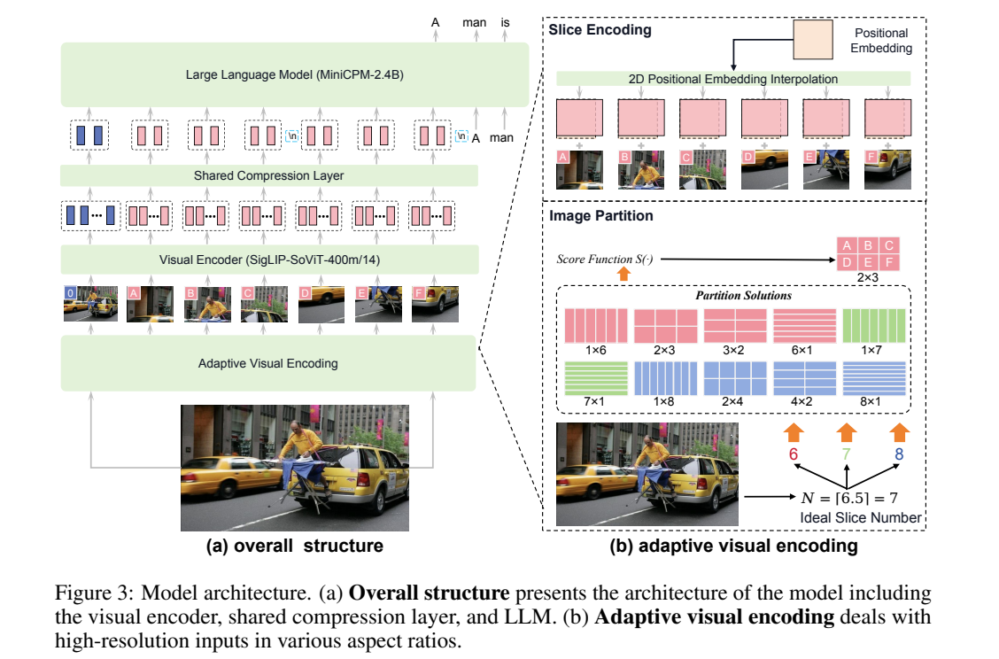
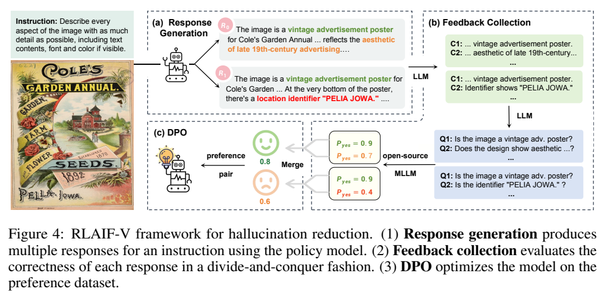
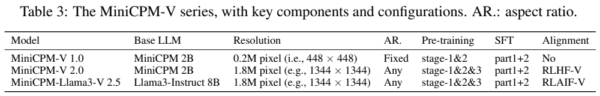
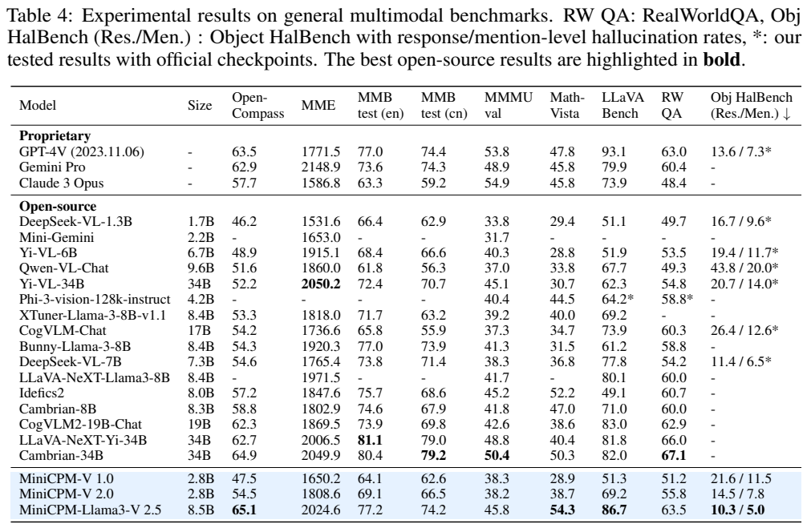
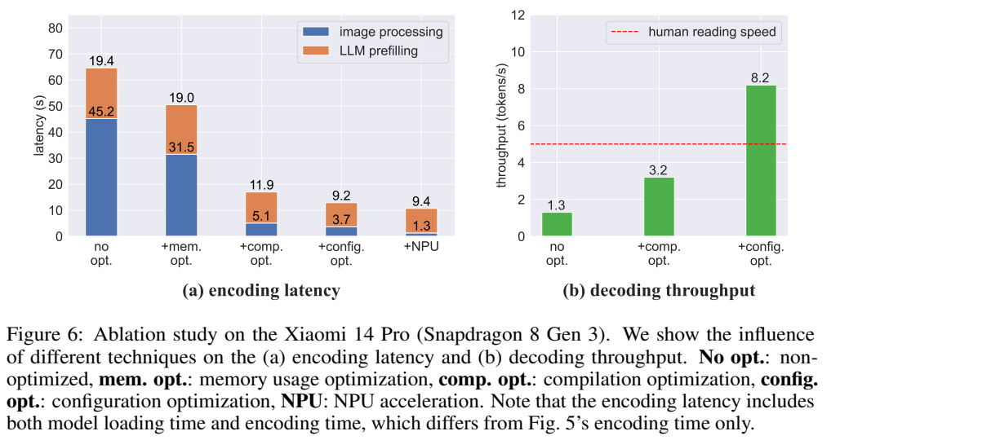

# MiniCPM-V：面向端侧的高分辨率视觉语言模型

## 1. 论文信息与模型定位

**MiniCPM-V: A GPT-4V Level MLLM on Your Phone**，Yuan Yao、Tianyu Yu、Ao Zhang 等，署名 MiniCPM-V Team、OpenBMB。本文依据 [arXiv 2408.01800v1](https://arxiv.org/abs/2408.01800v1)（2024 年 8 月 3 日，26 页）整理。[官方仓库](https://github.com/OpenBMB/MiniCPM-V)见原文首页。

报告介绍 MiniCPM-V 1.0、2.0 和 MiniCPM-Llama3-V 2.5，重点以 2.5 展开。这些版本接受图像与文字、输出文本；视频与音频扩展在原稿中属于未来工作，不能把后续 MiniCPM-o 的能力归入它。标题的“GPT-4V level”对应指定时期模型及 OpenCompass 基准结果，并不表示所有场景等同于 GPT-4V。

## 2. 快速概览

- **高分辨率切片**：保持宽高比，将图像切成匹配视觉预训练分布的局部块，并加入整体图像。
- **低视觉 token 预算**：共享单层交叉注意力压缩器，每块输出 64 或 96 个 token，减少语言模型前缀开销。
- **反馈对齐**：2.5 使用开源 AI 对回答中的原子陈述评分，再以 DPO 减少幻觉。
- **端侧工程**：量化、顺序加载、设备上编译、配置搜索和 NPU 视觉编码共同优化；8.2 token/s 不等于图像问答全程实时。

## 3. 整体架构

视觉编码器为 **SigLIP SoViT-400m/14**，压缩层为单层 cross-attention 的 Perceiver Resampler。图像切片独立编码，共享压缩器把各块特征变成少量视觉向量，再与文本进入语言模型。Figure 3 用 MiniCPM 语言骨干示意系列结构；2.5 的实际骨干是 **Llama3-Instruct-8B**，并非图中写出的 MiniCPM-2.4B。

1.0/2.0 的语言骨干在 Table 3 中称 MiniCPM 2B，全模型 Table 4 为 **2.8B**；2.5 全模型为 **8.5B**。语言模型简称与整体参数量应区分。1.0 使用固定 448×448 输入，不启用自适应切片；2.0/2.5 支持约 **1.8M 像素**与任意宽高比。

每个高分辨率块约含 1024 个视觉 token，经压缩后，1.0/2.0 每块 64 个、2.5 每块 96 个。报告给出 2.5 的视觉 token 范围 **96–960**，低于其比较的 LLaVA-NeXT-Llama3-8B **1728–2880**。这减少语言端计算，但不能认为视觉编码器无需处理原图细节。

## 4. 核心创新与数学原理

设原图尺寸为 $(W_I,H_I)$、视觉预训练尺寸为 $(W_v,H_v)$，理想切片数为 $N=\lceil W_IH_I/(W_vH_v)\rceil$。对于列数 $m$、行数 $n$，原文式 1 给出宽高比匹配分数：

$$
S(m,n)=-\left|\log\frac{W_I/m}{H_I/n}-\log\frac{W_v}{H_v}\right|.
$$

式 2 选最高分的划分。为避免素数切片数量只能形成极端长条，候选包含乘积为 $N-1,N,N+1$ 的网格；实践中限制 $N<10$。切片按比例缩放到与预训练相近的面积，将位置嵌入从一维还原为二维并插值，避免直接拉伸到正方形。整体缩略图提供全局信息，局部块提供细节；`<slice>` 起止标记和换行 token 表达空间布局。

RLAIF-V 对同一指令高温采样 **10** 个回答，用 Llama-3-8B 拆成原子陈述，再转换成 yes/no 问题交给视觉裁判。2.5 的裁判为 **LLaVA-NeXT-Yi-34B**；正文还提到为 2.0 使用 OmniLMM-12B。最终回答分数写为 $s_i=-n_{\rm rej}$，即不成立陈述越多分越低。图中概率示意和正文计数分数是不同呈现，不应把图中 0.8/0.6 当作全文唯一评分公式。

依据相对分数随机配成偏好对，以 DPO 学习。其标准原理可解释为增加获胜回答相对参考策略的对数概率优势；若用公式表示，则是 $-\log\sigma(\beta[\log\pi_\theta(y_w|x)/\pi_{\rm ref}(y_w|x)-\log\pi_\theta(y_l|x)/\pi_{\rm ref}(y_l|x)])$。这是对报告所用 DPO 的通用解释，报告未提供该式的编号与具体 $\beta$，本文不虚构其取值。

此外，4-bit 量化用式 3 的 $w'_i=\operatorname{round}(w_i/s)$ 概括缩放与离散化；实际采用 GGML **Q4_K_M**，并不等同于每层所有张量都只占精确 4 bit。

## 5. 数据构建与处理

Table 1 的预训练资源包括英文描述 **410M**、中文描述 **110M**、英文 OCR/知识 **39M**、中文 OCR/知识 **11M**。来源涵盖 COCO、VG、CC3M/12M、LAION、COYO、WuKong、WIT、IDL、SynthText、SynthDoG、ArxivCap 等；LAION-2B-OCR 由 OCR 工具处理图像生成。这是各类资源规模，不能把相加数直接当作每个阶段实际消费量。

先清除弱图文相关与格式异常例子。低质量 caption 用辅助语言模型重写为问答并取回答作为新描述；该模型由 GPT-4 标注少量种子训练，不能称全量数据都经 GPT-4 看图验证。Packing 将不同长度样本塞入固定序列，通过位置 ID 与注意力掩码隔离样本，截断最后一个例子；作者报告预训练加速 2–3 倍，但没有统一硬件条件下的完整成本表。

SFT 分两部分顺序训练。Part 1 为短描述、VQA、知识、定位、推理、数学、OCR、对话，Table 2 中 VQA 1.4M、OCR 1.7M、定位 570K。Part 2 加入长回答与复杂指令，包含 Part 1 抽样 400K、OCR 690K、指令 1.9M，以及未给完整数量的文本指令。2.5 还加 **2M Cauldron** 与 **90K、36 种语言**的多语数据。

反馈集包含 **3K 独立图像、6K 偏好对**，依靠 AI 裁判而非每条人工纠错。多语路线先中英图文预训练，再用少量高质量多语 SFT 迁移语言骨干能力；不能理解成 36 种语言都具备同样丰富的视觉训练数据。

## 6. 训练流程与目标

预训练分三步：第一步只训练随机初始化压缩层，冻结 ViT 与 LLM，224×224 输入、随机选取 200M 描述数据；第二步将分辨率提升到 448×448，**仅训练视觉编码器**，其他模块冻结，另外选 200M 描述数据；第三步训练 ViT 与压缩层、冻结 LLM，启用自适应切片并加入 OCR。第二步不应误写为同时训练压缩层。

SFT 解锁全部模型参数，并先基础短答、后复杂长答。2.5 再做 RLAIF-V。Table 3 将 2.0 对齐方式标为 RLHF-V，而正文 RLAIF-V 段也描述 2.0 的 AI 裁判设置，版本表达并不完全一致；本文按表区分发布配置，不将所有版本统一成同一种反馈方法。报告没有充分提供训练学习率、优化器、批量、epoch 与 GPU 小时。

部署方面，2.5 FP16 内存约 **16–17G**，Q4_K_M 降到约 **5G**。ViT 与 LLM 顺序加载减少内存换页；在目标设备编译、搜索 CPU 配置进一步加速。小米 14 Pro 上将 ViT 后端换为 QNN 使用 NPU，LLM 保留 llama.cpp。NPU 这里主要加速视觉编码，而不是已经全面加速语言解码。

## 7. 实验设置与主要结果

Table 4 的 OpenCompass 是 11 个多模态基准的综合指标；星号为作者用官方 checkpoint 重测。GPT-4V 对照明确为 **2023.11.06** 版本，不能与更新 GPT-4V/GPT-4o 混同。

| 模型 | 总参数 | OpenCompass | MMMU val | MathVista | Object HalBench 响应/陈述幻觉率 ↓ |
|---|---:|---:|---:|---:|---:|
| MiniCPM-V 1.0 | 2.8B | 47.5 | 38.3 | 28.9 | 21.6/11.5 |
| MiniCPM-V 2.0 | 2.8B | 54.5 | 38.2 | 38.7 | 14.5/7.8 |
| MiniCPM-Llama3-V 2.5 | 8.5B | 65.1 | 45.8 | 54.3 | 10.3/5.0 |
| GPT-4V-1106 | 未公开 | 63.5 | 53.8 | 47.8 | 13.6/7.3* |

2.5 综合分高 1.6 点、MathVista 高 6.5 点，但 MMMU 低 8.0 点；LLaVA Bench **86.7** 也低于 GPT-4V **93.1**。因此不能写全面超过。其 MMBench 英/中 test **77.2/74.2**、MME **2024.6**、RealWorldQA **63.5**。MME 是原表组合分数，不能当百分准确率。

Table 5 的 OCRBench/TextVQA val/DocVQA test：2.5 **725/76.6/84.8**，2.0 **605/74.1/71.9**，GPT-4V **645/78.0/88.4**。2.5 OCRBench 更高，但另外两项低于 GPT-4V；OCRBench 725 的尺度也不能与其他表的百分数直接比较。

Table 6 的 RLAIF 消融 OpenCompass **64.5→65.1**，但 MME **2039.8→2024.6**、MMMU **46.2→45.8**。该表 Object HalBench 写 **86.9/93.6→89.7/95.0**，与 Table 4 幻觉率方向相反、数值互补；这里按无幻觉比例理解其对应的下降趋势，不把 89.7 写成幻觉率。多语 Table 7 中德语 **22.8→76.5**、日语 **13.8→88.0**；评测把 LLaVA Bench 参考回答翻译后由 GPT-4-Turbo 打分，既不是人工语言资格认证，也不证明所有领域的多语能力。

Figure 6 的图像处理从 **45.2s** 经顺序加载变为 **31.5s**，编译后 **5.1s**，配置优化 **3.7s**，NPU **1.3s**；解码从 **1.3** 到 **3.2** 再到 **8.2 token/s**。最终还存在 LLM prefilling **9.4s**，所以 1.3s 仅是图像部分，不能当完整首 token 延迟。图注明这些延迟包含模型加载，与 Figure 5 仅编码的口径不同；初始正文 64.2s 与图中 45.2+19.4=64.6s 还有小差异。

Figure 7 的 vivo X100 Pro/Mac M1 解码 **4.9/16.9 token/s** 属于不同设备配置，不能把最高值推广到全部手机。报告未给出全面续航与持续热负载评测，仍承认电池、延迟和能力范围的限制。它提供了性能、压缩与工程优化共同实现端侧部署的证据，并未证明已经达到通用实时助手体验。本文未运行模型或复现手机实验。
