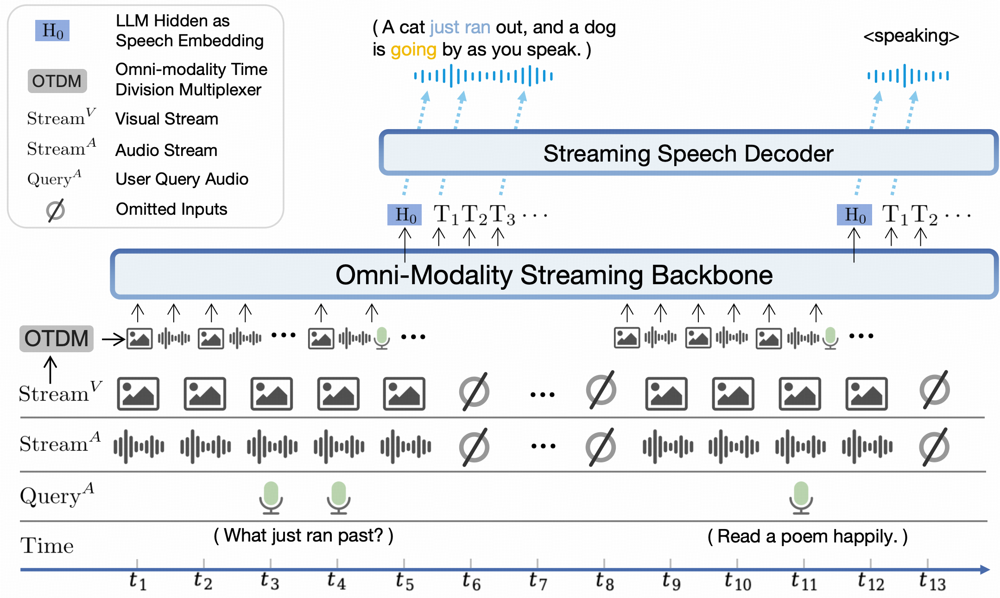

<!-- article-header:start -->
[项目首页](../../../README.md) › [模型系列](../../../reports/model-family-index.md) › [MiniCPM-V / MiniCPM-o](../README.md)
<!-- article-header:end -->

# MiniCPM-o 2.6：把视觉、声音与语音输出接入流式语言骨干

<!-- article-toc:start -->
<a id="article-toc"></a>

**本篇目录** · [论文定位](#paper-info) · [快速概览](#overview) · [整体架构](#architecture) · [核心原理](#principles) · [数据构建](#data) · [训练流程](#training) · [实验结果](#experiments)
<!-- article-toc:end -->

<a id="paper-info"></a>

## 1. 论文信息与模型定位

| 项目 | 信息 |
|---|---|
| 官方标题 | **MiniCPM-o 2.6: A GPT-4o Level MLLM for Vision, Speech and Multimodal Live Streaming on Your Phone** |
| 团队 | OpenBMB、清华大学、面壁智能 |
| 技术资料日期 | 官方模型卡于**2025-01-24**公告技术报告/博客发布 |
| 本文固定资料 | [官方技术指南](https://github.com/OpenBMB/MiniCPM-V/blob/1d6b7d68379974af0375cfdb903613d630da34aa/docs/minicpm_o2dot6_en.md)，commit `1d6b7d68379974af0375cfdb903613d630da34aa` |
| 补充资料 | [官方模型卡](https://huggingface.co/openbmb/MiniCPM-o-2_6) · [官方仓库](https://github.com/OpenBMB/MiniCPM-V) |
| 规模与模态 | 约8B；图像、视频、音频、文字输入，文字与语音输出 |

本条目是官方技术指南与模型卡的介绍。模型卡所称technical report指向官方Notion技术博客；本文没有将MiniCPM-V的2408.01800论文误标为本代独立报告。2.6的核心增量是把视觉理解扩展成全模态端到端交互，并以时间片组织持续输入。后续MiniCPM-o4.5的全双工机制属于另一版本，不能直接回填到2.6。

<a id="overview"></a>

## 2. 快速概览

| 关键设计 | 公开内容 | 实际作用 |
|---|---|---|
| 多模态底座 | SigLIP-400M、Whisper-medium-300M、ChatTTS-200M、Qwen2.5-7B | 将图像、听觉、语言与语音生成组合在约8B系统中 |
| TDM流式处理 | 把并行模态流分为周期性时间片，再顺序送入LLM | 持续接收场景信息，不必每次都先收完整段视频 |
| 声音控制 | 文字系统提示加音频系统提示 | 以参考声音和文字要求调整语音交互 |
| 视觉token密度 | 约1.8M像素对应640个视觉token | 控制语言上下文中的视觉预算；压缩不等于无损 |

官方表的OpenCompass平均70.2、OCRBench897及StreamingBench66.0分别衡量单图、文字视觉及流式理解；它们不是统一量纲的三项准确率。[官方指南：Introduction / Evaluation](https://github.com/OpenBMB/MiniCPM-V/blob/1d6b7d68379974af0375cfdb903613d630da34aa/docs/minicpm_o2dot6_en.md)

<a id="architecture"></a>

## 3. 整体架构



*原文件`assets/minicpm-o-26-framework-v2.png`；图例、时间轴和全部输入/输出路径保留。*

沿时间轴看，底部的视觉流、环境音频流与用户语音问题来自不同来源，OTDM（Omni-modality Time Division Multiplexer）将其组织成LLM可按顺序读取的片段。中间骨干输出文字token及隐藏状态，顶部Streaming Speech Decoder据此产生语音。图中的斜线圆圈表示省略的输入，不是模型一定在该时刻停止接收所有模态。[Model Architecture及原图](https://github.com/OpenBMB/MiniCPM-V/blob/1d6b7d68379974af0375cfdb903613d630da34aa/docs/minicpm_o2dot6_en.md)

| 模块 | 输入与输出 | 公开机制 |
|---|---|---|
| 视觉入口 | 图像 / 视频帧 → 视觉条件 | SigLIP-400M；支持多图、视频与高分辨率压缩表示 |
| 音频入口 | 环境声音 / 用户语音 → 听觉条件 | Whisper-medium-300M为基础音频组件；编码接口被改造成在线处理 |
| OTDM组织器 | 各模态并行片段 → 按时间片排序的输入 | 时分复用，在小周期内把不同模态信息串行化 |
| Qwen2.5-7B骨干 | 视觉、音频、文字条件 → 文字及隐藏状态 | 全模态流式语言骨干；统一利用累积上下文 |
| 流式语音出口 | LLM隐藏状态与文字 → 音频流 | 基于ChatTTS-200M组件；图中以H0标示用于语音的LLM隐藏表示 |
| 系统提示接口 | 文字角色要求及音频提示 → 语音风格条件 | 支持参考声音、声音配置和描述式控制 |

一次“刚才跑过去的是什么”问答先积累视频帧与声音片段，再将用户语音问题放入时间序列，骨干根据近期上下文回答，并通过语音出口播放。它不像先做完整ASR、把全部视觉内容翻成文字、最后交给独立聊天模型的固定三级管线。官方指南没有逐项展开视觉连接器和音频适配器的全部维度，本文仅保留已公开组件与数据流。

<a id="principles"></a>

## 4. 核心创新与数学原理

### 4.1 TDM：把并行感知转换成可持续的序列条件

LLM按序列处理，而摄像头、麦克风和用户问题可以同时产生信息。TDM的作用是建立小周期的输入组织规则，避免先把整段视觉流处理完才看到相邻音频。可用下式表示其组织思想，属于本文说明性记号：

```math
C_k=\mathrm{pack}(V_k,A_k,Q_k),\qquad C_{1:k}=[C_1;\ldots;C_k].
```

$`V_k`$、$`A_k`$、$`Q_k`$分别表示第$`k`$个时间片的视觉、音频、查询条件；空缺模态可省略，$`\mathrm{pack}`$仅表示按协议组织。原指南没有给出每个时间片的精确时长、缓存淘汰规则或最坏延迟，上式不假定所有模态恰好等长。时间片越细越利于及时响应，但会增加编码调用与上下文管理成本，最终延迟还依赖模型、设备和语音输出。[Model Architecture](https://github.com/OpenBMB/MiniCPM-V/blob/1d6b7d68379974af0375cfdb903613d630da34aa/docs/minicpm_o2dot6_en.md)

### 4.2 文字、隐藏状态与语音生成的分工

原图把$`H_0`$标作“LLM Hidden as Speech Embedding”，同时将文字token送往语音解码器。文字提供说什么，隐藏状态可以提供文字之外的语义条件；音频系统提示则指定声音。它们是不同的控制入口，不能把声纹相似、语义正确和自然度归为单一指标。

这种设计支持参考声音和描述式语音控制，但声音配置并不保证声纹完全一致。官方Seed-TTS相似度评测中，2.6仍低于表中的专用TTS模型，显示全模态统一与单任务精度之间存在取舍。[Model Architecture / End-to-end Voice Cloning](https://github.com/OpenBMB/MiniCPM-V/blob/1d6b7d68379974af0375cfdb903613d630da34aa/docs/minicpm_o2dot6_en.md)

### 4.3 高视觉token密度控制语言端成本

官方定义token密度为最大分辨率像素数除以视觉token数。用约1.8M像素和640token计算，约为每token2822像素，与表中密度一致；它表达单位语言位置概括的视觉范围，不是视觉编码器的patch边长。较短视觉序列有利于多图与持续视频条件，但不能仅凭这个比值推导全模型FLOPs、识别率或相同硬件下的固定加速倍数。[Superior Efficiency / Evaluation脚注](https://github.com/OpenBMB/MiniCPM-V/blob/1d6b7d68379974af0375cfdb903613d630da34aa/docs/minicpm_o2dot6_en.md)

### 4.4 端到端CE声明与后训练披露边界

官方Architecture说明各模态接口端到端训练，并使用CE损失。对离散预测部分，可用一般形式理解：

```math
\mathcal L_{\mathrm{CE}}=-\sum_{t\in\mathcal S}\log p_\theta(z_t\mid C,z_{\lt t}).
```

$`C`$是多模态条件，$`\mathcal S`$是实际有监督的位置。该式解释交叉熵预测，不声称是本模型所有语音声学模块的完整目标。资料还提及RLAIF-V与VisCPM，但没有给出本代各阶段的完整损失、冻结清单和权重；不能将引用方法的全部默认配方直接写成本版已验证事实。

<a id="data"></a>

## 5. 数据构建与处理

公开指南没有给出可重建训练集的总量、来源配比、全部教师模型与清洗阈值。能确定的是模型围绕单图、多图、视频、声音理解和语音交互训练，并将多语言能力联系到VisCPM、可信行为联系到RLAIF-V。相关技术引用为训练路线提供背景，不能代替本代语料清单。[Introduction及项目引用](https://github.com/OpenBMB/MiniCPM-V/blob/1d6b7d68379974af0375cfdb903613d630da34aa/docs/minicpm_o2dot6_en.md)

对输入处理，已明确支持任意宽高比和约1.8M像素图像，并将离线模态编解码器改成在线接口。视频和音频需要按时间段进入TDM，用户语音与环境音频的角色也需区分。源指南没有公布所有chunk长度、同步误差容限和重采样参数，本文不凭常见Whisper或ChatTTS配方补写。

<a id="training"></a>

## 6. 训练流程与目标

| 已公开环节 | 目标 / 机制 | 固定资料的披露范围 |
|---|---|---|
| 组件初始化 | 使用SigLIP、Whisper-medium、ChatTTS与Qwen2.5 | 组件名称与近似规模明确 |
| 全模态端到端训练 | 接口与骨干共同学习多模态知识，指南声明CE | 完整阶段、数据权重与参数冻结表未列出 |
| 流式适配 | 在线编解码器与TDM序列组织 | 公开机制图；没有完整训练日程 |
| 声音控制与行为对齐 | 音频系统提示、RLAIF-V / VisCPM相关路线 | 未公开完整本版奖励、偏好配方与所有超参 |

支持LLaMA-Factory微调和多种推理后端是开发入口，不等于已披露基础模型的完整预训练recipe。模型规模、640视觉token和端侧演示也不能代替实际训练硬件、耗时、batch或吞吐测量；这些内容在固定指南中没有完整给出。

<a id="experiments"></a>

## 7. 实验设置与主要结果

| 类别 | 指标 | MiniCPM-o2.6 | 条件与方向 |
|---|---|---:|---|
| 单图 | OpenCompass | 70.2 | 八任务平均 |
| OCR / 数学 | OCRBench / MathVista mini | 897 / 71.9 | 官方星号表示使用CoT |
| 多图 | BLINK val / Mantis Eval | 56.7 / 71.9 | 不同跨图任务 |
| 视频 | Video-MME无 / 有字幕 | 63.9 / 67.9 | 字幕条件分开 |
| ASR | AISHELL-1 CER / LibriSpeech-clean WER | 1.6 / 1.7 | 越低越好 |
| 语音翻译 | CoVoST英→中 / 中→英BLEU | 48.2 / 27.2 | 越高越好 |
| 语音对话 | AudioArena总体ELO / ASR-WER | 1131 / 9.8 | ELO向上、WER向下 |
| 声音克隆 | Seed-TTS中文 / 英文SIMO | 57 / 47 | 相似度，向上 |
| 流式理解 | StreamingBench总体 | 66.0 | 视频79.9、全来源53.4、上下文38.5 |

上述数值来自固定指南的Evaluation表，语音生成比较使用AudioEvals口径。本仓库没有运行模型。70.2的视觉平均略高于表中GPT-4o的69.9，但MMMU50.4低于GPT-4o69.2；AudioArena总体1131低于GPT-4o-Realtime1200；StreamingBench66.0也低于Gemini1.5Pro70.3。因此“GPT-4o Level”应理解为作者对若干能力的定位，不能扩张为所有任务、延迟和声音质量都相当。[Evaluation各表与脚注](https://github.com/OpenBMB/MiniCPM-V/blob/1d6b7d68379974af0375cfdb903613d630da34aa/docs/minicpm_o2dot6_en.md)

视觉星号行使用CoT，MME仅在Cognition子集使用；专有模型token密度还按API计费规则估算上界。基准条件、指标方向与输入模态需一起读取，不能只比较加粗数字。

<!-- article-footer:start -->
---

[← 上一篇：VideoLLaMA 3](../../videollama/arxiv-2501.13106/README.md) · [按发表时间浏览](../../../reports/paper-reading-guide.md#year-2025) · [下一篇：Baichuan-Omni-1.5 →](../../baichuan/document-165201d8355a/README.md)

[返回本篇目录](#article-toc) · [返回模型系列](../README.md)
<!-- article-footer:end -->
