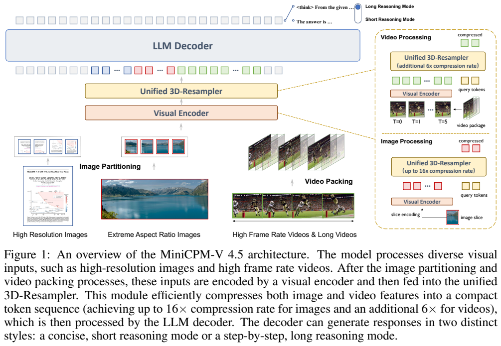
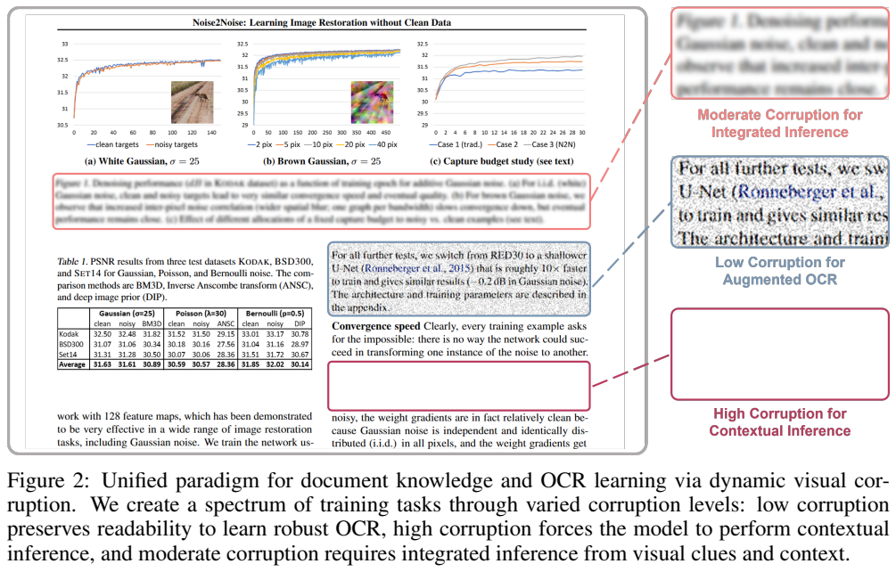
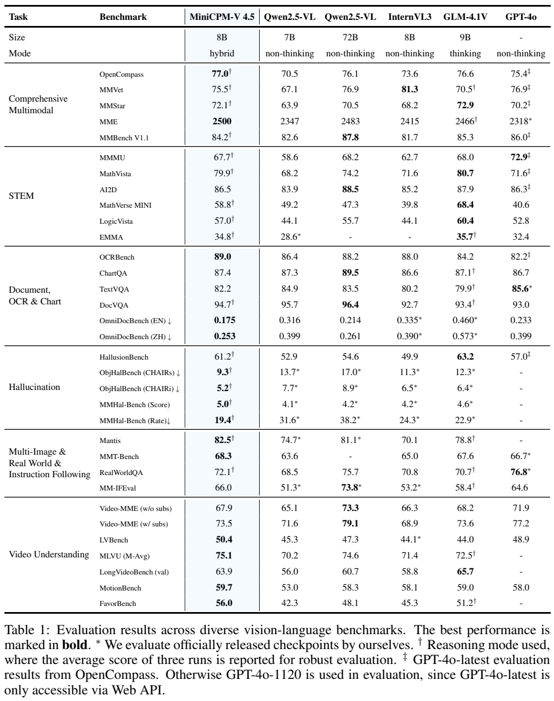
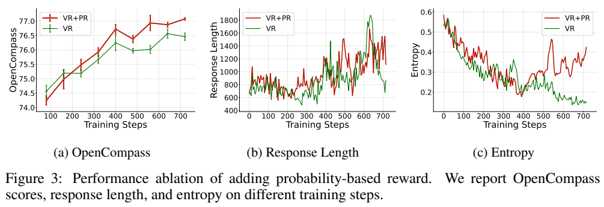
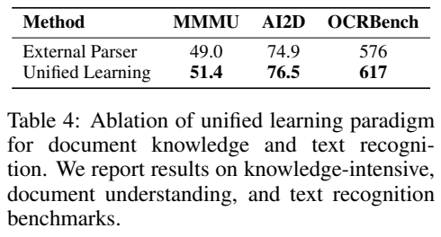
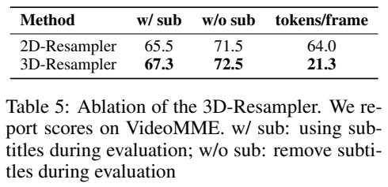

<!-- article-header:start -->
[项目首页](../../../README.md) › [模型系列](../../../reports/model-family-index.md) › [MiniCPM-V / MiniCPM-o](../README.md)
<!-- article-header:end -->

# MiniCPM-V 4.5：视频压缩、文档恢复与长短推理联合学习

<!-- article-toc:start -->

**本篇目录** · [论文定位](#paper-info) · [快速概览](#overview) · [整体架构](#architecture) · [核心原理](#principles) · [数据构建](#data) · [训练流程](#training) · [实验结果](#experiments)
<!-- article-toc:end -->

## 1. 论文信息与模型定位

正式技术报告是 [MiniCPM-V 4.5: Cooking Efficient MLLMs via Architecture, Data, and Training Recipes](https://arxiv.org/abs/2509.18154)，由 Tianyu Yu 等与 OpenBMB MiniCPM-V 团队撰写。本文固定依据 **2509.18154v1，2025 年 9 月 16 日**。原目录使用“A GPT-4o Level MLLM … on Your Phone”的发布介绍标题；本篇转以同版本官方技术报告为依据，避免把仓库后来更新的 MiniCPM-V 4.6 信息混入 4.5。

MiniCPM-V 4.5 面向图像、多图、文档与视频理解，输出文本，支持提示控制的短推理和长推理。论文把它称作 8B 级模型，效率表给出的总规模为 **8.7B**。其主要问题是怎样同时降低视觉序列长度、文档数据工程成本和不必要的长推理开销，而不是通过更大的语言主干追求单一榜单。[PDF 第 1–2 页](https://arxiv.org/pdf/2509.18154v1#page=1)

## 2. 快速概览

| 设计 | 机制与作用 |
|---|---|
| 统一 3D-Resampler | 跨注意力同时压缩视频包内的空间与时间冗余，图片是同一接口的特例。 |
| 动态文档视觉扰动 | 同一恢复文字目标覆盖轻度噪声 OCR、中度噪声联合推断、完全遮挡的上下文学习。 |
| 逐阶段解冻 | 先学视觉语言接口，再增强感知，最后让全部参数学习高质量混合数据。 |
| 长短推理混合 RL | 同一个模型按提示切换推理模式，rollout 同时覆盖两种行为。 |
| 多来源奖励 | 简单答案用规则，复杂自然语言用 RLPR 概率奖励，偏好模型只评价最终答案。 |
| RLAIF-V | 原子主张核验产生图像和视频偏好对，再用 DPO 减少事实性幻觉。 |

模型的效率主要来自让语言模型处理更短的视觉表示，以及按任务选择推理长度；压缩不代表视觉编码器可以完全省掉每帧的计算，长短模式也不是论文证明的自动难度路由器。[PDF 第 3–9 页](https://arxiv.org/pdf/2509.18154v1#page=3)

## 3. 整体架构

**Figure 1 的读法。** 从底部输入向上看，高分辨率及极端长宽比图片先切片，视频先按时间组成包，两类输入都经过视觉编码器与统一 3D-Resampler，再作为紧凑 token 送入语言解码器。右侧放大图中，图片主要压缩空间；视频还压缩相邻帧的冗余。顶端两种输出说明推理风格可控，不是两套独立解码器。

图片沿用 LLaVA-UHD 切片策略，根据图像分辨率估计切片数，再选择使每片尺寸最接近视觉编码器预训练设置的划分。可学习查询携带二维空间位置，通过跨注意力从切片特征读取固定长度表示。报告的示例中，448×448 图片使用 64 个视觉 token，而若干采用 MLP 与 pixel unshuffle 的对照模型使用 256 个。

视频把相邻帧放进同一包，查询同时使用空间和时间位置，联合读取多帧特征，再拼接不同包的输出。示例中 **6 个 448×448 帧压缩成 64 个 token**；6 秒、2 fps 的 12 帧可用 128 个 token 表示。与报告示例中 Qwen2.5-VL 的 1,536、InternVL3 的 3,072 个 token 比较，分别为 12 倍与 24 倍序列缩短。“96 倍压缩”是相对更细的视觉特征表示的口径，不能与上述模型间倍率混用。

报告设置最多采样 1,080 帧，最高 10 fps；训练时随机增强包大小与帧率，推理时可调整以适应设备和任务。图片、视频共享 Resampler 架构和权重，因而 2D 到 3D 的升级可放在较轻量的 SFT 阶段。报告没有给出可据此重建全部模块的层数、查询维度或各主干初始化表，不能从其他 MiniCPM 版本反推。[PDF 第 3–4 页，§2.1](https://arxiv.org/pdf/2509.18154v1#page=3)

## 4. 核心创新与数学原理

Resampler 的本质是固定数量查询对任意长度输入进行信息读取。用 $`Q`$ 表示带位置的可学习查询，$`K,V`$ 表示视觉特征，可以用下式解释其单次跨注意力：

$$
Z=\mathrm{softmax}\!\left(\frac{QK^\top}{\sqrt d}\right)V.
$$

这是一种帮助理解论文机制的标准注意力表达，并非报告给出的完整实现公式。输入帧数增加时，$`K,V`$ 的长度增加；一个包输出的 $`Z`$ 长度由查询数控制。重要的收益是减少进入语言解码器的 token，而不是让全部计算与帧数无关。把时间位置带进查询，则让压缩不至于把先后顺序完全当作无序图片集合。

文档学习把传统文字识别与知识学习放进一个连续任务谱。设原始文字为 $`y`$，页面为 $`I`$，随机扰动为 $`\mathcal C_\alpha`$，可用解释性目标写成：

$$
\mathcal L_{\mathrm{recover}}
=\mathbb E_\alpha[-\log p_\theta(y\mid\mathcal C_\alpha(I))].
$$

弱扰动时还看得清文字，训练主要奖励准确识别；中等扰动要结合残留字形与上下文；完全遮挡时只能借助邻近文字、表格、图像与已学知识恢复。报告希望借此减少外部 PDF 解析产生的结构噪声，并避免把不可辨认的增强样本一律当普通 OCR。这个设计不提供“任意遮挡内容都能正确恢复”的保证，完全遮挡本来就可能存在多种合理答案。[PDF 第 5–6 页，§2.2.3](https://arxiv.org/pdf/2509.18154v1#page=5)

强化学习的奖励公式则是原文明确写出的 Eq. (1)：

$$
R=R_{\mathrm{acc}}+R_{\mathrm{format}}+R_{\mathrm{rep}}
+\tfrac12\widetilde R_{\mathrm{rm}},\qquad
\widetilde R_{\mathrm{rm}}
=\frac{R_{\mathrm{rm}}-\overline R_{\mathrm{rm}}}{\sigma(R_{\mathrm{rm}})}.
$$

准确、格式和重复惩罚之外，偏好分数按同一提示下采样响应的均值与标准差归一化。长推理的奖励模型只评分最终答案，避免普通偏好模型因不熟悉长思考链而错误惩罚有效推理。GRPO 使用组内响应比较来优化策略；作者明确移除了 KL 与熵损失，不能补写成常规带 KL 的默认版本。[PDF 第 8 页](https://arxiv.org/pdf/2509.18154v1#page=8)

## 5. 数据构建与处理

**Figure 2 的读法。** 同一论文页面中选取文字区域，右侧展示轻度噪声后可辨认的字符、中度噪声后模糊的文本，以及完全空白的遮挡。图不是三个独立模型的比较，而是同一训练目标在不同可见度下迫使模型使用不同信息来源。

预训练图文对来自 LAION-2B、COYO 与中文网页数据，去除低分辨率图片，用 CLIP 过滤不相关图文，并用 Capsfusion 风格流程重新描述一部分样本，使原始 alt-text 的知识表达更完整。MLLM 概念标签用于平衡语言与长尾概念。交错数据来自 Common Crawl、OmniCorpus、MINT-1T，过滤坏图、图文比例失衡与低相关样本，在学习率衰减期选取知识密度较高子集。OCR 包括自然场景文字合成与真实 HTML 渲染；文档涵盖论文、学术报告、教材；视频采用 WebVid、Vript、OpenVid 等并补充详细描述。[PDF 第 4–6 页](https://arxiv.org/pdf/2509.18154v1#page=4)

SFT 的 STEM 题覆盖高中及以上跨学科问题，先筛掉不看图也能解答的题，再检查答案一致性，使用强 MLLM 拒绝采样得到可靠推理。Wikipedia 实体页产生长尾知识问答，同样强调视觉依赖。长 CoT 来自 OpenThoughts 和内部管线，优先选择早期模型难解的题，检查正确性、通过 RLAIF-V 做主张级事实验证、去除无意义重复，最后改写扩充多样性。

RL 覆盖数学、文档表格图表、综合推理、指令遵循；每部分进行人工参与的清洗和去重。作者区分标签是否正确与奖励判定是否正确：几个 token 的简单答案用规则，报告其奖励准确率约 98%；单位、长句或复合自然语言答案改用 RLPR。该 98% 是简单答案奖励核验的局部结果，不是模型的总体回答准确率。完整训练各阶段样本数和总 token 预算没有披露；消融用的 100 万样本也不能写成模型全部预训练数据规模。[PDF 第 7–8、12 页](https://arxiv.org/pdf/2509.18154v1#page=7)

## 6. 训练流程与目标

| 阶段 | 训练内容与参数范围 |
|---|---|
| 预训练 1 | 仅训练 2D-Resampler，视觉编码器和语言解码器冻结，用图像描述建立初步对齐。 |
| 预训练 2 | 解冻视觉编码器，继续训练 Resampler；语言解码器冻结，使用 OCR 密集数据与图像描述。 |
| 预训练 3 | 全参数端到端训练，加入纯文本、交错图文、视频和精选历史数据；WSD 衰减期增加高质量指令及知识数据。 |
| 通用 SFT | 多任务指令对齐，混入 10% 高质量纯文本以稳定语言能力。 |
| 长 CoT 与 3D 升级 | 引入显式推理预热，以及高帧率和长视频；将共享 Resampler 扩展到时空压缩。 |
| 混合 RL | 由提示控制长短模式，随机分配 rollout，两种模式共同使用 GRPO 优化。 |
| RLAIF-V / DPO | 同一模型多次采样，拆解响应为原子主张，按核验事实错误数构建图像和视频偏好对。 |

附录 A 给出真实超参数：预训练 WSD 稳定期学习率 $`5\times10^{-5}`$，衰减至 $`10^{-5}`$；通用 SFT 从 $`10^{-5}`$ 余弦衰减至 $`10^{-6}`$；长 CoT/3D 阶段预热到 $`5\times10^{-6}`$ 再衰减至 $`10^{-6}`$。RL 每批 128 个提示，每个采样 8 条，最大响应 8,192 token，温度 1.0，**50% 提示分配长推理模式**，学习率固定 $`10^{-6}`$。RLAIF-V 的全局批量为 256、学习率 $`10^{-6}`$、DPO $`\beta=0.1`$，训练 400 步。SFT 两阶段和 RL 的完整冻结配置、总步数及训练 GPU 数没有充分披露，因此不补全为“全部阶段全参数训练”。[PDF 第 4、6–9、20 页](https://arxiv.org/pdf/2509.18154v1#page=20)

引言提到只需 33.3% 长推理样本即可匹配单模式峰值，是效率讨论中的另一个实验描述；具体实现应以上述附录 50% rollout 提示设置为准，两者不能合并成一个默认比例。

## 7. 实验设置与主要结果

**Table 1 的读法。** 带 † 的条目使用推理模式，取三次结果平均；带 * 的对照是作者自行评测官方 checkpoint；GPT-4o 带 ‡ 的条目取 OpenCompass 的 GPT-4o-latest，其他采用 GPT-4o-1120。比较时应同时读成绩与模式、来源。OpenCompass 平均分包含五个以长推理运行的基准，因此 77.0 不能表述为全部任务短回答的分数。

| 指标 | MiniCPM-V 4.5 | 有助于理解的对照 |
|---|---:|---|
| OpenCompass | 77.0 | Qwen2.5-VL-72B 76.1，GPT-4o-latest 75.4。 |
| MMMU | 67.7 | GPT-4o-latest 72.9，Qwen2.5-VL-72B 68.2，说明总体平均领先不等于所有专业任务领先。 |
| OCRBench | 89.0 | Qwen2.5-VL-72B 88.2。 |
| DocVQA | 94.7 | Qwen2.5-VL-72B 96.4。 |
| Video-MME，无 / 有字幕 | 67.9 / 73.5 | Qwen2.5-VL-72B 73.3 / 79.1。 |
| OmniDocBench 英文 / 中文，越低越好 | 0.175 / 0.253 | 反映文档解析误差口径，不能当准确率百分比。 |

效率在 **8 张 A100** 的评测配置测得。Table 2 中 OpenCompass 完整评测耗时 7.5 小时，对照 GLM-4.1V 为 17.5 小时；Video-MME 为 0.26 小时、28G 显存，对照 Qwen2.5-VL-7B 为 3.00 小时、60G，GLM-4.1V 为 2.63 小时、32G。前一对照对应 8.7% 时间和 46.7% 显存。这是批量基准评测效率，**不是手机实测延迟**；报告该页叙述写 73.6，但 Table 2 的自身分数为 73.5，这里采用表格。[PDF 第 10–11 页](https://arxiv.org/pdf/2509.18154v1#page=10)

**消融页的读法。** Figure 3 左图对比规则奖励和规则加概率奖励，后者随训练更好；中、右图分别给出响应长度和熵，不能仅凭熵曲线推断事实准确性。Table 4 在 100 万高质量样本、其中 20% 知识文档的消融设置中，统一学习将 MMMU 从 49.0 提至 51.4、OCRBench 从 576 提至 617。该 OCRBench 使用原始分数口径，与主表的 89.0 不应直接相减。

Table 5 在通用 SFT checkpoint 后仅比较 Resampler，并训练 300 步：每帧平均 token 从 64.0 减为 21.3，两列 Video-MME 成绩由 65.5/71.5 增为 67.3/72.5。v1 原表两列标为 w/ sub、w/o sub，但其高低关系与主表字幕结果不同；本篇保留原列数值，不擅自调换表头。混合 RL 的 Table 3 则给出短模式 76.0/1.6B 训练 token、长模式 77.0/4.4B、混合 77.1/3.1B，支持在该实验下用较少 token 达到相近或更高平均成绩。它不能证明任何任务都应短推理，也不构成跨硬件普遍加速保证。[PDF 第 11–12 页](https://arxiv.org/pdf/2509.18154v1#page=11)

<!-- article-footer:start -->
---

[← 上一篇：Thyme](../../thyme/arxiv-2508.11630/README.md) · [按发表时间浏览](../../../reports/paper-reading-guide.md#year-2025) · [下一篇：InternVL 3.5 →](../../internvl/arxiv-2508.18265/README.md)

[返回本篇目录](#article-toc) · [返回模型系列](../README.md)
<!-- article-footer:end -->
