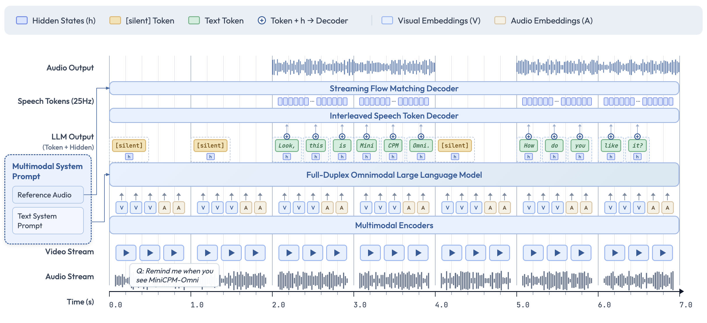
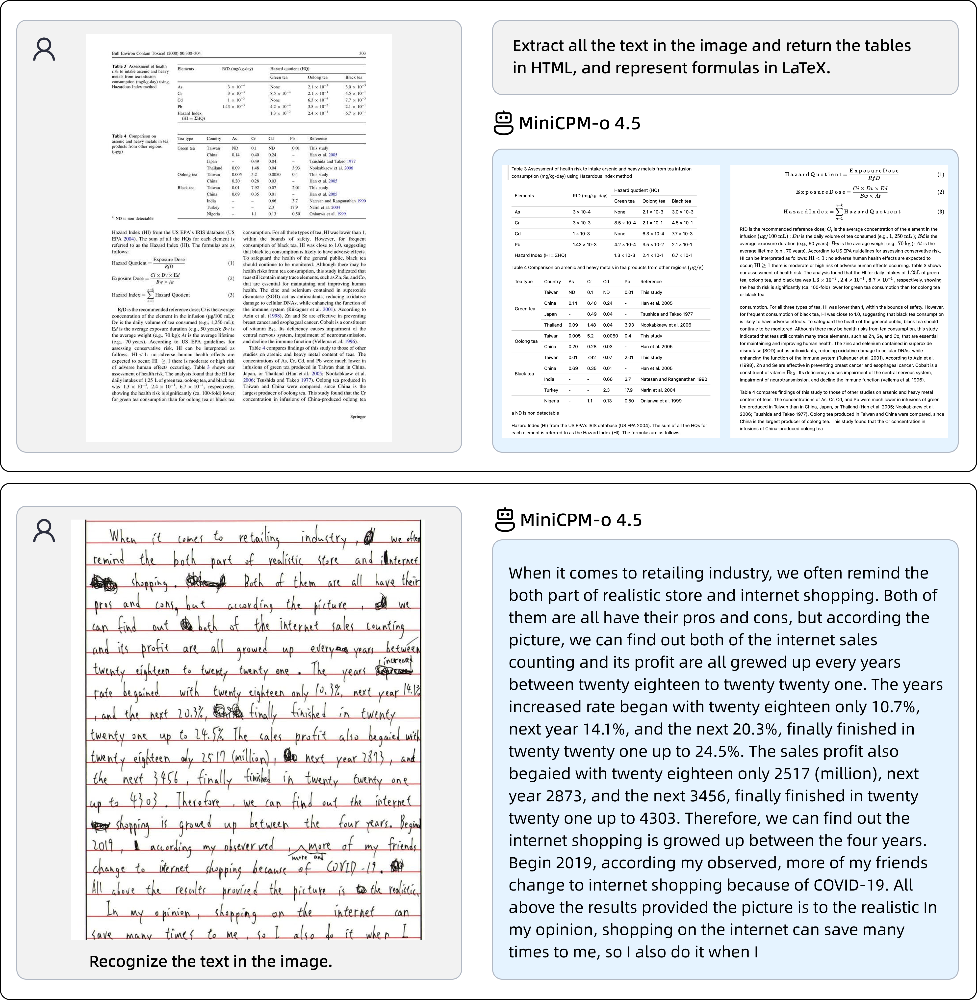
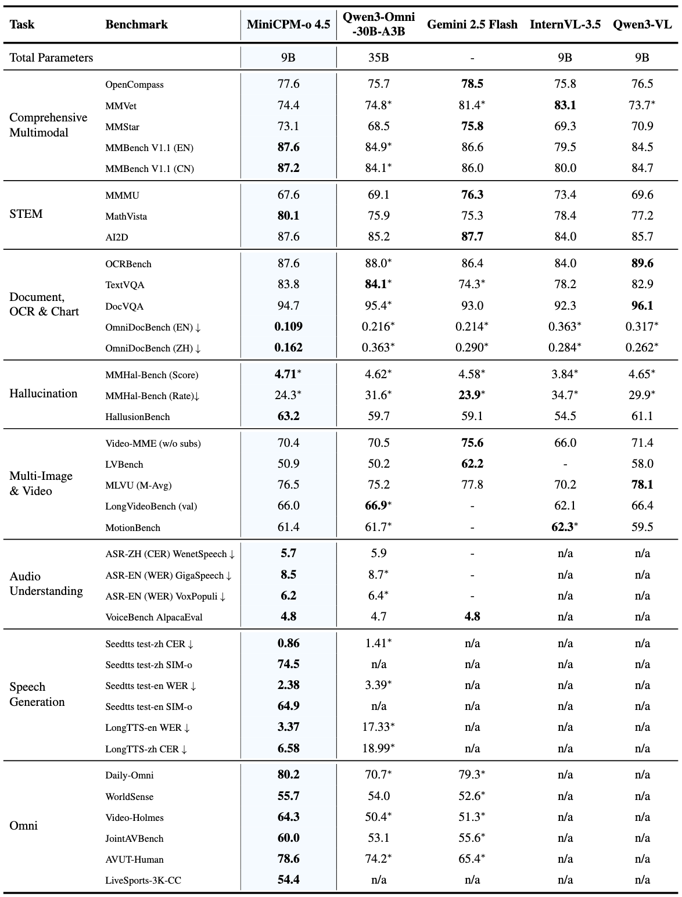

<!-- article-header:start -->
[项目首页](../../../README.md) › [模型系列](../../../reports/model-family-index.md) › [MiniCPM-V / MiniCPM-o](../README.md)
<!-- article-header:end -->

# MiniCPM-o 4.5：以时间片组织全双工多模态交互

<!-- article-toc:start -->

**本篇目录** · [论文定位](#paper-info) · [快速概览](#overview) · [整体架构](#architecture) · [核心原理](#principles) · [数据构建](#data) · [训练流程](#training) · [实验结果](#experiments)
<!-- article-toc:end -->

## 1. 论文信息与模型定位

| 项目 | 信息 |
|---|---|
| 原文 | MiniCPM-o-4_5 官方模型卡 |
| 团队 | OpenBMB / 面壁智能 |
| 来源 | [Hugging Face 官方模型卡](https://huggingface.co/openbmb/MiniCPM-o-4_5) |
| 固定版本 | 2026-10-08 获取的官方页面快照；页面列有 2026-02-06 的演示更新，不能直接当作初始发布日期 |
| 模型规模 | 总参数约 9B；基础组件为 SigLIP2、Whisper-medium、CosyVoice2 与 Qwen3-8B |
| 输入 / 输出 | 图像、视频、音频、文本输入；文本和流式语音输出 |
| 定位 | 可在持续观察和倾听时生成语音的开源全模态助手，并保留半双工问答接口 |

本条介绍的是 **4.5 版官方模型卡**。页面引用的《MiniCPM-V: A GPT-4V Level MLLM on Your Phone》（arXiv:2408.01800）是 2024 年视觉系列报告，不能据此把该报告中的训练数据、损失和手机实验直接归到 4.5。模型卡给出架构图、基准和可运行接口，但没有同等详细的完整训练报告。

## 2. 快速概览

4.5 的问题是：摄像头和麦克风连续产生信息时，模型怎样及时更新理解，同时说出回复？模型卡把输入编码、LLM 决策、文本与语音 token 解码和波形生成组织为流式链路。模型可选择继续听，也可主动开口，支持参考语音控制音色。

其公开特点包括最高 1.8 百万像素图像处理、最高 10 FPS 视频输入，以及全双工、半双工和普通 chat 接口。**10 FPS 是能力描述，不是所有视频基准的统一抽帧设置**。页面所称 1 Hz 指模型检查是否需要说话的决策频率，也不能解释为视频只有一帧每秒。

视觉成绩和语音成绩应分开看：Instruct 的 OpenCompass 为 77.6、MathVista 为 80.1；全双工 LiveSports-3K-CC 的 54.4 是相对 GPT-4o 的胜率；效率表中 0.6 秒首 token 延迟来自特定测量，不能作为所有硬件和所有交互模式的保证。

## 3. 整体架构

**原图来源：模型卡 Model Architecture，原图未编号。** 沿底部时间轴读图：视频帧与音频片段不断进入多模态编码器，视觉、音频 embeddings 交错进入 Full-Duplex Omnimodal LLM；LLM 输出文本 token、隐状态或 `[silent]`。上层语音 token 解码器同时使用文本与隐状态，随后 Streaming Flow Matching Decoder 逐段产生波形。图中 speech tokens 标注为 **25 Hz**，这是输出语音 token 的节奏，与视频采样频率和开口决策频率不同。

模型卡称各模块通过隐状态稠密连接，并把原先离线的编码、解码组件改造成在线处理。参考音频和文本 system prompt 共同指定声音与助手行为。图里的 silent 输出很关键：连续输入不等于必须连续说话，系统要在观察事件时保持静默，满足条件后才响应。

公开接口允许 `init_vision`、`init_audio`、`init_tts` 分别启停模块，先初始化 TTS，再用 `as_duplex()` 切换全双工。示例的每个时间块先 `streaming_prefill(audio_waveform, frame_list)`，再 `streaming_generate`，结果包含 `is_listen`、`end_of_turn` 和当前时间。半双工流式示例则先送完输入块，再生成回答：**输入流式化与听说同时进行是两种不同设置**。

## 4. 核心创新与数学原理

核心机制是 **Time-Division Multiplexing（TDM，时分复用）**。模型卡说明，音视频输入与输出按毫秒级时间同步，再切成周期性小时间片，把并行流在一个自回归模型内顺序组织。它让新输入在模型说话期间仍可进入上下文，并为主动提醒提供时间依据。

为解释这一思想，可把第 $`k`$ 个时间片写作 $`S_k=(V_k,A_k,O_k)`$，其中 $`V_k`$、$`A_k`$ 是该片收到的视觉和音频信息，$`O_k`$ 是输出文本、语音或静默。模型利用历史 $`S_{\lt k}`$ 与当前输入产生响应。这只是本介绍的概念记号，**原文没有公布对应的概率分解、完整注意力掩码、时间片精确长度或训练损失公式**，不能从示意图推出实现细节。

另一个设计是交错文本与语音 token 的解码。文字描述确定回答内容，隐状态给语音解码器提供更细的条件，流式波形解码减少等待完整句子的需求。原图明确出现 flow matching，但模型卡没有给出其速度场、插值路径和具体优化目标，不能套用通用公式充当本模型的公开 recipe。

主动说话仍有取舍：过早开口会打断用户，过晚开口可能错过视频中的事件。1 Hz 的开口判断说明存在离散决策节奏；真实端到端延迟还取决于输入分块、编码、LLM 解码和音频播放缓存。

## 5. 数据构建与处理

模型卡提到通过精心设计的后训练数据和专业配音演员录音构建语音助手能力，但没有公开各阶段样本数、音视频小时数、合成与真实数据占比、去重阈值和数据混合比例。页面列出的 VisCPM、RLPR、RLHF-V、RLAIF-V 等相关项目链接，也不足以证明 4.5 使用了其中每一个目标或全部数据。

可核验的是推理预处理：参考音频和用户音频示例用 **16 kHz、单声道**读取；视频工具联合抽取帧与音频片段，可使用 FFmpeg 并调整音频长度。`stack_frames` 用于提高视频刷新信息密度，`max_slice_nums` 用于控制高清视觉处理，二者影响成本，不能直接从最高像素能力推断默认 token 预算。

半双工语音演示将用户输入切为一秒、16000 samples 的块，末块不足一秒时补零，逐块 prefill；生成的音频以 **24 kHz** 保存。这些是公开示例的处理参数，不代表训练时所有音频均采用同样分块。

**原图来源：模型卡 Document Parsing 示例，无图号。** 上半展示双栏论文页转成可读文本、HTML 表格与 LaTeX 公式，下半展示手写文字识别。它说明目标输出包含结构，而不只是识别字符；这两例属于定性展示，不能用于估计整体错误率。

## 6. 训练流程与目标

公开资料能确认模型由上述视觉、音频、语音和语言组件组成，并针对在线编码解码、交错语音输出、全双工持续输入和主动响应进行设计。模型卡没有公开完整阶段划分、每阶段冻结参数、学习率、批量大小、token 数、优化器和奖励模型。因此不能把上一代 MiniCPM-V 的三阶段训练与 DPO 参数沿用到本版本。

在使用层面，示例支持 BF16、SDPA 或 FlashAttention 2，指定 `transformers==4.51.0`；`enable_thinking` 允许不同生成行为。全双工每块可限制新生成 speech tokens，并返回是否处于倾听状态。参考声音通过 `prepare` 或 token-to-wave 缓存传入。这些是接口和部署配置，本介绍没有运行权重，也不把示例调用当成训练复现。

官方完整 PyTorch 演示建议 NVIDIA GPU 至少 28 GB 显存；llama.cpp 的量化半双工与全双工又列出不同设备要求。它们与效率表的运行显存属于不同任务和实现，不能混用为一个统一最低显存数字。

## 7. 实验设置与主要结果

**原图来源：模型卡 Performance 汇总图，无图号。** 浅蓝列是 MiniCPM-o 4.5，星号对应官方测量标记，缺项不能视为零。原图把 OCRBench 写为百分制 87.6，而文本详细表写为 876；两者采用不同显示尺度。部分汇总图与后续详细表的基线数字也不同，例如 Gemini 的 OmniDocBench，下面的文字以对应详细表为准，不将不同表拼成一致配置。

视觉详细表分别标注 Instruct 与 Thinking。关键结果如下，均为模型卡报告值：

| 指标 | 4.5 Instruct | 4.5 Thinking | Qwen3-VL-8B Instruct |
|---|---:|---:|---:|
| OpenCompass | 77.6 | 78.2 | 76.5 |
| MMBench EN v1.1 | 87.6 | 89.0 | 84.5 |
| MMMU | 67.6 | 70.2 | 69.6 |
| MathVista | 80.1 | 81.0 | 77.2 |
| MM-Vet | 74.4 | 73.6 | 73.7* |
| OCRBench | 876 | 879 | 896 |
| TextVQA val | 83.8 | 79.8 | 82.9* |
| DocVQA val | 94.7 | 92.3 | 96.1 |

Thinking 在 MMMU 上增加 2.6，但 TextVQA、DocVQA 与 MM-Vet 下降，不能认为更长思考改善每类任务。Instruct 的 MMMU 也低于该表 GPT-4o 的 72.9 和 Gemini 2.5 Flash Non-thinking 的 76.3。页面总说明称评测使用 instruct，但另列 Thinking 表，本介绍保留各表的模式标签。

视频表中的 **Video-MME 明确无字幕**：4.5 为 70.4，Qwen3-Omni 为 70.5，Gemini 2.5 Flash Non-thinking 为 75.6。4.5 的 LVBench / MLVU M-Avg / LongVideoBench val / MotionBench 为 50.9 / 76.5 / 66.0 / 61.4。卡中未为这些行统一给出帧数、分辨率和输出预算，不能据此验证等成本比较。

文档解析详细表的 OmniDocBench Overall Edit 越低越好，4.5 英文 / 中文为 **0.109 / 0.162**，PaddleOCR-VL 为 0.105 / 0.126，DeepSeek-OCR 2 为 0.119 / 0.146。4.5 相对后一模型英文更好、中文更差，也没有在该表胜过所有专用文档流水线。

语音生成 SeedTTS 的中文 CER 为 **0.86%**、英文 WER 为 **2.38%**，优于 CosyVoice2 的 1.45% / 2.57%，但声音相似度 74.5 / 64.9 略低于其 74.8 / 65.2。LongTTS 英文 WER 3.37% 优于 CosyVoice2 14.80%，中文 CER 6.58% 则高于其 5.27%。识别也并非全面领先：AIShell1/2 的 CER 0.9 / 2.5，高于 Qwen3-Omni 的 0.6 / 2.3。

半双工音视频表中，Daily-Omni 为 80.2、WorldSense 为 55.7、Video-Holmes 为 64.3，八项平均为 **68.5**；Gemini 为 63.6、Qwen3-Omni 为 63.7。全双工 LiveSports-3K-CC 的 **54.4 是对 GPT-4o 的胜率**，不是分类准确率，不能与上述百分制问答成绩直接平均。

效率表报告 BF16 的 154.3 tokens/s、0.6 s 首 token 延迟和 19.0 GB 显存，int4 为 212.3、0.6 s 和 11.0 GB。表中未完整指明硬件、任务长度与并发流条件。公开证据支持它在小规模模型中同时覆盖多类模态和在线交互；关于每个模块的因果贡献、真实长期对话稳定性和不同设备端到端延迟，模型卡没有提供足够消融与统一实验设置。

<!-- article-footer:start -->
---

[← 上一篇：Kimi K2.5](../../kimi/arxiv-2602.02276/README.md) · [按发表时间浏览](../../../reports/paper-reading-guide.md#year-2026) · [下一篇：Qwen3.5 →](../../qwen/document-7cdfed4ac9e5/README.md)

[返回本篇目录](#article-toc) · [返回模型系列](../README.md)
<!-- article-footer:end -->
