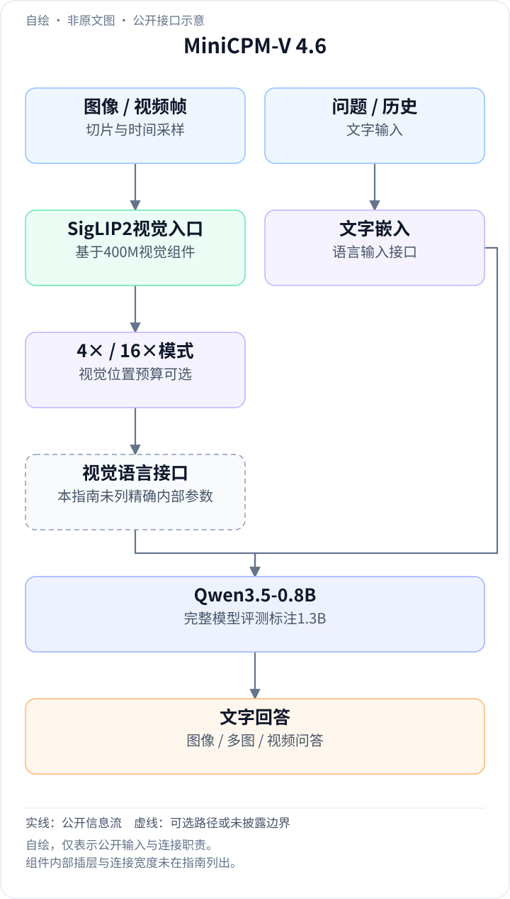
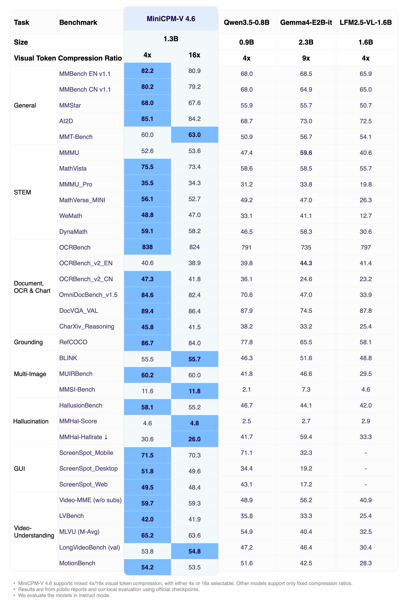
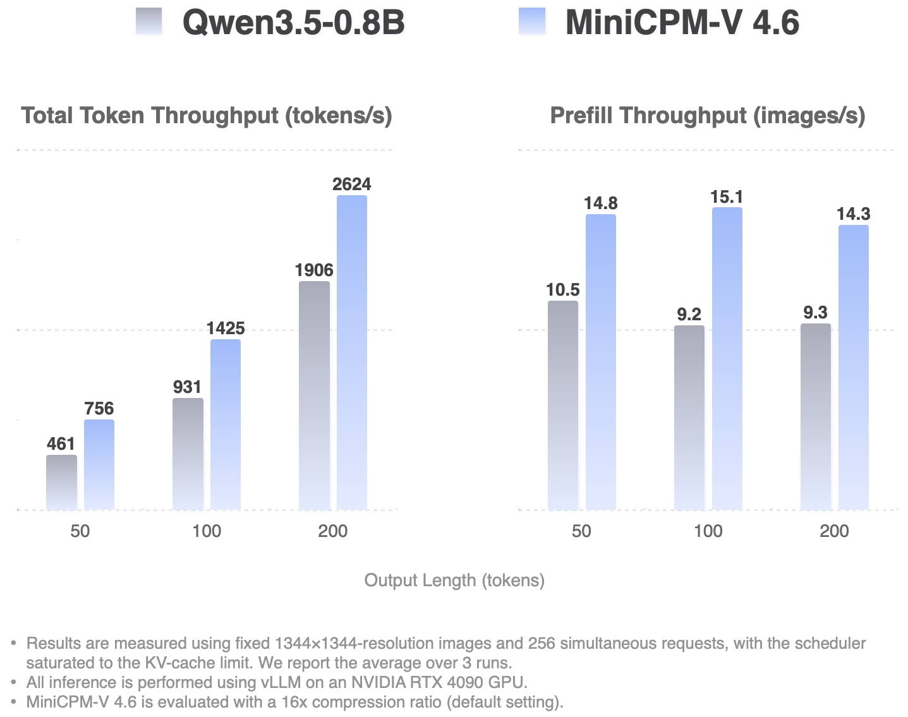
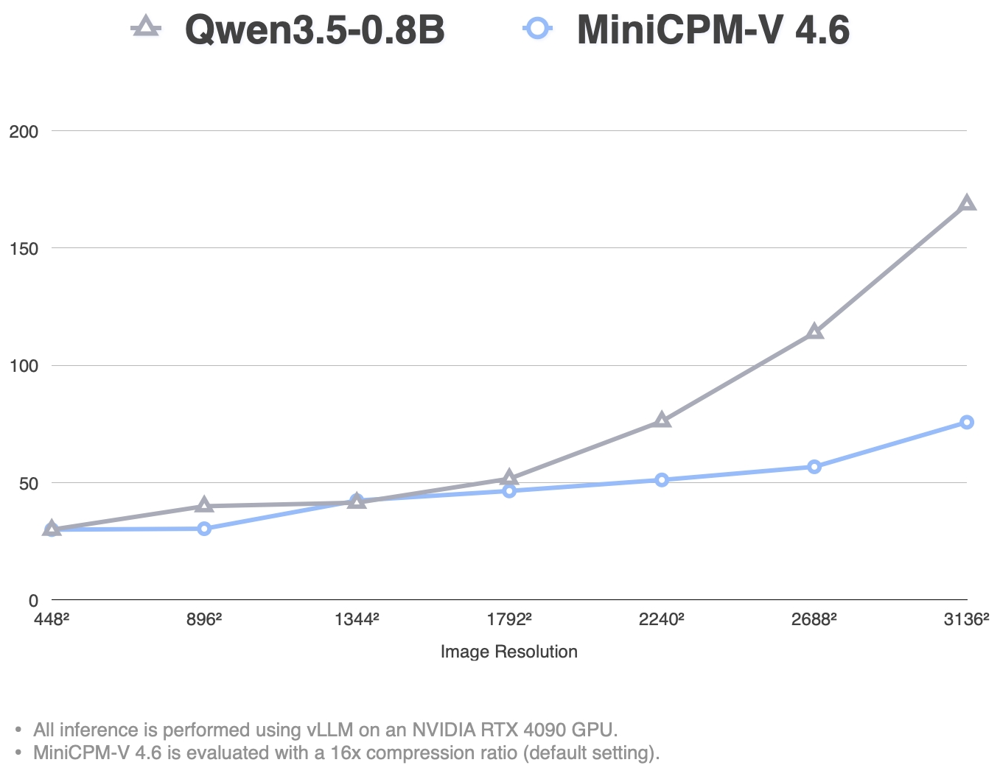

<!-- article-header:start -->
[项目首页](../../../README.md) › [模型系列](../../../reports/model-family-index.md) › [MiniCPM-V / MiniCPM-o](../README.md)
<!-- article-header:end -->

# MiniCPM-V 4.6：面向端侧的1.3B视觉模型与双压缩倍率

<!-- article-toc:start -->
<a id="article-toc"></a>

**本篇目录** · [论文定位](#paper-info) · [快速概览](#overview) · [整体架构](#architecture) · [核心原理](#principles) · [数据构建](#data) · [训练流程](#training) · [实验结果](#experiments)
<!-- article-toc:end -->

<a id="paper-info"></a>

## 1. 论文信息与模型定位

| 项目 | 信息 |
|---|---|
| 官方资料 | **MiniCPM-V 4.6** 模型指南与模型卡 |
| 发布日期 | **2026-05-11**，官方仓库发布记录 |
| 团队 | OpenBMB、清华大学、面壁智能 |
| 固定版本 | [官方指南](https://github.com/OpenBMB/MiniCPM-V/blob/1d6b7d68379974af0375cfdb903613d630da34aa/docs/minicpm_v4dot6_en.md)，commit `1d6b7d68379974af0375cfdb903613d630da34aa` |
| 代码与模型 | [仓库](https://github.com/OpenBMB/MiniCPM-V) · [模型卡](https://huggingface.co/openbmb/MiniCPM-V-4.6) |
| 规模与接口 | 官方评测图标注**1.3B总参数**；单图、多图、视频输入，文字输出 |

4.6把MiniCPM-V的高密度视觉理解路线扩展到更小的端侧模型：视觉组件基于SigLIP2-400M，语言底座为Qwen3.5-0.8B。这里0.8B是底座名称，不能当作完整多模态系统的总参数量。本条目依据官方模型资料，尚未核实独立同名技术报告PDF；指南引用的LLaVA-UHDv4是相关技术论文，并非本模型的另一个同名报告。

<a id="overview"></a>

## 2. 快速概览

| 设计 | 公开做法 | 适用价值 |
|---|---|---|
| 小型底座 | SigLIP2-400M + Qwen3.5-0.8B | 降低本地理解任务的资源门槛 |
| 可选视觉预算 | `downsample_mode="4x"`或`"16x"` | 细节与序列成本可以按任务选择 |
| 高分辨率与视频 | 切片、多帧、可选子帧堆叠 | 同一接口处理文字密集图和较长视频 |
| 部署覆盖 | iOS、Android、HarmonyOS及主流推理后端 | 公开客户端与量化入口，不等于各设备同样速度 |

官方对4×和16×分别报告成绩：4×通常保留更多细节，但16×在部分任务分数更高，不能预设低压缩率必然全面获胜。[Introduction / Evaluation / Advanced Parameters](https://github.com/OpenBMB/MiniCPM-V/blob/1d6b7d68379974af0375cfdb903613d630da34aa/docs/minicpm_v4dot6_en.md)

<a id="architecture"></a>

## 3. 整体架构

<!-- derived-architecture:start -->


*自绘公开接口示意（非原文图）。依据下述公开资料归纳；方框表示功能组件，不代表逐层实现。*

依据：[Introduction / Advanced Parameters](https://github.com/OpenBMB/MiniCPM-V/blob/1d6b7d68379974af0375cfdb903613d630da34aa/docs/minicpm_v4dot6_en.md)。
<!-- derived-architecture:end -->

一次问答先根据图像尺寸准备切片或根据视频设置采样帧，再由视觉编码路径产生压缩视觉序列；文字问题与视觉条件共同进入Qwen3.5-0.8B底座，输出答案。官方指南明确视觉与语言组件及压缩开关，但没有列完整连接器网络图或各层宽度，下面按已公开输入/输出职责整理。[Introduction / Usages](https://github.com/OpenBMB/MiniCPM-V/blob/1d6b7d68379974af0375cfdb903613d630da34aa/docs/minicpm_v4dot6_en.md)

| 模块 | 输入与输出 | 公开机制 |
|---|---|---|
| 图像处理器 | 原图 → 受切片预算约束的视觉输入 | `max_slice_nums`控制高分辨率切片上限；图像示例推荐36 |
| 视频处理器 | 视频 → 主帧及可选堆叠子帧 | `max_num_frames`控制主帧上限，`stack_frames`控制每秒采样点数 |
| 视觉编码路径 | 图像 / 帧 → 视觉表示 | 基于SigLIP2-400M；指南将效率改进联系到LLaVA-UHDv4 |
| 压缩及语言接口 | 视觉表示 → 4×或16×预算的语言条件 | 两种下采样模式；处理器占位数量与模型生成端必须一致 |
| Qwen3.5-0.8B | 视觉条件、问题及历史 → 文字回答 | 稠密小型语言底座；完整系统评测标注1.3B |

使用4×模式时，处理器与`generate`都要传入相同`downsample_mode`：前者决定视觉占位数量，后者决定实际编码。只在一端改值会破坏接口一致性。视觉连接器的精确层数、维度和模式混用策略没有在固定指南中完整给出，不应把一个使用开关推演成未公开的内部实现。

<a id="principles"></a>

## 4. 核心创新与数学原理

### 4.1 4× / 16×压缩改变的是视觉位置预算

在同一图像、相同压缩前网格的条件下，若其位置数为$`N`$，两种倍率的说明性计数为：

```math
N_{4\times}\approx N/4,\qquad N_{16\times}\approx N/16,\qquad N_{4\times}/N_{16\times}\approx4.
```

边界、切片及特殊token会影响实际计数，所以这里保留近似符号。4×为语言侧保留约四倍视觉位置，有利于细小字形或密集图表；16×则减少视觉序列与后续处理成本。公开评测同时比较这两种模式，而非用一套成绩代表所有压缩配置。[Advanced Parameters / Evaluation](https://github.com/OpenBMB/MiniCPM-V/blob/1d6b7d68379974af0375cfdb903613d630da34aa/docs/minicpm_v4dot6_en.md)

指南将视觉编码FLOPs减少超过50%与LLaVA-UHDv4联系起来，但没有在本页给出精确压缩插层位置和逐层计算图。FLOPs、首token延迟与解码吞吐是不同指标，不能由视觉FLOPs比例直接推出端到端速度翻倍。

### 4.2 主帧与子帧堆叠的两种时间预算

`max_num_frames`是主帧数量上限；`stack_frames=N`表示每秒共$`N`$个采样点，其中一个主帧，其余$`N-1`$个子帧合成网格，并与主帧交错。它增加时间覆盖，同时把部分帧压进合成图，因而兼顾时间线索与输入预算。

例如`stack_frames=3`表示1个主帧和2个子帧，不能误读为每次将三个完整视频同时输入。合成网格中的每个子帧可用空间变小，短动作、细字和时间细节之间仍需权衡。指南默认1，可按任务调整为3或5，但没有给出所有基准统一使用的帧采样表。[Video Inference / Advanced Parameters](https://github.com/OpenBMB/MiniCPM-V/blob/1d6b7d68379974af0375cfdb903613d630da34aa/docs/minicpm_v4dot6_en.md)

### 4.3 切片预算与图像身份标记

`max_slice_nums`限制大图可用切片数量；更多切片通常提供更高细节预算，同时提高视觉与语言开销。`use_image_id`决定是否在每幅图/帧的占位前加入图像身份标记，指南推荐图像打开、视频关闭。身份标记有助于多图指代，它并不是可学习目标检测器或额外定位头。

这些参数共同决定模型“能看到多少”：压缩倍率控制位置密度、切片控制空间范围、主/子帧控制时间覆盖。因此比较模型分数或延迟时，至少要固定这三类条件；不能只写模型名称。[Advanced Parameters](https://github.com/OpenBMB/MiniCPM-V/blob/1d6b7d68379974af0375cfdb903613d630da34aa/docs/minicpm_v4dot6_en.md)

### 4.4 服务吞吐与单请求首token延迟分别衡量不同瓶颈

高并发吞吐反映批处理和调度下单位时间完成的工作；TTFT反映单个请求等待首个回答token的时间。16×模式减少视觉条件后，两者可能受益，但解码长度、并发、KV-cache和后端都会改变实际收益。官方把两者分图展示，不能将其中一个当作另一项的测量。[Inference Efficiency](https://github.com/OpenBMB/MiniCPM-V/blob/1d6b7d68379974af0375cfdb903613d630da34aa/docs/minicpm_v4dot6_en.md)

<a id="data"></a>

## 5. 数据构建与处理

固定模型指南公开了输入处理与评测来源，没有列出基础训练语料总量、文本/图像/视频比例、合成教师或完整去重规则。能够核实的是单图、多图、视频和OCR等能力的公开评测，以及切片、帧堆叠、图像身份标记和压缩参数。

来源图脚注说明结果来自公开报告与作者使用官方checkpoint的本地评测混合，因此评测数据和训练数据必须分开。LLaVA-UHDv4论文的语料也不能未经说明直接视为本模型全部训练数据。[Evaluation图脚注 / Usages](https://github.com/OpenBMB/MiniCPM-V/blob/1d6b7d68379974af0375cfdb903613d630da34aa/docs/minicpm_v4dot6_en.md)

<a id="training"></a>

## 6. 训练流程与目标

| 环节 | 已公开信息 | 披露边界 |
|---|---|---|
| 底座选择 | SigLIP2-400M与Qwen3.5-0.8B | 固定指南未列全部初始化文件和结构参数 |
| 多模态训练 | 支持视觉理解、4×/16×压缩和Instruct / Thinking变体 | 未列完整阶段、冻结表及损失权重 |
| 下游微调 | SWIFT、LLaMA-Factory等适配入口 | 这是开发支持，不是基础预训练recipe |
| 量化与端侧部署 | GGUF、BNB、AWQ、GPTQ及三类移动平台 | 量化配置和设备测量需分别核对 |

指南未公开本代完整预训练优化目标、训练token量、batch、学习率、硬件和耗时。因此本文不补写通用CE公式冒充已披露目标，也不把Thinking名称直接等同某种已证实RL训练算法。

<a id="experiments"></a>

## 7. 实验设置与主要结果



*原图保留任务分组、压缩倍率、模型总规模与评测脚注。*

| 指标 | 4× | 16× |
|---|---:|---:|
| MMBench EN v1.1 | 82.2 | 80.9 |
| MMMU | 52.6 | 53.6 |
| MathVista | 75.5 | 73.4 |
| OCRBench | 838 | 824 |
| OmniDocBench v1.5 | 84.6 | 82.4 |
| RefCOCO | 86.7 | 84.0 |
| Video-MME无字幕 | 59.7 | 59.3 |
| MMHal-Hallrate，越低越好 | 30.6 | 26.0 |

这组数值支持灵活选择视觉预算，不能证明4×在所有任务均更好。以MMMU为例，两种模式均低于表中Gemma4-E2B-it的59.6；在OCRBench v2英文项也不是表中最高。[Overall Performance (Instruct)](https://github.com/OpenBMB/MiniCPM-V/blob/1d6b7d68379974af0375cfdb903613d630da34aa/docs/minicpm_v4dot6_en.md)





吞吐图使用固定1344×1344图像、256并发请求、KV-cache饱和调度，结果为3次均值；后端vLLM、GPU为RTX4090，MiniCPM-V4.6使用默认16×。输出长度50/100/200时，总token吞吐为756/1425/2624 token/s，对照Qwen3.5-0.8B为461/931/1906。TTFT图同样为RTX4090和16×，但属于单请求设置，不能把256并发条件挪到该图。[Inference Efficiency及图脚注](https://github.com/OpenBMB/MiniCPM-V/blob/1d6b7d68379974af0375cfdb903613d630da34aa/docs/minicpm_v4dot6_en.md)

本仓库没有复现这些测量。固定硬件上的服务器数据不能直接替代手机速度；指南支持三平台部署的事实，也不意味着iOS、Android和HarmonyOS拥有相同延迟。

<!-- article-footer:start -->
---

[← 上一篇：π0.7](../../pi/arxiv-2604.15483/README.md) · [按发表时间浏览](../../../reports/paper-reading-guide.md#year-2026) · [下一篇：SenseNova-U1 →](../../sensenova/arxiv-2605.12500/README.md)

[返回本篇目录](#article-toc) · [返回模型系列](../README.md)
<!-- article-footer:end -->
