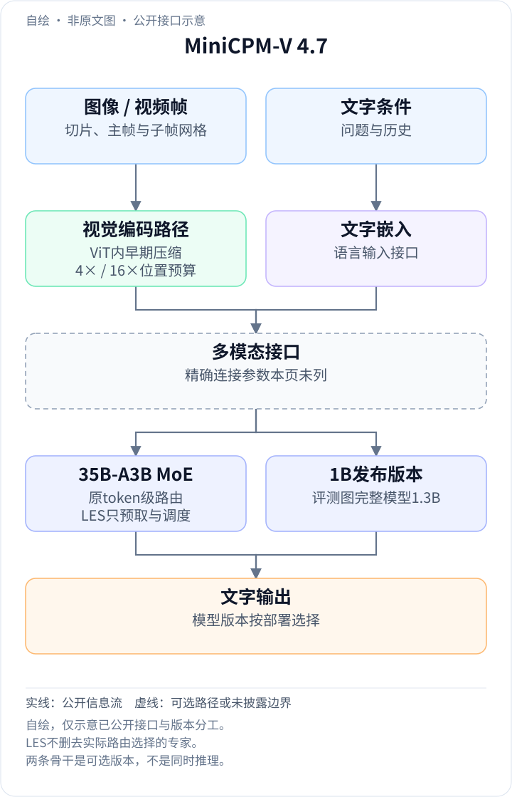
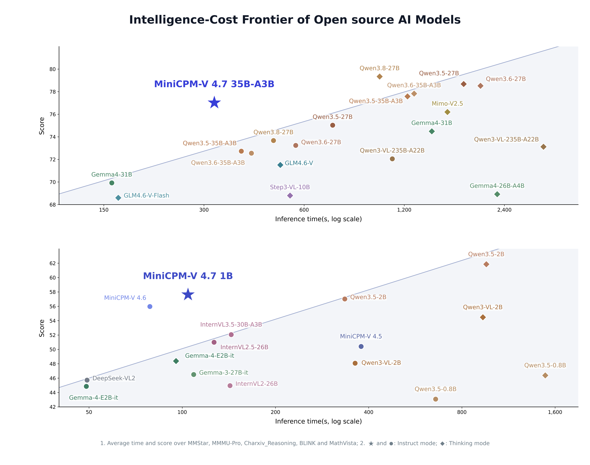
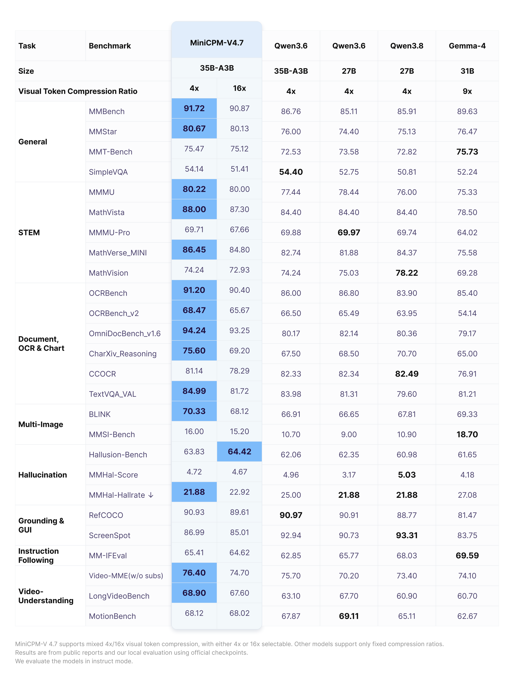
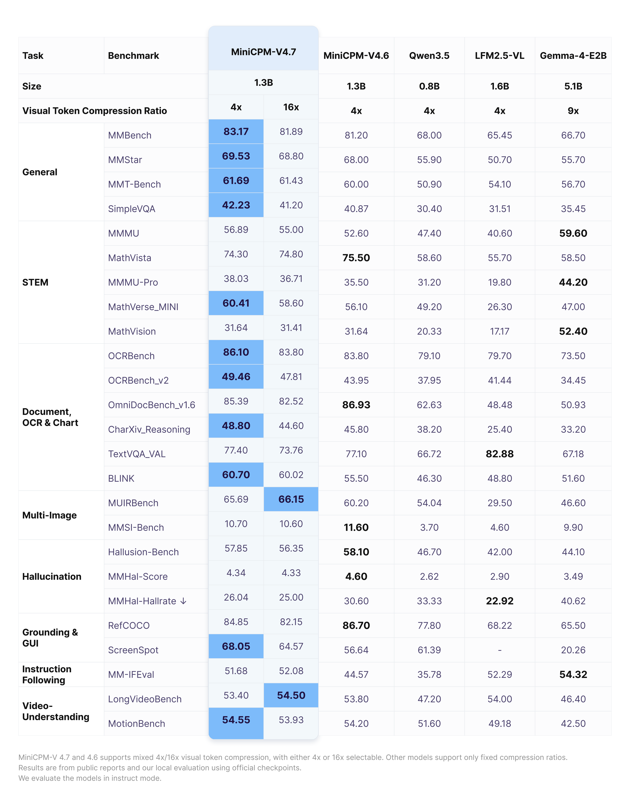

<!-- article-header:start -->
[项目首页](../../../README.md) › [模型系列](../../../reports/model-family-index.md) › [MiniCPM-V / MiniCPM-o](../README.md)
<!-- article-header:end -->

# MiniCPM-V 4.7：用专家预取和视觉早期压缩推进端侧MoE

<!-- article-toc:start -->
<a id="article-toc"></a>

**本篇目录** · [论文定位](#paper-info) · [快速概览](#overview) · [整体架构](#architecture) · [核心原理](#principles) · [数据构建](#data) · [训练流程](#training) · [实验结果](#experiments)
<!-- article-toc:end -->

<a id="paper-info"></a>

## 1. 论文信息与模型定位

| 项目 | 信息 |
|---|---|
| 官方资料 | **MiniCPM-V 4.7** 模型指南 |
| 发布日期 | **2026-10-12**，官方仓库Latest updates |
| 团队 | OpenBMB、清华大学、面壁智能 |
| 固定版本 | [官方指南](https://github.com/OpenBMB/MiniCPM-V/blob/1d6b7d68379974af0375cfdb903613d630da34aa/docs/minicpm_v4dot7_en.md)，commit `1d6b7d68379974af0375cfdb903613d630da34aa` |
| 代码与模型 | [仓库](https://github.com/OpenBMB/MiniCPM-V) · [35B-A3B模型卡](https://huggingface.co/openbmb/MiniCPM-V-4.7-35B-A3B) |
| 发布形态 | 35B-A3B MoE及1B版本；小版本评测图标注完整模型1.3B |

4.7同时推进模型能力与端侧推理系统：35B-A3B是MiniCPM-V系列首个MoE版本，1B版本延续小模型路线。二者都支持图像、多图和视频理解，核心输出为文字。本条目依据刚发布的官方模型指南，未把它称作已核实的独立arXiv技术报告。公开资料的亮点既包括视觉早期压缩，也包括加载专家权重时的调度优化，不能只把速度提升归因于激活参数少。

<a id="overview"></a>

## 2. 快速概览

| 设计 | 公开机制 | 解决的问题 |
|---|---|---|
| MoE端侧推理 | Lookahead Expert Scheduling（LES） | 在小内存设备上隐藏部分专家加载等待 |
| 权重与解码优化 | 逐层细粒度量化、DSpark投机采样 | 减少权重传输与逐token解码成本 |
| 视觉早期压缩 | 在ViT内较早减少视觉位置 | 降低后续视觉层的计算 |
| 双视觉预算 | 4×或16×压缩 | 按任务选择细节与成本 |
| 两种规模 | 35B-A3B与1B版本 | 分别覆盖高能力MoE和更小资源预算 |

指南报告35B-A3B在iPhone17ProMax以约3GB内存达到13+ token/s；这是特定部署配置的测量，不能等同所有设备速度，也不能解释成全部35B权重都常驻3GB。[On-Device Capability and Efficiency](https://github.com/OpenBMB/MiniCPM-V/blob/1d6b7d68379974af0375cfdb903613d630da34aa/docs/minicpm_v4dot7_en.md)

<a id="architecture"></a>

## 3. 整体架构

<!-- derived-architecture:start -->


*自绘公开接口示意（非原文图）。依据下述公开资料归纳；方框表示功能组件，不代表逐层实现。*

依据：[Introduction / On-Device Capability and Efficiency / Advanced Parameters](https://github.com/OpenBMB/MiniCPM-V/blob/1d6b7d68379974af0375cfdb903613d630da34aa/docs/minicpm_v4dot7_en.md)。
<!-- derived-architecture:end -->

模型接收单图、多图或按主/子帧规则处理的视频。视觉编码器内部采用LLaVA-UHDv4相关的早期压缩，之后按4×/16×模式形成视觉条件；文字与视觉条件进入相应规模的语言骨干。指南致谢列出SigLIP2以及Qwen3.5、Qwen3.6，但没有在本页给出每个版本的全部层数、专家数量与连接器配置，本文不自行建立未公开的参数对应表。[Introduction / Acknowledgements / Usages](https://github.com/OpenBMB/MiniCPM-V/blob/1d6b7d68379974af0375cfdb903613d630da34aa/docs/minicpm_v4dot7_en.md)

| 模块 | 输入与输出 | 公开机制 |
|---|---|---|
| 图像 / 视频处理器 | 原始媒体 → 切片、主帧及子帧网格 | `max_slice_nums`、`max_num_frames`、`stack_frames`控制输入预算 |
| 视觉编码与早期压缩 | 视觉输入 → 较短的中间表示 | 在ViT内部提前减少token，后续层处理更短序列 |
| 多模态输入接口 | 视觉与文字 → 语言条件序列 | 4×/16×模式决定视觉占位与编码预算，处理器及生成端需一致 |
| 35B-A3B MoE主干 | 多模态条件 → 文字或工具协议回答 | 逐token专家路由；总参数与每次激活量不同 |
| 1B发布版本 | 多模态条件 → 文字回答 | 独立小模型形态，官方评测图标注完整模型1.3B |
| LES与解码运行时 | 专家需求、权重和草稿 → 原目标模型输出 | 预取与实际专家加载重叠，结合量化和DSpark |

一次端侧问答先编码图像，再逐步生成答案。每层MoE真正需要的专家由原路由器决定；LES只提前猜测下一层可能要加载谁。它属于推理运行时，不是额外训练出的视觉感知模块，也不能画成另一个替代MoE路由器的网络。[On-Device Capability and Efficiency](https://github.com/OpenBMB/MiniCPM-V/blob/1d6b7d68379974af0375cfdb903613d630da34aa/docs/minicpm_v4dot7_en.md)

<a id="principles"></a>

## 4. 核心创新与数学原理

### 4.1 LES：预测加载需求，保留实际路由

MoE每个token只激活一部分专家，但不同层、不同token可能使用不同专家。若设备容不下全部权重，就必须从存储载入。只固定一小组专家虽然减少I/O，却会排除模型原本选中的专家，改变计算路径。

LES用跨层路由预测提前加载候选专家；实际路由产生后，先计算已成功预取的专家，同时加载其他必需专家。可用集合关系解释，非官方编号公式：

```math
A_l=(A_l\cap P_l)\cup(A_l\setminus P_l).
```

$`A_l`$是第$`l`$层实际选中的专家，$`P_l`$是预取候选。交集可先计算，差集仍必须加载并执行。预测失误主要影响等待时间，而不应删去原路由专家；因此“预测路由”与“替换路由”是不同机制。收益取决于预取命中、存储带宽及计算重叠，官方指南没有公布全部预测器结构与命中率曲线。[LES说明](https://github.com/OpenBMB/MiniCPM-V/blob/1d6b7d68379974af0375cfdb903613d630da34aa/docs/minicpm_v4dot7_en.md)

### 4.2 量化、投机解码与调度互补

细粒度逐层量化降低专家权重的存储和搬运负担；LES减少同步等待；DSpark通过投机采样提高解码效率。它们分别作用于权重体积、执行时序与生成步骤，不能把三个机制的加速倍数未经测量直接相乘。

指南强调LES不限制原有token级路由，但量化仍改变数值精度；“不牺牲能力”是作者对所测部署性能的表述，不是证明量化前后每个浮点结果完全一致。3GB描述运行内存预算，也不消除完整模型文件的存储需求。[On-Device Capability and Efficiency](https://github.com/OpenBMB/MiniCPM-V/blob/1d6b7d68379974af0375cfdb903613d630da34aa/docs/minicpm_v4dot7_en.md)

### 4.3 ViT内早期压缩与语言侧预算

如果只在视觉编码结束后压缩，前面完整ViT仍为所有位置付费。4.7公开强调将压缩提前到视觉编码器内部，让后续层处理较短序列；这与仅缩短LLM视觉前缀不同。

4×模式保留的视觉位置约为16×的四倍，通常更适合密集细节，但最终成绩仍受训练与任务影响。例如35B-A3B的HallusionBench在16×下64.42，略高于4×的63.83；小版本MathVista也为16×的74.80略高于4×的74.30。指南没有给出精确压缩层索引与所有合并权重，本文不补写未公布内部算子。[Efficient Architecture / Evaluation](https://github.com/OpenBMB/MiniCPM-V/blob/1d6b7d68379974af0375cfdb903613d630da34aa/docs/minicpm_v4dot7_en.md)

### 4.4 视频时间覆盖与图像预算协同

视频可由主帧与子帧网格交错表示：`stack_frames=N`为每秒一个主帧加$`N-1`$个子帧，子帧被合成一张网格。`max_num_frames`默认128是主帧上限，不能误当作任意视频必然采样128帧。增加堆叠改善时间覆盖，同时压缩每个子帧的空间细节；压缩模式、切片上限和采样数量需联合设置。

`downsample_mode`必须同时传给处理器与生成端，前者准备正确数量的占位，后者执行相应视觉编码。它是可复查的输入契约，不只是一个界面选项。[Advanced Parameters](https://github.com/OpenBMB/MiniCPM-V/blob/1d6b7d68379974af0375cfdb903613d630da34aa/docs/minicpm_v4dot7_en.md)

<a id="data"></a>

## 5. 数据构建与处理

指南公开了图像切片、视频帧组织与多模态使用参数，但没有提供基础训练数据的规模、来源比例、合成教师和完整过滤/去重流程。官方评测包含来自公开报告及本地官方checkpoint测量的结果，这些是评测来源，不是训练集清单。

同时发布的Self-Replay Fine-Tuning被指南定位为低成本扩展能力、减少遗忘的开发方法；本页没有给出基础模型使用该方法的完整训练配置，不能将它自动加入本代预训练数据流程。输入处理、后续定制和基础模型训练需要分开陈述。[Introduction / Evaluation脚注 / Usages](https://github.com/OpenBMB/MiniCPM-V/blob/1d6b7d68379974af0375cfdb903613d630da34aa/docs/minicpm_v4dot7_en.md)

<a id="training"></a>

## 6. 训练流程与目标

| 公开环节 | 可以确定的内容 | 尚未完整披露的内容 |
|---|---|---|
| 视觉和语言底座 | SigLIP2、Qwen3.5 / Qwen3.6相关基础组件 | 本页没有列每变体全部checkpoint及连接宽度 |
| 多模态模型训练 | 发布35B-A3B和小模型，具备双压缩模式 | 完整阶段、冻结范围、损失、token量与设备日程 |
| 低成本微调 | SRFT及SWIFT / LLaMA-Factory支持 | 不等于已公开原始基础训练全配方 |
| 推理优化 | LES、逐层量化、DSpark草稿模型 | 预取预测器及各部署组合的全部参数 |

本条目不凭MoE名称补写负载均衡损失，也不从Thinking或工具调用示例推断具体RL算法。独立的推理工程机制可以公开得很清楚，同时基础训练recipe仍未完整披露，这两种公开程度并不矛盾。

<a id="experiments"></a>

## 7. 实验设置与主要结果



*横轴是推理时间的对数刻度，纵轴是五个任务的平均分；星形/圆形表示Instruct，菱形表示Thinking。不是单条请求的手机延迟曲线。*

该图平均MMStar、MMMU-Pro、CharXiv Reasoning、BLINK和MathVista的时间与分数；比较受这些任务和推理模式限制。较靠左且较高表示在该集合中成本和成绩更优，不能根据几何图形推出对所有任务的Pareto最优。[Evaluation图脚注](https://github.com/OpenBMB/MiniCPM-V/blob/1d6b7d68379974af0375cfdb903613d630da34aa/docs/minicpm_v4dot7_en.md)





| 指标 | 35B-A3B 4× / 16× | 小版本4× / 16× |
|---|---:|---:|
| MMMU | 80.22 / 80.00 | 56.89 / 55.00 |
| MathVista | 88.00 / 87.30 | 74.30 / 74.80 |
| OCRBench（图中百分尺度） | 91.20 / 90.40 | 86.10 / 83.80 |
| OmniDocBench v1.6 | 94.24 / 93.25 | 85.39 / 82.52 |
| BLINK | 70.33 / 68.12 | 60.70 / 60.02 |
| RefCOCO | 90.93 / 89.61 | 84.85 / 82.15 |
| LongVideoBench | 68.90 / 67.60 | 53.40 / 54.50 |

表中OCRBench沿用本页百分尺度，不能与旧模型卡的860/897原始分值不换尺度直接比较。OmniDocBench为v1.6，不能和4.6旧资料的v1.5混为同一测试。小版本在本页对照中的OmniDocBench85.39低于4.6的86.93，MathVista74.30也低于4.6的75.50，说明整体进步仍伴随局部取舍。[Overall Performance各表](https://github.com/OpenBMB/MiniCPM-V/blob/1d6b7d68379974af0375cfdb903613d630da34aa/docs/minicpm_v4dot7_en.md)

手机13+ token/s、3GB运行内存是指南特定iPhone17ProMax配置的作者报告；本页没有列所有模型量化比特、能耗、专家驻留率和跨设备结果，不能据此承诺其他设备同等表现。本仓库没有运行模型或复现速度。

<!-- article-footer:start -->
---

[← 上一篇：Gemini 4 Argon](../../gemini/document-a07676c13763/README.md) · [按发表时间浏览](../../../reports/paper-reading-guide.md#year-2026)

[返回本篇目录](#article-toc) · [返回模型系列](../README.md)
<!-- article-footer:end -->
