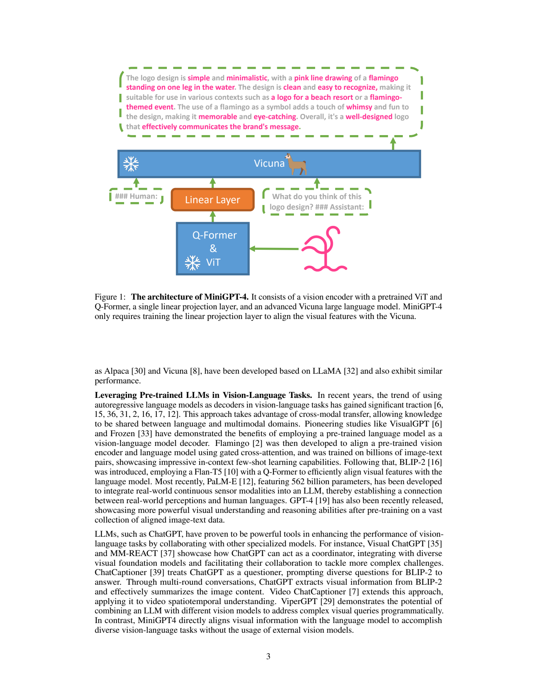
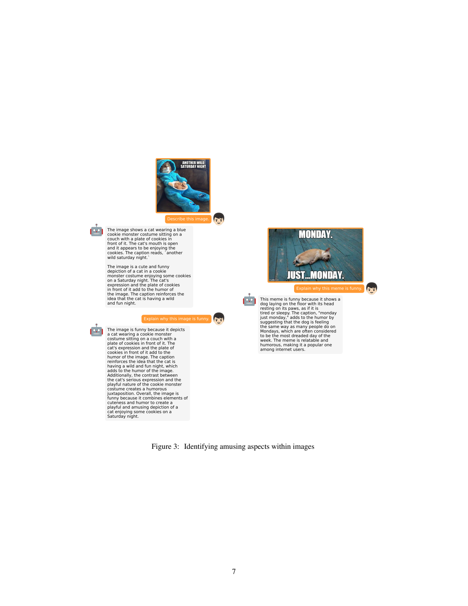
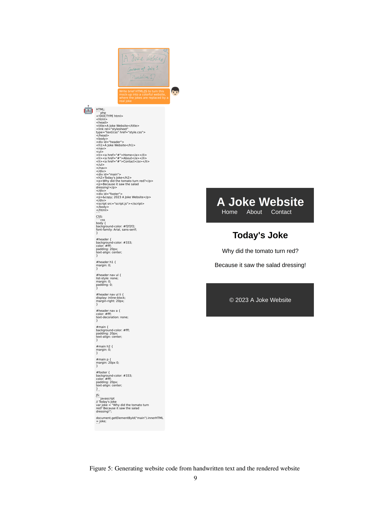
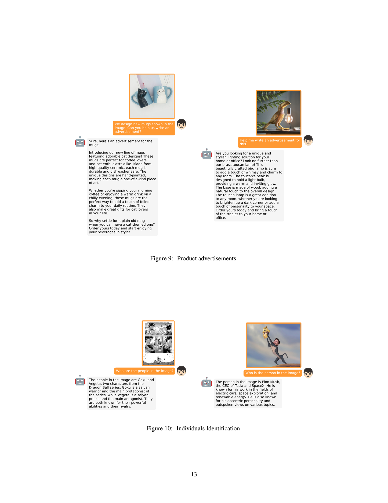

# MiniGPT-4：用冻结视觉编码器与语言模型建立图像对话接口

## 1. 论文信息与模型定位

| 项目 | 信息 |
|---|---|
| 原文 | MiniGPT-4: Enhancing Vision-Language Understanding with Advanced Large Language Models |
| 作者与机构 | Deyao Zhu、Jun Chen、Xiaoqian Shen、Xiang Li、Mohamed Elhoseiny；KAUST |
| 版本 | arXiv:2304.10592v1，2023 年 4 月 20 日，18 页；标为 Work in progress |
| 原文与项目 | [PDF](https://arxiv.org/pdf/2304.10592v1)、[项目](https://minigpt-4.github.io/) |
| 定位 | 以 Vicuna 为语言解码器的图像对话模型，通过一个可训练线性层连接已有视觉表示 |

MiniGPT-4 探索一种简单假设：若已有视觉网络和较强的指令语言模型，能否只训练两者之间的连接层，就产生细致描述、看图解释和图像条件的代码或创作？它使用 BLIP-2 的预训练视觉组件与 Vicuna，并通过少量高质量描述数据改善初步对齐后的语言重复和碎片化。

模型名称不能理解为对 GPT-4 权重的压缩版。GPT-4 的展示是作者动机，实际语言模型是基于 LLaMA 的 Vicuna。v1 没有明确列出所用 Vicuna 档位、系统总参数、图像分辨率或 Q-Former 查询数；本文不以后来模型配置填补这些缺项。

## 2. 快速概览

| 问题 | 原文的做法 |
|---|---|
| 视觉知识从哪里来？ | EVA-CLIP 的 ViT-G/14 与 BLIP-2 预训练 Q-Former |
| 语言能力从哪里来？ | 已有 Vicuna 指令语言模型 |
| 新训练什么？ | 两个阶段均仅训练一层线性投影，冻结视觉组件与 LLM |
| 第一次对齐 | 20,000 步，batch 256，约五百万图文样本展示量 |
| 为什么还要第二阶段？ | 原始网络图文对产生的短、杂乱语言不充分匹配聊天回答格式 |
| 第二阶段 | 约 3500 条清洗后的详细描述，400 步、batch 12 |
| 证据范围 | 原文主要为定性演示，没有标准基准表、独立正确率或与 GPT-4 的全面对照 |

“训练简单”指新增可更新组件少；基础视觉与语言模型的预训练成本仍然存在。生成 HTML、故事或广告也只是语言输出，不是模型自身生成图像、渲染网页或执行外部工具。

## 3. 整体架构

*原文 Figure 1，PDF 第 3 页完整页面；保留冻结标记、投影层和图注。*

图像经过预训练 ViT 与 Q-Former，得到用于语言接口的视觉表示，再由单个线性层投影到 Vicuna 词嵌入空间。Figure 1 的蓝色模块均冻结，橙色模块可训练。投影后的视觉特征被放进人类消息，后面附文字问题，Vicuna 生成助手回答。

Q-Former 已承担将视觉网格整合为较紧凑表示的作用，因此 MiniGPT-4 并非只靠线性层从原始像素学习所有视觉知识，也不是将原图所有 patch 一定直接送进 LLM。报告直接复用了已有预训练 Q-Former；v1 没有列出查询 token 数、特征维度和每图序列长度，不应套用 BLIP-2 的常见配置并称为这份原文已披露的参数。

视觉模型仍是系统内部组件。“不使用外部视觉模型”在本报告语境中指不需要像工具编排系统那样在生成期间调用另一个视觉问答服务，不是没有视觉编码器。它也没有增加单独的视觉检测、坐标或语音分支。

## 4. 核心创新与数学原理

### 线性投影充当可学习的视觉提示

报告没有编号数学公式。以解释性记号可将其接口写成：

\[
Z=Q_{\mathrm{frozen}}(V_{\mathrm{frozen}}(I)),\qquad
H_v=ZW+b,\qquad
P(Y\mid I,Q)=\prod_tP_{\mathrm{Vicuna}}(y_t\mid H_v,Q,y_{<t}).
\]

\(Z\) 是视觉组件输出，\(W,b\) 为可训练投影参数，\(H_v\) 成为连续的 soft prompt。公式只是对文字方法的统一写法，不是原文额外的理论贡献。线性层不单独负责判断笑点或写代码，而是把已有视觉表示变成语言模型可利用的上下文。

训练时语言模型权重冻结，仍需由其输出误差向投影反向传播梯度。冻结减少参数更新和优化器状态，不等于语言模型完全不参与训练计算。语言主干也不会因新增权重少而变成小型推理模型。

### 接口对齐还包含回答风格

第一阶段让视觉特征引导模型生成原图文对的文本，第二阶段改用详细描述与 Vicuna 对话格式，缓解重复、乱码、碎片句和偏离用户意图。课程表明“视觉信息能映射进去”和“助手能自然响应”是相关但不同的问题。

作者认为较强 LLM 可以带出复杂的视觉语言能力，但 v1 没有控制视觉表示、语言模型、数据质量等因素的完整实验，不能将演示当成“能力只来自语言模型”的因果证明。单个投影器和冻结 Q-Former 也限制了对新的空间定位与细粒度文字任务的适应。

## 5. 数据构建与处理

第一次对齐的数据来自 Conceptual Captions、SBU、LAION。20,000×256=5.12M 是训练中批次样本总量，原文写约五百万；它未给出逐来源配比、重复采样率、去重后的独立图像数和过滤阈值，所以不能直接称为五百万独立高质量图片。

第二阶段从 Conceptual Captions 随机选 5000 张，先由第一阶段模型生成详细描述。作者使用对话模板要求尽量多描述；若输出不超过 80 token，则补一轮“Continue”，拼接两个输出。80 token 是启发式长度判断，不能保证短回答是不完整句，也不能保证续写一定补充正确视觉信息。

随后让 ChatGPT 修正描述中的重复句、无意义字符、非英文内容与不完整句，再人工检查格式和重复内容，保留约 3500 条，约占候选集 70%。ChatGPT 处理已有文字描述，原文没有说明它在清洗时直接查看图片，因此文字流畅化不能自动补回第一阶段遗漏或误认的视觉事实。人工审核提高质量，但 v1 未给出详细的视觉正确性审计量表与标注一致性。

这些样本主要是同一类详细图像描述，用若干同义描述指令包装成对话。它不是 3500 个独立复杂任务种类，也没有专门列出 meme 解释、网页代码或食谱的监督数据。后续演示显示跨指令形式的迁移，不能将所有演示任务反写为训练配方。

## 6. 训练流程与目标

两个阶段始终冻结视觉编码器、Q-Former 和 Vicuna，只更新线性投影。第一阶段在四张 A100 80GB 上约十小时，20,000 步、batch 256；第二阶段单张 A100 约七分钟，400 步、batch 12。这里的资源是已有基础模型上的接口适配，不能宣称十小时即可从零训练达到 GPT-4 的多模态模型。

第二阶段使用 `###Human:`、图像特征标记和文字指令，随后 `###Assistant:` 生成描述。指令从若干同义描述请求中随机取样。原文明确不对文字图像提示部分计算其所谓“regression loss”，意图是让监督落在生成回答上；可用标准回答交叉熵解释为：

\[
\mathcal L_{\mathrm{answer}}=-\sum_{t\in Y}\log P(y_t\mid H_v,Q,y_{<t}).
\]

这不是像素回归损失，也不是奖励模型或 DPO。作者以 GPT-3 的指令与 RLHF 历史作类比，并未在 MiniGPT-4 配方中实际加入 PPO/RLHF。v1 未公布优化器、学习率、warmup、权重衰减和统一生成参数，不能从后续仓库配置或其他模型猜填。

400×12=4800 是第二阶段批次展示数量；它不表示清洗集变成 4800 条，也不能单凭这个乘积确认恰好训练了某个整数 epoch。报告给的是步数与 batch，而非完整抽样器行为。

## 7. 实验设置与主要结果

v1 以 13 组编号演示展示能力，没有提供 VQA、OCR、检测或图文推理标准成绩，也没有第二阶段前后的人类偏好胜率。不能为满足结果章节而补上后来论文版本、模型排行榜或与 GPT-4 的百分比对照。下列示例支持“存在这些输出”，不确定其整体成功率。

*原文 Figure 3，PDF 第 7 页完整页面；保留两张 meme 与所有问题、回答。*

模型结合服装、动物、图片文字和星期文化解释笑点，说明视觉前缀可影响语言推理。但是猫图回答多次重复“可爱、幽默、反差”的泛化描述，尚不足以证明已经稳定理解每种笑话的关键逻辑。图中样例不是随机抽样的统计测试。

*原文 Figure 5，PDF 第 9 页完整页面；保留手绘草图、生成代码与作者展示的渲染结果。*

模型将手绘笑话页面解释为 HTML/CSS/JS 输出。右侧渲染页面说明作者进行了展示性落地，不能把它推广为所有代码都能正确执行。生成内容加入了 Home/About/Contact 等草图未明确指定的元素；“生成网站”在此指输出代码及展示，而非模型拥有浏览器执行或部署能力。本文没有运行这些代码。

*原文 Figure 9、Figure 10，PDF 第 13 页完整页面；保留所有图片、问答和图注。*

广告示例能围绕猫杯和鸟形灯组织流畅文案，同时也暴露事实补充问题：杯子的手绘工艺、耐洗碗机等属性并非图片能证明。该图非常适合区分“视觉条件的文案创作”和“可靠的商品信息提取”。识别示例展示模型能将图像与已有语言知识联系起来，但没有身份识别基准或错误率，不能当成系统级可靠性结论。

作者自己指出两个主要限制：语言幻觉，以及不足的文字细节和空间感知。可能原因包括缺少带 OCR/定位的对齐数据、冻结 Q-Former 丢失重要特征，以及单个投影层容量有限。这些是报告提出的解释与后续方向，不是通过消融逐项证明的结论。

MiniGPT-4 的价值在于以明确且简单的冻结组件方案展示了图像接口与较强语言模型的组合潜力，并强调高质量回答格式的重要性。评价这份早期报告时，最应保留的是可复用的训练思路与定性证据的限度；没有基准成绩的部分不等于已被系统性验证的能力。本文未运行模型，也未补造原文缺失的结果。
