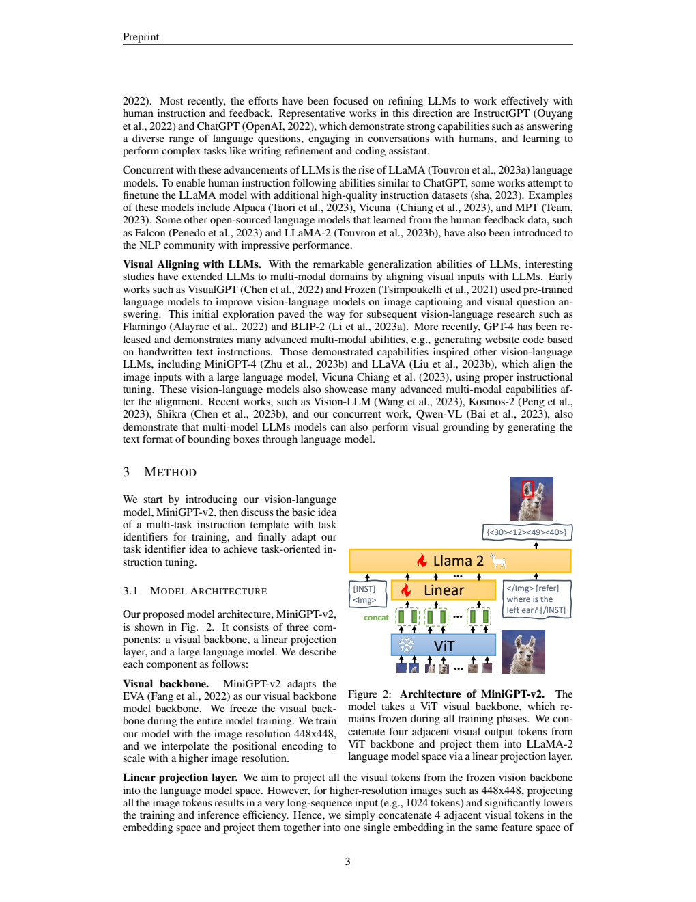
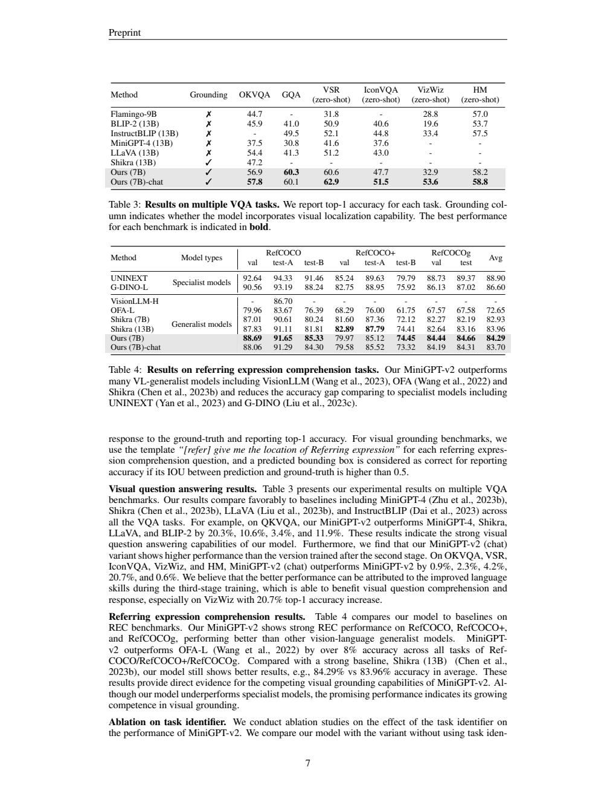
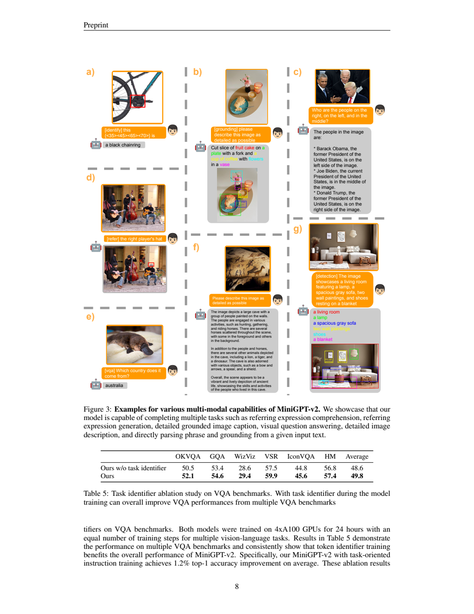
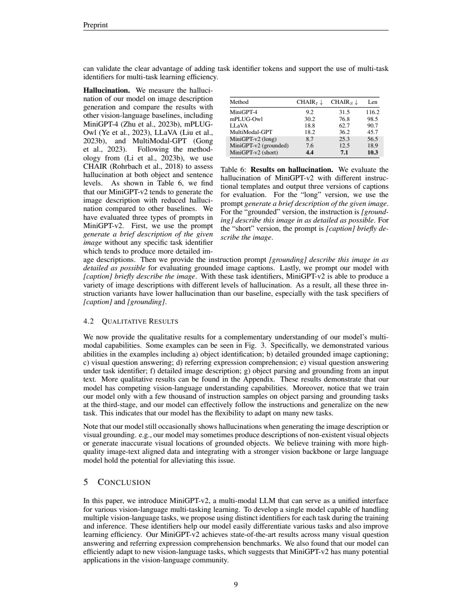

# MiniGPT-v2：用任务标识统一图像问答、描述与定位

## 1. 论文信息与模型定位

《MiniGPT-v2: Large Language Model as a Unified Interface for Vision-Language Multi-task Learning》由 Jun Chen、Deyao Zhu、Xiaoqian Shen 等作者提出，来自 KAUST 与 Meta AI Research。本文依据 [arXiv 2310.09478v1](https://arxiv.org/pdf/2310.09478v1)（2023 年 10 月 14 日）；项目入口为 [MiniGPT-v2](https://minigpt-v2.github.io/)。

模型采用冻结的 EVA 视觉骨干、线性投影层与 LLaMA-2-chat 7B，统一完成视觉问答、图像描述、区域描述与定位等任务。其主张是通过任务标识减少指令歧义，用文字形式输出各种结果，不必为每种任务单独部署一个输出模型。它不是图像生成模型，框坐标输出也不等同于像素分割。

## 2. 快速概览

| 关键选择 | 作用 |
| --- | --- |
| 448×448 图像输入 | 提供更多视觉细节 |
| 每四个邻近视觉 token 沿通道拼接 | 1024 个视觉位置压缩到 256 个输入 token |
| 六个任务标识 | 指定问答、描述、带框描述、定位、区域识别或文字实体定位 |
| 框坐标作为文字生成 | 复用语言模型词表与解码过程 |
| 三阶段训练 | 广泛图文学习、细粒度多任务训练、聊天指令调整 |
| LoRA 更新语言模型 | 冻结视觉编码器，训练投影器与低秩适配参数 |

第二阶段模型记为 MiniGPT-v2，第三阶段后记为 chat。两者不是所有评测上都同向改善，定位平均分从 84.29 降为 83.70，GQA 从 60.3 降为 60.1；聊天版主要改善部分问答与对话能力。

## 3. 整体架构

Figure 2 下方的 EVA ViT 带雪花，表示整个训练期间冻结。绿色 concat 把四个相邻视觉嵌入合并，随后线性层投影到语言模型维度；右侧文字指定 `[refer]`，要求定位动物的左耳；上方生成四个文字坐标，绘制后形成示例中的红框。绘框是对输出坐标的展示，模型并没有在该路径输出分割掩码。

高分辨率输入的位置编码通过插值适配。若原视觉特征是 $v_i\in\mathbb R^d$，四个特征拼成 $\tilde v_j\in\mathbb R^{4d}$，再由线性层产生语言模型所需嵌入。空间位置数减少 75%，但不同于平均池化，四个位置的信息先保留在拼接通道，再由可训练投影学习如何组合。序列减少四倍并不意味着整体运行速度必然四倍，论文没有给出端到端解码速度实测。

输入遵循 LLaMA-2 的对话格式，图像嵌入、任务标识和自然语言请求共同放入 `[INST] ... [/INST]`。纯语言指令不使用视觉任务标识。输出文字既可以是答案，也可以是对象短语和框坐标。[PDF 第 3–4 页](https://arxiv.org/pdf/2310.09478v1#page=3)

## 4. 核心创新与数学原理

“告诉我红衣人的位置”可能要求一个框，也可能要求“在右上角”的文字答案。MiniGPT-v2 显式加入任务条件，而不是只依赖相似自然语言请求推断回答格式。

| 标识 | 任务与输出 |
| --- | --- |
| `[vqa]` | 视觉问答，输出文字答案 |
| `[caption]` | 图像描述 |
| `[grounding]` | 描述图像，同时标注对象框 |
| `[refer]` | 指代表达理解，输出所指对象的框 |
| `[identify]` | 根据给定区域生成对象描述 |
| `[detection]` | 从输入文字解析对象短语，并在图像中定位 |

`[detection]` 在这里有特定含义：根据输入描述解析并定位实体，不等同于无条件、穷尽所有类别的传统检测器。标识为共享语言模型提供任务条件，报告没有使用六个独立专家路由模块。

框坐标表示为 `{<Xleft><Ytop><Xright><Ybottom>}`，整数归一化到 [0,100]。可用 $u=100x/W$、$v=100y/H$ 理解归一化尺度，但原文没有给出完整取整、裁边及错误字符串修复算法，本文不补设这些规则。相较连续回归头，文字输出能复用同一个生成接口；同时它受有限坐标精度和输出格式正确性约束。[PDF 第 4 页](https://arxiv.org/pdf/2310.09478v1#page=4)

论文没有提出编号的新损失公式。按其语言模型式训练流程，监督目标可解释为 $-\sum_t\log p(y_t\mid I,q,\tau,y_{<t})$，其中 $\tau$ 是任务标识；这只是对训练机制的归纳，不是原文明确新增的数学贡献。框坐标按文字序列学习，也没有披露额外 IoU 回归损失。LoRA 对查询与值投影做低秩更新，可用 $W'=W+BA$ 理解，rank=64；本文不把该解释式当作作者独创公式。

## 5. 数据构建与处理

第一阶段混合弱标注与细粒度数据，弱标注来源包括 LAION、CC3M、SBU 和 GRIT-20M。GRIT 用于指代表达理解、区域描述与带定位描述；细粒度数据包括 COCO caption、Text Captions、RefCOCO 系列、Visual Genome，以及 GQA、VQAv2、OCR-VQA、OK-VQA、A-OKVQA。第一阶段提高弱标注来源采样比例，但报告未给出完整数值。

第二阶段移除 LAION、GRIT 等弱监督来源，仅保留细粒度任务。区域描述 REG 通过反转已有指代数据构造：原本是短语→框，反转后是框→短语。这种复用让同一标注支持两个方向，不等于新采集一套独立人工语料。

第三阶段继续使用细粒度任务，并增加 LLaVA 的约 23K 详细描述、58K 复杂推理、Flickr30k 构造样本、混合多任务对话与 Unnatural Instructions。后者用于缓解长时间视觉训练后语言对话能力退化，报告并未引入人类偏好强化学习阶段。[PDF 第 5–6 页](https://arxiv.org/pdf/2310.09478v1#page=5)

Flickr30k 的带框描述筛选至少五个已定位短语的 caption，约 2.5K 样本；对象解析与定位另外构造 caption→grounded phrases 约 2.5K，以及 phrase→grounded phrase 约 3K。它们针对 GRIT 描述中定位对象较少、输出较短的问题。模型还把不同任务的单轮样本混成多轮对话，以训练上下文中切换任务的能力，但多轮总量、去重阈值和完整采样比例未披露。

附录提示格式保留任务要求：VizWiz 要求单词或短语，信息不足时回答 unanswerable；VSR 判断陈述真或假；HatefulMemes 提示将图片上的文字作为问题信息。因而 HM 成绩不是可以不依赖任何文字输入提示的结论。GQA、OK-VQA、RefCOCO 等参与训练，不能把所有表中评测统一称为零样本。[PDF 第 14 页](https://arxiv.org/pdf/2310.09478v1#page=14)

## 6. 训练流程与目标

三个阶段始终冻结视觉骨干，更新线性投影器并用 LoRA 微调 LLaMA-2-chat 的 Wq、Wv，rank=64。架构图中的语言模型火焰标记不代表更新全部原始语言参数。优化器是 AdamW、余弦学习率调度，所有阶段图像分辨率为 448×448。

| 阶段 | GPU | 步数 | 全局 batch | 最大学习率 | 报告耗时 |
| --- | --- | ---: | ---: | ---: | ---: |
| 广泛图文预训练 | 8×A100 | 400K | 96 | 1e−4 | 约 90 小时 |
| 细粒度多任务 | 4×A100 | 50K | 64 | 1e−5 | 约 20 小时 |
| 多模态聊天指令 | 4×A100 | 35K | 24 | 1e−5 | 约 7 小时 |

这些是原文提供的训练成本，不是本文重新测得。报告没有在这段配置中给出 A100 显存版本、序列长度、训练精度、warm-up 和权重衰减，不用其他 MiniGPT 版本的信息填补。

第三阶段提高新指令来源比例、降低细粒度任务比例，意在增强对话同时保留任务能力。然而定位与聊天会存在权衡，应同时比较两种检查点。任务标识消融是在 4×A100、24 小时及相同步数下比较，不等同于完整三阶段训练的最终分数。[PDF 第 6、8 页](https://arxiv.org/pdf/2310.09478v1#page=6)

## 7. 实验设置与主要结果

VQA 使用开放回答、贪心解码和与真实答案匹配的 Top-1 准确率；定位采用 `[refer]` 请求，预测框与真实框 IoU **大于 0.5** 算正确。Table 3 的 zero-shot 标注仅对应 VSR、IconVQA、VizWiz、HM 四列，不包含训练中使用的 OKVQA 和 GQA。

| 检查点 | OKVQA | GQA | VSR | IconVQA | VizWiz | HM |
| --- | ---: | ---: | ---: | ---: | ---: | ---: |
| MiniGPT-v2 | 56.9 | 60.3 | 60.6 | 47.7 | 32.9 | 58.2 |
| MiniGPT-v2 chat | 57.8 | 60.1 | 62.9 | 51.5 | 53.6 | 58.8 |

聊天版 VizWiz 增加 20.7 个百分点，而 GQA 略降。正文中若干 OKVQA 差值与该表不一致，本文以 Table 3 的可核验数值为准，避免复述混用检查点的提升幅度。

定位八个划分平均为 84.29，chat 为 83.70，Shikra-13B 为 83.96，专用 UNINEXT 为 88.90。MiniGPT-v2 在 RefCOCO val/test-A/test-B 为 88.69/91.65/85.33，但 RefCOCO+ val/test-A 的 79.97/85.12 仍低于 Shikra-13B 的 82.89/87.79。平均优势较小，不能称每个划分都超过 Shikra，更不能称超过专用定位模型。

Figure 3 的 a、d 分别展示区域描述和指代定位；b 把对象词组与框关联；g 根据输入句子解析并定位实体。彩色短语与框用于对应关系展示，并不能证明任意长描述都没有幻觉。图内人物身份与时任职位陈述是 2023 年模型示例输出，不应当作当前事实。Table 5 有标识的平均 49.8，无标识为 48.6，各列均有所提高；它是支持显式任务条件的受控实验。

CHAIR_I 衡量被描述对象层面的幻觉，CHAIR_S 衡量句子层面的幻觉，越低越好。长描述为 8.7/25.3，grounded 为 7.6/12.5，short 为 4.4/7.1；平均长度同时从 56.5 降到 18.9、10.3。较短回答提供较少内容，也有较少产生额外对象的机会，不能只看最低 CHAIR 就认为信息量相同且整体最优。

作者明确承认定位不准和不存在对象的描述，附录指出某些人物框错误、例图出现实际不存在的花瓶。文章反映的是论文报告的能力与边界，没有执行模型或声称完成独立复现实验。
