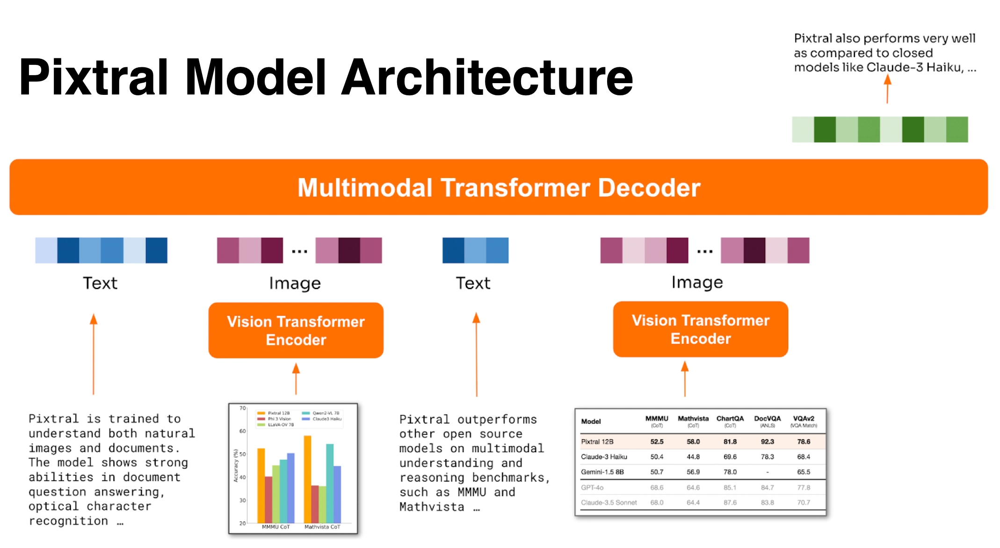
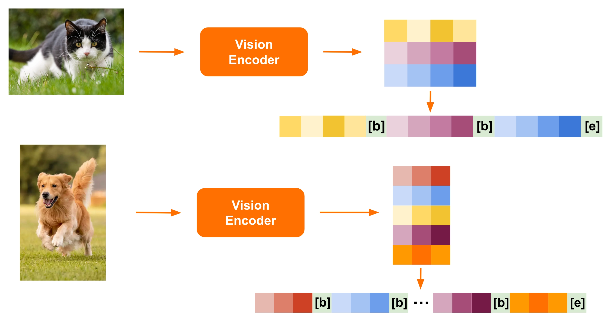
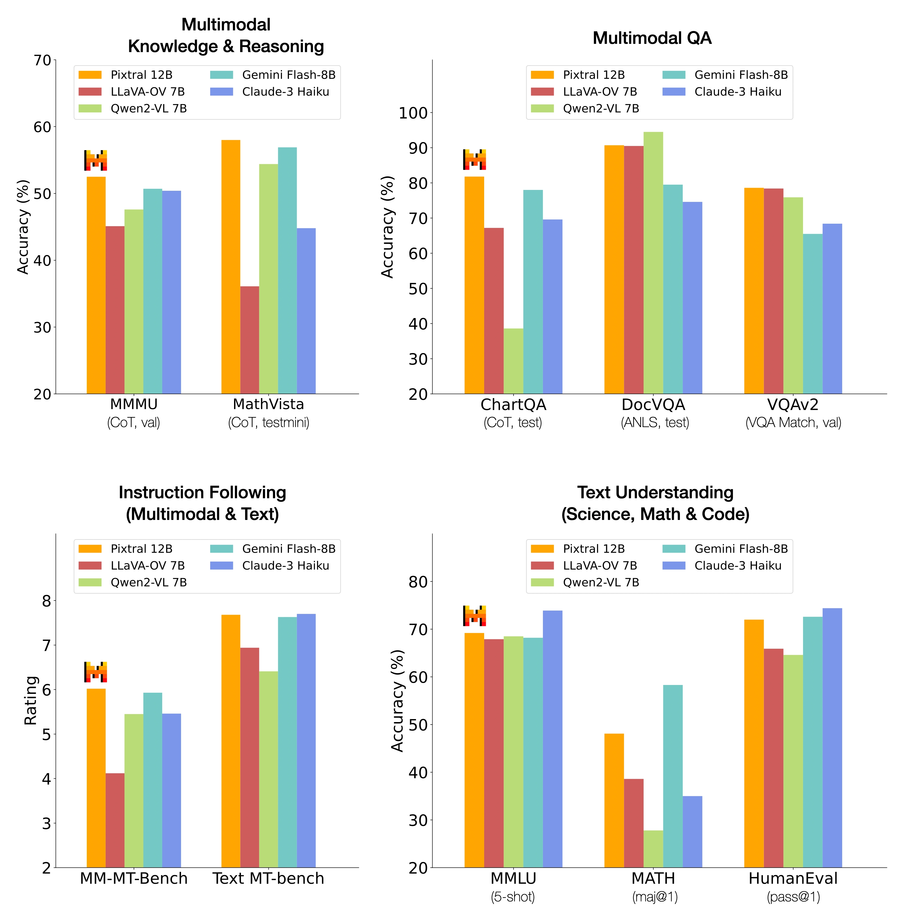
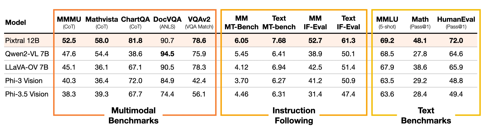

<!-- article-header:start -->
[项目首页](../../../README.md) › [模型系列](../../../reports/model-family-index.md) › [Mistral / Pixtral](../README.md)
<!-- article-header:end -->

# Pixtral 12B：可变分辨率视觉编码与交错图文指令遵循

<!-- article-toc:start -->
<a id="article-toc"></a>

**本篇目录** · [论文定位](#paper-info) · [快速概览](#overview) · [整体架构](#architecture) · [核心原理](#principles) · [数据构建](#data) · [训练流程](#training) · [实验结果](#experiments)
<!-- article-toc:end -->

<a id="paper-info"></a>

## 1. 论文信息与模型定位

| 项目 | 信息 |
|---|---|
| 原始材料 | Announcing Pixtral 12B，Mistral AI 官方发布说明 |
| 发布日期 | 2024-09-17 |
| 模型家族 | Mistral / Pixtral |
| 材料性质 | 官方技术博客；本篇以其公开方法、原始配图和评测为依据 |
| 模型组成 | 从头训练的 400M 视觉编码器，以及基于 Mistral Nemo 的 12B 多模态解码器 |
| 输入与输出 | 输入文本与图像，输出文本；可在同一上下文中处理多张图片 |
| 上下文 | 128K tokens，图像序列与文本共同占用预算 |
| 公开资源 | [原文](https://mistral.ai/news/pixtral-12b/)、[模型权重](https://huggingface.co/mistralai/Pixtral-12B-2409)、[推理代码](https://github.com/mistralai/mistral-inference) |

Pixtral 12B 的定位是保留通用文本模型能力，同时扩展自然图像、图表、文档与多图理解。它尤其关注两个容易被混在一起的问题：模型能否看清图片，以及模型能否严格执行基于图片提出的输出要求。例如，把两张表合并成指定格式的 Markdown，既要求读取单元格，也要求遵循合并规则和格式约束。

本篇解读固定于原始发布内容及 2026-10-08 获取的页面。页面如今明确标注该型号已停止维护；这个后续状态不改变本文对 2024 年模型方案的介绍。博客没有给出完整训练配置，因此下文会分别说明已经披露的机制与尚未公开的细节。

<a id="overview"></a>

## 2. 快速概览

| 关注点 | Pixtral 的处理方式 | 阅读时应关注什么 |
|---|---|---|
| 图像形状 | 视觉编码器原生支持不同分辨率与长宽比 | 图像的 token 数随空间大小变化 |
| 二维结构 | 每个 16×16 patch 产生视觉 token，行间与图末添加标记 | 相同 patch 数不代表相同图像形状 |
| 多图上下文 | 图像与文本交错进入统一解码器 | 图片数量受上下文和算力预算约束 |
| 指令遵循 | 同时评估文本和图文条件下的约束执行 | 有无图片会改变任务难度 |
| 能力保持 | 单独报告文本数学、代码和知识评测 | 多模态能力提升是否伴随文本退化 |

最值得记住的技术选择，是不把所有图片都压成同一种固定视觉输入形状。小图可以使用较短的视觉序列，包含细密文字的文档可以保留更多局部信息。代价是高分辨率图片产生更多 token，增加上下文占用与推理计算。

官方主比较表报告 MMMU 52.5、MathVista 58.0、ChartQA 81.8，以及文本 IF-Eval 61.3。它们来自不同数据集和评分方法，不能平均后解释成一个“综合理解率”。第七节会保留主要指标和比较条件。[来源：官方原文 Performance、Instruction following。](https://mistral.ai/news/pixtral-12b/)

<a id="architecture"></a>

## 3. 整体架构



*原始图片：官方发布页 “Pixtral Model Architecture”，无图编号，未重绘。图中由视觉编码器处理图片，由统一 Transformer 解码器处理交错文本与视觉序列。*

信息流可以分为三个环节。首先，图像进入新训练的 Vision Transformer 编码器，形成具有局部空间含义的视觉表示。其次，视觉表示被组织成含行边界与图像终止标记的一维序列，并与文本 token 交错排列。最后，多模态 Transformer 解码器在这些条件信息之上预测后续文本。

对单张图，解码器可以生成描述或回答问题；对多张图，同一条序列可以容纳“文字指令—图一—补充文字—图二”的输入，从而进行跨图比较。博客用两张表的合并任务展示了这种能力。架构并不要求先把每张图转换成独立的自然语言描述，再进行文本推理；视觉表示直接进入解码过程。

语言侧基于 Mistral Nemo，视觉侧是新训练的 400M 编码器。博客没有展开连接模块的层数、隐藏维度、视觉注意力位置编码或完整参数表，因此不能根据其他 Pixtral 版本反推本型号的内部配置。图中出现的性能小表也不应替代正式主比较表：其中 DocVQA 数值与后文表格不同，第七节明确选用主表。

| 模块 | 输入与输出 | 公开机制 |
|---|---|---|
| 原生分辨率视觉入口 | 不同宽高图像 → 16×16像素patch网格 | 可变序列长度保留图像比例；发布页未完整列出最大尺寸及填充规则。 |
| 400M视觉编码器 | patch网格 → 视觉特征 | 新训练的Vision Transformer编码图像，直接形成解码条件。 |
| 行与图像边界 | 视觉特征 → 含BREAK/END的序列 | 行间与图末标记区分二维形状和多张图；连接器层数未披露。 |
| 12B多模态解码器 | 交错图文 → 后续文本 | 语言侧基于Mistral Nemo，在共享128K上下文中生成回答。 |

[模块依据：官方固定发布页 Architecture、Instruction following、Performance](https://mistral.ai/news/pixtral-12b/)。

<a id="principles"></a>

## 4. 核心创新与数学原理

### 4.1 用序列边界保留二维形状




*原始图片：官方发布页可变分辨率视觉编码示意，无编号。横图和竖图产生不同的 patch 网格，展平时在行间插入 `[IMG BREAK]`，末尾插入 `[IMG END]`。*

假设预处理后的图像恰好可按 16 像素切分，令 patch 网格为 $`h\times w`$，则视觉 patch 数是 $`N=hw`$。这只是根据博客 patch 大小写出的计数关系；边界图像如何填充、最大尺寸如何限制，发布页没有完整说明。若每个非末行之后插入一个行间标记，再添加一个图末标记，示意序列长度为

```math
N_{\mathrm{seq}}=hw+(h-1)+1=hw+h.
```

这是对图示排列的解释，不是官方给出的 tokenizer 配置公式。它说明为什么额外标记有意义：一个 2×6 网格和一个 3×4 网格都有 12 个 patch，只看展平长度无法区分长宽比；行边界提供了显式的结构线索，使解码器能够区分每行结束的位置。

例如，512×768 的图像对应 32×48 的网格，共 1536 个 patch；256×256 对应 16×16，共 256 个 patch。在这个简化计数下，前者视觉 token 明显更多。高分辨率文档获得更多局部信息，小图保持较低成本。这体现的是表示容量随输入内容分配，而不是所有图片都有相同固定成本。

128K是整条上下文预算，要同时容纳文字、各图的视觉序列以及生成内容。保留高分辨率能增加局部线索，但多图输入也会累计消耗这个预算，因此“支持任意数量图片”应理解为受上下文容量约束的接口能力。行边界保留长宽结构，不能单独证明图像空间关系已被完整理解。 [Architecture](https://mistral.ai/news/pixtral-12b/)

### 4.2 图文交错条件下预测下一个文本 token


博客明确说明，模型在交错图文数据上学习预测后续文本。令 $`c`$ 表示包含文本与视觉表示的上下文，目标文本为 $`y_{1:T}`$，其自回归分解可以写为

```math
p_\theta(y\mid c)=\prod_{t=1}^{T}p_\theta(y_t\mid c,y_{\lt t}).
```

相应的解释性负对数似然为

```math
\mathcal L_{\mathrm{text}}=-\sum_t \log p_\theta(y_t\mid c,y_{\lt t}).
```

这两个式子是对已披露“预测下一个文本 token”目标的数学重述。博客没有说明所有训练阶段的 loss mask、额外辅助项、图像重建目标或偏好优化算法；本文不把这些未公开项补入实际训练配方。

这种条件建模允许答案同时依赖图片内容和指令约束。识别图表中的数值解决感知问题，按照指定列名输出表格解决指令问题；统一训练目标可以覆盖两者，但不能单凭目标形式证明模型已经学会可靠空间推理。

两张表合并的示例显示，解码器可以同时利用不同图像中的互补字段，以及文字指令指定的合并方式。这样无需先强制为每图生成一段描述再拼接，避免中间文字摘要遗漏字段；代价是视觉表示本身占用上下文，感知错误仍可能传到最终答案。该发布型号描述的是图文输入、文字输出，不能由统一解码器推断其具有图像生成头。 [Architecture、Qualitative examples](https://mistral.ai/news/pixtral-12b/)

### 4.3 将指令遵循作为独立评测维度


发布页在文本 IF-Eval、MT-Bench 之外构建多模态版本 MM-IF-Eval、MM-MT-Bench，避免只用视觉问答正确率衡量所有能力。严格的格式、条数或内容约束与开放式回答质量不同，因而这几个分数也不能直接互换。其价值在于把“看懂”与“按要求完成任务”同时纳入验收。[来源：原文 Architecture、Instruction following。](https://mistral.ai/news/pixtral-12b/)

发布页说明使用共同评测框架和相同提示重测模型，并先核对GPT-4o、Claude3.5等公开结果。共同提示减少了提示和评分设置的差异，但未必是每个模型各自最优的提示。因此表格支持该受控设置下的比较，指令遵循指标也应与感知准确率并读，而不应混成一个全任务能力结论。 [Performance、Instruction following](https://mistral.ai/news/pixtral-12b/)

<a id="data"></a>

## 5. 数据构建与处理

原文确认使用交错图像与文本训练，并面向自然图像和文档内容。支持可变尺寸意味着数据管线必须保留每张图片的网格形状，并让序列边界与图片顺序一致。例如，用户要求比较两张表时，如果图像位置与文字引用错配，即使单图编码正确，跨图推理仍可能失败。

从已披露内容能够还原的处理链是：准备图文输入，按图像自然分辨率与长宽比获得 patch 网格，编码成视觉表示，添加行间与图末标记，再将其放回图文交错序列。这里的“自然分辨率”来自发布说明，不能据此假定任意尺寸都没有上限或完全不做预处理。

博客没有公开训练样本总量、图文与纯文本混合比例、来源清单、去重策略、OCR 合成数据规模、过滤器阈值和人工标注流程。页面展示的 GDP 图、训练损失图、两张表合并与截图生成 HTML 等，是能力案例；不能把它们当作完整训练数据集的统计证据。

评测方面，作者为每个数据集选择能够复现 GPT-4o 与 Claude 3.5 Sonnet 已报告表现的提示，再将同一提示用于所有参评模型，并表示会公开提示。这比直接拼接各模型宣传页分数更有可比性，但仍需要评测提示和代码才能完整复现。本文只根据发布页已经提供的条件解读。[来源：原文 Evaluation protocol。](https://mistral.ai/news/pixtral-12b/)

<a id="training"></a>

## 6. 训练流程与目标

能够确认的流程包括：从头训练新的视觉编码器，以 Mistral Nemo 为语言基础建立多模态解码器，并在交错图文条件下预测文本。视觉侧是否有单独预训练阶段、各阶段是否冻结语言参数、何时提高分辨率，发布页没有给出可复现的顺序表，因此本文不套用其他模型常见的“两阶段训练”作为 Pixtral 已披露事实。

模型的结果目标有三项：增强多模态推理，提升带图与纯文本指令遵循，同时保持基础文本能力。第一项通过视觉问答与图表文档评测观察，第二项通过 IF-Eval 和 MT-Bench 系列观察，第三项通过 MMLU、MATH 和 HumanEval 观察。它们是评测目标；不能由此推定训练损失中必然有三项对应加权项。

博客没有报告优化器、学习率、训练步数、batch size、训练算力、偏好数据量或 RL 方法。权重开放使推理研究可进行，但仅靠本篇发布说明还不能重建训练。其最清晰的可迁移经验是：让图像表示适应实际空间结构，并把图文指令约束与文本能力保持一起纳入模型验收。

<a id="experiments"></a>

## 7. 实验设置与主要结果



*原始图片：官方发布页综合评测图，无编号。四组子图分别展示多模态知识推理、视觉问答、指令遵循和文本能力；纵轴和指标各不相同。*



*原始图片：官方主比较表，无编号。本文数字转录以这张表为准，其中列明 CoT、ANLS、VQA Match、5-shot 和 Pass@1 等评测口径。*

| 指标 | Pixtral 12B | Qwen2-VL 7B | LLaVA-OV 7B | 解读 |
|---|---:|---:|---:|---|
| MMMU，CoT | 52.5 | 47.6 | 45.1 | 多学科视觉理解与推理 |
| MathVista，CoT | 58.0 | 54.4 | 36.1 | 图形条件下的数学问题 |
| ChartQA，CoT | 81.8 | 38.6 | 67.1 | 此处为作者统一提示重测的结果 |
| DocVQA，ANLS | 90.7 | 94.5 | 90.5 | Pixtral 没有在该项超过所有比较模型 |
| VQAv2，VQA Match | 78.6 | 75.9 | 78.3 | 通用视觉问答 |
| MM-IF-Eval | 52.7 | 38.9 | 42.5 | 图文条件下的指令遵循 |
| Text IF-Eval | 61.3 | 50.1 | 51.4 | 文本约束执行 |
| Text MT-Bench | 7.68 | 6.41 | 6.94 | 开放式文本回答质量 |
| HumanEval，Pass@1 | 72.0 | 64.6 | 65.9 | 纯文本代码能力 |

这些结果支持模型在约 12B 规模下兼顾图文推理和文本指令能力。比如文本 IF-Eval 相对表中最高的其他模型 51.4，提高 9.9 个百分点，约为 19.3% 的相对提升；原文“约 20%”是相对变化，不能写成提高 20 个百分点。

DocVQA 需要特别核查：整体架构宣传图的小表使用 92.3，而正式主比较表和多图合并示例使用 90.7。本文采用主比较表 90.7，并保留两张原图供查证，不将两个版本的数字混合成同一结果。闭源和较大模型比较中，GPT-4o、Claude 3.5 Sonnet 的 MMMU 分别为 68.6、68.0，仍明显高于 52.5，因此“较小模型中表现强”不等于“所有指标达到最强闭源模型”。

案例展示能说明模型会读复杂图表、合并多图信息和从截图生成网页，但不是随机抽样的大规模测试；其中模型对训练损失图的原因解释也没有外部真值验证。发布页没有提供可变分辨率、边界 token 或训练策略的组件消融，不能把所有性能提升单独归因于某一个设计。对研究复用而言，最可靠的结论是架构与综合评测方案；更强的因果结论需要额外实验。

<!-- article-footer:start -->
---

[← 上一篇：ChartMoE](../../chartmoe/arxiv-2409.03277/README.md) · [按发表时间浏览](../../../reports/paper-reading-guide.md#year-2024) · [下一篇：Qwen2-VL →](../../qwen/arxiv-2409.12191/README.md)

[返回本篇目录](#article-toc) · [返回模型系列](../README.md)
<!-- article-footer:end -->
