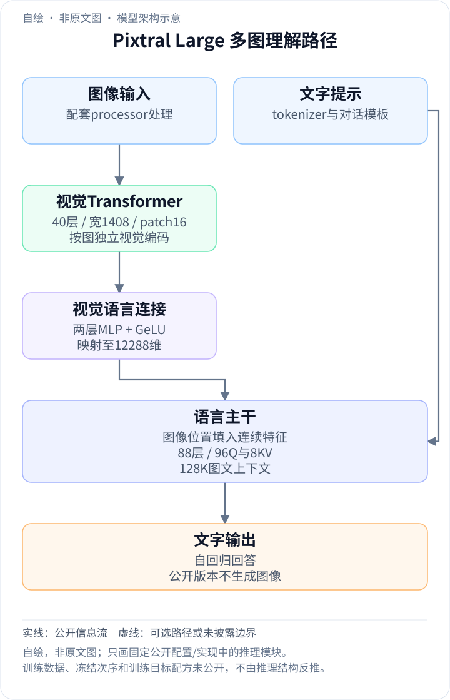
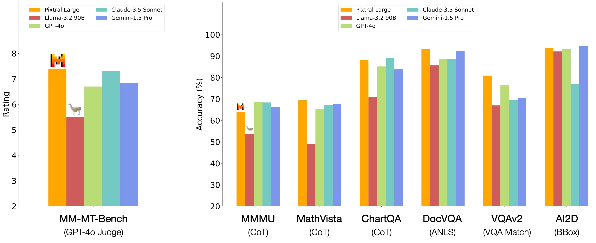
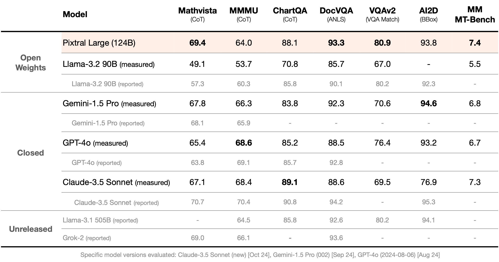

<!-- article-header:start -->
[项目首页](../../../README.md) › [模型系列](../../../reports/model-family-index.md) › [Mistral / Pixtral](../README.md)
<!-- article-header:end -->

# Pixtral Large：大型视觉编码器与多图长上下文

> 解读 Mistral AI 于 **2024-11-18** 发布的 **Pixtral Large** 官方博客，固定原始页面快照为 2026-10-13。组件细节补充采用官方模型 HF revision **c1e51f6f11974a1199685d35c62f5a425c2d001e** 的 `params.json` 与模型卡，以及官方 mistral-inference commit **9eaeb91c17450e09021b6065a1d5cc69876507c8**。公开推理配置不代表完整训练方法。

<!-- article-toc:start -->
<a id="article-toc"></a>

**本篇目录** · [论文定位](#paper-info) · [快速概览](#overview) · [整体架构](#architecture) · [核心原理](#principles) · [数据构建](#data) · [训练流程](#training) · [实验结果](#experiments)
<!-- article-toc:end -->

<a id="paper-info"></a>

## 1. 论文信息与模型定位

| 项目 | 内容 |
|---|---|
| 团队与材料 | Mistral AI；官方发布博客、开放模型卡与推理配置 |
| 家族 | Mistral / Pixtral，继 Pixtral 12B 后的大规模视觉模型 |
| 规模口径 | 124B 型号；官方拆为约 123B 多模态解码器与 1B 视觉编码器 |
| 输入输出 | 图像及文字输入、文字输出，支持多图文档/图表/自然图像理解 |
| 上下文 | 官方称 128K，配置最大位置为 131,072 |
| 开放形式 | 开放权重，MRL 研究许可；不能标为 Apache 2.0 |
| 官方资源 | [发布博客](https://mistral.ai/news/pixtral-large/) · [固定模型卡](https://huggingface.co/mistralai/Pixtral-Large-Instruct-2411/blob/c1e51f6f11974a1199685d35c62f5a425c2d001e/README.md) · [固定参数](https://huggingface.co/mistralai/Pixtral-Large-Instruct-2411/blob/c1e51f6f11974a1199685d35c62f5a425c2d001e/params.json) |

模型以 Mistral Large 2 为语言基础，目标是在保留文字能力的同时处理复杂视觉内容。本文介绍该历史版本；当前抓取的博客已标注 deprecated，不将其描述为现役最新模型。

<a id="overview"></a>

## 2. 快速概览

Pixtral Large 将 40 层、宽度 1,408 的视觉 Transformer 与 88 层、宽度 12,288 的语言主干连接。图像按 16×16 patch 转成视觉序列，二维位置与图像内部注意力描述空间结构，MLP 将视觉向量映射到语言宽度，再与文字嵌入放入共同序列。

多图在视觉主干内保持彼此独立，进入语言主干后才结合提问做跨图理解。128K 是图文共同消耗的预算；公开“至少 30 张高分辨率图”是容量说明，不等于任何尺寸图片都能无限加入。

官方评测在部分文档、数学和生成式多模态基准上有优势，但 MMMU、ChartQA 等并非全部领先。发布材料没有给出训练语料规模、冻结安排与完整消融，以下以可验证的模块机制和评测条件为主。

<a id="architecture"></a>

## 3. 整体架构

<!-- derived-architecture:start -->


*自绘模型架构示意（非原文图）。依据下述公开资料归纳；方框表示功能组件，不代表逐层实现。*

依据：[Key Features / Metrics](https://huggingface.co/mistralai/Pixtral-Large-Instruct-2411/resolve/c1e51f6f11974a1199685d35c62f5a425c2d001e/README.md)；[vision_encoder / language args](https://huggingface.co/mistralai/Pixtral-Large-Instruct-2411/resolve/c1e51f6f11974a1199685d35c62f5a425c2d001e/params.json)；[视觉编码、连接器与图文融合](https://raw.githubusercontent.com/mistralai/mistral-inference/9eaeb91c17450e09021b6065a1d5cc69876507c8/src/mistral_inference/vision_encoder.py)。
<!-- derived-architecture:end -->

| 模块 | 输入与输出 | 公开机制 |
|---|---|---|
| 图像 patch 嵌入 | RGB 图像 → 宽度 1,408 的网格 | Conv2d kernel/stride=16，无偏置；每图独立提取 patch |
| 空间位置 | 每个 patch 的二维坐标 → RoPE 旋转位置 | 按高/宽网格生成位置，视觉 RoPE 基频 10,000 |
| 视觉 Transformer | 各图 patch → 视觉特征 | 40 层、16 注意力头、FFN 6,144；图像之间使用 block-diagonal mask 隔离 |
| 视觉语言适配器 | 1,408 维视觉特征 → 12,288 维表示 | 两层线性 + GeLU，配置 adapter_bias=false |
| 图文融合 | 文字嵌入/图像占位 → 统一序列 | 图像位置写入视觉表示，其余位置保留文字嵌入，检查序列长度与维度一致 |
| 语言主干 | 图文上下文 → 文字预测 | 88 层，96 个 Q 头、8 个 KV 头，head dimension 128；词表 32,768 |
| 生成与缓存 | 完成 prefill 的上下文 → 自回归回答 | 语言位置 RoPE 基频为十亿，按历史序列继续生成 |

一次推理按“各图编码→视觉投影→填入图像 token 位置→语言 prefill→逐词生成”进行。图像特征在视觉端没有跨图注意力，跨图比较依赖之后的语言主干。本文固定参数没有启用后来 Small 3.1 使用的 2×2 PatchMerger；不能把同家族的新组件倒推到该版本。[固定 params；官方 VisionTransformer / VisionLanguageAdapter / embed_vision_language_features](https://github.com/mistralai/mistral-inference/blob/9eaeb91c17450e09021b6065a1d5cc69876507c8/src/mistral_inference/vision_encoder.py)

<a id="principles"></a>

## 4. 核心创新与数学原理

### 4.1 二维位置与分图注意力：先提取每张图自己的结构

卷积 patch 嵌入给每张图产生二维网格，代码显式保留每个 patch 的行列坐标，再取二维 RoPE。将多张图的 token 串接处理只是批处理组织，不意味着它们在视觉层可以互相读取：block-diagonal mask 将注意力分成逐图的独立块。

这种设计保留每幅图内部的全局视觉关系，同时避免一个页面的视觉表征被另一张不相关图片直接混入。进入语言主干后，图像表示与问题和其他图像共同参与生成，因此可进行跨页证据整合。两阶段分工不同，不应把视觉隔离误读为整个模型不能比较多图。

二维位置编码在代码中有直接依据，但博客没有提供相对其他位置编码的控制消融，因此不能量化其独立提升。[官方 vision_encoder.py 的 position_meshgrid / freqs_cis / forward](https://github.com/mistralai/mistral-inference/blob/9eaeb91c17450e09021b6065a1d5cc69876507c8/src/mistral_inference/vision_encoder.py)

### 4.2 两层适配器与图像占位：把连续视觉表示接入语言空间

官方适配器的计算可写成：

```math
z=W_{\mathrm{out}}\,\mathrm{GeLU}(W_{\mathrm{in}}h).
```

$`h`$ 为 1,408 维视觉 token，第一层映射至语言宽度 12,288，第二层保持该宽度；固定配置关闭偏置。此式是源码计算的转写，不是论文提出的独立训练目标。

实现分别获得文字和图像特征，再按输入 token 是否为图像占位进行填充。视觉 token 数与预留位置数必须一致，视觉/文字宽度也必须一致。图像不必先被 OCR 转成文字，MLP 传入的是连续特征；它保留空间视觉信息供语言主干使用。

固定参数未配置空间合并，且官方参数类默认合并尺寸为 1、合并器标识为空。这个版本的适配器改变特征宽度，不应把它描述为把 patch 数压成四分之一。[官方 vision_encoder.py 的 VisionLanguageAdapter；args.py 默认值；transformer.py 融合逻辑](https://github.com/mistralai/mistral-inference/blob/9eaeb91c17450e09021b6065a1d5cc69876507c8/src/mistral_inference/transformer.py#L122)

### 4.3 多图预算与 GQA：容量来自序列空间，也受缓存成本约束

按公开 patch 16 设计，一张处理后的 1,024×1,024 视图会产生 $`(1024/16)^2=4096`$ 个 patch token。这是示例尺寸的算术推导，实际图像形状和特殊标记还要经过配套 processor；不能用它宣称每张图恒定占用 4,096 token。

30 个这种视图的 patch 已约 122,880 token，接近 128K 上下文，需要继续为提示、结构标记和答案留预算。它帮助理解官方多图容量为何必须附带分辨率条件。增大上下文长度并不会使视觉输入免费。

语言 GQA 由 96 个查询头共享 8 个 KV 头，降低相对于完全独立 KV 头的缓存存储；但历史仍随序列增长。124B 权重自身也有显著硬件成本，因此该模型的“大规模多图理解”与轻量端侧模型是不同部署定位。[官方参数与模型卡 Key features / Usage](https://huggingface.co/mistralai/Pixtral-Large-Instruct-2411/blob/c1e51f6f11974a1199685d35c62f5a425c2d001e/params.json)

<a id="data"></a>

## 5. 数据构建与处理

官方博客展示多语言票据 OCR、训练曲线分析、网页截图问答，表明预期应用覆盖文档、图表和自然图像。然而案例并不披露训练数据来源，不能由这些例子推断对应数据集、数量或合成比例。

公开材料没有给出完整语料构建、清洗/去重阈值、视觉分辨率混合或多图采样 recipe。推理侧可确认逐图 patch 编码、二维位置和语言序列中的图像占位；训练数据层面的未知保持明确。[官方博客 Qualitative Samples；固定模型卡](https://mistral.ai/news/pixtral-large/)

<a id="training"></a>

## 6. 训练流程与目标

| 环节 | 已公开内容 | 未披露内容 |
|---|---|---|
| 语言基础 | 建立在 Mistral Large 2 上 | 继续预训练的 token 数和数据混合 |
| 视觉组件 | 约 1B 视觉编码器与 MLP 适配器 | 视觉预训练来源、冻结/解冻次序 |
| 指令模型 | 发布 Pixtral-Large-Instruct-2411 | SFT/偏好/RL 的完整阶段、损失系数和优化超参 |
| 系统提示 | V7 模板，建议使用明确 system prompt | 不能把提示模板当作新训练算法 |

因此本文不补写一个“标准多阶段训练配方”来冒充该模型事实。官方声称保留文字能力，但没有在发布博客提供独立逐阶段消融；组件架构可由配置核对，能力保留仍需看对应评测。[官方博客；固定模型卡 System Prompt Handling / Basic Instruct Template](https://huggingface.co/mistralai/Pixtral-Large-Instruct-2411/blob/c1e51f6f11974a1199685d35c62f5a425c2d001e/README.md)

<a id="experiments"></a>

## 7. 实验设置与主要结果



*来源：官方博客 Benchmark summary。左侧 MM-MT-Bench 为 GPT-4o judge 评分，右侧不同任务分别采用各自评测协议，不能平均成统一准确率。*

| 基准/口径 | Pixtral Large | 官方同框架对照 |
|---|---:|---|
| MathVista CoT | 69.4 | GPT-4o 65.4；Gemini 1.5 Pro 67.8 |
| MMMU CoT | 64.0 | GPT-4o 68.6；Claude 3.5 Sonnet 68.4 |
| ChartQA CoT | 88.1 | Claude 3.5 Sonnet 89.1 |
| DocVQA ANLS | 93.3 | Gemini 1.5 Pro 92.3 |
| VQAv2 VQA Match | 80.9 | GPT-4o 76.4 |
| AI2D BBox | 93.8 | Gemini 1.5 Pro 94.6 |
| MM-MT-Bench | 7.4 | Claude 3.5 Sonnet 7.3 |



*来源：官方博客 Detailed benchmarks。原图区分 measured 与 reported；保留底部版本脚注，避免从不同来源挑选最高分拼成单一对照。*

被测版本为 Claude 3.5 Sonnet 2024-10 新版、Gemini 1.5 Pro 002、GPT-4o 2024-08-06。官方采用共同测试框架的成绩与各厂家原先 reported 成绩存在差异，表中刻意分开；其优势成立于这些固定协议，不能外推为所有视觉任务都超过全部闭源模型。

多图问答和定性案例说明模型的应用范围，但并非对多页定位、幻觉或最大上下文稳定性的完整压力测试。公开资料支持 Pixtral Large 在该时期具有较强图表/文档与生成式多模态能力，仍保留 MMMU、ChartQA 和 AI2D 等明确的非领先项。[固定模型卡 Metrics；官方博客 Performance](https://huggingface.co/mistralai/Pixtral-Large-Instruct-2411/blob/c1e51f6f11974a1199685d35c62f5a425c2d001e/README.md#metrics)

<!-- article-footer:start -->
---

[← 上一篇：LongVU](../../longvu/arxiv-2410.17434/README.md) · [按发表时间浏览](../../../reports/paper-reading-guide.md#year-2024) · [下一篇：ChatRex →](../../chatrex/arxiv-2411.18363/README.md)

[返回本篇目录](#article-toc) · [返回模型系列](../README.md)
<!-- article-footer:end -->
