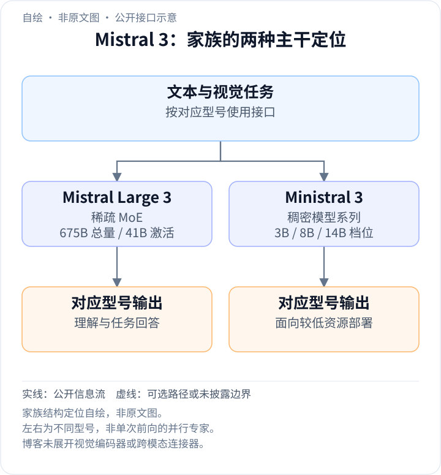
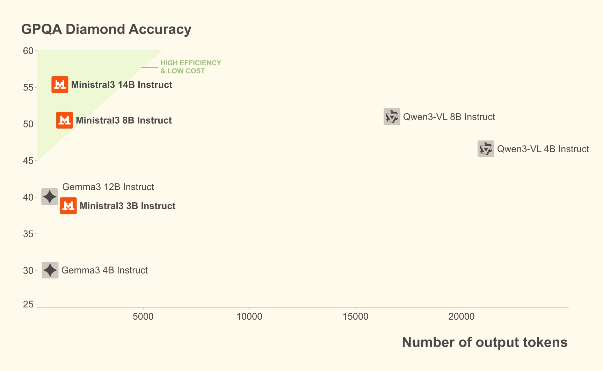
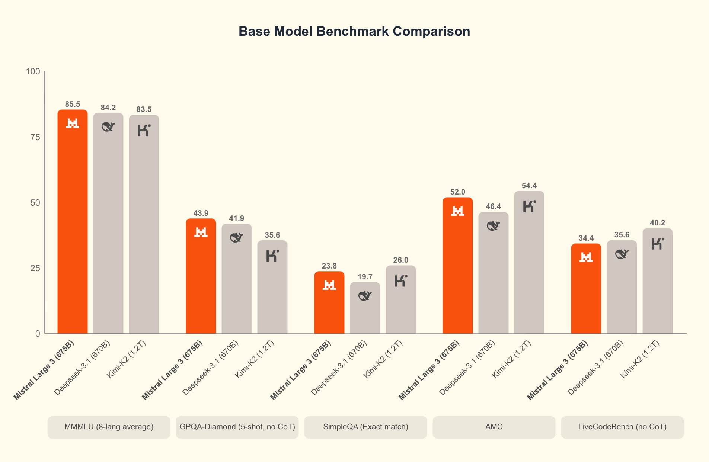
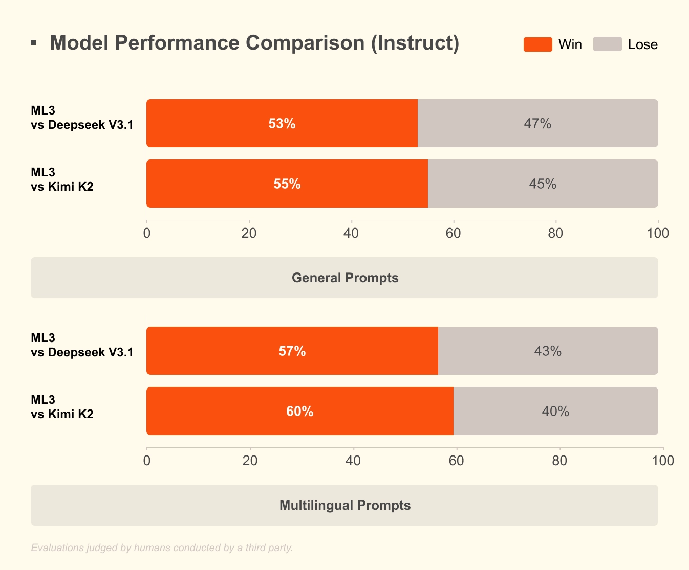

<!-- article-header:start -->
[项目首页](../../../README.md) › [模型系列](../../../reports/model-family-index.md) › [Mistral / Pixtral](../README.md)
<!-- article-header:end -->

# Mistral 3：稀疏大模型与端侧多模态模型的联合发布

<!-- article-toc:start -->
<a id="article-toc"></a>

**本篇目录** · [论文定位](#paper-info) · [快速概览](#overview) · [整体架构](#architecture) · [核心原理](#principles) · [数据构建](#data) · [训练流程](#training) · [实验结果](#experiments)
<!-- article-toc:end -->

<a id="paper-info"></a>

## 1. 论文信息与模型定位

| 项目 | 信息 |
|---|---|
| 原始材料 | Introducing Mistral 3，Mistral AI 官方发布页 |
| 发布日期 | 2025-12-02 |
| 模型家族 | Mistral / Pixtral |
| 材料性质 | 模型系列发布说明；本文以该页面公开的信息与原图为范围 |
| 大模型 | Mistral Large 3，675B 总参数、41B 激活参数的稀疏 MoE |
| 小模型 | Ministral 3，3B、8B、14B 三种稠密型号 |
| 多模态范围 | 本次发布明确包括图像理解与多语言能力 |
| 资源 | [官方原文](https://mistral.ai/news/mistral-3/)、[Large 3 官方集合](https://huggingface.co/collections/mistralai/mistral-large-3)、[Ministral 3 官方集合](https://huggingface.co/collections/mistralai/ministral-3) |

这份材料讨论的是一组面向不同部署规模的模型，而不是一个单独型号。Large 3 以大容量稀疏专家实现通用能力，Ministral 3 以较小稠密模型服务本地与端侧场景。官方为大模型发布 base 和 instruct，为每种小模型发布 base、instruct、reasoning，并明确这些小模型均具备图像理解能力。

应按发布日期区分现状和计划：Large 3 的 reasoning 版本在文中属于后续计划，不能将小模型 reasoning 的成绩写成 Large 3 当时已发布的能力。原文全部型号使用 Apache 2.0 许可；许可名称本身不意味着训练数据、全部配方和实验代码均已公开。

<a id="overview"></a>

## 2. 快速概览

| 技术轴 | 已披露设计 | 对模型定位的意义 |
|---|---|---|
| 参数扩展 | Large 3 为稀疏 MoE，41B 激活、675B 总量 | 区分计算时使用的参数与需要存储的全部参数 |
| 端侧覆盖 | 3B / 8B / 14B 稠密模型 | 用户可按显存与任务难度选择规模 |
| 输出行为 | base、instruct、reasoning 变体 | 基础建模、直接回答与更长推理分别评估 |
| 图像理解 | 大小模型系列均包含视觉能力 | 本篇不把一般语言成绩直接当成视觉成绩 |
| 推理工程 | NVFP4 权重，vLLM、TensorRT-LLM、SGLang 等支持 | 参数规模较大时，量化和并行运行决定部署可行性 |

发布页的主要主张是兼顾能力和运行成本。较小模型的成本既与参数量有关，也与输出长度有关：即使两个模型单 token 开销类似，生成一千个 token 和生成一万个 token 的总延迟也会不同。因此原文分别讨论 instruct 的较短输出与 reasoning 的更长思考，二者对应不同的取舍。[来源：原文 Ministral 3 部分。](https://mistral.ai/news/mistral-3/)

<a id="architecture"></a>

## 3. 整体架构

<!-- derived-architecture:start -->


*自绘公开接口示意（非原文图）。依据下述公开资料归纳；方框表示功能组件，不代表逐层实现。*

依据：[official-source-snapshot-2026-10-08; Mistral Large 3 / Ministral 3](https://mistral.ai/news/mistral-3)。
<!-- derived-architecture:end -->

Large 3 是稀疏混合专家模型；Ministral 3 是稠密模型系列。文章没有给出 Large 3 每层专家数量、路由 Top-k、共享专家配置、注意力形式、视觉编码器型号及连接模块尺寸，因此不能仅凭家族名把 Mixtral 或 Pixtral 某一历史版本的内部结构搬到这里。

在结构层面，Large 3 的核心事实是“总量大、逐 token 激活量较小”。总参数决定模型存储容量和部署权重开销，激活参数描述一次计算中参与的参数规模。二者不会因使用同一个“B”单位而变成可以互换的指标。小模型则在每个 token 的处理过程中使用稠密主干，用较小的参数总量控制端侧资源需求。

官方页面提供的原始图片以评测图为主，没有详细模块架构图。本文保留真实的结果图，并在文字中说明已披露的结构，避免用未经来源支持的示意图填补内部设计。主系列的视觉输入能力已确认，但页面没有逐模块描述图像如何压缩、投影和与文本融合。[来源：原文 Mistral Large 3、Ministral 3。](https://mistral.ai/news/mistral-3/)

| 模块 | 输入与输出 | 公开机制 |
|---|---|---|
| 视觉与文字入口 | 图像、文字 → 模型条件 | 系列支持图像理解；页面未说明视觉编码、压缩和融合的内部层级。 |
| Large3稀疏主干 | 上下文 → 生成状态 | 675B总参数、41B激活；路由算法及专家配置未披露。 |
| Ministral3稠密主干 | 上下文 → 生成状态 | 3B/8B/14B；每种规模提供base、instruct和reasoning变体。 |
| 生成与部署接口 | 生成状态 → 文本 | Large3发布base/instruct与NVFP4检查点；发布页当时将reasoning版本列为后续计划。 |

[模块依据：官方固定发布页 Mistral Large3、Ministral3、Deployment](https://mistral.ai/news/mistral-3)。

<a id="principles"></a>

## 4. 核心创新与数学原理

### 4.1 稀疏参数容量与逐 token 计算


为了理解 MoE，可用一般形式写出一个专家层：

```math
y=\sum_{i\in S(x)}g_i(x)E_i(x).
```

$`E_i`$ 是第 $`i`$ 个专家，$`g_i`$ 是路由权重，$`S(x)`$ 是输入 $`x`$ 激活的专家集合。这个公式用于解释稀疏专家的概念，不是发布页披露的 Large 3 具体路由公式。它说明模型可以保有很多专家，而每个 token 只调用其中一部分。Large 3 的激活参数与总参数之比为

```math
41/675\approx 6.07\%.
```

这不是实际 FLOPs 恰好为稠密 675B 模型 6.07% 的证明：共享层、注意力、路由、通信与实现开销也影响运行成本。原文只给出参数规模，没有足够数据推导精确算力节省。

模型规模和后训练变体是两个不同维度。固定发布页中的Large3提供base与instruct，reasoning版本当时仍为后续计划；Ministral3三个规模则各有三种变体。因而解释该页成绩时需要辨明具体检查点，不能因为同属Mistral3就把reasoning的长推理行为自动套给所有已发布权重。 [Mistral Large3、Ministral3](https://mistral.ai/news/mistral-3)

### 4.2 大权重的低精度部署


原文发布用 llm-compressor 构建的 NVFP4 检查点，并说明可以用 vLLM 在一个 8×A100 或 8×H100 节点运行。用只计权重、忽略元数据的简化估算，675B 参数若每参数 16 bit，需要约 1.35 TB；按 4 bit 估算则为约 337.5 GB。

这仅解释量化为什么对部署重要。实际 NVFP4 还有缩放与格式信息，部分算子和权重可能使用其他精度，运行时还要保存 KV cache、激活和通信缓冲。不能将 337.5 GB 当作官方实测显存，也不能根据激活量 41B 认为只需要存储 41B 权重。原文没有披露每层量化误差和视觉任务上的完整量化消融。

稀疏激活主要控制每token参与计算的参数，低比特权重则主要压缩完整模型的存储需求，两者解决的问题不同。部署仍要让全部专家权重可访问，并承担专家分配与通信开销。发布页提供单节点运行示例，但没有足够测量把激活比例直接转换成吞吐、首token延迟或量化后的多模态精度损失。 [Deployment](https://mistral.ai/news/mistral-3)

### 4.3 同时考虑准确率和输出预算




*原始图片：发布页 “GPQA Diamond Accuracy”，无编号。纵轴为准确率，横轴为输出 token 数；越靠左上，表示在该评测中输出较短且准确率较高。*

可以把一次生成延迟概念性分成 $`T_{\mathrm{prefill}}+N_{\mathrm{out}}\,t_{\mathrm{decode}}`$。这个近似用于解释比较维度，未假定实际服务的每 token 时间恒定。参数量影响单步成本，输出长度影响步数；更长的 reasoning 也可能提高正确率。因此讨论效率必须同时注明模型变体、输入长度、输出预算、硬件与服务设置，不能只比较一个参数数字。

页面把instruct模型较短的输出和reasoning模型用更长推理提高正确率分别展示。这体现的是检查点与输出预算的选择，而非短答案天然更准确。比较图中的点应按同一任务和具体变体解释；若输入长度、硬件或批处理不同，仅凭输出token数不能推导服务延迟排名。 [Ministral3、GPQA Diamond图](https://mistral.ai/news/mistral-3)

<a id="data"></a>

## 5. 数据构建与处理

发布页确认 Large 3 从头训练，系列具备多模态和多语言能力，但没有提供训练 token 总量、图像数量、视频或音频数据管线、图文混合比例、去重算法与质量过滤阈值。“支持 40+ 语言”的发布描述也不等同于这些语言在训练中具有相同数据量。

对 base、instruct、reasoning，读者应把预训练数据和后训练数据分别看待。前者承担基础知识与表示学习，后者塑造指令行为与推理风格；这是理解模型发布形式的概念区分。原文没有公开每个变体的标注数量、偏好样本或 RL 环境，因此本文不据此补出一个推测的训练数据配方。

图像理解的存在支持其归入多模态模型资料，但本页详细展示的多数评测属于文本知识、推理和通用回答。没有给出视觉训练规模，也没有在这些图中给出 MMMU、DocVQA 等系统视觉结果。研究者不能用纯文本知识成绩替代视觉数据质量的证据。

<a id="training"></a>

## 6. 训练流程与目标

原文披露 Large 3 使用约 3000 张 NVIDIA H200 GPU 从头训练，之后进行后训练，发布 base 与 instruction-fine-tuned 权重。这个数字描述训练硬件规模，不包含完整训练时长；据此无法得到总 GPU 小时或总 FLOPs。

Ministral 3 则对每个规模发布三种变体。base 适合观察基础模型能力，instruct 面向常规指令任务，reasoning 可生成较长推理以提高困难任务准确率。发布页没有说明 reasoning 的损失、奖励函数、采样温度、训练步数或精确阶段划分，不能自动把它标成某个特定 RL 算法。

工程协作还涉及低精度执行、注意力和 MoE kernel、prefill/decode 分离以及推测解码。这些属于推理系统优化，不能写成模型训练目标。官方声称相应支持使服务更高效，但没有在本页提供统一硬件条件下的详细吞吐与延迟实测表。本文因此区分训练披露、模型行为和服务实现三个层次。

<a id="experiments"></a>

## 7. 实验设置与主要结果



*原始图片：发布页基础模型比较图，无编号。保留 MMLU 的八语言平均、GPQA 的 5-shot/no-CoT、SimpleQA 的 Exact match 与 LiveCodeBench 的 no-CoT 标签。*

| 基础模型指标 | Mistral Large 3 | DeepSeek-3.1 | Kimi-K2 |
|---|---:|---:|---:|
| MMLU，8-language average | 85.5 | 84.2 | 83.5 |
| GPQA-Diamond，5-shot、no CoT | 43.9 | 41.9 | 35.6 |
| SimpleQA，Exact match | 23.8 | 19.7 | 26.0 |
| AMC | 52.0 | 46.4 | 54.4 |
| LiveCodeBench，no CoT | 34.4 | 35.6 | 40.2 |

结果显示 Large 3 在这组 MMLU 和 GPQA 比较中领先，但在 SimpleQA、AMC、LiveCodeBench 中并非全部最佳。原图没有为每项列出置信区间，也没有完整提示和样本构成，所以接近的分数差异不能自动视为统计显著。



*原始图片：发布页指令模型比较图，无编号。图下注明由第三方组织、由人类判定；上下分别为一般提示与多语言提示。*

一般提示中，Large 3 对 DeepSeek V3.1、Kimi K2 的胜率分别为 53%、55%；多语言提示中分别为 57%、60%。这是图中 Win/Lose 的比较口径，不是客观问答准确率，也不是语言基准的总分。发布页未给出样本量、用户构成、置信区间和详细裁判规则，不能将几个百分点直接解释成稳定普遍优势。

小模型部分，原文报告 14B reasoning 在 AIME ’25 达到 85%。它对应 reasoning 变体，不能与上图 base 的 no-CoT 结果拼接成同一种设置。GPQA 的准确率与输出长度图说明 instruct 型号在该比较中强调少生成 token；图中没有足够信息把这一观察转换成固定倍数的实际端到端速度。

这份发布材料最充分支持的结论，是一个覆盖大型稀疏模型与端侧稠密模型、提供不同输出行为的多模态系列已经推出。其视觉结构细节、视觉任务体系、数据管线和后训练配方，仍需相应技术报告和模型卡补充；本篇没有把发布声明扩展为未经公开验证的完整训练方案。

<!-- article-footer:start -->
---

[← 上一篇：Qwen3-VL](../../qwen/arxiv-2511.21631/README.md) · [按发表时间浏览](../../../reports/paper-reading-guide.md#year-2025) · [下一篇：GPT-5.2 →](../../gpt/document-e2a1f413a7a5/README.md)

[返回本篇目录](#article-toc) · [返回模型系列](../README.md)
<!-- article-footer:end -->
