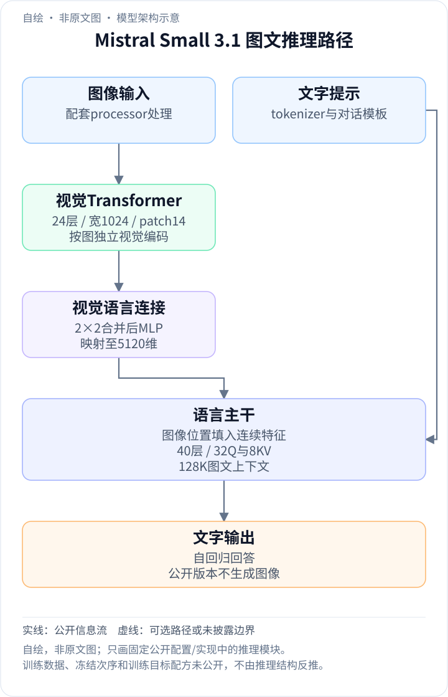
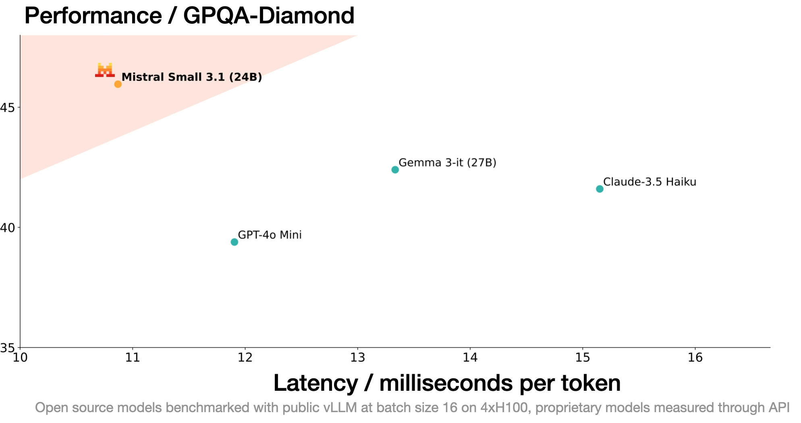

<!-- article-header:start -->
[项目首页](../../../README.md) › [模型系列](../../../reports/model-family-index.md) › [Mistral / Pixtral](../README.md)
<!-- article-header:end -->

# Mistral Small 3.1：视觉 token 合并与 24B 长上下文模型

> 本文解读 Mistral AI 于 **2025-03-17** 发布的官方博客 **Mistral Small 3.1**，固定页面快照为 2026-10-13；架构补充来自官方 HF revision **68faf511d618ef198fef186659617cfd2eb8e33a** 的配置/模型卡，以及 Transformers **v4.50.0** 的 Mistral3 实现。公开推理配置不代表完整训练配方。

<!-- article-toc:start -->
<a id="article-toc"></a>

**本篇目录** · [论文定位](#paper-info) · [快速概览](#overview) · [整体架构](#architecture) · [核心原理](#principles) · [数据构建](#data) · [训练流程](#training) · [实验结果](#experiments)
<!-- article-toc:end -->

<a id="paper-info"></a>

## 1. 论文信息与模型定位

| 项目 | 内容 |
|---|---|
| 团队与材料 | Mistral AI；官方发布博客、模型卡与开放推理配置 |
| 家族 | Mistral / Pixtral；Small 3.1 在 Small 3 基础上加入视觉并扩大上下文 |
| 规模与开放形式 | 24B 型号，发布 Base 与 Instruct，Apache 2.0 |
| 输入与输出 | 文字/图像输入、文字输出，可生成结构化工具调用 |
| 上下文 | 最大位置配置 131,072，官方称 128K |
| 定位 | 兼顾多模态、工具使用、长文档与本地部署的中型模型 |
| 官方资源 | [发布博客](https://mistral.ai/news/mistral-small-3-1/) · [固定模型卡](https://huggingface.co/mistralai/Mistral-Small-3.1-24B-Instruct-2503/blob/68faf511d618ef198fef186659617cfd2eb8e33a/README.md) · [固定配置](https://huggingface.co/mistralai/Mistral-Small-3.1-24B-Instruct-2503/blob/68faf511d618ef198fef186659617cfd2eb8e33a/config.json) |

该版本的意义在于把视觉理解纳入 Small 规模，同时保留文字和工具接口。它不是 Pixtral Large 的缩小尺寸配置，也不能因为共享 Pixtral 视觉组件名称，就沿用 Pixtral 12B 的 patch 大小与序列组织细节。

<a id="overview"></a>

## 2. 快速概览

Small 3.1 采用 24 层、宽度 1,024 的 Pixtral 视觉编码器，patch 为 14；语言主干为 40 层、宽度 5,120。视觉特征先经过 RMSNorm，再把空间相邻 2×2 patch 合并，最后通过两层 MLP 映射到语言表示空间。压缩后的表示替换输入序列中对应图像占位，语言模型随后自回归回答。

这一结构降低了高分辨率图像进入语言模型的 token 数，但需要视觉端先处理较密的 patch。分辨率、视觉计算和语言序列成本应分开看；2×2 合并并不意味着图像编码成本也严格降为四分之一。

官方公开了较完整的结果表与部署配置，但没有披露视觉预训练数据规模、各阶段冻结状态、优化器或偏好训练细节。以下将推理路径讲清，并明确训练层面的信息边界。

<a id="architecture"></a>

## 3. 整体架构

<!-- derived-architecture:start -->


*自绘模型架构示意（非原文图）。依据下述公开资料归纳；方框表示功能组件，不代表逐层实现。*

依据：[Key Features / Metrics](https://huggingface.co/mistralai/Mistral-Small-3.1-24B-Instruct-2503/resolve/68faf511d618ef198fef186659617cfd2eb8e33a/README.md)；[vision_config / text_config](https://huggingface.co/mistralai/Mistral-Small-3.1-24B-Instruct-2503/resolve/68faf511d618ef198fef186659617cfd2eb8e33a/config.json)；[视觉编码、连接器与图文融合](https://raw.githubusercontent.com/huggingface/transformers/v4.50.0/src/transformers/models/mistral3/modeling_mistral3.py)。
<!-- derived-architecture:end -->

| 模块 | 输入与输出 | 公开机制 |
|---|---|---|
| 图像处理 | 原图 → RGB/归一化像素与实际图像尺寸 | 固定 processor 配置最长边 1,540、patch 14；具体缩放/填充由配套处理器执行 |
| Pixtral 视觉主干 | patch 序列 → 宽度 1,024 特征 | 24 层、16 注意力头、FFN 4,096；取最后一层视觉特征 |
| 空间合并 | 2×2 patch 特征 → 一个宽度 1,024 的表示 | RMSNorm 后，四个 token 拼接为 4,096 维，再经无偏置可学习线性层压回 1,024 |
| 多模态投影 | 合并特征 → 宽度 5,120 的语言嵌入 | 1,024→5,120 线性、GeLU、5,120→5,120 线性，配置无偏置 |
| 文字与融合 | 文字嵌入/图像占位 → 统一输入序列 | Tekken 词表 131,072；图像特征替换 image token 对应嵌入 |
| 语言主干 | 统一上下文 → 下一文字 token | 40 层，32 个 Q 头、8 个 KV 头，head dimension 128；RMSNorm 与 RoPE |
| 推理输出 | 文字历史 → 回答或工具调用序列 | 自回归生成，使用配套 system/instruction 模板与终止规则 |

一次推理先由 processor 准备图像和输入 token，视觉主干计算 patch 表示，连接器合并并投影；实现核对图像占位数量和特征数量一致，再用 `masked_scatter` 写入输入嵌入。prefill 后的缓存解码不再重复传入图片像素。工具调用是生成的结构化文字，外部工具的执行仍由应用程序完成。[固定配置；Transformers v4.50.0 的 PatchMerger、MultiModalProjector、get_image_features、forward](https://github.com/huggingface/transformers/blob/v4.50.0/src/transformers/models/mistral3/modeling_mistral3.py)

<a id="principles"></a>

## 4. 核心创新与数学原理

### 4.1 先编码再合并：减少进入语言模型的视觉序列

2×2 合并作用于已经经过视觉主干的特征。实现先按实际图像尺寸恢复二维 patch 网格，用 kernel/stride 都为 2 的 `unfold` 提取不重叠窗口，将四个宽度 $`C=1024`$ 的向量拼成一个向量，再用可学习线性层映射回 $`C`$。

可将一个窗口的计算写为下式；**这是固定实现的计算转写，而非官方博客提出的新公式**：

```math
u=W_m\,\mathrm{concat}(\tilde h_{00},\tilde h_{01},\tilde h_{10},\tilde h_{11}),
\qquad \tilde h=\mathrm{RMSNorm}(h).
```

权重 $`W_m`$ 的输入/输出宽度为 4,096/1,024。与直接平均相比，可学习合并可以给不同位置和通道不同权重；它仍压缩多个位置的信息，不应称为无损操作。对处理后为偶数 patch 网格的图像，视觉序列长度约缩为四分之一；边界尺寸与填充应服从实际 processor，不自行给任意原图套精确公式。[PatchMerger / MultiModalProjector](https://github.com/huggingface/transformers/blob/v4.50.0/src/transformers/models/mistral3/modeling_mistral3.py#L67)

### 4.2 非线性投影与占位替换：保持图像和文字序列对齐

合并后还有两层投影：$`z=W_2\,\mathrm{GeLU}(W_1u)`$，$`z`$ 的宽度为 5,120。该转换使视觉表示能与文字嵌入进入同一语言主干；它不是将图像先转成 OCR 字符串，再把字符串交给纯文本模型。

输入中为图像预留的 token 位置必须与输出视觉特征对应。实现会比较占位嵌入的元素数量与视觉特征的元素数量，不匹配就报错；然后把这些位置替换成视觉向量。这解释了为什么不能用普通文本替换图像标记，或在缩放/合并策略不同的情况下复用旧占位数量。

公开实现说明了维度与融合方式，却不说明投影器最初在哪个数据阶段初始化、训练多久或是否先冻结其他组件；本文将两类事实分别处理。[固定 config；get_image_features / forward](https://github.com/huggingface/transformers/blob/v4.50.0/src/transformers/models/mistral3/modeling_mistral3.py#L442)

### 4.3 GQA 与 128K：长上下文预算还要包含视觉 token

配置给 32 个查询头和 8 个 KV 头，意味着每组四个查询头共享一组 K/V。共享键值头降低历史缓存相对于同数量独立 KV 头的成本，但每个 KV 头仍要存储序列历史。配置 `sliding_window=null`，不能套用 Gemma 3 的局部窗口方案来解释本模型。

131,072 是位置/上下文配置；文字提示、图像表示、对话历史和输出都占用序列资源。更多图片或更高分辨率仍会增加计算与缓存，因此“128K”和“可在单卡运行”不是任意最大输入下同时成立的部署承诺。模型卡把 RTX 4090 / 32GB Mac 的适用性明确限定为量化后部署。[固定 config 的 text_config；官方模型卡](https://huggingface.co/mistralai/Mistral-Small-3.1-24B-Instruct-2503/blob/68faf511d618ef198fef186659617cfd2eb8e33a/config.json)

<a id="data"></a>

## 5. 数据构建与处理

官方材料没有给出完整训练数据清单或图文数量。模型卡列出 24 种支持语言和文字/视觉/工具使用能力，但这些是能力与接口描述，不能换算成各语言训练比例。参数配置也不能反推出数据构建流程。

公开预处理文件给出 RGB 转换、归一化、最长边 1,540、patch 14；语言使用 Tekken tokenizer。图像预处理改变 patch 网格，连接器再压缩空间序列，最终必须与输入占位一致。这里描述的是运行时处理，不当作训练数据清洗或采样 recipe。[固定 preprocessor_config.json](https://huggingface.co/mistralai/Mistral-Small-3.1-24B-Instruct-2503/blob/68faf511d618ef198fef186659617cfd2eb8e33a/preprocessor_config.json)

<a id="training"></a>

## 6. 训练流程与目标

| 环节 | 已公开事实 | 披露边界 |
|---|---|---|
| 模型来源 | 基于 Mistral Small 3，3.1 加入视觉与长上下文改进 | 不代表继承全部上一代训练设置 |
| Base | 发布可继续训练的预训练 checkpoint | 数据量、优化器和阶段时长未披露 |
| Instruct | 模型卡明确由对应 Base 得到的 instruction-finetuned 版本 | 未说明完整 SFT/偏好/RL 过程 |
| 多模态组件 | 公开视觉、合并、投影、语言参数配置 | 不能由代码类结构推定冻结次序或各模态 loss 权重 |
| 推理协议 | V7-Tekken 模板，以 mistral-common 为格式依据 | 模板不是训练目标公式 |

本介绍不添加统一 CE 或 DPO 数学式来填补这些空白；推理代码支持计算语言预测损失，只说明接口具备该计算能力，并不能证明发布模型的全部优化过程。[官方博客、固定模型卡 Basic Instruct Template / Key Features](https://mistral.ai/news/mistral-small-3-1/)

<a id="experiments"></a>

## 7. 实验设置与主要结果

| 视觉/长上下文基准 | Small 3.1 Instruct | 模型卡口径 |
|---|---:|---|
| MMMU | 64.00 | 视觉结果表 |
| MMMU Pro | 49.25 | 与 MMMU 不同基准 |
| MathVista | 68.91 | 视觉数学任务 |
| ChartQA | 86.24 | 图表问答 |
| DocVQA | 94.08 | 文档问答 |
| AI2D | 93.72 | 图示理解 |
| MM-MT-Bench | 7.3 | 模型卡原尺度；博客显示图会缩放至 0–100 |
| RULER 128K | 81.20 | 长上下文表，不是视觉基准 |

原表尽可能使用其他提供者已报告的成绩，否则用 Mistral 自身评测框架重测，因此并非所有对照均在完全相同环境重跑。模型卡 Base 的 MMMU 为 59.27，也不能与 Instruct 的 64.00 混为同一 checkpoint。[固定模型卡 Benchmark Results](https://huggingface.co/mistralai/Mistral-Small-3.1-24B-Instruct-2503/blob/68faf511d618ef198fef186659617cfd2eb8e33a/README.md#benchmark-results)



*来源：官方博客 Performance / GPQA-Diamond 图。图注说明开放模型使用公共 vLLM、batch 16、4×H100，闭源模型经 API 测量；该图是文字科学问答与延迟比较，不是多模态准确率图。*

发布页还称推理速度可达 150 token/s；这不是上述图中所有点或任意硬件的统一速度。不同批量、输入长度、图片数量和量化策略都会影响延迟。表中 Gemma 3 27B IT 的 MATH 高于本模型，也说明官方“同级最佳”应按具体测试读取，不能外推为每项都领先。

<!-- article-footer:start -->
---

[← 上一篇：Nexus-O](../../nexus-o/arxiv-2503.01879/README.md) · [按发表时间浏览](../../../reports/paper-reading-guide.md#year-2025) · [下一篇：Gemma 3 →](../../gemma/arxiv-2503.19786/README.md)

[返回本篇目录](#article-toc) · [返回模型系列](../README.md)
<!-- article-footer:end -->
