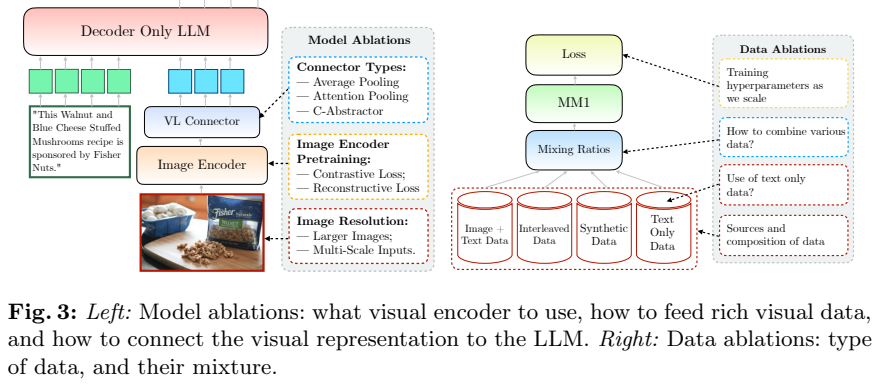
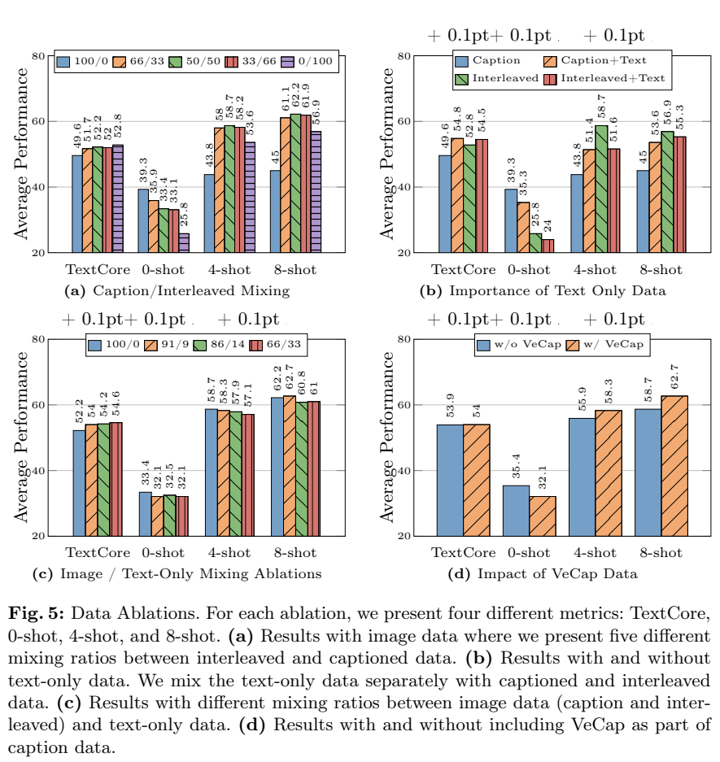
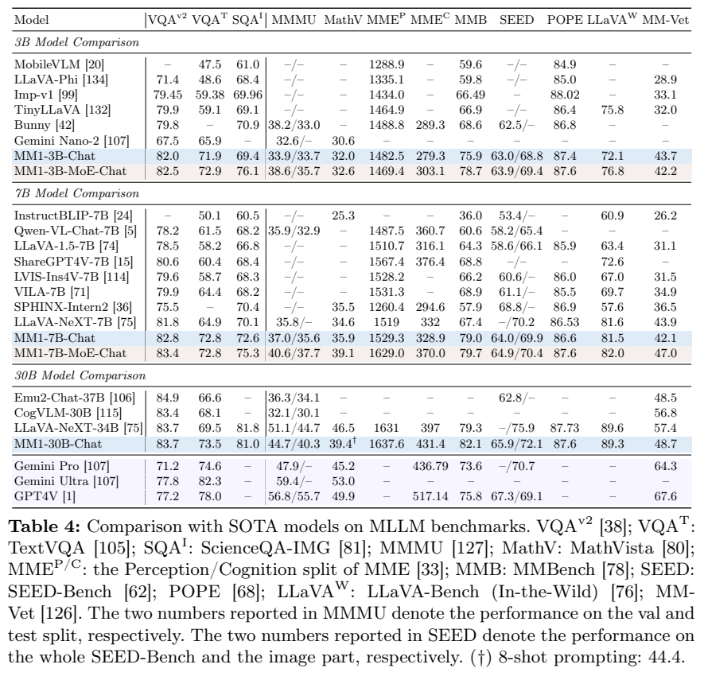
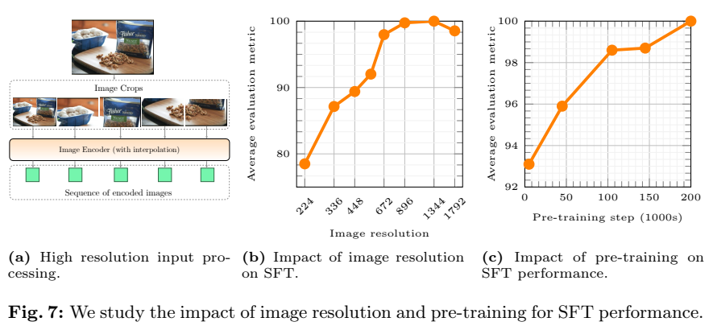

<!-- article-header:start -->
[项目首页](../../../README.md) › [模型系列](../../../reports/model-family-index.md) › [MM1](../README.md)
<!-- article-header:end -->

# MM1：用系统消融建立多模态预训练配方

<!-- article-toc:start -->
<a id="article-toc"></a>

**本篇目录** · [论文定位](#paper-info) · [快速概览](#overview) · [整体架构](#architecture) · [核心原理](#principles) · [数据构建](#data) · [训练流程](#training) · [实验结果](#experiments)
<!-- article-toc:end -->

<a id="paper-info"></a>

## 1. 论文信息与模型定位

| 项目 | 信息 |
|---|---|
| 论文 | MM1: Methods, Analysis & Insights from Multimodal LLM Pre-training |
| 作者与机构 | Brandon McKinzie、Zhe Gan 等，Apple |
| 本文依据 | [arXiv:2403.09611v1](https://arxiv.org/abs/2403.09611v1)，2024-03-14，41 页 |
| 模型 | 3B、7B、30B dense，以及基于小模型扩展的 MoE；-Chat 表示 SFT 后模型 |
| 输入 / 输出 | 单图或多图与文本输入，文本输出；报告不覆盖视频、音频与图像生成 |
| 定位 | 分析架构、数据和优化选择怎样影响多模态预训练，并检验结论能否延续到指令微调 |

MM1 的贡献是公开“如何选出配方”的实验过程。它先用小规模模型比较选择，再把结果扩展到 30B，分别报告基础模型的上下文学习与 Chat 模型的指令能力。模型名称中的规模对应语言主干规模，不应把 MoE 的 3B / 7B 名称直接当作所有专家的总参数量。

<a id="overview"></a>

## 2. 快速概览

论文提出三个主要经验。首先，图像分辨率和进入 LLM 的视觉 token 数比连接器种类更显著地影响效果。其次，短图像描述有利于零样本任务，而网页交错图文有利于 few-shot 与多图能力，少量纯文本帮助保留语言表现。最后，在小模型上寻找的学习率规律可用于大模型，不过它属于本实验配方下的经验拟合。

最终预训练采用 CLIP ViT-H、378×378 图像、每图 144 个 token，以及 45% 交错图文、45% 图文对、10% 纯文本。语言模型与视觉模块均解冻，之后用高分辨率 SFT 得到 Chat 系列。MM1-30B 在预训练的 16-shot VQAv2 为 71.9；Chat 版本零样本 MathVista 为 39.4、8-shot 混合分辨率提示为 44.4。它们对应不同训练与提示设置，不能连成一个“统一分数”。

<a id="architecture"></a>

## 3. 整体架构



**Figure 3，PDF 第 5 页。** 左图是视觉编码器 → VL Connector → decoder-only LLM：图像 patch 特征被压缩并映射到语言模型的输入空间，与文字 embedding 共同进入自回归解码器。右图展示数据来源和比例，这是与架构同样重要的另一组变量。原页包含研究流程示意，不表示每个图上标出的组件都在最终模型中使用。

基础消融配置是 1.2B LLM、336 像素的 CLIP ViT-L/14、C-Abstractor 和 144 个视觉 token；**编码器对比另用 2.9B LLM**以容纳大编码器。最终版本改用在 DFN-5B 上以 CLIP 目标预训练的 ViT-H，378 像素，连接器仍是 C-Abstractor。语言模型为 Apple 内部预训练主干，并非 LLaMA 或 Vicuna。

连接器比较了平均池化加线性投影、可学习查询的注意力池化、以及保留局部结构的 C-Abstractor。增加 token 能保存更多细节，也消耗上下文与注意力计算。报告比较 64 / 144 token，并不据此证明连接器在所有规模、任务上都无关。

高分辨率 SFT 使用位置 embedding 插值与分图：一张 1344×1344 图构成一张 672×672 全局图和四张同尺寸局部图，每个视图压缩为 144 token，总计 **720 token**。672 像素编码时的 2304 个 patch token 是视觉编码器内部序列，与连接器输出数量不同。

<a id="principles"></a>

## 4. 核心创新与数学原理

**经验驱动的学习率扩展。** 论文在 9M、85M、302M、1.2B 小语言模型上搜索学习率，再以 8-shot 下游平均成绩选择配置，避免把验证损失直接当作任务表现。原文 Equation 1 为：

```math
\eta=\exp[-0.4214\ln(N)-0.5535],
```

$`N`$ 是语言模型非 embedding 参数数，$`\eta`$ 是预测峰值学习率。它等价于幂律 $`\eta\propto N^{-0.4214}`$：主干增大时，预测学习率降低。正文给出 30B 预测值约 $`2.2\times10^{-5}`$；附录 B.1 说明实际 3B / 7B / 30B 采用便于使用的 **6e-5 / 4e-5 / 2e-5**。因此不能把拟合预测与最终取整配置写成完全相同。随机初始化连接器统一峰值 8e-5。

**保持上下文边界。** 图文对和交错文档被 pack 到同一长序列时，注意力掩码禁止跨样本边界访问。若无该限制，模型可能在训练中利用不相关图文，影响 few-shot 迁移。45 / 45 / 10 是序列来源的采样概率，不是视觉 token 与文本 token 的数量占比。

**MoE 扩展。** 模型只把语言解码器的部分 FFN 换成稀疏专家，视觉编码器和连接器保持相同。采用 Top-2 路由、64 / 32 个专家、每 2 / 4 层替换一层，并给负载均衡和 router z-loss 分别设置 0.01 / 0.001 系数。MoE 增大总容量而控制激活专家数；论文没有把完整总参数、延迟和训练成本表列出来，不能宣称与 dense 完全等成本。

**混合分辨率上下文示例。** 高分辨率一图占 720 token，四个示例便占 2880 个视觉 token。附录 C.5 对 $`K`$ 个示例仅保留末尾 $`N=3`$ 张高分辨率图，其余用低分辨率，以便在固定上下文内增加示例。论文展示这种输入预算调整能提升 MathVista，但它同时改变分辨率和示例数，不是只比较思维链文字长度。

<a id="data"></a>

## 5. 数据构建与处理

预训练数据池包含约 2B 图文对、300M VeCap 合成图文对、600M 交错文档和 2T 纯文本 token。**这些是候选数据规模，不是最终实际消耗量**。图文对来自 CC3M、CC12M、HQIPT-204M、COYO 与内部网页数据；交错数据包含 OBELICS 与内部网页。

附录披露内部交错数据流程：从 3B 清洗后 HTML 抽取正文与 ``，删除无图或超过 30 图的页面，下载图片后保持其正文位置；得到 500M 文档、1B 图像和 500B 文本 token。删除损坏图、比例低于 1/2 或高于 2 的图、边长过小或过大的图，以及 URL 包含 logo、button、icon 等的图片；URL 或 MD5 出现超过十次的图被去重，页内重复图仅留首个。表中 600M 是含外部来源的总交错池，不能与内部 500M 混淆。

纯文本从 150B 英文 HTML 出发，去除模板、低质量内容，经 exact hash 和 LSH 近重复检测得到 3B HTML，再结合网页、代码、社交、书籍、百科和数学语料。报告未逐一公开内部原始数据和可下载清单。

SFT 正文概括为约 1M 样本，**Table 5 更精确地列出总计 1.45M**。包括 LLaVA-Conv 57K、LLaVA-Complex 77K、ShareGPT-4V 102K、纯文本 13K，以及视觉问答、OCR、图表和文档数据；Synthdog-en 500K、DVQA 200K 是大块来源。短答案任务加单词或短语指令，A-OKVQA要求直接回答选项字母。最终随机混合，未观察到 LAION-GPT4V 或 LVIS-Instruct4V 进一步收益，因此没有纳入最终组合。

<a id="training"></a>

## 6. 训练流程与目标

1. **初始化与小模型实验。** 视觉和语言主干各有自身预训练；连接器随机初始化。基础小模型固定大部分设置，只改一个架构或数据变量，数据消融训练 200K steps。
2. **大规模多模态预训练。** 全模型解冻，序列长 4096，每序列最多 16 图，每图 144 token，batch 512，训练 200K steps。正文称约 100B token，同时附录给出每 batch 约 1M 文本与 1M 图像 token；报告对计数口径未完全解释，不自行把数据池 token 与实际步数乘积等同。
3. **高分辨率 SFT。** 视觉编码器与 LLM 解冻，10K steps、batch 256、AdaFactor、峰值 1e-5、余弦衰减到零；调整位置 embedding 和分图来保留细节。SFT 数据均为单图，但模型仍保留部分多图和 few-shot 能力。

预训练使用 AXLearn、AdamW、2000-step 线性 warmup、余弦衰减到峰值的 10%、最大梯度范数 1。正文经验规则为 $`\lambda=0.1\eta`$，附录 Table 7 另列学习率 / 权重衰减预测值和解耦实现，二者不能直接当作完全一致的实际超参清单。30B 另加系数 1e-4 的 z-loss 以稳定训练，不要与 MoE router 的 0.001 混成一个值。

模型通过自回归文本预测学习多模态条件生成。报告没有完整展开基础生成损失公式；公开信息足以描述优化流程，但不支持补写未给出的图像重建训练目标。AIM 的重建目标是被比较视觉编码器的先验训练方式，不是所有 MM1 阶段的共同损失。

<a id="experiments"></a>

## 7. 实验设置与主要结果



**Figure 5，PDF 第 9 页。** (a) 对比 caption / interleaved 比例，caption-only 零样本均值 39.3，而 50 / 50 为 33.4；8-shot 则由 45.0 上升到 62.2。单一数据源改善一个评价口径，可能损害另一口径。(b)(c) 纯文本对 TextCore 与 few-shot 的影响也依赖其原有组合。(d) 加入 VeCap，4-shot / 8-shot 从 55.9 / 58.7 到 58.3 / 62.7，但零样本由 35.4 降到 32.1，不是全部指标同时提高。

编码器 Table 1 中，CLIP ViT-L 的 224→336 像素使零 / 4 / 8-shot 均值从 36.9 / 58.7 / 62.2 升到 39.9 / 62.4 / 66.0。ViT-L→ViT-H 在 336 像素只增加到 40.5 / 62.6 / 66.3，支持该组实验中分辨率收益更大。不同预训练目标的数据规模并不等同，不能把 AIM 对比解释为纯粹的损失函数因果结论。

预训练 Table 3 的字幕生成使用 CIDEr，VQA 使用准确率，输出为 greedy decoding；不同 shot 数应逐行比较。MM1-30B 的 0 / 8 / 16-shot VQAv2 为 **48.9 / 70.9 / 71.9**，COCO CIDEr 为 **70.3 / 123.1 / 125.3**。16-shot TextVQA 50.6、VizWiz 57.9、OKVQA 59.3。部分基线“0-shot”仍有两条纯文本 demonstration，而 MM1 没有；IDEFICS 含 COCO 相关训练数据，原表脚注必须保留。



**Table 4，PDF 第 14 页。** MMMU 两列为 val / test；SEED 两列为全 benchmark / 图像子集。以下是 dense Chat 的关键数字：

| 模型 | VQAv2 | TextVQA | MMMU val / test | MathVista | MMBench | MM-Vet |
|---|---:|---:|---:|---:|---:|---:|
| MM1-3B-Chat | 82.0 | 71.9 | 33.9 / 33.7 | 32.0 | 75.9 | 43.7 |
| MM1-7B-Chat | 82.8 | 72.8 | 37.0 / 35.6 | 35.9 | 79.0 | 42.1 |
| MM1-30B-Chat | 83.7 | 73.5 | 44.7 / 40.3 | 39.4 | 82.1 | 48.7 |
| LLaVA-NeXT-34B | 83.7 | 69.5 | 51.1 / 44.7 | 46.5 | 79.3 | 57.4 |

30B 在 TextVQA、MMBench 较强，但 MMMU、MathVista 与 MM-Vet 未超过该表 LLaVA-NeXT-34B；GPT-4V 的 MMMU 56.8 / 55.7 和 MM-Vet 67.6 也明显更高。7B-MoE 的 MMMU 40.6 / 37.7、MathVista 39.1、MM-Vet 47.0 优于同系 dense；3B-MoE 的 MM-Vet 42.2 却低于 dense 43.7，因此 MoE 不是每项都改善。



**Figure 7，PDF 第 15 页。** 左侧是全局与四个局部视图，中央显示分辨率提升至 1344 像素后再加大并未继续改善；右侧随预训练步数增加，SFT 综合指标上升。其综合量是各任务除以基线后取平均，不能当作原始准确率。正文给出 336→1344 约 15% 相对提升。

附录 Figure 10 提醒，低分辨率下冻结视觉编码器更好约 2.2 points，高分辨率下解冻更好约 2.9，因此最终解冻选择有范围条件。MathVista 上，30B-Chat 的 0-shot 39.4、4-shot CoT 41.9、8-shot 混合分辨率 CoT 44.4 展示了上下文能力；这属于额外示例和输入预算改变后的成绩。论文充分支持预训练设计对后续能力的重要性，但不支持“某连接器永远无用”“高分辨率无限提高”或“所有模型全面领先”的推广。

<!-- article-footer:start -->
---

[← 上一篇：MoAI](../../moai/arxiv-2403.07508/README.md) · [按发表时间浏览](../../../reports/paper-reading-guide.md#year-2024) · [下一篇：LITA →](../../lita/arxiv-2403.19046/README.md)

[返回本篇目录](#article-toc) · [返回模型系列](../README.md)
<!-- article-footer:end -->
