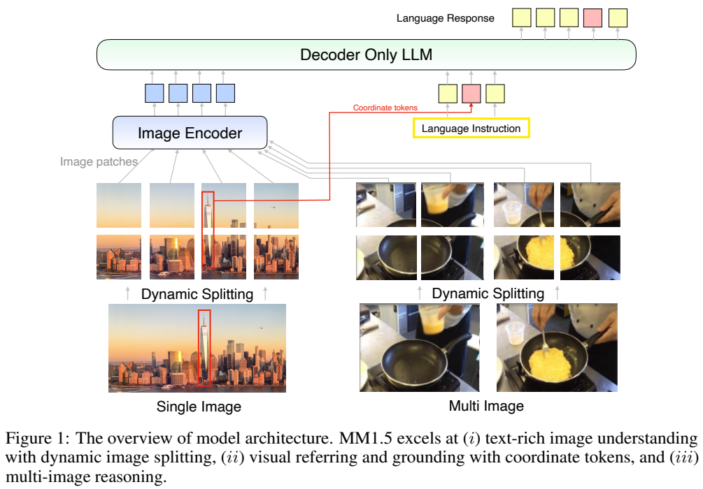
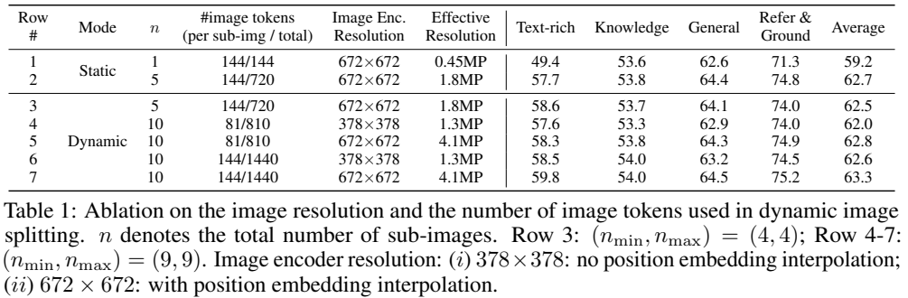
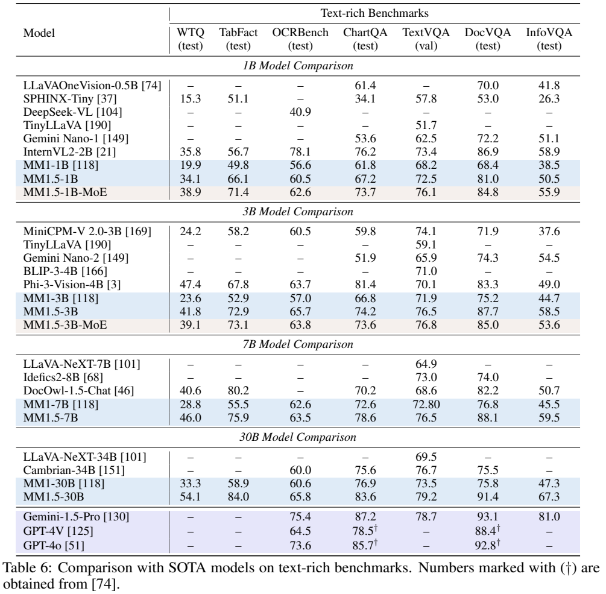

<!-- article-header:start -->
[项目首页](../../../README.md) › [模型系列](../../../reports/model-family-index.md) › [MM1](../README.md)
<!-- article-header:end -->

# MM1.5：数据配比、动态切图与细粒度视觉理解

> 解读 Apple 的 **MM1.5: Methods, Analysis & Insights from Multimodal LLM Fine-tuning**，固定采用 arXiv **2409.20566v1**（2024-09-30）。本文区分通用MM1.5、Video与UI专用微调版本，所有结果均为报告中的对应配置。

<!-- article-toc:start -->
<a id="article-toc"></a>

**本篇目录** · [论文定位](#paper-info) · [快速概览](#overview) · [整体架构](#architecture) · [核心原理](#principles) · [数据构建](#data) · [训练流程](#training) · [实验结果](#experiments)
<!-- article-toc:end -->

<a id="paper-info"></a>

## 1. 论文信息与模型定位

| 项目 | 内容 |
|---|---|
| 团队与家族 | Apple；MM1的后续多模态模型家族 |
| 稠密规模 | 1B、3B、7B、30B |
| 稀疏版本 | 1B-MoE、3B-MoE，64专家、top-2；型号标签不能直接当作全部存储参数量 |
| 输入输出 | 单图、多图、文字及点/框提示；文字与含坐标的定位回答 |
| 专用分支 | MM1.5-Video用于视频问答，MM1.5-UI用于移动界面理解 |
| 研究定位 | 保留MM1基本网络，系统研究数据、分辨率与训练阶段对能力迁移的影响 |
| 官方资源 | [固定报告](https://arxiv.org/pdf/2409.20566v1) · [Apple研究页](https://machinelearning.apple.com/research/mm15-methods-analysis-insights) |

公开材料是一份方法与实验报告，没有证实本文所有型号已开放权重。AXLearn是训练框架，不能把框架代码的开放等同于MM1.5参数和全部训练数据开放。报告同时包含静态切图的快速消融和动态切图的最终模型，阅读时须保持这一区别。[§1、§3.1、§4，第1–6、14–16页](https://arxiv.org/pdf/2409.20566v1#page=14)

<a id="overview"></a>

## 2. 快速概览

MM1.5把三个能力放进同一图文模型：读取文字密集的图片、理解或生成点框定位、联合推理多张图片。它采用内部CLIP视觉编码器、C-Abstractor连接器及decoder-only语言模型，在高分辨率时动态切成多个子图，另给一个全局概览；局部细节与整图关系共同进入语言序列。

性能变化主要由训练设计解释。基础预训练把图文对、交错图文和纯文本的采样比从45:45:10改成50:10:40；随后新增45M OCR样本的高分辨率持续预训练，最后用80%单图、10%多图、10%纯文本SFT。论文研究了额外合成描述，但最终持续预训练配方没有采用它，不能把所有尝试过的数据都计入最终训练。

数据之间存在取舍：加入定位数据显著增强grounding，却略损通用类别均分；多图数据改善跨图任务，同时也占用单图学习预算。MM1.5的价值在于给出这些受控观察与最终平衡点，而不是证明某种固定比例对所有模型和数据源都最优。

<a id="architecture"></a>

## 3. 整体架构



*Figure1，PDF第2页。单图或多图先切分、编码，坐标随语言提示进入同一主干；图中未逐层展开C-Abstractor和MoE配置。*

| 模块 | 输入与输出 | 公开机制 |
|---|---|---|
| 动态切图 | 原图 → 局部子图及概览 | 最终局部网格范围4–9，适配长宽比；支持约4MP输入 |
| 内部CLIP编码器 | 672×672子图 → 视觉特征 | 从原生378分辨率插值位置嵌入；所有训练阶段不冻结 |
| C-Abstractor | 视觉特征 → 语言可用图像token | 沿用MM1连接器；最终设计每子图144 token，消融另比较81 |
| 子图位置组织 | 局部网格位置、概览 → 有序序列 | 最终使用image/row/column索引，概览置于局部子图之后 |
| 文字与坐标表示 | 指令、点或框 → 语言条件 | 可理解输入位置，也能在生成回答中输出框，不要求另接独立检测头 |
| 稠密语言主干 | 图像表示与文字 → 自回归回答 | 1B–30B decoder-only，沿用MM1内部语言模型 |
| 可选MoE语言层 | token隐藏表示 → 稀疏FFN结果 | 1B/3B的语言FFN每隔两层采用64专家、top-2；视觉与连接器保持不变 |

一次“这几张图有哪些差别”的推理，先分别建立视觉表示，再按图像顺序与指令共同输入语言主干。最终设置仅对少于3张图片的样本启用动态切图，以免多图序列过长；因此不能将每张图片均按最大10个视图估算所有输入。

对单图最终网格，最多9个局部子图加1个概览，共10个视图、最多 $`10\times144=1440`$ 个图像token；这是该切图配置的视觉表示数，不含文字、索引和分隔符。Video分支则每视频均匀取24帧，关闭逐帧切图，每帧144 token，构成3,456个视觉token后再结合问题。[§3.1、§3.5、§4–5，第5–6、11–14、20页](https://arxiv.org/pdf/2409.20566v1#page=12)

<a id="principles"></a>

## 4. 核心创新与数学原理

### 4.1 动态网格：同时避免无效补边和过度缩小

固定2×2切图会把低分辨率图片无谓拆开，也可能为极端长宽比图片生成大量padding。动态方案在允许的局部子图数内枚举网格，先尝试覆盖原图、不向下缩小，再选择补边最少的候选。原文Eq.(1)为：

```math
g^*=\arg\min_{(n_h,n_w)\in\mathcal G}
\left(n_hn_wr^2-h_gw_g\right).
```

$`r`$为编码器边长，$`n_h,n_w`$为网格行列，$`h_g,w_g`$为保持比例、按长边适配候选网格后的尺寸。约束为 $`n_hr\ge h_g\ge h`$、$`n_wr\ge w_g\ge w`$：候选既需容纳缩放后图像，也不能比原图更小。原图尺寸为 $`h,w`$，候选集合 $`\mathcal G`$ 满足 $`n_{\min}\le n_hn_w\le n_{\max}`$。若不存在可覆盖原图的候选，才转而最小化下采样造成的分辨率损失。这个分支不是简单“永远选最接近长宽比的网格”。[§3.5、Eq.(1)，第11–12页](https://arxiv.org/pdf/2409.20566v1#page=11)



*Table1，PDF第13页。n包括概览；每子图分辨率、每子图token和有效整图分辨率是三个不同变量。*

同为10个视图、144 token/视图，编码分辨率378→672时，文字密集类别均分58.5→59.8；同为672分辨率，81→144 token时为58.3→59.8。编码细节和语言端表示数分别发挥作用，不能把收益全部归到“更多token”。这些是3B消融，不是每个型号都复现过的独立定律。[Table1，第13页](https://arxiv.org/pdf/2409.20566v1#page=13)

### 4.2 子图顺序与定位：输入组织会改变可见信息

语言主干使用自回归mask，因此顺序会影响视觉位置能读取哪些前文。概览放在局部子图之后时，它在语言主干中的表示可以读取先前的局部信息；放在之前时，局部位置可读取概览。报告Table3发现“概览在后”略优，并在最终模型采用该顺序，而非引入新的双向图像注意力模块。

索引用 $`(k,i,j)`$ 表示图像编号和网格行列，帮助保留摊平后的二维结构。输出点框也需与原图坐标对应；只在推理时改变最低切图数可能破坏这种适配。Table2中训练(4,4)、推理改(1,9)时，定位类别从74.0骤降到24.5，即使部分文档指标提高，也不能视为安全的普遍升级。

报告没有重新列出坐标量化的全部token词表和舍入实现，本文不据示例指定统一精度。定位能力来自数据监督和图像组织共同作用，不意味着模型具备任意GUI的可执行操作权限。[§3.5、Tables2–3，第12–14页](https://arxiv.org/pdf/2409.20566v1#page=13)

### 4.3 数据采样权重：先比较能力，再决定全局配方

论文把SFT分成单图、多图和纯文本，令 $`w_s+w_m+w_t=1`$；最终取 $`(w_s,w_m,w_t)=(0.8,0.1,0.1)`$。单图内部再以general为基准，设置science/math/code/refer&ground相对权重0.1/0.5/0.2/2.0。这些相对比值不是整个SFT中的百分数，归一化后才得到最终类别份额。

例如最终全部SFT中text-rich37.2%、refer&ground22.5%、general11.3%、math5.6%、code2.3%、science1.1%，合计80%。这种重采样避免大数据组完全淹没小组，但仍会改变其他能力的学习预算。Figure8显示从Base加入定位数据，定位均分18.02→74.79，文字密集均分62.23→60.97；再加多图/纯文本后，多图均分43.59→55.78。

MMBase是general、text-rich、knowledge三个类别均分的平均，不是所有任务按样本数加权的真实流量准确率。作者分别扫描多图和文本比例以节省实验成本，没有穷举三者所有组合，故最终比例是该实验条件下的选择，而不是已证明的全局最优解。[§3.2、Figures6–8、§4，第7–9、14页](https://arxiv.org/pdf/2409.20566v1#page=8)

### 4.4 高分辨率持续预训练：OCR数据是否有用取决于可见细节

OCR持续预训练并非只增加样本数量：若编码分辨率过低，转写监督要求的文字可能已经在缩放后不可辨。Figure9中，无持续预训练的MMBase为58.8，378分辨率OCR训练后为58.28，1344有效分辨率则为60.26；后续SFT均用相同1344设置，隔离的是持续预训练的输入分辨率差异。

作者还试验LLaVA-Recap和ShareGPT4V等合成描述，单独或与OCR混合都未明确超过纯OCR设置；另用MM1生成7M自描述探索，但最终配方仍只用45M OCR。不能把“研究了合成描述”转写成“最后模型额外用了7M描述”。

预训练文本也会影响最终视觉任务。用HQ-Text替换原文本，再把图文对/交错图文/文本的比例改为50:10:40，可改善多项后SFT成绩。选择依据是下游结果，区别于原MM1更侧重few-shot预训练指标；减少交错数据也使多图均分略降，反映其取舍。[§3.3–3.4、Figures9–10、§4，第9–11、14页](https://arxiv.org/pdf/2409.20566v1#page=10)

### 4.5 MoE与专项微调：增加容量和改变任务分布是两种方法

MoE只替换语言解码器中的FFN，保持视觉与连接器不变。每隔两层的稀疏层有64专家，top-2门控让每个token只调用少数专家；0.01负载均衡损失抑制流量集中，0.001 router z-loss用于稳定路由数值。报告没有给出全部路由容量或丢弃规则，不能由top-2直接算出全模型只有2/64的计算量。

容量扩张也并非所有任务都受益：3B-MoE的MMMU42.9高于稠密3B37.1，但DocVQA85.0低于87.7。Video和UI则通过任务数据进一步训练：Video显式区分不使用视频数据的直接迁移与视频SFT；UI用Ferret-UI数据，主要测识别、描述与定位，而非完整自主操作成功率。[§4–6、Tables5–6、10、12，第14–17、20–23页](https://arxiv.org/pdf/2409.20566v1#page=16)

<a id="data"></a>

## 5. 数据构建与处理

| 环节 | 公开来源与规模 | 处理与边界 |
|---|---|---|
| 基础预训练 | 2B图文对；600M交错文档、含1B图像；2T纯文本token | 三者单位不同，50:10:40是采样配比，不是独立图片数量比例 |
| 持续预训练 | 45M OCR，PDFA/IDL/RenderedText/DocStruct-4M | 默认四来源等采样；排除未带来收益的多粒度文本定位split |
| 单图SFT | general、文字密集、科学、数学、代码、定位 | 为不同能力分组、重采样；最终合计80% |
| 多图SFT | 差异比较、图像关系、视觉推理及少量内部构建数据 | 最终10%，图像较多时不启用逐图切分 |
| 文本SFT | OpenOrca、MathInstruct、OrcaMath、代码与指令资料等 | 最终10%；维持语言和推理能力 |
| Video专项 | ShareGPTVideo 556K、VideoChat2 225K、ActivityNet-QA 31.5K | 仅视频SFT版本使用，不加到training-free版本 |
| UI专项 | Ferret-UI混合约801K样本 | 含基础任务与GPT-4生成界面功能/布局对话 |

样本来源数量不等于最终采样次数，持续预训练和SFT也可能复用相关任务。报告标记部分基准训练split已出现在混合中，应区分正常任务监督和未见过训练数据的迁移；不能把所有结果都描述成零训练接触。[Figure4、§3.1、§4–6，第6、14、20、23页](https://arxiv.org/pdf/2409.20566v1#page=14)

<a id="training"></a>

## 6. 训练流程与目标

| 最终阶段 | 公开设置 | 作用 |
|---|---|---|
| 大规模预训练 | 378图像分辨率；200K步、序列4096，沿用MM1学习率调度 | 建立单图、多图与文本基础能力 |
| 高分辨率持续预训练 | 45M OCR；30K步、峰值学习率 $`10^{-5}`$ | 学习读取高细节文本 |
| 多任务SFT | 最终混合配方；23K步、峰值 $`2\times10^{-5}`$ | 学习指令、定位及多图响应 |
| Video/UI额外适配 | 分别使用视频/界面数据 | 形成独立任务分支，不能合并为同一个通用checkpoint |

图像编码器和语言模型在所有阶段均不冻结，使用AXLearn。§3.1快速消融默认batch256、AdaFactor、峰值 $`10^{-5}`$、SFT一轮；§4最终设置则明确给出上述23K步和 $`2\times10^{-5}`$。两者需分别记录，不能拿消融默认值覆盖最终配方。

训练通过统一文字和坐标序列学习目标任务，本文不添加原文没有提出的独立框回归损失、分割头或偏好RL阶段。MoE的两个辅助损失是明确公开项，其余基础架构和预训练调度多引用MM1，完整复现仍需对应组件及未开放资料。[§3.1、§4，第5–6、14–16页](https://arxiv.org/pdf/2409.20566v1#page=14)

<a id="experiments"></a>

## 7. 实验设置与主要结果

报告用内部lm-eval-harness分支测35个多模态基准，通常zero-shot、贪心解码；VL-ICL表为4-shot，其他对照可能使用beam search。下表比较同规模的MM1与MM1.5，不把模型规模变化误当数据配方收益。



*Table6，PDF第17页。保留全部规模和对照；不同任务的百分数不代表同一种评分协议。*

| 指标 | MM1-3B → MM1.5-3B | MM1-30B → MM1.5-30B |
|---|---:|---:|
| DocVQA test | 75.2 → 87.7 | 75.8 → 91.4 |
| InfoVQA test | 44.7 → 58.5 | 47.3 → 67.3 |
| ChartQA test | 66.8 → 74.2 | 76.9 → 83.6 |
| OCRBench，报告百分制 | 57.0 → 65.7 | 60.6 → 65.8 |
| MathVista testmini | 32.0 → 44.4 | 39.4 → 55.6 |
| MuirBench test | 28.0 → 44.3 | 36.7 → 58.2 |

前四行见Table6，MathVista见Table5，多图见Table9。结果支持文字密集与跨图能力提升，但MM1.5-3B的MM-Vet41.0低于MM1-3B43.7，不能称全部指标都提高。[Tables5–6、9，第16–19页](https://arxiv.org/pdf/2409.20566v1#page=17)

视频分支也需分设置：3B training-free在无字幕VideoMME为48.4，视频SFT后49.5；ActivityNet-QA从50.9升至57.9，前者是选择题、后者采用GPT评分的开放问答。视频SFT改善明显，但7B无字幕VideoMME53.5仍低于表中LLaVA-OneVision-7B58.2；24帧与对照32帧、数据和训练课程也不同。[§5、Table10，第20–21页](https://arxiv.org/pdf/2409.20566v1#page=21)

UI分支3B在iOS/Android定位均分为87.3/88.8，Screen2words为103.3、低于Ferret-UI-13B113.4。界面元素理解并不等于点击执行成功率，报告也没有提供统一端侧响应延迟或完整设备内存实验。证据支持在相同底座上，通过分辨率和数据课程提高多种能力；其边界由具体checkpoint、任务监督和解码协议共同决定。[§6、Table12，第22–23页](https://arxiv.org/pdf/2409.20566v1#page=23)

<!-- article-footer:start -->
---

[← 上一篇：Emu3](../../emu/arxiv-2409.18869/README.md) · [按发表时间浏览](../../../reports/paper-reading-guide.md#year-2024) · [下一篇：AuroraCap →](../../auroracap/arxiv-2410.03051/README.md)

[返回本篇目录](#article-toc) · [返回模型系列](../README.md)
<!-- article-footer:end -->
