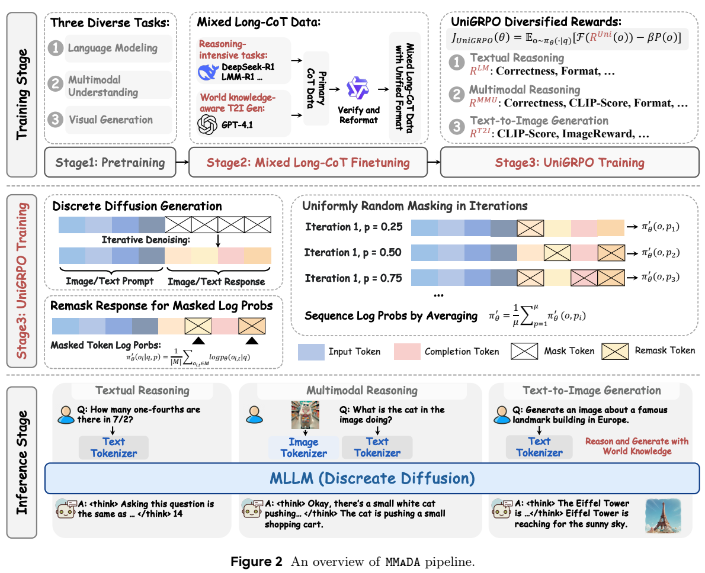
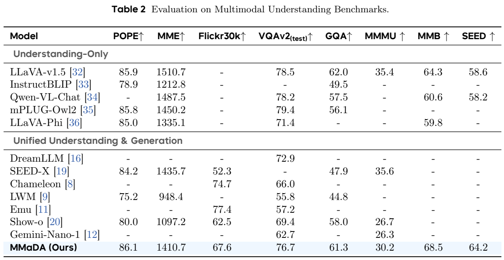
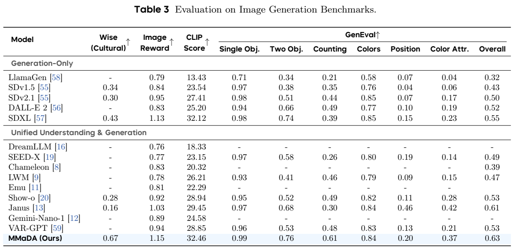
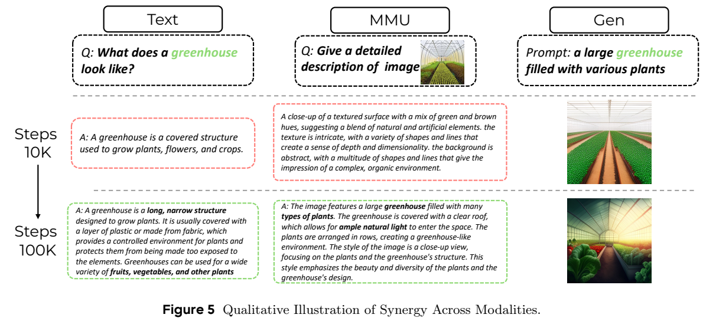
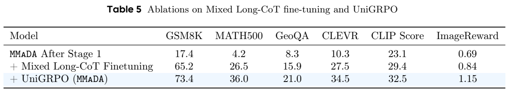
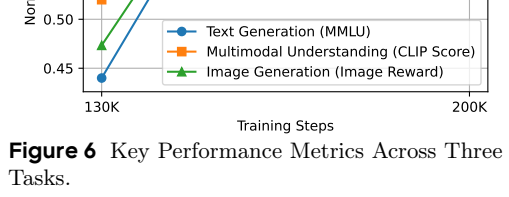

<!-- article-header:start -->
[项目首页](../../../README.md) › [模型系列](../../../reports/model-family-index.md) › [MMaDA](../README.md)
<!-- article-header:end -->

# MMaDA：用统一离散扩散完成语言推理、视觉理解与图像生成

<!-- article-toc:start -->
<a id="article-toc"></a>

**本篇目录** · [论文定位](#paper-info) · [快速概览](#overview) · [整体架构](#architecture) · [核心原理](#principles) · [数据构建](#data) · [训练流程](#training) · [实验结果](#experiments)
<!-- article-toc:end -->

<a id="paper-info"></a>

## 1. 论文信息与模型定位

| 项目 | 信息 |
| --- | --- |
| 原标题 | MMaDA: Multimodal Large Diffusion Language Models |
| 作者与机构 | Ling Yang、Ye Tian、Bowen Li 等；Princeton、北京大学、清华大学、ByteDance Seed |
| 核验版本 | [arXiv 2505.15809v1](https://arxiv.org/abs/2505.15809v1)，2025 年 5 月；本地原文 37 页 |
| 代码 | [Gen-Verse/MMaDA](https://github.com/Gen-Verse/MMaDA) |
| 模型 | MMaDA-8B；从 LLaDA-8B-Instruct 初始化，图像 tokenizer 使用 Show-o 的预训练权重 |
| 任务范围 | 纯文本推理、图像问答和描述、文本到图像，以及掩码补全示例 |

MMaDA 研究的是统一模型的另一条路线：文本和图像都通过“给定部分可见内容，恢复被遮住的离散 token”学习。它不是把自回归语言模型接到独立图像扩散模型上的工具链，也不是连续图像 latent 上预测高斯噪声的 DDPM。核心贡献同时落在预训练目标、混合思维链微调和扩散模型强化学习上。本文根据 v1 正文及附录解释其方法和局限；结果均为论文报告，未运行模型复现。

<a id="overview"></a>

## 2. 快速概览

MMaDA 的流程包含三个环节。首先，统一的 mask predictor 学习语言和图像的 token 恢复；其次，不同任务都被组织成“推理过程＋最终结果”，给模型建立长 CoT 的冷启动；最后，UniGRPO 用答案正确性、格式、图文匹配和图像偏好等奖励优化生成。输出可以是文字答案，也可以是推理之后的图像 token，因而文本知识能通过生成上下文影响画面。

| 要点 | 实际含义 |
| --- | --- |
| 统一模型 | 一个共享扩散预测模型承担三类任务，输入与输出仍经过文本或图像 tokenizer |
| 统一目标 | 在随机掩码位置预测原 token，采用带时间权重的交叉熵 |
| 混合 CoT | 数学、几何、视觉组合推理与依赖世界知识的文生图采用统一格式 |
| 统一 RL | 固定采样答案，改变答案掩码，计算局部预测分数并施加 GRPO 风格更新 |
| 不同采样 | 文本按 64-token 块从左到右去噪；图像整段并行去噪 |

论文图像生成的 GenEval 总分为 0.63，文本 GSM8K 为 73.4；这些结果说明统一离散扩散能同时覆盖多种任务，并不意味着它在所有理解或语言基准上超过专用模型。8B 规模、数据配比和抽样步数仍显著影响表现。

<a id="architecture"></a>

## 3. 整体架构



**读图：** Figure 2 上半部连接预训练、混合长 CoT 和强化学习；中间的重掩码图说明 RL 更新并非把扩散生成结果直接当作自回归序列；下半部显示文本 tokenizer、图像 tokenizer 和共享 MLLM。该图完整保留了图例和图注，也直接说明“统一”不等于没有模态编码组件。

文本转换为离散文本 token；图像编码为离散视觉码，最终再由图像解码环节还原像素。共享网络接收含可见 token 和 `[MASK]` 的序列，能够同时为多个缺失位置输出分类分布。图像理解的条件是图像与问题，恢复目标是文字回答；文生图以文字条件恢复图像 token；纯文本则恢复答案或推理轨迹。理解与生成共享概率建模机制，而不是各训练一个互不相干的输出模型。

模型继承 LLaDA 的语言基础，图像 tokenizer 继承 Show-o。论文没有在此报告中完整列出扩展词表、全部层级参数和 tokenizer 的独立训练配方，因此不凭模型名称补出这些实现细节。图像评测中 1,024 个视觉 token 对应 512×512 输出；这是报告使用的表示和分辨率，不能理解成一个 token 等于一个像素。

推理时统一网络仍允许任务采用不同策略。文本的 1,024-token 输出被划分成 64-token 块，共 512 个去噪步；块之间从左到右，块内并行预测。图像把 1,024 个 token 看作一整块，使用余弦重掩码日程、50 步和 3.5 的 classifier-free guidance。半自回归是采样顺序，不会把训练目标变成逐 token 的自回归交叉熵。正文第 3 节把文本每步动作写成释放两个“最低置信度”token，同时引用 low-confidence remasking；两种说法的方向并不完全一致，本文保留其块长和步数，不擅自把该句当成已核验的代码行为。

<a id="principles"></a>

## 4. 核心创新与数学原理

**统一掩码恢复。** 令干净序列为 $`x_0`$，随机时间 $`t`$ 对应损坏后的 $`x_t`$，$`m_i`$ 表示位置 $`i`$ 是否被掩码。原文 Eq. (1) 为：

```math
\mathcal L_{\mathrm{unify}}=-\mathbb E_{t,x_0,x_t}\left[\frac1t\sum_{i=1}^{L}m_i\log p_\theta(x_0^i\mid x_t)\right].
```

网络只在掩码位置承担恢复损失，可见位置提供上下文。$`1/t`$ 是原文的时间权重，不能简单删成普通平均交叉熵。正文写 $`t`$ 在 $`[0,1]`$ 均匀采样，公式在端点零处形式上奇异；实际有限精度采样或端点处理需要实现核验，本文不自行宣布其具体 epsilon。对于文字与图像，这一目标都是离散类别预测，不需要为图像另设连续噪声均方误差。

**条件微调。** Eq. (2) 保留 prompt $`p_0`$，只损坏输出 $`r_0`$ 得到 $`r_t`$：

```math
\mathcal L_{\mathrm{Mixed-SFT}}=-\mathbb E\left[\frac1t\sum_i\mathbf1[r_t^i=\mathrm{MASK}]\log p_\theta(r_0^i\mid p_0,r_t)\right].
```

推理过程和结果都属于输出，因此模型学习的不仅是短答案，还包括两者之间的语义衔接。文生图的 CoT 可以先把“法国赠送给美国的著名雕像”解析为自由女神像，再生成对应画面；这是把知识推理变成图像生成条件，而不是保证每一段可见 CoT 都忠实反映内部因果过程。

**UniGRPO 的关键在概率近似。** 自回归模型能把序列概率分解为依次生成的条件概率乘积；扩散模型的多轮并行恢复不能直接照搬这条生成路径。MMaDA 先从旧策略为同一问题采样 $`G`$ 个答案，计算组内相对优势（原文 Eq. (15)）：

```math
\widehat A_i=\frac{R_i-\mathrm{mean}(R_1,\ldots,R_G)}{\mathrm{std}(R_1,\ldots,R_G)}.
```

随后固定这些答案，问题始终可见，答案按不同时间重新掩码；当前、旧和参考模型在相同扰动条件下预测被遮住的真实答案 token。单次更新不再需要为一个答案并行跑 128 个掩码样本，且不同更新覆盖多个去噪阶段。算法还使用随机起点、之后均匀间隔的时间安排；正文例子为 100、300、500、700、900，避免所有训练都停留在全掩码答案的起点。

这里必须区分**论文的意图与公式的记号问题**。Eq. (3)–(4) 用 $`\pi'_\theta`$ 表示含 $`\log p_\theta`$ 的预测分数，Eq. (5) 前却把两个 $`\pi'`$ 的商称为策略概率比。对数分数之商并不等于概率之比，平均掩码 log-prob 也不是已经精确求出的完整扩散序列 log-likelihood。因此不能把该近似叙述成严格无偏的真实序列概率。

为了说明 PPO/GRPO 的标准数学含义，若 $`\ell_\theta`$ 与 $`\ell_{\mathrm{old}}`$ **确实是同一条件下的对数概率**，正确的概率比应写作 $`\rho=\exp(\ell_\theta-\ell_{\mathrm{old}})`$，对应截断项 $`\min(\rho\widehat A,\mathrm{clip}(\rho,1-\epsilon,1+\epsilon)\widehat A)`$，另加参考策略 KL 惩罚。这是标准定义的解释，不是替论文宣称代码已按此实现。UniGRPO 最稳妥的理解是用不同掩码条件下的局部预测估计构造 RL 代理目标，其效果由消融实验支持。

<a id="data"></a>

## 5. 数据构建与处理

基础语言数据使用 RefinedWeb。图像侧先使用 ImageNet-1k 做类别条件生成，同时包含图文描述任务，再转入更丰富的图文对。引用的数据源包括 Conceptual 12M、SAM、LAION aesthetics 和 JourneyDB；正文给出了来源，但没有逐项列出最终清洗后的样本数、采样权重和去重阈值。

指令数据使用 Alpaca 与 LLaVA-1.5。长 CoT 的文本数学和逻辑部分来自 ReasonFlux、LIMO、s1k、OpenThoughts、AceMath-Instruct；视觉部分由 LMM-R1 对 GeoQA、CLEVR 生成回答，并保留回答正确的样本。文生图部分由 GPT-4.1 合成科学、文化、地标等事实实体与描述，再写成统一推理格式。其目的在于让图像生成训练包含“先辨认概念，再描述画面”的知识过程。

统一的输出结构由特殊分隔 token 串起 reasoning process 和 result。文中强调多样性、难度与正确性筛选，但未给全部生成 prompt、各教师实际调用数量和 verifier 的完整规则。本文也不把模型生成 CoT 自动视为人工验证的真值。RL 数学任务使用 GSM8K 训练集，视觉数学和组合任务使用 GeoQA、CLEVR；图文类奖励另使用图像与文字匹配度，实际跨任务配比没有完整披露。

<a id="training"></a>

## 6. 训练流程与目标

| 阶段 | 报告中的设置 | 学习目标 |
| --- | --- | --- |
| Stage 1 | 先 200K 步，再 400K 步；第二段替换 ImageNet 为更多样的图文对 | 语言、图像理解与生成的统一扩散预训练 |
| Stage 2 | 50K 步，混合指令数据与推理数据 | prompt 保留、输出掩码的 Mixed-SFT |
| Stage 3 | 50K 步 UniGRPO | 正确性、格式与图文生成奖励 |

实现段报告 64 张 A100 80GB、全局 batch size 1,280、AdamW、初始学习率 $`5\times10^{-5}`$ 与余弦日程。这些是正文的总设置；报告没有清楚区分每个 RL 内层更新的 batch、$`G`$、KL 系数和所有阶段是否完全共用超参数，不应补出它未写的配置。

文本正确答案奖励为 2.0，符合 `<think>...</think>` 格式另得 0.5。GeoQA、CLEVR 使用同类正确性与格式奖励；caption 类任务增加 $`0.1\times\mathrm{CLIP}`$。文生图使用各缩放 0.1 的 CLIP 和 ImageReward。奖励直接影响优化方向，特别是 CLIP Score 和 ImageReward 同时作为训练奖励和报告指标，其增长不能单独证明所有人类审美维度均改善。

论文强调不同模态的联合优化，但 Figure 6 的横轴为 130K–200K，正文称这一段是 Stage 2，而实现段 Stage 1 累计 600K、Stage 2 50K。两个训练步数口径未说明如何对应，故这里按实现段给出配方，曲线只作为论文所示趋势，不能拼成一致的全训练时间线。一次去噪可以恢复多个位置，带来少于 1,024 次前向的可能性；实际速度还受每步序列长度和注意力开销影响，报告未提供同硬件端到端延迟证明。

<a id="experiments"></a>

## 7. 实验设置与主要结果



**读表：** Table 2 区分 understanding-only 与理解生成统一模型，箭头均指较高更好，横线表示未报告。MMaDA 在 POPE 为 86.1，MMBench 68.5、SEED 64.2，超过表中 LLaVA-v1.5 的 85.9、64.3、58.6；但 MME 1,410.7、VQAv2 76.7、GQA 61.3、MMMU 30.2 仍低于 LLaVA 的 1,510.7、78.5、62.0、35.4。与 Show-o 相比则在已列各列更高。故“统一扩散具有有效理解能力”成立，“在视觉理解上全面胜出”不成立。带 CoT 的输出以最终答案计分。



**读表：** Table 3 中 MMaDA 的 WISE Cultural 为 0.67、ImageReward 1.15、CLIP 32.46、GenEval 0.63。对应 Show-o 为 0.28、0.92、28.94、0.53，SDXL 为 0.43、1.13、32.12、0.55。50K 测试 prompts 用于 CLIP 与 ImageReward；WISE 此表只有文化子集，不能外推整个世界知识评测。GenEval 分项也有弱点：MMaDA 位置关系 0.20、颜色属性 0.37，低于 Janus 的 0.46、0.42；总体优势主要来自单物体、双物体和计数等改善。

语言结果在 Table 4：MMLU 68.4、ARC-C 57.4、GSM8K 73.4、MATH 36.0、GPQA 28.4；相对 LLaDA 的 65.9、47.9、70.7、27.3、26.1 有增长，但 TruthfulQA 从 46.4 降到 43.1。Qwen2-7B 的 GSM8K 80.2、MATH 43.5 仍更高，表中不同模型继承的数据与训练预算也并未统一。







**读表和图：** Table 5 保留全部三行与六列，是判断后训练作用最直接的证据：GSM8K 17.4→65.2→73.4，MATH500 4.2→26.5→36.0，GeoQA 8.3→15.9→21.0，CLEVR 10.3→27.5→34.5，CLIP 23.1→29.4→32.5，ImageReward 0.69→0.84→1.15。Stage 2 的跃升较大，RL 进一步增益；不能把全部涨幅归给 UniGRPO。此处明确是 MATH500，Table 4 写 MATH，不能未经说明视为完全同一测试集。Figure 5 的温室图文例子展示质量变化，Figure 6 是归一化指标趋势，两者均不能替代独立控制变量的跨模态因果消融。

Table 6 比较采样步数：图像 CLIP 在 1,024/50/15 步为 32.8/32.0/31.7；语言 MMLU 在 1,024/512/256 步为 66.9/66.3/65.7。减少步数有质量取舍，而且这些值不同于主结果表，不能当作一条完全相同配置的分数。附录展示知识生成、文本计算和视觉推理案例，也包含表述或推理不严谨之处，例如把正方形边上的点误当作圆弧上的点使用圆周角定理；可见长 CoT 本身并不保证几何论证正确。该工作最有价值的证据是统一建模、后训练设计及其量化消融，而不是挑选出的单个成功示例。

<!-- article-footer:start -->
---

[← 上一篇：UniGen](../../unigen/arxiv-2505.14682/README.md) · [按发表时间浏览](../../../reports/paper-reading-guide.md#year-2025) · [下一篇：BAGEL →](../../bagel/arxiv-2505.14683/README.md)

[返回本篇目录](#article-toc) · [返回模型系列](../README.md)
<!-- article-footer:end -->
