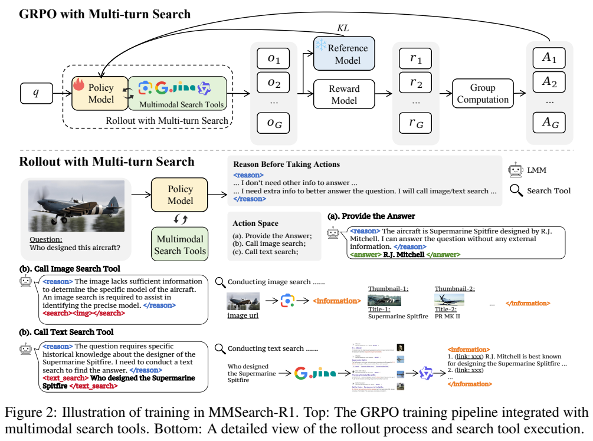
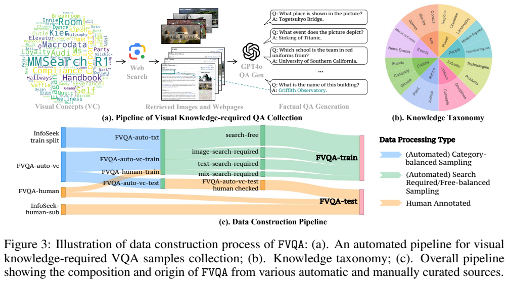
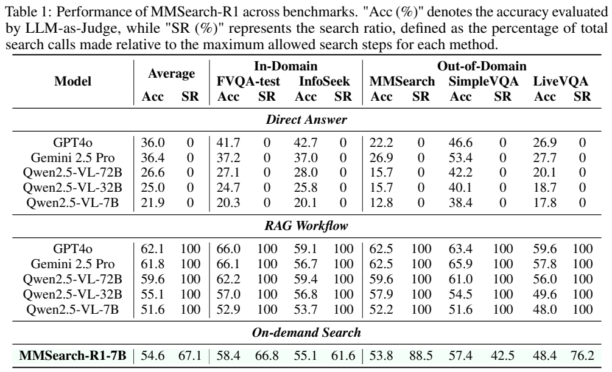
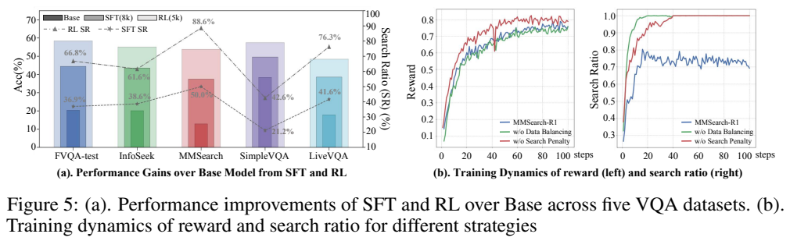

<!-- article-header:start -->
[项目首页](../../../README.md) › [模型系列](../../../reports/model-family-index.md) › [MMSearch-R1](../README.md)
<!-- article-header:end -->

# MMSearch-R1：让视觉语言模型学习何时搜索、搜索什么

<!-- article-toc:start -->

**本篇目录** · [论文定位](#paper-info) · [快速概览](#overview) · [整体架构](#architecture) · [核心原理](#principles) · [数据构建](#data) · [训练流程](#training) · [实验结果](#experiments)
<!-- article-toc:end -->

## 1. 论文信息与模型定位

**论文**：[MMSearch-R1: Incentivizing LMMs to Search](https://arxiv.org/abs/2506.20670v1)，本文以2025年6月25日的v1、28页PDF为依据。作者包括Jinming Wu、Zihao Deng、Wei Li、Yiding Liu、Bo You、Bo Li、Zejun Ma和Ziwei Liu，来自ByteDance与南洋理工大学S-Lab。[官方项目](https://github.com/EvolvingLMMs-Lab/multimodal-search-r1)。

模型基于Qwen2.5-VL-7B-Instruct，研究的是视觉问答中的**搜索决策训练**。图片可能提供足够的形状、文字或场景信息，却无法单独告诉模型“这是哪一种罕见植物”“这架飞机的设计者是谁”。固定检索流程每题都查，会浪费工具调用；完全依赖模型记忆，又容易在长尾实体与新事件上猜错。本文让模型在直接回答、以图搜索、文字搜索之间选择，并把实际网页返回内容接入强化学习。

它没有重新提出视觉编码器，也没有证明7B模型的内部知识覆盖超过更大模型。报告中的能力来自7B策略模型、搜索服务、网页读取器与Qwen3-32B摘要模型组成的完整系统。[原文§2，PDF第3—4页](https://arxiv.org/pdf/2506.20670v1#page=3)。

## 2. 快速概览

| 方面 | 核心内容 |
|---|---|
| 输入输出 | 图片与事实问题；输出短答案，期间可调用图像和文字搜索 |
| 策略训练 | 不依赖冷启动SFT的GRPO训练；每题采样多条含真实工具交互的轨迹 |
| 数据 | 构建FactualVQA，筛出约5,000条训练问题，兼有需要搜索和无需搜索的样本 |
| 行为约束 | 每轮一次动作，推理、工具请求和答案使用规定标签；工具结果不参与语言损失 |
| 结果 | 五个测试集的平均准确率54.6%，搜索比率67.1%；同规模固定RAG为51.6%、100% |
| 阅读边界 | 搜索比率按表注是调用次数相对最大步骤数的归一化值；不能直接当作“搜索的题目比例” |

最有价值的结论是：在同一工具管线下，学习搜索策略可以同时改善回答质量和调用效率。该结论限于论文所选的事实型视觉问答任务；未报告端到端服务价格或延迟的系统性比较。

## 3. 整体架构

**Figure 2怎么读。** 上半部分从问题出发，由策略模型生成一组轨迹，奖励模型评分，组内比较得到优势，再更新策略；冻结参考模型提供KL约束。下半部分展开交互：模型先在`<reason>`标签内说明判断，再选择最终`<answer>`、图像请求`<search></search>`或含自然语言查询的`<text_search>`。图中的绿色框是外部服务，并非模型新增的神经网络层。

图像搜索把**原始整张输入图**的URL送入SerpAPI，获得Google Lens结果，返回前五个有效缩略图与标题，以交错图文形式提供给模型。文字搜索则由策略自行生成查询，SerpAPI获取网页URL，Jina Reader读取页面，Qwen3-32B结合用户原始问题把页面压缩为摘要。摘要提示限制最多五句话，读取前30,000字符，要求兼顾页面主要内容与问题相关证据。[附录C—D，PDF第18—20页](https://arxiv.org/pdf/2506.20670v1#page=18)。

返回内容用`<information>`包围，成为下一轮上下文。训练时这些工具返回token被掩码，模型只对自己产生的推理、请求和答案负责；否则训练可能把网页内容误当成策略自身生成的文本。当前图像工具不支持任意局部裁剪搜索，这会影响小目标和背景复杂图片。

系统还包含Redis分层缓存、LRU淘汰、对象存储引用、请求重试和分布式限流，分别缓存查询结果、网页正文与摘要。这些工程组件支撑高并发rollout，但也意味着“真实互联网环境”不等于每个调用都重新抓取最新网页。

## 4. 核心创新与数学原理

**把是否搜索纳入奖励。** 原文式(1)为

$$
r=(1-\alpha)\,A\,P+\alpha F.
$$

其中$A$是最终短答案的精确字符串匹配分数，正确为1；$F$是多轮格式分数，全部符合标签、一次动作等要求才为1；$P$是搜索惩罚相关因子。只要使用过搜索，正确性分数就受到惩罚。它不是按每次调用线性累加的成本函数。训练配置称搜索惩罚设置为0.1、$\alpha=0.1$，但v1没有把该配置值与式中乘数的换算写成清晰分段式，本文不据此自行推导“调用一次奖励减少多少”。

奖励鼓励模型先利用已有知识，再在不足时补证据。这也带来权衡：如果惩罚过大，模型可能冒险猜测；如果样本几乎都需要搜索，低成本偏好又缺少足够的无需搜索正例。论文因此把奖励与数据平衡联合设计。[§2.4、§3，PDF第4—6页](https://arxiv.org/pdf/2506.20670v1#page=4)。

**组内比较完整交互轨迹。** 对同一问题生成$G$条轨迹，附录B使用归一化优势

$$
\hat A_i=\frac{r_i-\operatorname{mean}(r_1,\ldots,r_G)}{\operatorname{std}(r_1,\ldots,r_G)}.
$$

GRPO以新旧策略的token概率比$R_{i,t}=\pi_\theta(o_{i,t})/\pi_{\rm old}(o_{i,t})$优化截断代理目标，并加入参考模型KL项：

$$
\mathbb E\!\left[\frac1G\sum_i\frac1{|o_i|}\sum_t
\{\min(R_{i,t}\hat A_i,\operatorname{clip}(R_{i,t},1-\epsilon,1+\epsilon)\hat A_i)
-\beta D_{\rm KL}(\pi_\theta\Vert\pi_{\rm ref})\}\right].
$$

这里奖励在轨迹层面产生，不能把公式解读为每个中间推理步骤都获得了事实正确性验证。模型可能因更好的查询、对网页证据的利用或回答形式而获益，实验没有把这些因素完全分离。[附录B，PDF第17页](https://arxiv.org/pdf/2506.20670v1#page=17)。

## 5. 数据构建与处理

**Figure 3怎么读。** 上方从视觉概念出发抓取图片和网页，用GPT-4o生成简短事实问答，并按知识分类平衡；下方的桑基图显示自动视觉概念样本、InfoSeek文字知识样本和人工样本流向训练及测试集。绿色流量进一步分成不搜索、图像搜索、文字搜索和混合搜索需求。这里的FactualVQA是本文新建数据，不应与其他同缩写FVQA数据集混淆。

自动视觉知识部分从MetaCLIP元数据的常见与长尾概念抽样，约10,000个概念对应网页图片，再由GPT-4o结合图文产生QA；得到约6,000条，其中5,400用于训练、600留作测试。文字知识部分从InfoSeek训练集平衡采样约7,000条，另收集800条人工训练问题。问题强调唯一、简洁的事实答案，以便自动奖励核验。

原始训练池还需进行**针对基座模型的搜索难度筛选**。作者先用初步训练模型对每题rollout八次：八次全错的样本丢弃；只有特定搜索策略能答对的归为需要搜索；只要存在无需搜索且答对的轨迹，便可归为无需搜索。最后保留约5,000条，约3,400条需要搜索、1,600条无需搜索。该标签表达的是特定模型和工具配置下的可答性，不是问题永久、客观的知识难度。

FVQA-test共1,800条，由600条自动视觉概念留出样本、600条重新人工标注答案的InfoSeek Human样本、600条新人工问题组成。自动留出样本也进行了人工核验。测试还使用InfoSeek随机2,000条、MMSearch含图片子集171条、SimpleVQA英文子集1,013条和LiveVQA的3,602条，不能把表中结果写成覆盖各原始数据集全部版本。[§3、附录E，PDF第5—6、20—21页](https://arxiv.org/pdf/2506.20670v1#page=5)。

## 6. 训练流程与目标

主要模型直接从Qwen2.5-VL-7B-Instruct进行搜索强化学习，没有先蒸馏GPT-4o轨迹作为冷启动。veRL实现GRPO，每题八条rollout，训练批量512、mini-batch 128，学习率$2\times10^{-6}$，截断范围0.2，KL系数0.001，策略训练使用4节点、每节点8张H100。网页摘要模型另部署在8节点、每节点8张H100的集群；不能把这64张卡误写成7B策略模型训练的GPU配置。[§4.1、附录F，PDF第6、22页](https://arxiv.org/pdf/2506.20670v1#page=22)。

正文实验设置描述最多三轮对话、前两轮可搜索、第三轮回答，图像搜索只在第一轮允许；附录F.1又写每条rollout最多三次工具调用，二者存在不一致。本文保留这一来源限制，主结果的搜索比率按Table 1表注解释。作者选择约第50步收敛附近的检查点评测，训练动态绘制到100步；这不等于所有实验均只训练50步。参数冻结范围、完整优化器和最终服务成本未充分披露，不从基座训练配方反推。

SFT是**对照实验**：从原始13,200条问题生成GPT-4o轨迹，剔除约5,200条最终答案不正确的轨迹，剩8,000条；用户输入和工具返回被掩码。该对照一轮训练，学习率$10^{-5}$、cosine调度、warmup比例0.1，8张H100、每设备批量1、梯度累积2。RL的5,000问题和SFT的8,000轨迹数量较小，但RL还包含多次rollout与在线工具调用，不能由“样本更少”推出总训练成本更低。

## 7. 实验设置与主要结果

**Table 1怎么读。** 同一行同时给准确率Acc和搜索比率SR；固定RAG每题先图搜再文搜，达到允许的搜索预算，SR为100。表注把SR定义为总调用次数相对最大搜索步骤数的百分比，正文另有“调用搜索的响应比例”的表述，二者并不严格相同。下表沿用明确的表注口径，54.6也是五个数据集准确率的简单平均，不是按题数加权的总准确率。

| 系统 | 五集平均Acc | SR |
|---|---:|---:|
| Qwen2.5-VL-7B直接回答 | 21.9 | 0 |
| Qwen2.5-VL-7B固定RAG | 51.6 | 100 |
| Qwen2.5-VL-32B固定RAG | 55.1 | 100 |
| MMSearch-R1-7B | **54.6** | **67.1** |
| Qwen2.5-VL-72B固定RAG | 59.6 | 100 |
| GPT-4o固定RAG | 62.1 | 100 |

MMSearch-R1相对同规模固定RAG提升3.0个百分点，归一化搜索调用下降32.9%；接近32B固定RAG，但平均仍低0.5个百分点。分集准确率为FVQA-test 58.4、InfoSeek 55.1、MMSearch 53.8、SimpleVQA 57.4、LiveVQA 48.4。搜索比率分别66.8、61.6、88.5、42.5、76.2，体现知识需求差异，但不能据此断言每次未搜索都被正确校准。

准确率由GPT-4o-20241120作为裁判判断语义正确，temperature 0、top-p 0.1；这与训练奖励的字符串精确匹配不同。策略推理采用确定性输出。比较模型共用搜索管线，结果含摘要模型的贡献，并非不受外部系统影响的裸模型排行榜。[§4、附录F，PDF第7—9、22页](https://arxiv.org/pdf/2506.20670v1#page=7)。

**Figure 5怎么读。** 左图比较SFT和RL在不同测试集上的增益与搜索比率；右图蓝线是完整方案，去掉数据平衡或搜索惩罚后，搜索比率趋近100%，即便训练奖励略高，也说明策略更倾向于频繁调用工具。数据平衡与奖励必须协同，单看reward曲线不能说明效率更好。附录另用GPT-4o奖励把一个数据子集上的平均准确率从55.7升到59.5，但搜索比率也从77.3升到82.6；该子集缺少足够无需搜索样本，不能把59.5当作主模型Table 1结果。

一般视觉能力检查中AI2D由93.0到92.8、ChartQA由86.6到86.1、OCRBench由84.7到84.5，有小幅下降；MathVista由68.2到68.8、LLaVA-Wilder由73.5到74.8提高，不能概括成所有能力都无损。工具端到端无有效结果的失败率约为图像搜索0.2%、文字搜索1%，返回不足五项时失败问题还更多。网页排序变化、提取失败和摘要幻觉都会影响结果。论文成功演示了按需搜索的训练路径，但未消除搜索证据不可靠、精确匹配误罚、推理链未经逐步验证等限制。[附录G—H，PDF第23—25页](https://arxiv.org/pdf/2506.20670v1#page=23)。

本文数值均来自指定原文；原图仅保存可追溯图表裁图，未运行模型或复现实验。

<!-- article-footer:start -->
---

[← 上一篇：Show-o2](../../show-o/arxiv-2506.15564/README.md) · [按发表时间浏览](../../../reports/paper-reading-guide.md#year-2025) · [下一篇：Qwen VLo →](../../qwen/document-244376c2123a/README.md)

[返回本篇目录](#article-toc) · [返回模型系列](../README.md)
<!-- article-footer:end -->
