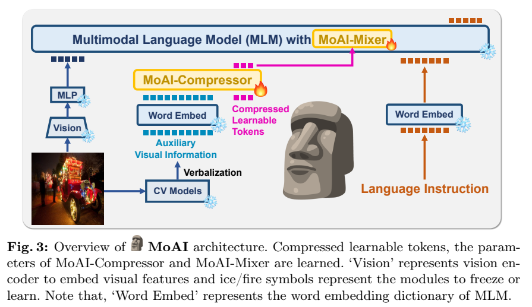
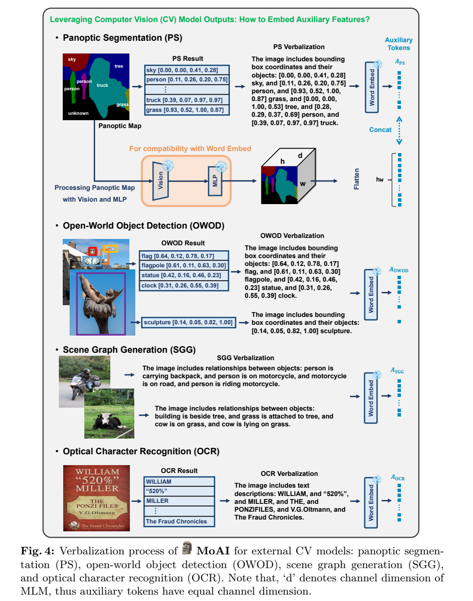
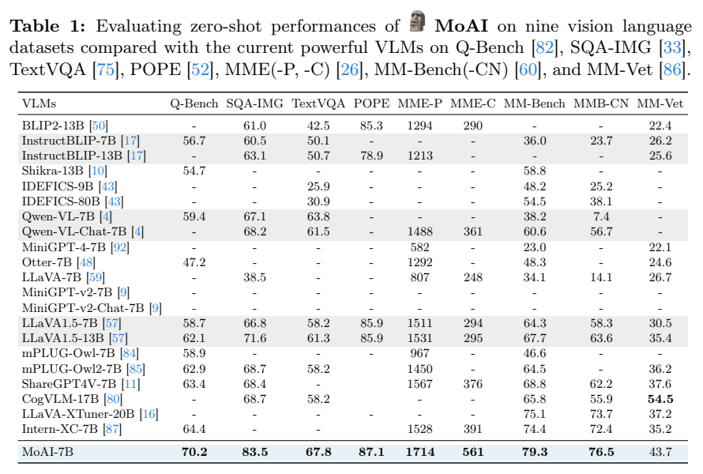
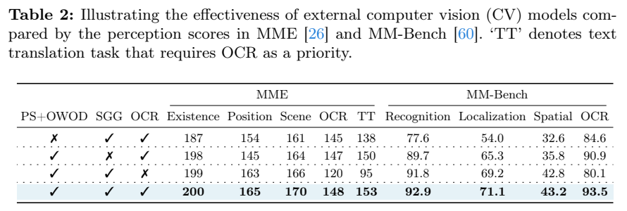
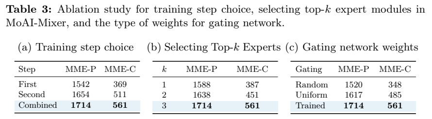

<!-- article-header:start -->
[项目首页](../../../README.md) › [模型系列](../../../reports/model-family-index.md) › [MoAI](../README.md)
<!-- article-header:end -->

# MoAI：融合外部视觉专家的场景理解模型

<!-- article-toc:start -->
<a id="article-toc"></a>

**本篇目录** · [论文定位](#paper-info) · [快速概览](#overview) · [整体架构](#architecture) · [核心原理](#principles) · [数据构建](#data) · [训练流程](#training) · [实验结果](#experiments)
<!-- article-toc:end -->

<a id="paper-info"></a>

## 1. 论文信息与模型定位

| 项目 | 信息 |
|---|---|
| 论文 | MoAI: Mixture of All Intelligence for Large Language and Vision Models |
| 作者 | Byung-Kwan Lee、Beomchan Park、Chae Won Kim、Yong Man Ro |
| 机构 | KAIST 电气工程学院 |
| 固定版本 | [arXiv:2403.07508v1](https://arxiv.org/abs/2403.07508v1)，2024-03-12，29 页 |
| 官方项目 | [ByungKwanLee/MoAI](https://github.com/ByungKwanLee/MoAI) |
| 主干与任务 | CLIP-L/14 + InternLM-7B，图像与指令输入、文本输出，侧重真实场景中的对象、位置、关系与文字 |

这里的 MoE 指具有明确功能的注意力专家混合，而非把语言模型 FFN 扩成大量无预设角色的稀疏专家。7B 是语言主干量级；完整系统还包括视觉编码器、新增模块和约 332M 参数的外部 CV 模型，不能把所有计算都算作一个裸 7B LLM。

<a id="overview"></a>

## 2. 快速概览

MoAI 的动机是，通用视觉编码器可能漏读文字、对象位置和关系，而传统 CV 模型已经具备这些能力。作者把四类外部结果转换为语言模型可处理的辅助 token，压缩成固定 64 个 token，再用可学习门控决定每层如何使用它们。

架构包含 **MoAI-Compressor** 与 **MoAI-Mixer**。前者把变长感知结果对齐压缩；后者在视觉、语言和辅助信息之间执行六种注意力交互。训练先让专家各自学会工作，再学习其组合权重，同时冻结原视觉和语言主干。

原文报告 MMBench 79.3、中文 76.5、MME perception / cognition 1714 / 561；组件消融显示移除 OCR 后，MME OCR 从 148 降为 120。不过系统的优势依赖于外部感知器质量，原文没有完整测量增加的总时延，也没有用所有任务证明全面超过闭源模型。

<a id="architecture"></a>

## 3. 整体架构



**Figure 3，PDF 第 6 页。** 图左是原图经冻结 Vision 和两层 GELU MLP 进入 MLM；中间是四类 CV 输出经过 verbalization、冻结 word embedding 和可训练 Compressor；右边是语言指令。冰与火分别表示冻结和训练，新增辅助 token、Compressor、Mixer 是主要学习部分。辅助信息并不是简单附加一个长文字提示后交给 LLM，而是在中间层被专门注意力模块读取。

四个外部模型分别是 Mask2Former（Swin-B/4，106M）、OWLv2（CLIP-B/16，154M）、panoptic SGG（ResNet-50，44M）与 PaddleOCRv2（18M）。分割给出固定类别的物体及背景，开放世界检测补充遗漏对象，SGG 给对象关系，OCR 提供中英文文字。

Compressor 用固定 64 个可学习 token 收集辅助证据，输出通道维 4096。正文把 Mixer 描述为每个 MLM 层中的模块，但实现细节明确只装在 **零起始层索引 7、15、23、31**。应以实际四处插入的配置理解评测，不能据前面的通用示意图声称 32 层均有 Mixer。

对每个 Mixer，视觉分支有“视觉读辅助”“视觉读语言”“视觉读自身”三个专家，语言分支有“语言读辅助”“语言读视觉”“语言读自身”三个专家。专家结果经门控混合，再交给原 Transformer decoder block。

基础视觉语言路径具体使用 **CLIP-L/14 → 两层线性层加 GELU → InternLM-7B**。辅助专家的输出先被文字化，再经语言侧嵌入和 Compressor 形成辅助 token；它们没有替换 CLIP 原有的图像网格。一次推理因此同时保留“原图视觉特征”“用户问题”“专家辅助信息”三种来源，Mixer 在选定语言层中学习它们的交换与组合，最后仍由 InternLM 输出文本。外部专家承担实际前处理，不能把这部分计算视为压成 64 个向量后便无需执行。（§3.1，PDF 第6页）

<a id="principles"></a>

## 4. 核心创新与数学原理

**压缩变长感知描述。** 原文 Equation 1 写为：

```math
A=\mathrm{MoAI\!\!-Compressor}([A_{PS},A_{OWOD},A_{SGG},A_{OCR}],A_{input}).
```

四组输入来自不同感知任务，长度随图像变化；$`A_{input}`$ 提供固定查询，最终 $`A\in\mathbb R^{4096\times64}`$。固定长度减少语言模型不断读取长检测清单的代价，同时也可能丢掉细节，因此需要后续任务损失训练压缩器。

**显式角色的注意力专家。** Equation 3 中，视觉分支读取辅助信息为 $`I_{AUX}^{(l)}=CA(q=I^{(l)},k=A,v=A)`$，读取语言则把 key/value 换成 $`L^{(l)}`$；语言分支对称构造，另有各自 self-attention。专家负责的信息通道事先明确，门控再学习何时使用何种信息。

按照 Equation 5，视觉门控为：

```math
[w_{AUX},w_{LANG},w_{SELF}]
=\mathrm{softmax}(I^{(l)T}W_{GatingI}),
\qquad
\hat I^{(l)}=w_{AUX}\odot I_{AUX}^{(l)}+w_{LANG}\odot I_{LANG}^{(l)}+w_{SELF}\odot I_{SELF}^{(l)}.
```

语言门控独立计算 $`[w_{AUX},w_{IMG},w_{SELF}]`$，没有参数共享。softmax 沿三专家维归一化，每个 token 可有不同权重；这些权重是可学习的融合比例，不能当作经过校准的事实可信度。表中最佳 $`k=3`$ 表示三个分支全参与，不是每 token 只激活一个专家的稀疏路由。

**低秩参数化。** 注意力投影写成 $`W=W_AW_B`$，$`W_A\in\mathbb R^{d\times r}`$、$`W_B\in\mathbb R^{r\times d}`$，$`d=4096,r=64`$。原文明确分解的是 **$`W`$ 本身，而非常规 LoRA 的增量 $`\Delta W`$**。将 $`d^2`$ 参数变成 $`2dr`$ 减少投影开销；输入 query 与专家输出有残差相加，以减小对冻结 decoder 的扰动。完整系统依然需要运行四个 CV 模型，低秩并不意味着整体推理免费。

<a id="data"></a>

## 5. 数据构建与处理



**Figure 4，PDF 第 7 页。** 由上到下看四组信息：分割、检测以名称和框坐标表示，SGG 用“主体—关系—客体”句子，OCR 用读出的文本。分割分支还把彩色 panoptic map 经视觉编码器与 MLP 转成具有空间结构的特征，与对象文字描述拼接。框坐标和语言语义共同提供位置依据，不能把它概括成只有 OCR 的辅助提示。

全景分割固定类别无法识别的对象记为 unknown；开放检测使用 ADE20K-847 与 ImageNet 合并的 1847 个类别，并不意味着无限开放的任意自然语言查询。Mask2Former 保留实例阈值 0.5、mask 使用阈值 0.95；OWLv2 两个阈值分别 0.1 / 0.5；SGG 谓词阈值 0.8。PaddleOCR 设置中英文并允许旋转文字。这些筛选使辅助文本偏向高置信结果，也可能遗漏低置信但对问答重要的内容。

训练使用经 ShareGPT4V 相关工作过滤的 LLaVA-Instruct-665K。论文强调没有额外策划新的视觉指令集，但并不表示未使用外部模型既有训练知识，或每个 CV 输出都是人工真值。没有公开过滤后精确数量、每类辅助描述的 token 分布、训练图缓存成本和新增人工标注规模，应保留这些信息边界。

<a id="training"></a>

## 6. 训练流程与目标

第一步训练 64 个可学习 token、Compressor 和六专家。对视觉、语言两组分别随机选一个专家输出进入 decoder（Equation 4），让每个专家独立形成有效表示。AdamW 训练一个 epoch，余弦学习率从 1e-4 降到 1e-6。

第二步继续训练上述参数，并加入两组线性门控，让三专家加权融合。仍训练一个 epoch，学习率从 2e-5 降到 1e-6。Compressor 为四层 Transformer encoder，自注意力四头、每头维度 64；Mixer 专家四头、投影低秩 64，按通道配置分头维 1024。原 CLIP、MLP、word embedding、decoder 和外部 CV 模型依 Figure 3 冻结。

视觉指令数据提供回答监督，两阶段通过输出任务学习专家与门控。论文没有完整列出生成交叉熵的公式、loss mask、batch size、图像分辨率、最大序列长度及硬件数量，不能补成一份完整复现 recipe，也没有声称使用 RLHF 或偏好优化训练 MoAI 新模块；文中 InternLM 的 RLHF 描述属于基础主干来源。

推理使用 4-bit nf4 与 double quantization，并进行确定性、宽度为 3 的 beam search。原文未完整给出各外部 CV 模型运行精度和流水并行方式，所以不能直接把这句话解释为所有系统组件都用 4-bit，或据此推算端到端显存和延迟。

<a id="experiments"></a>

## 7. 实验设置与主要结果



**Table 1，PDF 第 12 页。** 行是各模型、列是不同任务，MME-P/C 是感知 / 认知分数；不是百分制准确率。MoAI 的九列结果为 Q-Bench 70.2、ScienceQA-IMG 83.5、TextVQA 67.8、POPE 87.1、MME-P 1714、MME-C 561、MMBench 79.3、中文 MMBench 76.5、MM-Vet 43.7。

| 模型 | TextVQA | POPE | MME-P / C | MMBench / CN | MM-Vet |
|---|---:|---:|---:|---:|---:|
| LLaVA1.5-7B | 58.2 | 85.9 | 1511 / 294 | 64.3 / 58.3 | 30.5 |
| Qwen-VL-Chat-7B | 61.5 | — | 1488 / 361 | 60.6 / 56.7 | — |
| Intern-XC-7B | — | — | 1528 / 391 | 74.4 / 72.4 | 35.2 |
| MoAI-7B | 67.8 | 87.1 | 1714 / 561 | 79.3 / 76.5 | 43.7 |
| CogVLM-17B | 58.2 | — | — | 65.8 / 55.9 | 54.5 |

MoAI 对所列 7B 模型在多项感知任务改善明显，但 MM-Vet 仍低于 CogVLM 的 54.5。所谓 zero-shot 指评测时没有上下文示例，并不表示模型未经指令微调。报告没有为所有第三方模型重新统一训练数据、输出方式和感知器预算，闭源雷达图也不支持全面领先的概括。





**Table 2、3，PDF 第 13 页。** Table 2 的叉号表示移除对应组件，首列把 PS 和 OWOD 一起移除，因此不能分别估算二者独立贡献。完整配置 MME 存在性 / 位置 / OCR 为 200 / 165 / 148；无 PS+OWOD 为 187 / 154 / 145，无 SGG 为 198 / 145 / 147，无 OCR 为 199 / 163 / 120。MMBench OCR 完整为 93.5，无 OCR 降到 80.1；文字翻译 MME 从 153 降到 95。这支持模型通过辅助信息补足感知，而不是仅增加模块参数。

Table 3 显示只用第一 / 第二 / 两阶段组合，MME-P/C 分别为 **1542/369、1654/511、1714/561**；Top-1 / 2 / 3 专家分别为 1588/387、1638/451、1714/561；随机 / 均匀 / 训练门控为 1520/348、1617/485、1714/561。该组实验支持先训练专家再学习融合，以及学习门控优于直接平均，但没有报告重复种子与误差条。

附录把对象存在、计数、定位、关系、文字识别等维度分别定义，并提供回答示例。例子只能解释能力类型，不能代替测试统计。MoAI 的证据最充分地支持真实场景感知任务的改善；外部 CV 错误传播、总推理成本、图表与高阶数学泛化，仍未由本报告充分测量。

<!-- article-footer:start -->
---

[← 上一篇：DeepSeek-VL](../../deepseek/arxiv-2403.05525/README.md) · [按发表时间浏览](../../../reports/paper-reading-guide.md#year-2024) · [下一篇：MM1 →](../../mm1/arxiv-2403.09611/README.md)

[返回本篇目录](#article-toc) · [返回模型系列](../README.md)
<!-- article-footer:end -->
