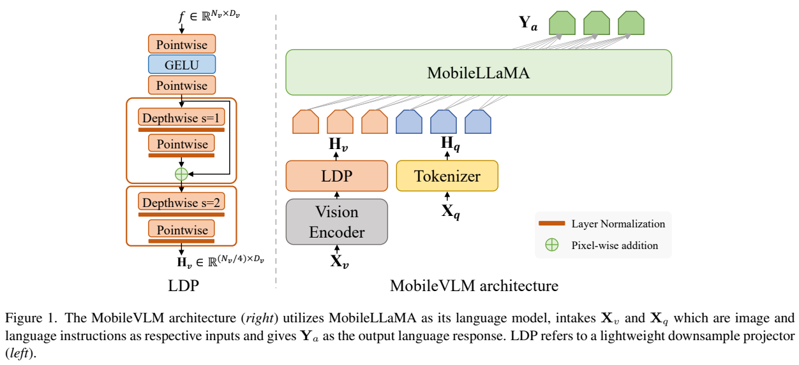
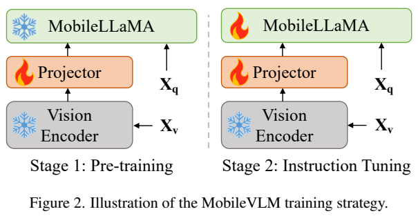
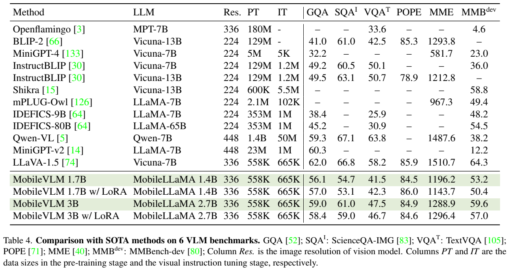
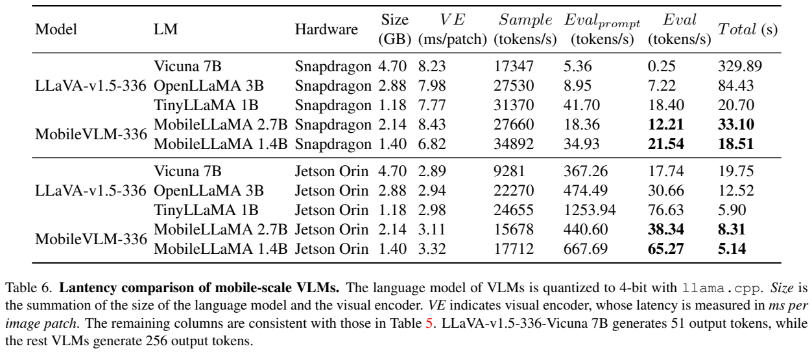
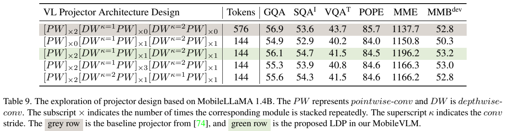
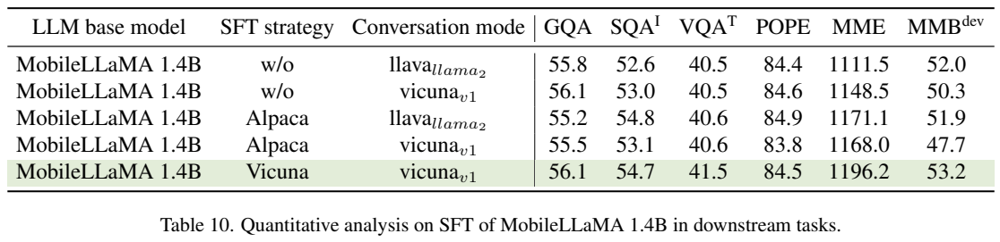
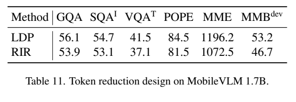

<!-- article-header:start -->
[项目首页](../../../README.md) › [模型系列](../../../reports/model-family-index.md) › [MobileVLM](../README.md)
<!-- article-header:end -->

# MobileVLM：面向移动设备的视觉语言助手

<!-- article-toc:start -->
<a id="article-toc"></a>

**本篇目录** · [论文定位](#paper-info) · [快速概览](#overview) · [整体架构](#architecture) · [核心原理](#principles) · [数据构建](#data) · [训练流程](#training) · [实验结果](#experiments)
<!-- article-toc:end -->

<a id="paper-info"></a>

## 1. 论文信息与模型定位

| 项目 | 内容 |
|---|---|
| 原文 | *MobileVLM: A Fast, Strong and Open Vision Language Assistant for Mobile Devices*；目录题名另含 “Reproducible” |
| 作者与机构 | Xiangxiang Chu、Limeng Qiao、Xinyang Lin 等；美团、浙江大学、大连理工大学 |
| 固定版本 | [arXiv:2312.16886v1](https://arxiv.org/abs/2312.16886v1)，2023 年 12 月 28 日，23 页 |
| 官方代码 | [Meituan-AutoML/MobileVLM](https://github.com/Meituan-AutoML/MobileVLM) |
| 家族与规模 | MobileLLaMA 1.4B/2.7B 为语言骨干；含视觉组件的 MobileVLM 名为 1.7B/3B |
| 输入与输出 | 单张图像与文字问题输入，自回归文字回答输出 |

报告把移动部署问题拆成两项：一是语言模型本身要足够小，二是图像送进语言模型的 token 要足够少。它从公开文本训练 MobileLLaMA，再接入已预训练的 CLIP 视觉编码器，以轻量下采样投影器 LDP 压缩视觉序列。这里“从头训练”适用于语言骨干，并非视觉编码器也从随机初始化训练。

该版本研究普通视觉问答、图片文字理解与对话，没有训练视频或音频接口，也没有动作输出。文末提及自动驾驶、机器人应用是方向，不能据此把模型定位成已验证的具身控制系统。

<a id="overview"></a>

## 2. 快速概览

| 关键问题 | 本文做法 | 需要保留的边界 |
|---|---|---|
| 大语言骨干在手机上太慢 | 训练 1.4B、2.7B 的 LLaMA 风格稠密模型 | 小模型不保证达到 7B 模型的科学知识、OCR 等水平 |
| 336 分辨率图像带来长前缀 | LDP 将 576 个视觉 token 减至 144 | CLIP 仍处理原始 576 个 patch，压缩发生在编码之后 |
| 纯文字骨干不熟悉对话 | 先进行多轮文本 SFT，再进行图文对齐与指令训练 | 对话格式与数据质量也是性能来源 |
| 如何判断移动可用性 | 在 Realme GT 骁龙 888 与 Jetson AGX Orin 上测量 | 报告给出特定量化、提示和输出长度下的速度，不是通用设备承诺 |

最直接的结果是：1.7B 模型在报告设置下达到手机 21.54 token/s、Orin 65.27 token/s 的文字解码速度。3B 模型的 GQA、ScienceQA-IMG、TextVQA 为 59.0、61.0、47.5。它的取舍是以较少模型参数和较短视觉前缀提供相对可用的理解能力，而不是在所有指标上超过较大模型。

<a id="architecture"></a>

## 3. 整体架构





*原文 Figure 1、Figure 2，PDF 第 5 页图表区域裁切，保留层结构、残差连接、冻结/训练图例与模块标记。*

右侧主流程为图像→视觉编码器→LDP→MobileLLaMA。文字问题经 tokenizer 与词嵌入进入同一个语言骨干；两种输入在嵌入空间汇合，输出仍是语言 token。这里没有生成图像的解码器。

视觉编码器是 CLIP ViT-L/14，输入 336×336。空间网格为 24×24，即 576 个 patch 特征。LDP 先用两层 pointwise 变换与 GELU 对齐通道，然后用 stride=1 的 depthwise 卷积模块增强局部交互并加残差，再通过 stride=2 的模块将空间网格变成 12×12。每个最终视觉向量的宽度匹配语言嵌入维度。报告采用 LayerNorm，而非受批次统计影响的 BatchNorm；投影器不到 20M 参数。

MobileLLaMA 1.4B 是 24 层、隐藏维度 2048、16 个注意力头；2.7B 是 32 层、隐藏维度 2560、32 头。两者复用 LLaMA2 的 32K SentencePiece 词表，但词嵌入从头训练；使用 RoPE、RMSNorm、SwiGLU，MLP 扩展比为 8/3。文本预训练长度为 2K；正文引用位置插值说明可扩展到 8K，但未给出本模型 8K 的系统评测，不能当成已充分验证的长上下文能力。

图中 LDP 输出标签写作视觉宽度 $`D_v`$，但正文 Eq. (1) 前后明确要求输出宽度为语言维度 $`D_t`$。本介绍按实际连接关系解释，不将该标注差异推广为另一套架构。

<a id="principles"></a>

## 4. 核心创新与数学原理

报告 Eq. (1)、(2) 的基本关系可以写成：


```math
f=F_{\rm enc}(X_v),\qquad H_v=P(f),\qquad
p(Y\mid H_v,H_q)=\prod_{i=1}^{L}p(y_i\mid H_v,H_q,y_{<i}).
```


这里 $`f\in\mathbb R^{576\times D_v}`$，$`H_v\in\mathbb R^{144\times D_t}`$。视觉向量作为连续嵌入输入语言模型，并非先转成 OCR 文本后回答。最终概率分解属于标准自回归建模，创新集中在接口的空间压缩和部署取舍。

为把 Eq. (3) 的运算次序说清，可将不同层的权重与步长分开记为：


```math
f_0=\mathrm{PW}_2(\mathrm{GELU}(\mathrm{PW}_1(f))),
```


```math
f_1=f_0+\mathrm{LN}(\mathrm{PW}_3(\mathrm{LN}(\mathrm{DW}_{s=1}(f_0)))),
```


```math
H_v=\mathrm{LN}(\mathrm{PW}_4(\mathrm{LN}(\mathrm{DW}_{s=2}(f_1)))).
```


这是对原文 Eq. (3) 与图结构的整理，不是增加新算法。Pointwise 卷积在同一空间位置混合通道；depthwise 卷积逐通道处理邻近空间位置。第 5.2 节文字将 feature/token interaction 的对应说得不够一致，读者应以卷积实际运算理解：前者负责通道映射，后者带来空间 token 的局部交互。

为何不直接把图片缩小到 168×168？两种方法送入 LLM 的 token 都是 144，但前者先用 336 图像经过 CLIP 提取细节，再学习压缩；后者在视觉编码前已经损失输入分辨率。LDP 能利用更完整的初始特征，仍可能丢失小字或细粒度空间信息，不能声称压缩无损。

从计算上看，若文字 token 数为 $`T`$，LLM 的完整前缀注意力项由与 $`(576+T)^2`$ 成比例变为与 $`(144+T)^2`$ 成比例，KV 缓存的视觉部分也相应缩短。这是标准复杂度解释，并非论文测得所有算子的 16 倍提速。视觉编码器并未缩减，生成时还包括线性层、缓存访问、加载和输出长度等成本；论文报告的“LDP 比视觉编码器快约 81 倍”也不等于整个模型快 81 倍。

<a id="data"></a>

## 5. 数据构建与处理

语言模型只用 RedPajama v1，按其 tokenizer 统计约 1.3T token。附录 Table 12 的采样比例为 Common Crawl 67.7%、C4 15.0%、Book/GitHub/Wikipedia 各 4.5%、ArXiv 2.5%、StackExchange 2.0%；显示值相加略有舍入误差。该方案强调公开来源与可控比较，报告没有另加私有教材数据。

预处理将文本 tokenize 为 ID 并序列化到分桶文件，以 memory mapping 提供数据；固定随机种子打乱顺序，便于中断后恢复。不同句子通过 EOS 分隔并打包。EOS 是分隔符，正文未说明对每个样本增加独立注意力块屏蔽，不能据此假定打包样本完全隔离。

文本 SFT 使用第三方平台的人类与 ChatGPT 多轮对话，进行格式统一与质量整理，并按 Vicuna 对话模板组织。该版本没有披露独立对话条数及详细质量过滤阈值。答案末尾特殊符号分隔后续轮次，仅助手答案参与反向传播。

图文数据的版本记录有重要冲突：Table 4 标注预训练 558K、指令训练 665K，并与 LLaVA-1.5 对比；第 4.1 节却写 filtered CC-595K 和 LLaVA-Instruct-158K。两处规模不能视为同一明确配方。本介绍保留表格评测对应的 558K/665K 标注，同时将正文训练超参列出；不擅自替作者把这些数据版本合并或修正为某一种。数据来源的公开性不意味着该 v1 中每项配方记载都已无歧义。

<a id="training"></a>

## 6. 训练流程与目标

全流程包含文字预训练、文字 SFT、视觉接口对齐、图文指令训练，最后两项合称报告的 VLM 训练阶段。

| 阶段 | 更新范围 | 原文训练设置 |
|---|---|---|
| 文本预训练 | MobileLLaMA 全模型 | 1.3T token；全局 batch 写为 5,242,880，未明示单位；LR 3e-4→3e-5，cosine，2000 步 warmup |
| 文本 SFT | 语言模型 | batch 128、长度 2048、无 weight decay；1.4B：LR 2e-5/3 epoch；2.7B：LR 3e-5/2 epoch |
| 图文对齐 | 仅 LDP，冻结 CLIP 与 LLM | 正文 LR 1e-3、batch 256、1 epoch；数据版本见上节冲突 |
| 图文指令训练 | LDP 与 LLM，CLIP 继续冻结 | 正文 LR 2e-5、batch 128、1 epoch |

预训练采用 AdamW，β=(0.9,0.95)、weight decay 0.1、梯度裁剪 1.0，PyTorch Lightning+DeepSpeed ZeRO-1、梯度累积与 FlashAttention V2；硬件为 20 节点、每节点 8 张 A100。正文报告的吞吐为每 GPU 18,800/8,500 token/s，属于作者记载而非本文复测。5,242,880 若解释为 token batch 可对应 2560×2048，但这是算术解释，报告未明确给出 batch 单位，不能写成数百万条文本样本。

多模态阶段采用 AdamW，无 weight decay，cosine 与 3% warmup。报告称 8 张 A100 上 1.7B/3B VLM 训练耗时 5/8 小时；此数值没有包含前面的 1.3T 文本预训练成本。

其语言建模目标可用标准负对数似然解释：$`\mathcal L=-\sum_{i\in\mathcal A}\log p(y_i\mid H_v,H_q,y_{\lt i})`$。$`\mathcal A`$ 表示参与监督的答案位置；答案掩码在文本 SFT 中明确披露，多模态阶段正文只写语言模型损失，未逐 token 描述完整掩码实现。这一公式是解释，不是新增的原文编号公式。

另外报告测试图文指令阶段的 LoRA：冻结 LLM 原权重，只更新低秩矩阵，r=128、α=256。LLM 相关更新参数比例为 8.87%/7.41%，不是整个 VLM 的统一比例；LDP 属于独立接口。LoRA 的作用是减小训练更新量，不自动消除推理时视觉编码与语言解码成本。

<a id="experiments"></a>

## 7. 实验设置与主要结果



*原文 Table 4，PDF 第 7 页图表区域裁切，保留模型、分辨率、PT/IT、所有结果列与脚注。*

| 模型 | GQA | ScienceQA-IMG | TextVQA | POPE | MME | MMBench-dev |
|---|---:|---:|---:|---:|---:|---:|
| MobileVLM 1.7B | 56.1 | 54.7 | 41.5 | 84.5 | 1196.2 | 53.2 |
| MobileVLM 3B | 59.0 | 61.0 | 47.5 | 84.9 | 1288.9 | 59.6 |
| LLaVA-1.5 7B | 62.0 | 66.8 | 58.2 | 85.9 | 1510.7 | 64.3 |

MME 是综合分数，不能与其余百分制列直接做算术平均。3B 相比部分早期 7B/13B 模型有优势，但仍在表中所有六项低于 LLaVA-1.5 7B。文本骨干 MMLU 为 24.97%/27.30%；常识任务的竞争力不能替代广泛科学与知识推理。LoRA 也不是各项都提高：1.7B 的 POPE 84.5→86.0，但 MMBench 53.2→50.4；3B 的 MMBench 59.6→57.0。



*原文 Table 6，PDF 第 9 页图表区域裁切，保留精度、大小、各速度列、总时长与输出长度脚注。*

该实验使用 llama.cpp，LLM 4-bit，视觉编码器与投影器保持原精度，336 图像加固定图片描述问题。1.7B 在骁龙 888 上解码 21.54 token/s，总时长 18.51s；Orin 上 65.27 token/s、5.14s。3B 分别为 12.21/38.34 token/s，总时长 33.10/8.31s。“Sample” 是采样吞吐，“Eval prompt” 是前缀处理速度，“Eval” 才是生成解码速度，不能把上万 token/s 的 Sample 列当成模型输出速度。

正文声称所有 VLM 输出固定 256 token，但表脚注明确 Vicuna 7B 只生成 51 token，其余 256。因此 Total 时间比较含输出长度、加载等差异，不能据此得到等长输出的统一倍速。TinyLLaMA 基线在 Orin 解码 76.63 token/s，快于 MobileVLM 1.7B；但前缀更多使总时长 5.90s，高于 5.14s。报告的价值在于展示端到端前缀成本，而非证明 MobileVLM 每个速度指标都是最快。







*原文 Table 9、10、11，PDF 第 11 页图表区域裁切，保留所有配置行与表头。*

投影消融显示，直接 DW 下采样的 144-token 配置 TextVQA 为 40.2；加入前端两层 PW 后为 41.5，但仍低于 576-token MLP 的 43.7。LDP 同时使 ScienceQA 53.6→54.7、MME 1137.7→1196.2，说明压缩存在任务相关得失。继续增加卷积模块并未稳定提高结果。

相同 144-token 条件下，336 图像加 LDP 对比 168 图像直接降分辨率：GQA 56.1 vs 53.9、TextVQA 41.5 vs 37.1、MMBench 53.2 vs 46.7。该实验支持“先提取高分辨率特征再压缩”比直接低分辨率输入更有效，但没有证明任意比例压缩都不会损失细节。

MobileVLM 给出了从文本骨干、接口设计到真实设备测量的一套具体证据。使用其结果时应同时保留数据版本冲突、速度协议差异，以及与较大模型间的能力差距。本文未运行模型或在移动设备上复测。

<!-- article-footer:start -->
---

[← 上一篇：InternVL](../../internvl/arxiv-2312.14238/README.md) · [按发表时间浏览](../../../reports/paper-reading-guide.md#year-2023) · [下一篇：ChartAssistant →](../../chartassistant/arxiv-2401.02384/README.md)

[返回本篇目录](#article-toc) · [返回模型系列](../README.md)
<!-- article-footer:end -->
