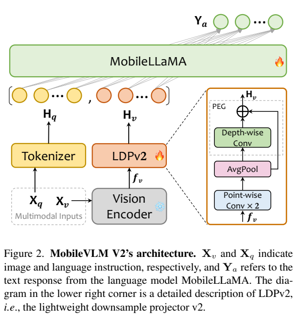
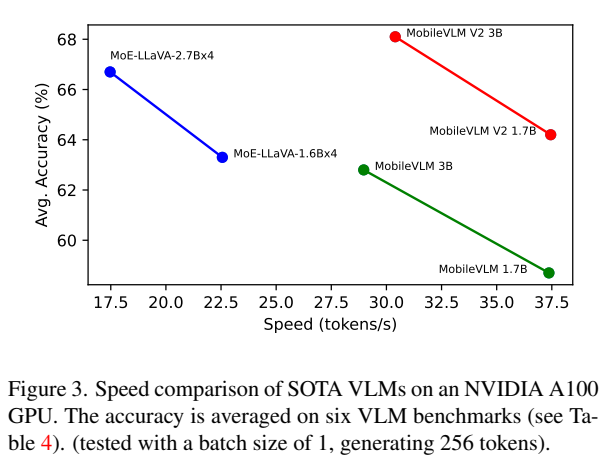
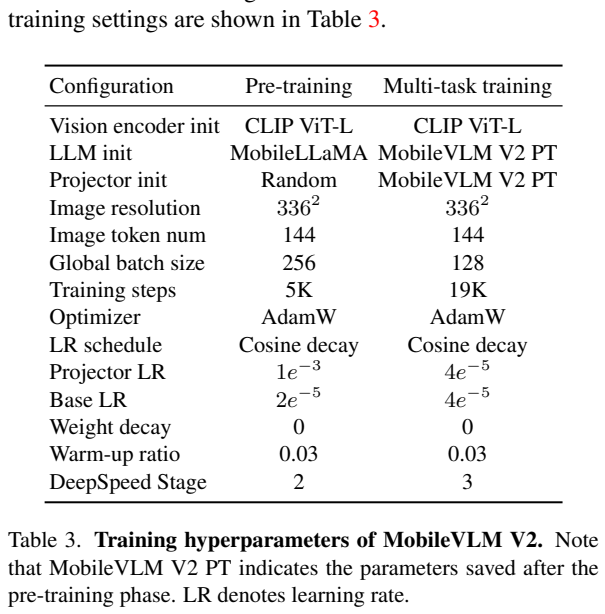
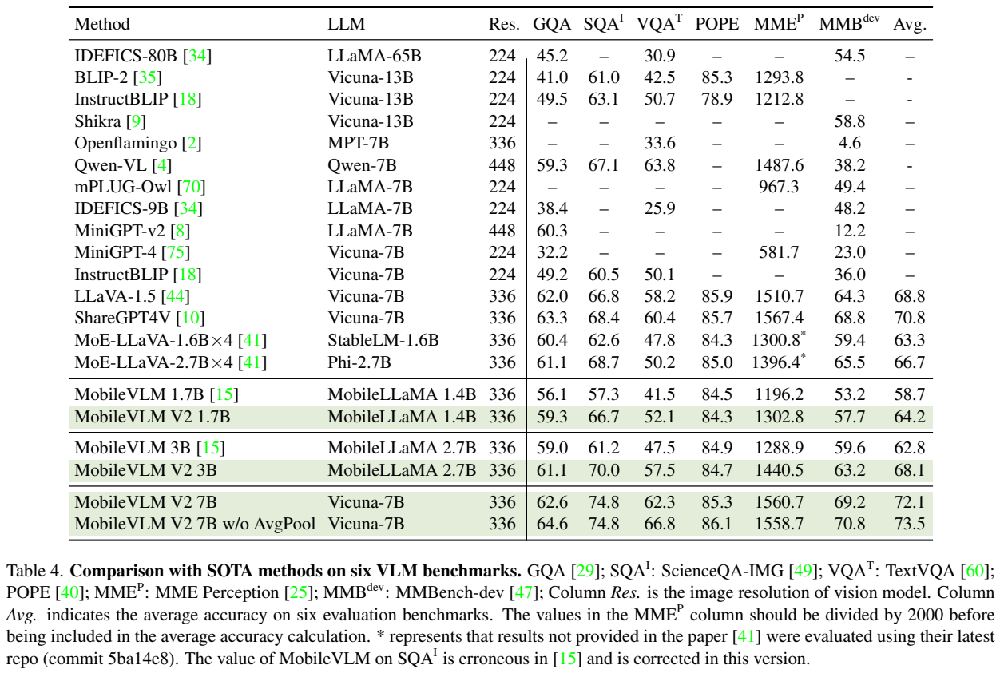
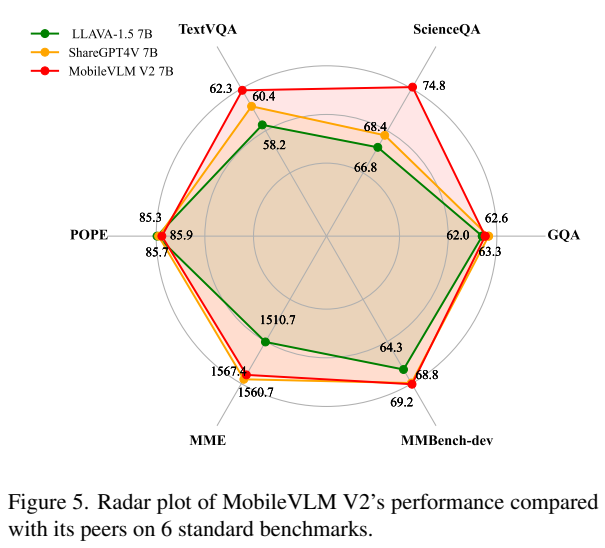
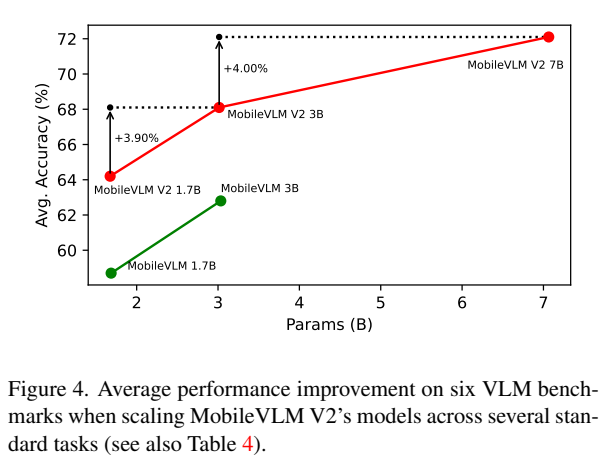
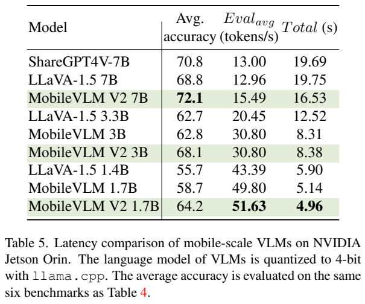
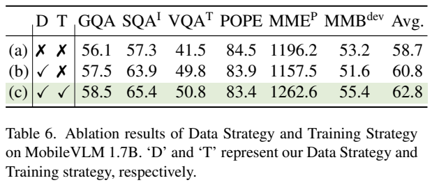

<!-- article-header:start -->
[项目首页](../../../README.md) › [模型系列](../../../reports/model-family-index.md) › [MobileVLM](../README.md)
<!-- article-header:end -->

# MobileVLM V2：以轻量投影、数据扩充和联合训练改善移动端视觉语言模型

<!-- article-toc:start -->
<a id="article-toc"></a>

**本篇目录** · [论文定位](#paper-info) · [快速概览](#overview) · [整体架构](#architecture) · [核心原理](#principles) · [数据构建](#data) · [训练流程](#training) · [实验结果](#experiments)
<!-- article-toc:end -->

<a id="paper-info"></a>

## 1. 论文信息与模型定位

《MobileVLM V2: Faster and Stronger Baseline for Vision Language Model》由 Xiangxiang Chu、Limeng Qiao、Xinyu Zhang 等作者提出，机构包括美团、浙江大学和大连理工大学。本文依据 [arXiv 2402.03766v1](https://arxiv.org/pdf/2402.03766v1)（2024 年 2 月 6 日）介绍；代码入口为 [Meituan-AutoML/MobileVLM](https://github.com/Meituan-AutoML/MobileVLM)。

它面向资源受限设备上的图像理解与对话，在 MobileVLM 基础上同时调整训练数据、可训练参数和视觉投影器。重点是让小模型获得更好的精度与速度组合。1.7B、3B 版本分别使用 MobileLLaMA-1.4B-Chat、2.7B-Chat；另以 Vicuna-7B 构建扩展版本。报告包含 Jetson Orin 实测，不能将该平台结果直接当作任意手机的速度。

<a id="overview"></a>

## 2. 快速概览

| 问题 | 论文的处理 |
| --- | --- |
| 图像 token 增加语言模型计算量 | 将 576 个视觉 token 压缩为 144 个 |
| 原投影器参数较多、适配小模型困难 | 两层逐点卷积、平均池化和轻量位置编码组成 LDPv2 |
| 少量数据限制知识与任务覆盖 | 120 万图文预训练对，约 240 万多任务样本 |
| 小语言模型在对齐阶段适应不足 | 两个训练阶段均更新语言模型和投影器，冻结视觉编码器 |
| 只看准确率无法衡量部署价值 | 同时报告六项评测和 A100、Jetson Orin 生成速度 |

这里的“总计 360 万”包含两个阶段，不能理解为第二阶段独有 360 万指令。提升也并非每个基准都同向：1.7B 的 POPE 从 84.5 降为 84.3，3B 从 84.9 降为 84.7。论文展示的是综合收益与部署权衡。[PDF 第 4、6 页](https://arxiv.org/pdf/2402.03766v1#page=4)

<a id="architecture"></a>

## 3. 整体架构



Figure 2 从下向上展示两条输入路径。图像进入冻结的 CLIP ViT-L/14，指令经过分词与词嵌入；图像特征通过可训练的 LDPv2 变换，随后与文字 token 拼接，由语言模型自回归生成回答。雪花标记视觉编码器冻结，火焰标记投影器和语言模型更新。右侧局部图对应投影器内部的三步处理。

输入图像统一为 336×336，patch 步长 14，因此视觉特征排列为 24×24，共 576 个 token。逐点卷积负责把 CLIP 特征通道映射到语言模型维度；2×2 池化将网格变成 12×12；深度卷积加残差保留局部位置关系。该设计使用部署框架普遍支持的运算，减少的不只是投影器计算，也包括语言模型接收的视觉序列长度。系统输出仍是文字，报告没有增加图像生成或音频模块。[PDF 第 3 页](https://arxiv.org/pdf/2402.03766v1#page=3)

LDPv2 的输出随后与文字 token 一起进入 **MobileLLaMA 系列**，由它生成最终回答。该语言主干沿用上一代 MobileVLM 的选择，使用与 LLaMA2 相同的 tokenizer；本文的结构改进集中在视觉连接器，而非重新定义一套语言词表。读 Figure 2 时，右下角是上方 LDPv2 的内部展开，同一张图只有一条视觉连接路径，不能把两个框算成串联的两次 576→144 压缩。（§3.1–3.2、Figure2，PDF 第3页）

<a id="principles"></a>

## 4. 核心创新与数学原理

原文式（3）可以直接写成：

```math
f_0=\mathrm{PW}(\mathrm{GELU}(\mathrm{PW}(f_v))),\qquad
f_1=\mathrm{AvgPool}_{2\times2}(f_0),\qquad
H_v=\mathrm{DW}(f_1)+f_1.
```

PW 是逐点卷积，改变通道维而不混合空间位置；平均池化完成无参数的空间压缩；DW 是深度卷积，为每个通道提取邻域关系，作为条件位置编码 PEG。相比给每个位置添加固定的可学习向量，PEG 的编码由当前局部特征产生。最后的残差让原始压缩特征仍可直接传递。

对一般 k×k 池化，token 数变为原来的 $`1/k^2`$，这里是 1/4。这个比例只说明序列压缩，不能推导整个模型会快四倍；文字长度、解码过程、视觉编码和硬件实现仍影响总耗时。

原文的“位置部分减少 99.8% 参数”对应旧模块约 12.64M 到 PEG 约 0.02M，**不是整个模型减少 99.8%**。Table 7 中完整 LDPv1 投影器为 18.94M，LDPv2 为 6.32M；同一增强数据与训练设置下，平均分由 62.8 提升到 64.2。没有位置增强的平均池化投影器为 63.2，加入可学习位置向量为 63.7，再换 PEG 为 64.2。这支持局部位置增强的作用，但只是在该小模型与该套任务中的受控消融。[PDF 第 8 页](https://arxiv.org/pdf/2402.03766v1#page=8)

语言建模沿用原文式（2）：$`p(Y_a\mid H_v,H_q)=\prod_i p(y_i\mid H_v,H_q,y_{\lt i})`$。对应最小化回答 token 的负对数似然，是对概率式与原文“next-token prediction”描述的解释；论文没有新设独立的对比学习、奖励模型或强化学习目标。

<a id="data"></a>

## 5. 数据构建与处理

预训练采用 ShareGPT4V-PT 的 120 万图文对，以较详细描述学习视觉到语言的映射。附录说明其涉及 COCO、SAM 和 LLaVA-1.5 预训练相关图像来源。第二阶段将图像描述、对话、开放式问答和选择题共同转换为图像加指令、回答的格式。

| 第二阶段数据 | Table 2 样本量 | 所覆盖的任务 |
| --- | ---: | --- |
| Visual Dialog | 123K | 多轮图像对话 |
| TextVQA | 35K | 图像文字相关问答 |
| VSR / VIGC | 13K / 37K | 空间关系与视觉问答 |
| IConQA / ScienceQA | 107K / 13K | 选择式理解、科学问答 |
| COCO / SBU | 592K / 844K | 场景描述 |
| ShareGPT4V | 665K | 混合指令任务 |

这些列项约为 242.9 万，正文取整为 240 万。SBU 经过清理，数量与原始公开数据不同，但没有披露完整筛选阈值、去重规则和各来源采样权重。不能把所有数据都称为人工独立撰写，也不能据此保证绝无评测泄漏。

附录 Table 8 给出了各任务的提示格式；**TextVQA 提示包含参考 OCR token**。因此其 TextVQA 得分不能解读为完全不使用外部文字提示的纯视觉 OCR 成绩。科学选择题加入选项，图像描述使用描述请求，空间问答以相应指令形式组织。作者增加任务覆盖，让相同的小语言模型学习不同回答要求。[PDF 第 4、12–14 页](https://arxiv.org/pdf/2402.03766v1#page=12)

<a id="training"></a>

## 6. 训练流程与目标





Table 3 应按列阅读两个阶段；Figure 3 的横轴是 A100 上的 token/s，纵轴是六项平均分，两者不能混作移动端数据。训练配置如下。

| 配置 | 预训练 | 多任务训练 |
| --- | --- | --- |
| 初始化 | CLIP、MobileLLaMA 预训练权重；投影器随机初始化 | 第一阶段检查点 |
| 更新参数 | 投影器与语言模型 | 投影器与语言模型 |
| 冻结部分 | 视觉编码器 | 视觉编码器 |
| 全局 batch / 步数 | 256 / 5K | 128 / 19K |
| 投影器学习率 | 1e−3 | 4e−5 |
| 语言模型基础学习率 | 2e−5 | 4e−5 |
| 优化器 / 权重衰减 | AdamW / 0 | AdamW / 0 |
| 调度 / warm-up | 余弦衰减 / 0.03 | 余弦衰减 / 0.03 |
| DeepSpeed 阶段 | 2 | 3 |

正文报告使用 8 张 A100，两个阶段约 5 小时和 9 小时，但未逐一列出所有模型尺寸的相同耗时、显存和数值精度，因此不把它当作每个版本的固定训练成本。训练序列长度也没有在 Table 3 中给出。

与第一代只在初始对齐训练投影器的做法相比，V2 从第一阶段就让小语言模型适应新视觉输入。Table 6 提供了证据：仅换数据时平均分 58.7→60.8，但 MME 与 MMBench 下降；再开放语言模型参与整个流程后平均分到 62.8。这说明新增数据是否能被有效利用，与训练配置相关。该表中的 POPE 继续从 83.9 降到 83.4，不能说联合训练对所有指标都有提升。[PDF 第 4、5、7 页](https://arxiv.org/pdf/2402.03766v1#page=7)

<a id="experiments"></a>

## 7. 实验设置与主要结果







Table 4 使用 GQA、ScienceQA-IMG、TextVQA、POPE、MME Perception、MMBench-dev。平均分计算前将 MME 除以 2000，再与其他百分比统一尺度，不能直接平均表中的原始数字。绿色行是 V2，紧邻行便于比较相同规模的第一代。Figure 5 的雷达图呈现各任务相对表现，具体差异应回到表值判断。

| 模型 | GQA | ScienceQA-IMG | TextVQA | POPE | MME | MMBench-dev | 平均分 |
| --- | ---: | ---: | ---: | ---: | ---: | ---: | ---: |
| MobileVLM 1.7B | 56.1 | 57.3 | 41.5 | 84.5 | 1196.2 | 53.2 | 58.7 |
| V2 1.7B | 59.3 | 66.7 | 52.1 | 84.3 | 1302.8 | 57.7 | 64.2 |
| MobileVLM 3B | 59.0 | 61.2 | 47.5 | 84.9 | 1288.9 | 59.6 | 62.8 |
| V2 3B | 61.1 | 70.0 | 57.5 | 84.7 | 1440.5 | 63.2 | 68.1 |
| V2 7B | 62.6 | 74.8 | 62.3 | 85.3 | 1560.7 | 69.2 | 72.1 |
| V2 7B 去掉平均池化 | 64.6 | 74.8 | 66.8 | 86.1 | 1558.7 | 70.8 | 73.5 |

去掉池化后 TextVQA 提升 4.5 分，支持细粒度文字可能被空间压缩损失的解释。代价是恢复更多视觉 token，7B 的速度优势缩小到与 ShareGPT4V 接近；“压缩没有损失”并不成立。





Table 5 的语言模型以 llama.cpp 做 4-bit 量化，在 NVIDIA AGX Jetson Orin 生成 256 token。V2 1.7B 为 **51.63 token/s、总计 4.96 秒**，V2 3B 为 **30.80 token/s、总计 8.38 秒**；3B 与前代的 token/s 相同，主要获得准确率提升。7B 为 15.49 token/s，ShareGPT4V-7B 为 13.00 token/s。速度受该框架和实现约束，不能跨硬件外推。

A100 的 Figure 3 则使用 PyTorch、batch=1、生成 256 token，1.7B 与 3B 分别是 37.37 和 28.97 token/s。论文不同段落给出“75% 更快”和“1.65 倍”两种概括，此处保留明确的平台和实测值，不将它们合并成单一倍数。

本文没有重新运行模型。上述数值是原文报告结果；实验说明了小模型的数据、训练与投影器可以共同改善综合表现，同时保留了 OCR 细节损失、部分幻觉指标回退和硬件适用范围这些实际边界。

<!-- article-footer:start -->
---

[← 上一篇：CogCoM](../../cogcom/arxiv-2402.04236/README.md) · [按发表时间浏览](../../../reports/paper-reading-guide.md#year-2024) · [下一篇：Prismatic VLMs →](../../prismatic/arxiv-2402.07865/README.md)

[返回本篇目录](#article-toc) · [返回模型系列](../README.md)
<!-- article-footer:end -->
