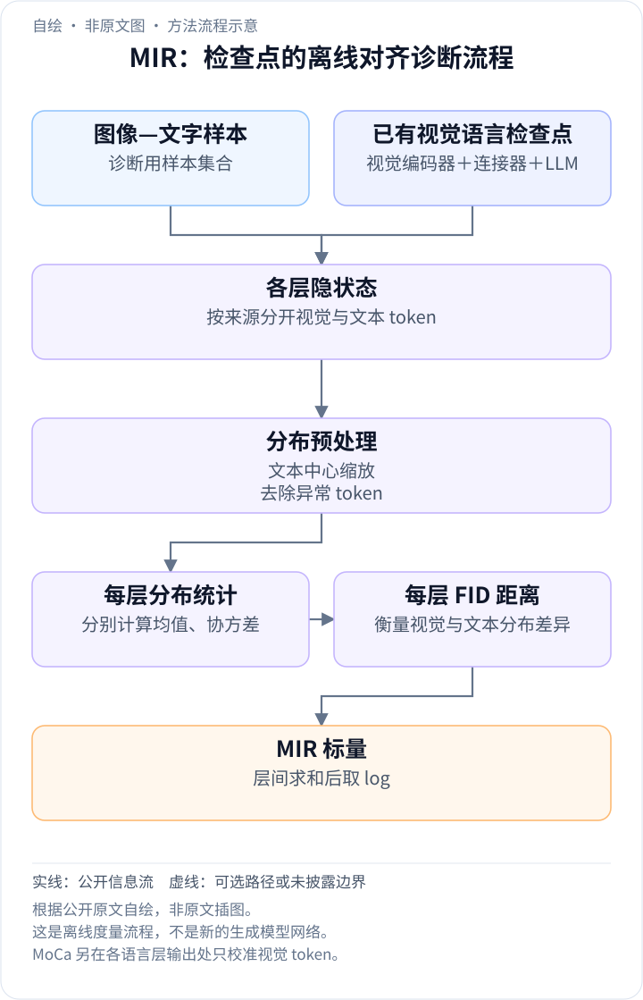
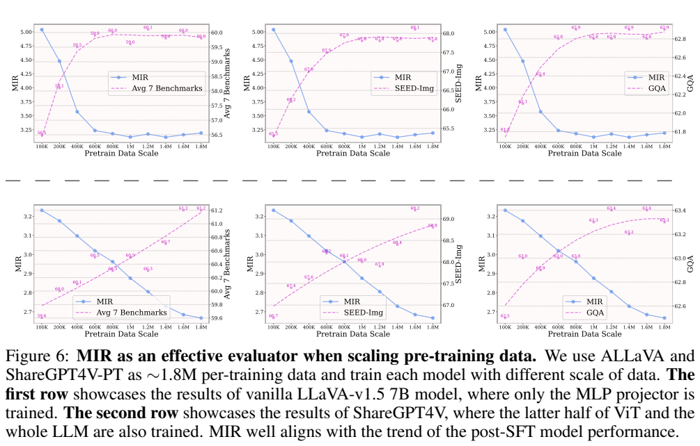
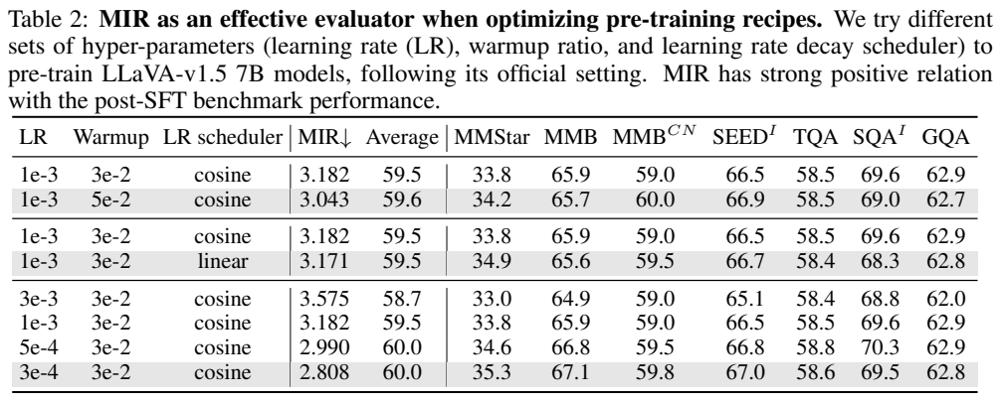
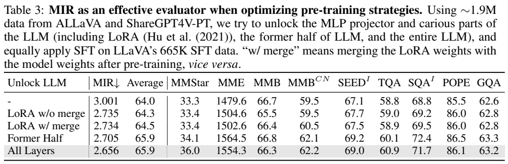
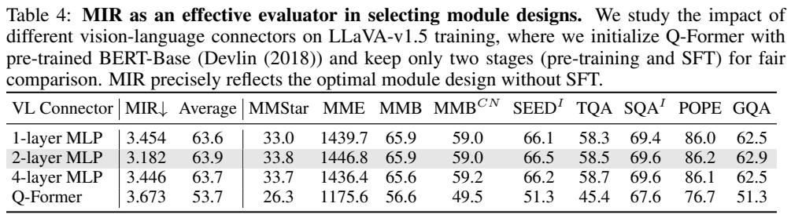
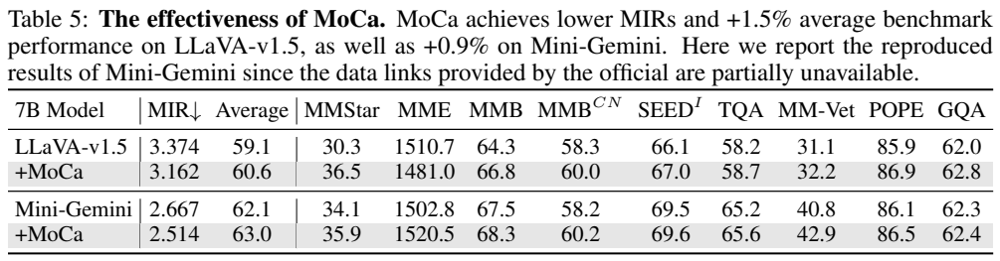

<!-- article-header:start -->
[项目首页](../../../README.md) › [模型系列](../../../reports/model-family-index.md) › [Modality-Integration-Rate](../README.md)
<!-- article-header:end -->

# Modality Integration Rate：从层间分布差异判断多模态对齐

<!-- article-toc:start -->
<a id="article-toc"></a>

**本篇目录** · [论文定位](#paper-info) · [快速概览](#overview) · [整体架构](#architecture) · [核心原理](#principles) · [数据构建](#data) · [训练流程](#training) · [实验结果](#experiments)
<!-- article-toc:end -->

<a id="paper-info"></a>

## 1. 论文信息与模型定位

| 项目 | 信息 |
|---|---|
| 原论文 | Deciphering Cross-Modal Alignment in Large Vision-Language Models with Modality Integration Rate |
| 作者 | Qidong Huang、Xiaoyi Dong、Pan Zhang 等 |
| 机构 | USTC、Shanghai AI Laboratory、CUHK |
| 固定来源 | [arXiv:2410.07167v1](https://arxiv.org/abs/2410.07167v1)，2024-10-09，18 页 |
| 项目 | [shikiw/Modality-Integration-Rate](https://github.com/shikiw/Modality-Integration-Rate) |
| 定位 | 预训练质量诊断指标 MIR，以及逐层视觉特征校准模块 MoCa；不是独立厂商基础模型系列 |
| 实验对象 | LLaVA-v1.5、ShareGPT4V、Mini-Gemini，以 7B 为主，附录扩展到 13B |

论文研究的是“怎样在尚未进行 SFT 时判断视觉与语言已经对齐”，希望减少为了比较预训练配方而反复执行完整 SFT 的成本。应将本条归为方法研究；MIR 的名称包含 Rate，但实际数值是跨层分布距离之和的对数，**越低表示模态间隔越小**，不是每秒处理速率或百分制正确率。

<a id="overview"></a>

## 2. 快速概览

作者发现，给固定 LLM 增加图像模态时，loss、perplexity 和 few-shot 分数可能持续改善或波动，却不对应 SFT 后的任务表现。MIR 分别收集各层视觉、文本 token，统一尺度后计算高斯分布距离，再跨层聚合；较低 MIR 在所测配置中通常对应更好的 SFT 表现。

另一贡献 MoCa 在每个 LLM 层末尾只对视觉 token 加一个可学习缩放和偏移，帮助其适应原本为文本训练的模型。LLaVA-v1.5 的报告平均分从 59.1 到 60.6，Mini-Gemini 复现版从 62.1 到 63.0。改善有任务差异：LLaVA 的 MME 1510.7→1481.0，并非每项都提高。

MIR 测量全局分布而非具体图文配对语义。输入文本与图像不相关时数值仍稳定，是作者验证的特性，也意味着不能把它直接用作判断单条 caption 正确性的评分器。

<a id="architecture"></a>

## 3. 整体架构

<!-- derived-architecture:start -->


*自绘方法流程示意（非原文图）。依据下述公开资料归纳；方框表示功能组件，不代表逐层实现。*

依据：[§2.1；PDF 第3–4页；MoCa见第10页 Eq.5](https://arxiv.org/pdf/2410.07167v1)。
<!-- derived-architecture:end -->

基础模型写成 $`M=(E,P,D)`$：视觉编码器 $`E`$、连接器 $`P`$ 和语言模型 $`D`$。图像经 $`P(E(v))`$ 得到视觉 token，文本经 tokenizer 得到输入，两种 token 一起通过各层 decoder。MIR 需要访问内部隐状态，并按来源区分 token；因此不能只凭闭源 API 的回答文本计算该指标。

第 $`k`$ 层收集 $`N`$ 个样本的视觉特征 $`f_k^v\in\mathbb R^{r\times d}`$ 和文本特征 $`f_k^t\in\mathbb R^{s\times d}`$，其中 $`r`$、$`s`$ 是两类 token 总数，通常不同。计算路径是收集 → 文本中心缩放 → 移除异常值 → 每层均值与协方差 → FID → 求和取 log。这是离线或检查点诊断过程，**不是新增生成头**。

模块实验以 CLIP-ViT-L/336、Vicuna v1.5 和 MLP 为默认配置。MoCa 插在各 LLM 层输出、传入下一层前，只变换视觉部分，保留文字及原归一化参数的语言先验。论文没有统一架构总览图；自绘图补充 MIR 的离线计算路径，原公式与消融图继续说明度量和校准的作用位置。

MIR 的数据流与模型回答路径要分开：同一检查点先前向处理一批图文样本，按 token 来源收集每层隐藏状态；文本中心归一化对两类特征使用同一个由文本统计得到的缩放量，随后去异常值、估计各自分布，计算逐层距离并聚合成一个标量。这个标量用于比较检查点，普通问答不必每次重新计算全数据集 MIR。若启用 MoCa，则每个语言层输出中的视觉位置先做逐通道缩放和平移，再传给下一层；文字位置不经这项额外变换。MIR 是诊断，MoCa 才改变模型前向路径，二者不能画成同一个新增生成头。（§2.1、Eq.5，PDF 第3–4、10页）

<a id="principles"></a>

## 4. 核心创新与数学原理


**[原文 Equation 2—4，PDF 第 4 页](https://arxiv.org/pdf/2410.07167v1#page=4)** 定义文本中心缩放、FID 聚合及均值协方差。理解这些公式时应注意距离越小越好，且两种 token 必须乘同一尺度。

文本中心缩放因子为：

```math
\alpha_k=\frac{s}{\sum_{j=1}^{s}\Vert f^t_{k,j}\Vert _2}.
```

这样文本 token 平均二范数归一到 1，而视觉 token 也乘同一个 $`\alpha_k`$，保留两模态之间原有幅值差异。分别把每个 token 归一为单位向量会抹掉这部分信息；完全不缩放又会让深层较大幅值干扰跨层比较。

异常值函数 $`\omega`$ 按 3σ 原则移除少量高范数 token，之后计算两类 token 的均值 $`\mu`$、样本协方差 $`\Sigma`$。原文的 MIR 是：

```math
\mathrm{MIR}=\log\sum_k\left[\Vert \mu_{v,k}-\mu_{t,k}\Vert _2^2+
\mathrm{Tr}\left(\Sigma_{v,k}+\Sigma_{t,k}-2(\Sigma_{v,k}\Sigma_{t,k})^{1/2}\right)\right].
```

这是借用 FID 的分布距离形式；此处特征来自 LLM 隐状态，**不运行 Inception 图像分类器**。均值项比较整体偏移，协方差项比较分布扩散与方向。原文 Equation 4 将文本协方差左侧也排成 $`\Sigma_{v,k}`$，属于下标笔误；根据定义及 Equation 3，本介绍按 $`\Sigma_{t,k}`$ 理解，不引入第二个视觉协方差。

矩阵平方根用 Newton–Schulz 迭代近似降低计算成本，作者报告通常误差低于 1%，没有完整给出通用的每次耗时和硬件预算。指标是矩统计代理，不等同于语义理解的理论保证，也没有证明任何方法只要最小化 MIR 就一定提高任务表现。

MoCa 的原文 Equation 5 为：

```math
\psi(f_k^v)=u\odot f_k^v+b,
\qquad u,b\in\mathbb R^{1\times d}.
```

原文把偏移向量记作 $`v`$，这里用 $`b`$ 避免与视觉模态下标混淆。缩放初始全 1、偏移全 0，因此初始变换为恒等映射。它只增加逐通道仿射参数，不改变文本分支；不是把 MIR 直接加成可微训练损失，也没有新建跨注意力模块。

<a id="data"></a>

## 5. 数据构建与处理

默认 MIR 使用 **100 张随机 TextVQA validation 图像与 CNN/DM 文本**。无需图文相关配对，实验还比较人物、艺术、风景、OCR 图像与新闻、邮件文本；纯模板和 Vicuna-v1 模板；模型见过与未见过的图文。这里的不相关文本是指标验证选择，不是作者声称训练 caption 可以随意错配。

数据规模实验把 ALLaVA 与 ShareGPT4V-PT 汇成约 1.8M 图文对，逐级从 100K 增至 1.8M，保持每次后续 SFT 相同。冻结策略实验另写约 1.9M 长描述，两个近似量来自各实验说明，不将其强行修成一个精确规模。默认 LLaVA 原配方则用 558K BLIP-2 生成描述。

详细程度实验在句子层面对长 caption 截断，平均长度从 15.2、49.1、127.1 到 181.2；它改变描述信息量，也可能改变训练 token 数，不能只解释为词汇量增加。下游统一使用 LLaVA 665K SFT 数据，以减少指令数据差异造成的混淆。报告没有完整披露新增网页清洗、去重规则或全新人工标注流程，因为它主要复用已有资料。

<a id="training"></a>

## 6. 训练流程与目标

MIR 自身没有待训练权重。先训练预训练检查点，计算 MIR，再对这些检查点执行相同 SFT，以验证指标能否预测后续表现；指标通过验证后才有望帮助筛配置或早停。论文没有给出一个适用于所有模型的 MIR 早停阈值。

数据规模实验有两种设置：LLaVA-v1.5 仅训练 MLP projector，预训练学习率 1e-3；ShareGPT4V 设置解冻视觉编码器后半部分及整个 LLM，学习率 2e-5。各模型随后在同一 665K 数据上 SFT，学习率 2e-5。另比较 LLM LoRA、前半层和全部层解冻，以及 LR、warmup 和 cosine / linear schedule。

连接器实验比较 1 / 2 / 4 层 MLP 与 Q-Former：后者从 BERT-Base 初始化，**没有 BLIP-2 中额外的视觉对齐 warm-up 阶段**。预训练冻结视觉与语言主干，SFT 解冻 LLM 与连接器。因此结果只适用于该两阶段配置，不能证明采用完整 BLIP-2 训练的 Q-Former 普遍不如 MLP。

MoCa 随模型预训练和 SFT 一起学习，遵循 LLaVA、Mini-Gemini 的原训练设置。报告未逐项重列全部 batch、硬件、优化器参数及随机种子，不能把引用官方配方当作全文披露完整 recipe。MIR 也没有替换文本生成监督，更没有进行 RLHF。

<a id="experiments"></a>

## 7. 实验设置与主要结果



**Figure 6，PDF 第 7 页。** 上排仅训练 projector，MIR 与 SFT 表现到约 800K—1M 后趋于饱和；下排训练更多模块，MIR 继续下降，七基准平均由 59.6 增至 61.2。上下排同时改变可训练模块，不能把差异完全归为数据量。上排平均 100K 为 56.5，800K 为 60.0，1.8M 为 59.8，呈小幅波动，并非严格单调。

指标有效性主要验证“排序与趋势”，没有将 MIR 当作最终任务分。Figure 1 用最后 50 steps loss、1000 个 ShareGPT4V 图文的 PPL，以及 MME/MMBench/SEED-Img 的 2-shot 分数比较；在该数据规模实验中，它们比 MIR 更难反映饱和。Figure 3 的跨输入稳定性、Figure 5 的两轮训练实验进一步支持其鲁棒性，但这并不意味着 loss 在所有多模态预训练中都无用。

Table 1 的 caption 平均长度 15.2→181.2，使 MIR **3.588→3.218**，报告平均 **63.8→64.4**，TextVQA 57.7→59.7；中文 MMBench 却由 59.5→57.6。更低全局距离不保证每个专项都提升。





**Table 2、3，PDF 第 9 页。** Table 2 为七项平均，学习率 3e-3 的 MIR / 平均为 3.575 / 58.7，1e-3 为 3.182 / 59.5，3e-4 为 2.808 / 60.0。Table 3 包含更多任务列，其不解冻 LLM / 前半层 / 全部层的 MIR 为 3.001 / 2.705 / 2.656，平均为 64.0 / 65.9 / 65.9。前半层和全部层具有不同 MIR、相同平均，说明它不是精确到小数点的任务分预测器；不同表的 Average 也不能跨任务集合直接比较。





**Table 4、5，PDF 第 10 页。** 两层 MLP 的 MIR 3.182、平均 63.9；Q-Former 为 3.673 / 53.7，需保留其没有额外预对齐的条件。MoCa 的关键结果如下：

| 设置 | MIR↓ | Average | MMStar | MMBench | MME | MM-Vet |
|---|---:|---:|---:|---:|---:|---:|
| LLaVA-v1.5 | 3.374 | 59.1 | 30.3 | 64.3 | 1510.7 | 31.1 |
| +MoCa | 3.162 | 60.6 | 36.5 | 66.8 | 1481.0 | 32.2 |
| Mini-Gemini 复现版 | 2.667 | 62.1 | 34.1 | 67.5 | 1502.8 | 40.8 |
| +MoCa | 2.514 | 63.0 | 35.9 | 68.3 | 1520.5 | 42.9 |

平均增加 1.5 / 0.9 是报告分数的绝对差，不应改成相对增长率。Mini-Gemini 因部分官方数据链接失效使用作者复现版，不能冒充官方完整模型。

附录 Table 6 以十次采样比较数量：1 样本平均 MIR 3.380，100 为 3.375，1000 为 3.376；均值接近，但少量样本的范围更大，作者建议至少 20 个。Table 7 中 Vicuna 7B / 13B 为 3.374 / 2.583，说明跨规模也存在变化；这不是已校准的厂商模型排行榜。总体证据支持 MIR 作为同类训练实验的辅助诊断量，尚缺充分的跨模态、不同深度与极端分布验证，不能据一个全局数值省去所有下游评测。

<!-- article-footer:start -->
---

[← 上一篇：AuroraCap](../../auroracap/arxiv-2410.03051/README.md) · [按发表时间浏览](../../../reports/paper-reading-guide.md#year-2024) · [下一篇：LongVU →](../../longvu/arxiv-2410.17434/README.md)

[返回本篇目录](#article-toc) · [返回模型系列](../README.md)
<!-- article-footer:end -->
