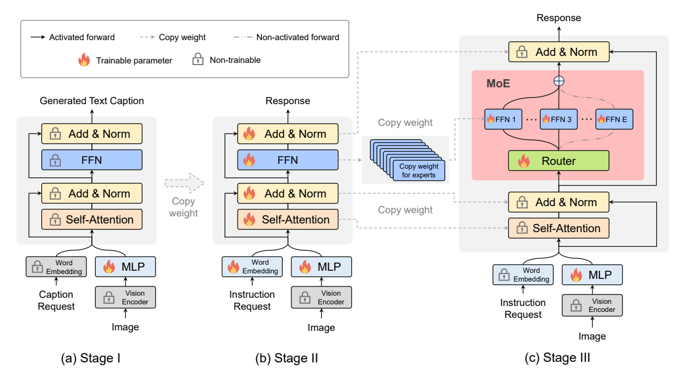
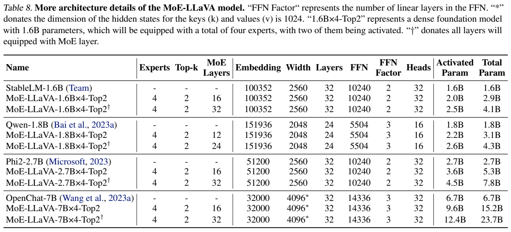
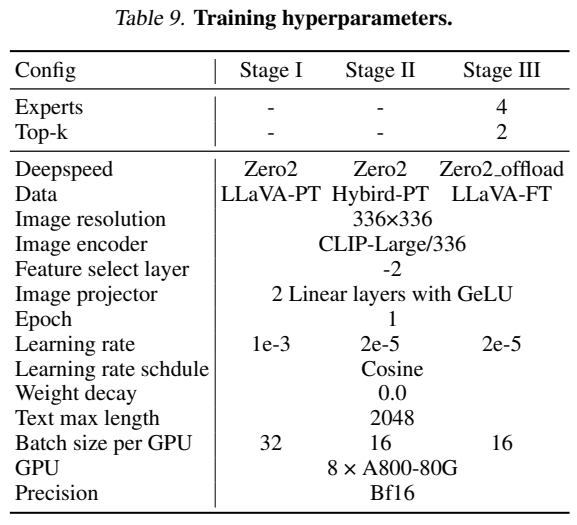
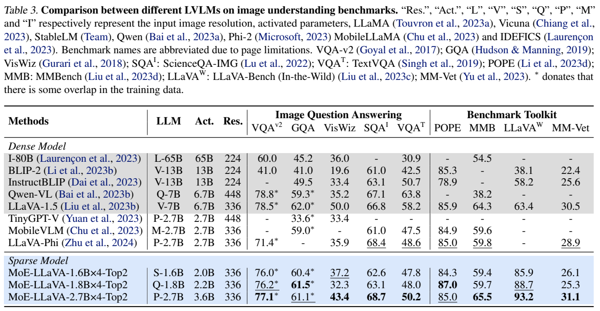
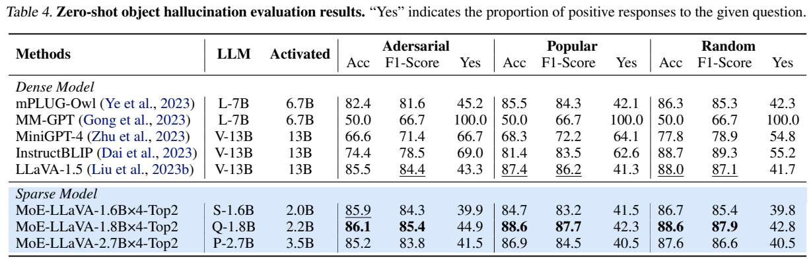
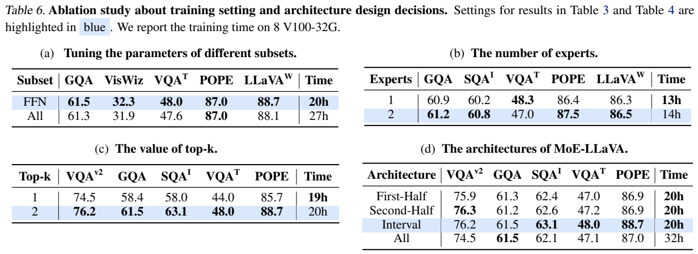
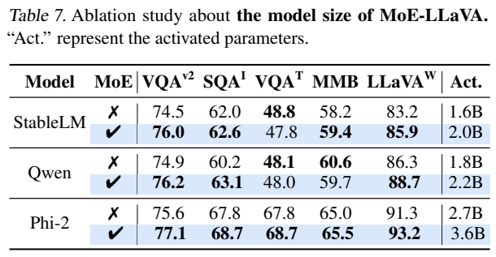

<!-- article-header:start -->
[项目首页](../../../README.md) › [模型系列](../../../reports/model-family-index.md) › [MoE-LLaVA](../README.md)
<!-- article-header:end -->

# MoE-LLaVA：先学习图文理解，再扩展为稀疏专家模型

<!-- article-toc:start -->

**本篇目录** · [论文定位](#paper-info) · [快速概览](#overview) · [整体架构](#architecture) · [核心原理](#principles) · [数据构建](#data) · [训练流程](#training) · [实验结果](#experiments)
<!-- article-toc:end -->

## 1. 论文信息与模型定位

| 项目 | 内容 |
|---|---|
| 论文 | *MoE-LLaVA: Mixture of Experts for Large Vision-Language Models* |
| 作者与机构 | Bin Lin、Zhenyu Tang、Yang Ye、Jiaxi Cui 等；北京大学、中山大学、FarReel AI Lab、腾讯、鹏城实验室 |
| 固定来源 | [arXiv:2401.15947v1](https://arxiv.org/abs/2401.15947v1)，2024 年 1 月 29 日，22 页 |
| 官方仓库 | [PKU-YuanGroup/MoE-LLaVA](https://github.com/PKU-YuanGroup/MoE-LLaVA) |
| 定位 | 以小型语言骨干建立稀疏图文理解基线，主要处理单图加文字并输出文字 |

这篇论文的主线是训练顺序：先对齐视觉输入，再把稠密语言模型训练成视觉语言模型，最后复制前馈层形成专家。作者发现，同时学习新模态和稀疏路由容易退化，因此先给专家提供具有多模态能力的初始化。

专家是在语言模型若干层内执行的 FFN，不是独立完整大模型，也没有预先指定“图像专家”“文字专家”。论文讨论检测、分割、生成、视频等未来扩展，但当前评测集中在图像问答与对象幻觉，不能把这些扩展当作已完成能力。

## 2. 快速概览

| 要点 | 实际做法 |
|---|---|
| 视觉接口 | CLIP-Large/336，倒数第二层特征，双线性层加 GELU 投影器 |
| 稀疏结构 | 默认隔层将 FFN 替换成 4 个专家，每个 token 激活 Top-2 |
| 训练方法 | 投影器对齐→稠密图文指令训练→复制专家后稀疏训练 |
| 目标 | 答案自回归损失，加系数 0.01 的负载均衡损失 |
| 关键证据 | Phi-2 版本若干指标接近或超过 LLaVA-1.5 7B；Qwen 版本 POPE 表现较好 |
| 已知限制 | 大骨干扩展并非稳定收益；FP16 可能 NaN；缺少真实推理速度与显存对照 |

| 语言骨干 | MoE 层数/总层数 | 报告激活参数 | 报告总参数 |
|---|---:|---:|---:|
| StableLM 1.6B | 16/32 | 2.0B | 2.9B |
| Qwen 1.8B | 12/24 | 2.2B | 3.1B |
| Phi-2 2.7B | 16/32 | 3.6B | 5.3B |

这些数值来自 Table 1/8 的语言结构统计。附录参数公式不包括视觉编码器与投影器，因此不能将“2.2B 激活”直接视作整套系统的精确参数总量，也不能以模型名中的“1.8B×4”计算成四个完整 1.8B 模型。

## 3. 整体架构

*原文 Figure 3，PDF 第 4 页图表区域裁切，保留复制权重路径、激活/未激活路径、冻结和训练图例。图注误写 “two-stage”，实际图和方法均为三阶段。*

图像先被 CLIP 编为特征。336×336、patch 14 对应 24×24=576 个视觉 token；投影器将其通道宽度映射为语言隐藏维度。文字经词嵌入处理，两种 token 拼接后进入语言骨干。接口没有下采样到固定少量查询，也没有 OCR 引擎代替视觉编码器。

注意力层负责 token 之间交互；稀疏化发生在部分 FFN。每个 MoE 层带有独立的可学习线性路由器，将一个 token 的隐藏状态映射为专家分数，并选择其中两条路径。其余层继续使用原本稠密 FFN。不同 token、不同层可以选不同专家，因此一次序列推理仍可能访问全部专家权重；“每个 token 激活两个”不等于整次请求只需加载两个专家。

Stage III 从 Stage II 的稠密多模态 FFN 复制专家，随后训练使这些副本逐渐分化。第 3.2 节曾写从 Stage I 复制，但第 3.3 节、Figure 3 和训练动机都明确是 Stage II 后的初始化，本介绍按后一组相互一致的说明解读并记录差异。

主配置均是 **4 个 FFN 专家、每个 token 激活 top-2**，但语言底座和稀疏层数不同：StableLM-1.6B 的 32 层中有 16 个 MoE 层，Qwen-1.8B 的 24 层中有 12 个，Phi2-2.7B 的 32 层中有 16 个。默认交替替换 FFN，因此图像和文字共同经过原自注意力，进入稀疏 FFN 时才分别按 token 路由。top-2 指每层每个 token 的专家选择，不是只运行整网两层，也不代表四个独立视觉编码器。（Table1、§4.1，PDF 第5页）

## 4. 核心创新与数学原理

设 token 隐藏向量为 $`x\in\mathbb R^D`$，专家数为 $`E`$。将原文 Eq. (5)、(6) 的维度与 Top-k 索引整理为：

$$
p(x)=\mathrm{softmax}(x^\top W),\quad W\in\mathbb R^{D\times E},\qquad
\mathcal S(x)=\mathrm{TopK}(p(x),k),
$$

$$
\mathrm{MoE}(x)=\sum_{i\in\mathcal S(x)}p_i(x)\,e_i(x),\qquad E=4,\ k=2.
$$

这里求和遍历被选中的专家编号，不是固定调用第 1、2 个专家。原文直接使用 softmax 权重，未明确说明选中后是否再次归一化，故不额外加入这种实现设定。论文称其为 soft router，指路由分数可学习；实际仍执行离散 Top-k 选择，而非计算全部专家的密集加权输出。

若稠密共享部分参数为 $`P_s`$，每个专家的参数为 $`P_e`$，MoE 层数为 $`L_m`$，可用近似关系理解存储与激活差异：$`P_{total}\approx P_s+L_m E P_e`$，$`P_{active}\approx P_s+L_m kP_e`$。这只是参数组成的解释，不是论文的新公式。注意力、视觉编码器、词嵌入、路由开销并没有变成零；随着 $`k`$ 增大，激活计算也增大。所以“保持成本不变”应限定为增加专家数但固定激活专家数的理想 FFN 计算比较，不能推断模型端到端延迟恒定。

负载均衡的意图是防止大量 token 聚集到少数专家。Eq. (9) 为 $`\mathcal L_{aux}=E\sum_i F_i P_i`$。为避免原文 Eq. (10) 求和下标和专家下标混乱，可用标准 Top-1 统计定义示意：

$$
F_i=\frac1B\sum_{b=1}^{B}\mathbf1[\arg\max_j p_j(x_b)=i],\qquad
P_i=\frac1B\sum_{b=1}^{B}p_i(x_b).
$$

原式使用 argmax，但默认前向为 Top-2；它没有清楚披露实际实现是否统计两条分配，以及是否按 Top-k 重新缩放。本式解释的是原文采用的 Top-1 形式，不冒充已经查证的 dispatcher 实现。硬选择计数通常不直接求梯度，均衡信号通过平均路由概率影响 router。均衡是正则目标，不保证每层每位专家恰好处理 25% token；原文自己的路由图存在明显层间偏好。

MoE-tuning 的新意主要在初始化和课程顺序，而不是发明 Top-k 或负载均衡。先让稠密 FFN学会跨模态任务，再分裂成多个专家，可降低同时学习视觉接口、答案生成和路由的难度；这个解释得到消融支持，但不构成任意规模都稳定的理论保证。

## 5. 数据构建与处理

| 数据组 | 用途 | 来源与规模 |
|---|---|---|
| LLaVA-PT | Stage I 视觉对齐 | LLaVA-1.5 558K |
| Hybrid-FT | Stage II 稠密图文能力 | SViT-core 157K、LVIS 220K、LRV 331K、MIMIC-IT LA split 256K，共 964K |
| LLaVA-FT | Stage III 专家微调 | LLaVA-1.5 mix 665K |

第二阶段专门增加更复杂的指令，包括图像逻辑推理与文字识别，为复制专家提供较强起点。作者重新组织公开数据，而非在本文报告中从原始图像重新人工标注全部指令。三个阶段样本规模相加为 2.187M 次训练集条目，但各来源可能含重复图片或相关任务，不能当作 2.187M 张互不重复的新图像。

图像尺寸统一为 336×336，取 CLIP 的倒数第二层特征；文本最大长度 2048。v1 没有给出所有数据清洗阈值、去重策略、类别比例、长样本截断规则或每个集合的具体 teacher 提示。本介绍不将各引用数据集的外部配方补写成本文已经披露的配方。

## 6. 训练流程与目标

*原文 Table 8、Table 9，PDF 第 15 页图表区域裁切，保留全部结构变体、参数计数、三阶段超参和说明。*

| 阶段 | 主要更新范围 | LR/全局 batch/epoch |
|---|---|---|
| I：视觉对齐 | 仅投影器；冻结 CLIP 与 LLM | 1e-3 / 256 / 1 |
| II：稠密图文训练 | 语言模型和投影器；CLIP 冻结 | 2e-5 / 128 / 1 |
| III：稀疏专家训练 | FFN/MoE 专家、router，并按 Figure 3 更新投影器；注意力等共享部分冻结 | 2e-5 / 128 / 1 |

第三阶段更新范围的记载并不完全一致：Figure 2 图注说仅 MoE 层；Figure 3 显示 MLP 可训练；Table 6a 的“FFN”文字解释为训练所有 FFN 和 MoE 层。不能简单概括成“只训练新增 router”，也不宜声称从 v1 中能确定每个参数名的冻结设置。

各阶段 cosine 调度、weight decay 0、长度 2048、gradient checkpointing；Table 9 为 8×A800-80G、BF16，前两阶段 ZeRO-2，第三阶段 ZeRO-2 offload。附录另提可用 A100 和小模型的 8×V100-32G，Table 6 时间实验明确采用 V100，不能将不同硬件上的时间混成统一成本。该表未披露优化器种类、β、warmup 比例等，不能自行填成 LLaVA 默认配置。作者发现两 epoch 易过拟合，使用一 epoch；FP16 曾出现 NaN，不能据此说 BF16 解决了所有训练稳定性问题。

原文总目标 Eq. (7) 为 $`\mathcal L=\mathcal L_{regressive}+0.01\mathcal L_{aux}`$。答案项用标准记号解释为：$`\mathcal L_{regressive}=-\sum_{t=1}^{M}\log p_\theta(y_t\mid V,Q,y_{<t})`$，仅对生成文字计算。原文 Eq. (8) 将输出长度、视觉长度与隐藏维度的符号混用；这里以 $`M`$ 单独代表答案长度，保持其自回归监督含义。该训练没有报告奖励模型、PPO 或 DPO。

## 7. 实验设置与主要结果

*原文 Table 3、Table 4，PDF 第 6 页图表区域裁切；保留所有模型行、训练重叠星号、POPE 的 Acc/F1/Yes 列。*

| 模型 | VQAv2 | GQA | ScienceQA-IMG | TextVQA | MMBench | MM-Vet |
|---|---:|---:|---:|---:|---:|---:|
| MoE-LLaVA Qwen | 76.2* | 61.5* | 63.1 | 48.0 | 59.7 | 25.3 |
| MoE-LLaVA Phi-2 | 77.1* | 61.1* | 68.7 | 50.2 | 65.5 | 31.1 |
| LLaVA-1.5 7B | 78.5* | 62.0* | 66.8 | 58.2 | 64.3 | 30.5 |

星号表示训练数据有重叠，不能将这些项理解成严格未见任务的零样本泛化。Phi-2 版本比 LLaVA-1.5 7B 的 ScienceQA、MMBench、MM-Vet 分别高 1.9、1.2、0.6 个百分点，但 TextVQA 低 8.0 个百分点、VizWiz 43.4 vs 50.0。LLaVA-Bench-Wild 为 93.2 vs 63.4，属于该基准分值差，不能概括为所有视觉理解能力提高 29.8%。

对象幻觉评测询问图片中是否存在对象。Qwen 版本三个 POPE 子集 F1 为 85.4/87.7/87.9，对照 LLaVA-1.5 13B 的 84.4/86.2/87.1；对应提高 1.0/1.5/0.8 个百分点。它支持该二分类协议下的优势，不代表开放长描述没有幻觉。其三项 accuracy 为 86.1/88.6/88.6，不能将 F1 增益写成 accuracy 增益。

*原文 Table 6、Table 7，PDF 第 8 页图表区域裁切，保留四组消融与全部数值。*

三阶段方法在 Table 5 的 GQA/ScienceQA/POPE 为 61.5/63.1/87.0，而直接稀疏化联合训练为 58.4/58.1/81.9，支持先稠密学习再专家化。FFN 子集训练与全参数训练分别需 20h/27h，前者 GQA 61.5 vs 61.3；此证据是特定 V100 训练实验，论文没有部署 tokens/s 对照。

Top-2 相比 Top-1 使 GQA 58.4→61.5、TextVQA 44.0→48.0，时间 19h→20h；增加激活计算可提升能力，但不能称为成本完全不变。Table 6c 的 POPE 列写 88.7，与主结果 87.0 不一致，本介绍不合并这两个数字。全层 MoE 需 32h，隔层为 20h，且并非全层性能最好。

Table 7 及附录 Table 10 有额外数值问题：Phi 的 TextVQA 重复 ScienceQA 的 67.8/68.7，与主 Table 3 的 50.2 不一致；Qwen 的不同表也有出入。因此主要模型比较使用 Table 3，不利用重复数值宣称 OCR 增益。附录 OpenChat 稠密→MoE 后 ScienceQA 69.0→62.8、MMBench 66.9→65.9，说明向更大骨干扩展会退化；作者归因于数据不足，但这仍是推测，并非已经证明的唯一原因。

路由分析显示专家在不同深度有偏好，部分层出现明显负载集中，同时图像与文字都能使用多个专家。这适合观察模型如何分工，不证明专家已经学到可解释、稳定的任务类别。MoE-LLaVA 的可复用价值是三阶段初始化经验与稀疏多模态基线；对效率和扩展性的判断还需要实际部署测量及更大规模实验。本文未运行模型。

<!-- article-footer:start -->
---

[← 上一篇：InternLM-XComposer2](../../internlm-xcomposer/arxiv-2401.16420/README.md) · [按发表时间浏览](../../../reports/paper-reading-guide.md#year-2024) · [下一篇：LLaVA-NeXT →](../../llava/document-86e88fe4b1ec/README.md)

[返回本篇目录](#article-toc) · [返回模型系列](../README.md)
<!-- article-footer:end -->
