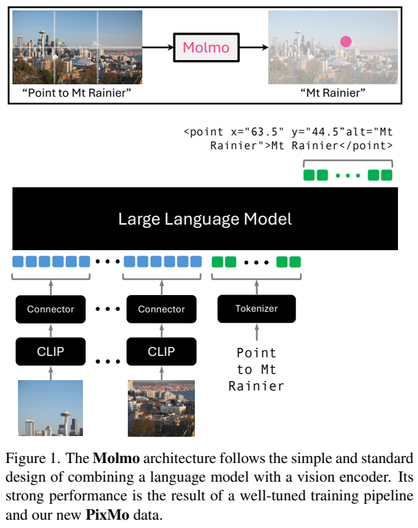
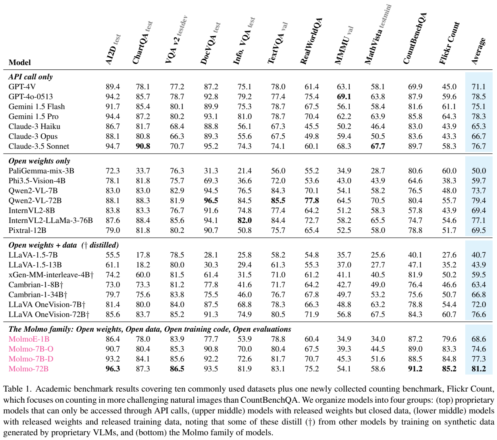
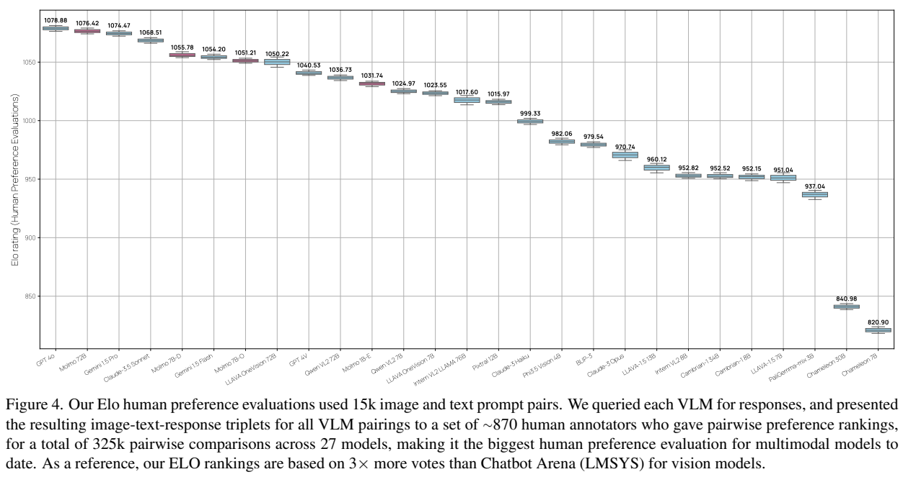

# Molmo 与 PixMo：以人工密集描述和二维指点建设开放多模态模型

## 1. 论文信息与模型定位

论文为 **Molmo and PixMo: Open Weights and Open Data for State-of-the-Art Multimodal Models**，由 Allen Institute for AI 与华盛顿大学团队提出，Matt Deitke、Christopher Clark 等为作者。本介绍依据 **arXiv 2409.17146v1，2024 年 9 月 25 日**，共 8 页。[固定版本 PDF](https://arxiv.org/pdf/2409.17146v1)；[官方项目](https://molmo.allenai.org/)。

**Molmo** 是图像理解与指令跟随模型家族，**PixMo** 是作者构建的图像描述、问答、文档、指点等数据系列。语言底座包括 OLMoE-1B-7B、OLMo-7B-1024、Qwen2-7B、Qwen2-72B。它可以用文本形式输出二维点，支持定位、计数和解释，但本报告没有把它定义为一个生成图片或音频的模型。

这是首发的简短报告，部分数据、训练与评估代码在原文中仍属于后续发布计划。因此本文按固定版本解释方法和结果，不将“计划开放”写成发表当天所有资源已经可用。

## 2. 快速概览

Molmo 的重点不是复杂新连接器，而是**高质量视觉监督和简单的全参数训练**。作者不使用其他闭源 VLM 为图片直接生成合成描述，而让标注员以 **60–90 秒口述**详细描述图像，保存录音，再转写并用纯语言 LLM 整理文字。PixMo-Cap 训练使用 **712K 不同图片、约 1.3M 描述**。

第二阶段混合学术数据和新 PixMo 任务，特别是二维指点：模型可以先指出每个目标，再据点计数，也可以用点指明回答的视觉证据。语言输出由此具备可关联到具体像素位置的形式。

72B 在作者 11 项学术基准平均为 **81.2**，GPT-4o-0513 为 **78.5**；人类偏好 Elo 中 Molmo-72B 为 **1076.42**，略低于 GPT-4o 的 **1078.88**。平均领先不代表所有任务领先：MMMU 为 **54.1 / 69.1**，MathVista 为 **58.6 / 63.8**，Molmo 明显更低。

## 3. 整体架构

**Figure 1，PDF 第 2 页** 展示多图块经 CLIP 与连接器进入语言模型，文字请求则经 tokenizer 输入。顶端的点输出把“指向山的位置”编码成含 x、y 和文本标签的标记。读图时应关注两个接口：图像以连续视觉特征输入，位置则以语言模型生成的结构化文本输出，并不是另接一个检测头完成所有定位。

架构有四部分：预处理器产生**多尺度、多裁块图像**；ViT 独立编码每个裁块；连接器用 **MLP** 映射到语言模型输入维度，然后**池化减少视觉 token 数**；decoder-only LLM 生成描述、回答与点。

所有公开模型都使用 **OpenAI CLIP ViT-L/14，336px**。报告没有给出裁块上限、池化精确形式、投影器层数或最终 token 数，不能从 Figure 1 中的方块数反推出真实序列长度。多个语言底座采用相同数据和大体配方，但学习率存在区别；原文未列出对应值。

MolmoE-1B 的语言底座是 OLMoE-1B-7B，名称体现高效激活规模，不能当作整套模型只有 1B 总参数。Molmo-7B-O 使用 OLMo，7B-D 使用 Qwen2，72B 也使用 Qwen2；O/D 是底座路线的区分，不是视觉编码器不同。

## 4. 核心创新与数学原理

第一项创新是**通过口述改善监督密度**。让人写描述时，往往只列最显著对象；强制长篇输入又容易造成时间成本和复制闭源模型答案。改为说出所见，标注员可以快速覆盖物体数量、位置关系、文字、背景、色彩和细微内容。录音为标注过程提供可追溯凭据，转写和整理阶段再处理口语痕迹。

这不是“完全不用语言模型”。作者使用纯语言 LLM 整理转写、生成摘要和部分问答，也使用代码生成合成文档。关键区分是：主要图像描述的视觉内容来自人，而不是让外部闭源 VLM 直接看图生成训练答案。训练中仍包含合成数据和语言模型辅助，不能写成全部为未经机器处理的人工文本。

第二项创新是**指点作为语言输出与视觉推理中间形式**。设模型给某类对象输出点集 \(P=\{(x_i,y_i)\}_{i=1}^n\)，计数可解释为 \(n=|P|\)。这让“有几个”同时携带“分别在哪里”的证据。**该关系是任务解释，不是原文的独立损失公式。** 固定版本没有公布完整坐标归一化与解码协议、点匹配损失或防止重复点的机制，不能补造为一套检测算法。

监督还包含目标不存在的样本。这样模型面对“指出某物”时可以表达没有目标，而不必总生成一个坐标。指点证据有望帮助机器人/网页 agent，但本报告的这些潜在应用不等于已验证所有闭环行动成功率。

第三项设计是**从第一阶段就联合更新所有组件**。随机初始化连接器连接已有 CLIP 与 LLM，随后整套模型直接学习密集描述，减少依赖大量弱配对数据、轮流冻结/解冻的复杂适配。正文没有给出完整消融，不能把“简洁训练成功”改写成已证明任意小数据都能全参数稳定训练。

## 5. 数据构建与处理

[原文 Section 3，PDF 第 3 页](https://arxiv.org/pdf/2409.17146v1#page=3) 说明口述数据采集、真实用户式问答及指点数据的构建。核对各数据量时应区分单位：图片数、描述数、问答数、问答—点对不是同一口径。

PixMo-Cap 按约 **70 个主题**搜集图片，早期每张由三名标注员各说至少 60 秒，后期改为一名标注员说至少 90 秒。录音转写后由纯语言模型整理；当有三份描述时，还可总结出第四份描述，形成自然的数据增强。**712K 图片、约 1.3M 描述**是实际训练数量，不能把每张都乘四。

| 新数据 | 原文规模 | 构建重点 |
|---|---|---|
| AskModelAnything | 162K 问答、73K 图像 | 人提问题，密集描述+OCR供纯语言 LLM回答，人反复纠正 |
| Points 定位/计数 | 2.3M 问答—点对、428K 图像 | 指出全部实例，并包含目标不存在的数据 |
| Points 解释 | 79K 问答、29K 图像 | 将带文本标签的点交给语言 LLM，用位置支持回答 |
| CapQA | 214K 问答、165K 图像 | 仅根据真值描述生成多种主题和风格的问答 |
| Docs | 255K 图像、2.3M 问答 | LLM生成图表/文档/表格/图示代码，再依据代码生成答案 |
| Clocks | 826K 样本 | 约50种手表、约160K表盘风格，随机时间渲染 |

AskModelAnything 的语言 LLM 没有直接看图，但作者自己的第一阶段模型提供了密集描述，OCR 工具提供文字；人类审核负责纠正最终答案。Docs 的答案来自生成代码这一特权信息，不是外部 VLM 对渲染图的预测。上述管线减少闭源视觉模型依赖，却仍需要关注描述、OCR 或生成代码中的错误。

学术混合包括 VQAv2、TextVQA、OK-VQA、ChartQA、DocVQA、InfographicVQA、AI2D、A-OKVQA、AndroidControl、ScienceQA、TabMWP、ST-VQA、TallyQA、DVQA、FigureQA、PlotQA 的训练数据。ChartQA 的人工/增强样本等权。固定版本未给出所有混合比例和独立图片去重总数，不能简单相加表中图像数作为唯一训练图像量。

## 6. 训练流程与目标

**阶段一：描述生成。** 预训练好的 CLIP 和语言模型通过随机初始化连接器组合，以 PixMo-Cap 的密集描述监督训练，**所有参数更新**。这里“从头建设多模态模型”并不是把语言模型与 CLIP 都从随机初始化开始；基础组件已经独立预训练。

**阶段二：监督指令微调。** 在学术任务与 PixMo 系列混合上继续**更新全部参数**，让描述能力转成问答、定位、计数等交互能力。作者明确 **不使用 RLHF**。

文本生成和结构化点输出都可以用自回归条件似然解释：

\[
\mathcal L=-\sum_t\log p_\theta(y_t\mid y_{<t},I,q).
\]

该式是对训练任务的概括，报告没有给出逐 token 掩码、点字段的特殊加权或单独回归损失。它也没有披露可完整复现训练的 GPU、batch、学习率、epoch、上下文长度、优化器与 token 总量，不能用后续长版本或别的模型配置补入本篇。

开放性需要按组件判断。PixMo 的目标是开放视觉语言数据，但当前使用的 OpenAI CLIP 预训练数据闭源；Qwen2 是开放权重底座，OLMo 路线的数据和代码更充分开放。原文 Figure 3 正是按视觉编码器、语言底座、最终 VLM 分别讨论权重、数据与代码，而不是用“开放”一个标签抹去这些差别。

## 7. 实验设置与主要结果

**Table 1，PDF 第 6 页** 覆盖 AI2D test、ChartQA test、VQAv2 testdev、DocVQA test、InfographicVQA test、TextVQA val、RealWorldQA、MMMU val、MathVista testmini、CountBenchQA，以及新建的更难自然图像计数集 Flickr Count。

对照成绩优先采用作者公布的数字，缺失时取其他报告/公开榜单，再缺失才自行计算。因此它不是所有模型在一个完全受控流程中的重评。作者也指出同一模型因提示、预处理等差异可出现较大波动，并避免对闭源数据模型的“零样本”宣称作强划分。

| 指标 | Molmo-7B-D | Molmo-72B | GPT-4o-0513 |
|---|---:|---:|---:|
| AI2D | 93.2 | 96.3 | 94.2 |
| DocVQA | 92.2 | 93.5 | 92.8 |
| TextVQA | 81.7 | 83.1 | 77.4 |
| MMMU | 45.3 | 54.1 | 69.1 |
| MathVista | 51.6 | 58.6 | 63.8 |
| CountBenchQA | 88.5 | 91.2 | 87.9 |
| Flickr Count | 84.8 | 85.2 | 59.6 |
| 11项平均（原表） | 77.3 | 81.2 | 78.5 |

计数是显著强项，尤其 Flickr Count 相差 **25.6** 分；MMMU、MathVista 则落后。平均分提高不等于复杂学科知识和数学推理全面更强，也不能忽略学术训练数据在微调中的参与。MolmoE-1B 平均 **68.6**、7B-O **74.6**，说明语言底座选择同样影响结果。

**Figure 4，PDF 第 7 页** 来自 **15K 图像—文本请求**、约 **870 名标注员**、超过 **325K 成对偏好判断**，覆盖 27 个模型。作者用 Bradley–Terry 方法估计 Elo。纵轴是相对偏好评分，不是正确率；应同时看误差范围和模型间距离。Molmo-72B 的 **1076.42** 紧邻 GPT-4o 的 **1078.88**，不能从这点差宣称稳定胜负，也不能把 Elo 直接换成任务准确率。

AndroidControl 上 Molmo-72B 低层准确率 **88.7%**、高层 **69.0%**，原对照为 **83.2% / 70.8%**。低层更好而高层更低，支持指点用于行动接口的潜力，但不是两个层次都提升，更不是真实机器人执行成功率。

本篇最有价值的是完整说明数据从何而来、指点怎样与语言交互结合，以及两阶段全参数训练如何支撑模型。首发版本没有完整超参数与机制消融，开放计划也需与实际已发布内容区分。本介绍核对全文和四页原图，没有运行模型或重做偏好实验。
