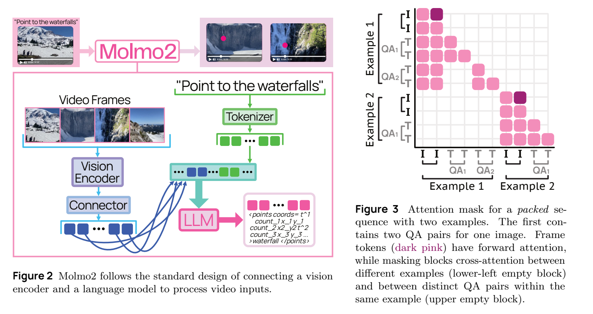
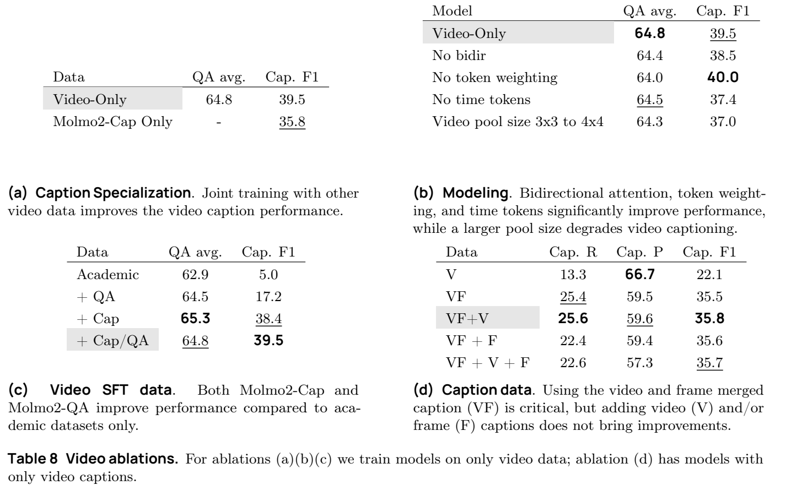
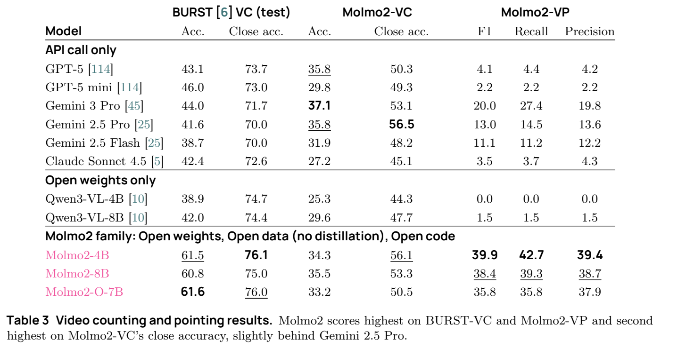

<!-- article-header:start -->
[项目首页](../../../README.md) › [模型系列](../../../reports/model-family-index.md) › [Molmo](../README.md)
<!-- article-header:end -->

# Molmo2：视频理解、时空指点与对象跟踪

> 解读 Ai2 / University of Washington 的 **Molmo2: Open Weights and Data for Vision-Language Models with Video Understanding and Grounding**，固定采用 arXiv **2601.10611v4**。本版本修订过部分评测结果；本文使用 v4 表格，不沿用旧版更高的 Point-Bench 分数。

<!-- article-toc:start -->
<a id="article-toc"></a>

**本篇目录** · [论文定位](#paper-info) · [快速概览](#overview) · [整体架构](#architecture) · [核心原理](#principles) · [数据构建](#data) · [训练流程](#training) · [实验结果](#experiments)
<!-- article-toc:end -->

<a id="paper-info"></a>

## 1. 论文信息与模型定位

| 项目 | 内容 |
|---|---|
| 团队 | Allen Institute for AI、University of Washington |
| 日期与版本 | 首次提交 2026-01-15；本文固定 v4，2026-04-02 |
| 型号 | Molmo2-4B、Molmo2-8B、Molmo2-O-7B |
| 语言组件 | 前两者使用 Qwen3；O-7B 使用 OLMo 3 |
| 输入与输出 | 图像、多图、视频与文字输入；文本、时空点及带对象 ID 的轨迹输出 |
| 研究问题 | 在开放权重、数据与训练代码条件下，让视频回答具有可定位的空间和时间依据 |
| 官方资源 | [固定报告](https://arxiv.org/pdf/2601.10611v4) · [代码](https://github.com/allenai/molmo2) · [模型](https://huggingface.co/collections/allenai/molmo2) |

这里的开放范围需准确理解：作者不以闭源 VLM 产生视觉标注，但仍使用闭源纯文本 LLM 协助数据构建，SigLIP 2 视觉组件的训练数据也没有完全开放。附录 H 主动披露了这些限制；O-7B 的语言基座开放不意味着全部组件都能从完全开放数据重建。[§1、附录 H，PDF 第 2–3、46–48 页](https://arxiv.org/pdf/2601.10611v4#page=47)

<a id="overview"></a>

## 2. 快速概览

Molmo2 把“看懂视频”扩展为“指出何时何处发生什么”。模型不仅生成一段回答，还能在多个时间戳输出坐标，并通过重复的对象 ID 将同一对象跨帧关联起来；计数任务可以先逐个指点，再得到数量。

核心网络延续视觉编码器、注意力池化连接器和语言主干。图像使用更细的 2×2 patch 池化，视频使用 3×3，以减轻多帧序列成本。所有输入视觉 token 在语言主干中可以双向交流，答案仍按自回归顺序生成。

数据与训练是另一重点：九个新视频/多图数据集补充详细描述、开放问答、指点和跟踪；message tree 复用同一视觉输入的多份标注，打包减少 padding，token 加权平衡长描述与短答案。长上下文训练是短暂的最后阶段，不能把能读更多帧等同于长视频定位已完全解决。

<a id="architecture"></a>

## 3. 整体架构



*原文 Figure 2–3，PDF 第 6 页。Figure 2 按视频帧/问题→编码器/连接器→语言主干→点序列阅读；Figure 3 展示训练打包和分支隔离，彩色格表示允许注意，空白格阻止不同样本或不同答案分支互读。*

| 模块 | 输入与输出 | 公开机制 |
|---|---|---|
| 图像裁块 | 图像 → 全局缩小图与重叠局部块 | 通常训练至多 8 个局部块，推理至多 24 个；指点 SFT 部分样本也采用 24 个 |
| 视频采样 | 视频 → 带时间戳的单裁块帧 | 通常 2 fps；超出帧上限时均匀采样，包含最后一帧；常规/长阶段上限 128/384 |
| SigLIP 2 So400m/14 | 每幅裁块 → patch 特征 | 27 层、1152 维；连接器取倒数第 3 与第 9 层特征 |
| 注意力池化连接器 | 局部 patch → 更短视觉序列 | 图像窗口 2×2，视频 3×3；patch 均值为多头注意力查询，两类输入共享池化参数 |
| 共享投影 MLP | 池化特征 → LLM 输入表示 | SwiGLU MLP；连接器尺寸随语言模型变化 |
| 输入序列组织 | 视觉 token + 标记/时间戳/提示 → LLM 序列 | 视频帧交错文字时间戳，多图交错图像序号；可用字幕放在视觉输入后 |
| 语言与结构输出 | 联合表示 → 文本/点/轨迹 | Qwen3 或 OLMo 3 自回归生成；紧凑纯文本坐标格式含对象 ID |

视觉编码器分别处理各裁块，跨帧关联主要在接收视觉 token 的语言主干中完成，并没有使用一个未披露的独立视频编码网络。多裁块图像另带列标记表达宽高比，单裁块图像不加列标记。模型跟踪输出是点轨迹；评测中的分割掩码可由外部 SAM 2 从点生成，并非网络直接逐像素生成所有掩码。[§3.1、§4.2、附录 A，PDF 第 6、11、27–29 页](https://arxiv.org/pdf/2601.10611v4#page=6)

报告的视觉 checkpoint 名与 Table 12 Image Size 写 384，而附录 A 规定裁块实际缩放到 378，以适配 patch 网格；边缘不能整除池化窗口时，用较少 patch 池化。本文不根据 checkpoint 名硬套固定视觉 token 数，也不忽略边缘处理。[附录 A、Table 12，PDF 第 27–29 页](https://arxiv.org/pdf/2601.10611v4#page=27)

<a id="principles"></a>

## 4. 核心创新与数学原理

### 4.1 图像/视频不同池化粒度：在细节与帧数间分配预算

图像将 2×2 patch 聚合，视频将 3×3 聚合，以减少每帧进入 LLM 的 token。原文机制可解释性转写为：

```math
q=\frac{1}{m}\sum_{j=1}^{m}h_j,\qquad
z=\mathrm{MultiHeadAttention}(q,H,H),\qquad
v=\mathrm{MLP}(z).
```

$`H`$ 是局部窗口的 patch 特征，$`m`$ 是有效 patch 数，通常为 4 或 9，边缘窗口可能更少。此式用于说明 §3.1 的均值查询注意力池化，不是论文另行提出的编号公式。相比只做平均，均值作为查询后仍能学习对不同 patch 的注意权重。

更强压缩有代价。Table 8b 将视频池化从 3×3 改为 4×4 时，QA 平均值 64.8→64.3，描述 F1 39.5→37.0；高层选择题下降较小，并不能证明细节描述也无需更多视觉 token。[§3.1、Table 8，PDF 第 6、13 页](https://arxiv.org/pdf/2601.10611v4#page=13)

### 4.2 视觉双向注意与 message tree：共享输入，隔离答案

视觉 token 即使来自不同图像或帧，也可向前注意彼此；因此后面的帧能参与前面视觉表示的更新。这个许可只针对输入视觉表示，不能让答案读取未来答案。

训练时，同一视频的多个问答形成树：视觉输入为根，每份标注为独立分支。树被线性化，但注意力掩码禁止答案分支互读，也禁止打包后不同样本互读。这样不用重复编码整段视频来学习每个问题，还可避免同视频其他答案成为泄漏信息。原文平均每个视觉输入有约 4 份标注，打包后每序列约容纳 3.8 个例子，作者报告约 15 倍训练效率；此数来自组合训练组织，不是单次推理的 15 倍加速。[§3.2、Figure 3，PDF 第 6–8 页](https://arxiv.org/pdf/2601.10611v4#page=7)

### 4.3 token 加权：避免长输出吞没短答案的学习信号

同一混合中既有单 token 选择题，也有超过 4,000 token 的描述。即使长描述抽样比例较小，其损失 token 仍可能主导更新。作者对视频描述使用 0.1、指点使用 0.2 权重，其他任务按答案长度 $`n`$ 使用 $`4/\sqrt{n}`$。

若每个答案 token 采用此权重，其他条件相同的长答案总贡献近似随平方根长度增长，而非线性增长；这是对该启发式的解释，不是新的论文定理。实现还以全设备平均损失 token 数归一化每设备梯度，避免各卡短答案比例不同导致隐式重加权。



*原文 Table 8，PDF 第 13 页；灰行是子集训练的专用 4B 基线，不能直接当作完整 8B 模型结果。*

取消 token 加权后 QA 64.8→64.0，但描述 F1 39.5→40.0；它是在任务间重新平衡，并非让所有指标同时提高。长上下文阶段也改善长视频 QA，同时降低描述 F1，需要按用途判断收益。[§3.2、附录 A、Table 8/11，PDF 第 7、13–14、28 页](https://arxiv.org/pdf/2601.10611v4#page=14)

### 4.4 紧凑坐标与对象 ID：把指点、计数和跟踪连起来

点输出包含归一化到 0–1000 的 x/y、视频时间戳或图像序号，以及从 1 开始的对象 ID。按时间/图像序号再按空间位置排序；同一对象跨帧重复 ID，因此模型可以区分“同一只动物出现多次”与“多只动物”。坐标保存在紧凑的类 HTML 文本属性中，减少相对 JSON 格式的输出 token。

计数消融中，先指点再计数在 Molmo2-VideoCount 验证集达到 34.5，直接计数为 28.1。对象 ID 使计数更可检查，但模型仍会重复点、丢失对象或改变对象内点位；结构输出不能自动保证正确关联。[§3.2、Table 9、附录 A/H，PDF 第 7、13–14、27–28、47–48 页](https://arxiv.org/pdf/2601.10611v4#page=27)

### 4.5 同时打包裁块与语言序列：减少两端 padding

仅把文字拼长不够，因为视觉输入的裁块数也不同。附录 B 的在线打包器维护 48 个预处理例子，用动态规划选取子集，在文字 token 与裁块双重容量约束下最大化 $`T+30I`$；常规 SFT 约束为 $`T\le16384`$、$`I\le128`$，长阶段增至 36,864 token 与 384 幅输入。

$`T`$、$`I`$ 是选择子集的文字序列 token 和图像裁块计数，30 是调节两端利用率的启发式权重。求解时 token 数量化到 32 的倍数；池太大收益趋缓，视觉权重太低又可能让大裁块例子滞留。这是训练调度机制，不改变推理时各帧的语义。[附录 B，PDF 第 28 页](https://arxiv.org/pdf/2601.10611v4#page=28)

<a id="data"></a>

## 5. 数据构建与处理

| 数据组 | 公开采集规模 | 方法与边界 |
|---|---|---|
| Molmo2-Cap | 104K 视频级、431K 片段级描述 | 人工口述、Whisper 转写、文本 LLM 整理，再合并 Molmo 帧级细节；平均 924 词/视频 |
| AskModelAnything | 140K 视频问答 | 人工问题，以已有视频描述生成初答，人工迭代修订；不是闭源 VLM 直接看视频出答案 |
| CapQA / SubtitleQA | 约 1M / 300K 问答 | 自有视频描述模型加文本 LLM；字幕来自转写 |
| VideoPoint / VideoTrack | 前者超过 650K 采集查询；后者 3.6K 视频、15K 复杂查询 | 人工时间/空间点击或重写既有轨迹描述；另纳入学术数据转换 |
| MultiImageQA / MultiImagePoint | 72K 问答 / 超过 470K 指点例子 | 相似图像组、人工问答或 PixMo 点标签组合 |

另以 CoSyn 生成约 188K 文档/图表等多图样本。上述是各采集阶段口径，过滤并组织成 message tree 后的数量见 Table 1/13，不能将原始查询数当成最后训练例子数。原文新数据共五个人工与四个合成集，另有两个复用学术标注的 curated 集；训练还混入 PixMo、公开图像/视频 QA 与 Tulu 文本数据。[§2、Table 1/13，PDF 第 4–5、30 页](https://arxiv.org/pdf/2601.10611v4#page=4)

<a id="training"></a>

## 6. 训练流程与目标

| 阶段 | 数据与更新 | 配置 |
|---|---|---|
| 图像预训练 | 60% 描述、30% 指点、10% NLP；所有组件可更新 | 32K 步、batch 128；图像描述、转写、指点和文本任务 |
| 联合 SFT | 图像/多图/视频/文本分类采样，类内主要按数据集规模平方根采样 | 30K 步、batch 128，最大 16,384 token，通常 128 视频帧 |
| 长上下文 SFT | 同一混合，扩展序列与帧上限 | 2K 步、36,864 token、384 帧；LLM 使用 8 GPU 上下文并行 |

常规 SFT 学习率：视觉与连接器均为 5e-6，语言为 1e-5。长阶段使用 Ulysses attention 以支持自定义掩码，并分摊视觉帧编码与池化；不是采用无法处理该掩码的默认 FlashAttention。实现使用 FSDP2、SDPA、编译与 bf16 AMP，LayerNorm/RoPE 仍为全精度。[§3.2、附录 A–B/Table 12，PDF 第 7、28–29 页](https://arxiv.org/pdf/2601.10611v4#page=29)

<a id="experiments"></a>

## 7. 实验设置与主要结果



*原文 Table 3，PDF 第 9 页；精确计数准确率、允许误差的 close accuracy 与点 F1 是不同指标。*

| v4 指标 | Molmo2-4B | Molmo2-8B | Molmo2-O-7B |
|---|---:|---:|---:|
| Molmo2-VideoCount 精确准确率 | 34.3 | 35.5 | 33.2 |
| Molmo2-VideoPoint F1 | 39.9 | 38.4 | 35.8 |
| Molmo2-Track Overall J&F | 56.7 | 56.2 | 53.7 |
| Point-Bench 平均 | 67.7 | 68.7 | 66.5 |
| MMMU val | 50.9 | 53.0 | 45.8 |

指点评测以点是否落在对应时空掩码中衡量，跟踪 J&F 使用 SAM 2 将点转换成分割；HOTA 另衡量对象关联。v4 Table 5 中 Gemini 3 Pro 的 Overall J&F 为 44.6，摘要仍写 41.1；本文采用该表对应值，不复用摘要的旧对照数。[Table 3/5/6/7，PDF 第 9–12 页](https://arxiv.org/pdf/2601.10611v4#page=10)

人工偏好评测为 450 个问答加 51 个描述视频，收集超过 105K 评分；8B bootstrap Elo 中位数为 1057，Qwen3-VL-8B 为 1054，成对胜率约 53%（排除平局），因此是接近的竞争表现。基准还混合作者报告、已有报告与自行补测结果，提示/帧数未必全部一致。[§4.1、Table 15/Figure 6，PDF 第 8–9、33–34 页](https://arxiv.org/pdf/2601.10611v4#page=33)

模型长视频 QA、OCR 密集任务和 MathVista/MMMU 仍有差距；长于约 3 分钟的视频定位训练覆盖有限。高密度指点、长视频和超长描述还会出现重复退化。论文最有价值的增量是公开的视频定位数据与可复查的时空输出，而不是证明 8B 在所有任务上超过更大闭源模型。[§4.3、附录 H，PDF 第 12、46–48 页](https://arxiv.org/pdf/2601.10611v4#page=48)

<!-- article-footer:start -->
---

[← 上一篇：STEP3-VL-10B](../../step/arxiv-2601.09668/README.md) · [按发表时间浏览](../../../reports/paper-reading-guide.md#year-2026) · [下一篇：DeepSeek-OCR 2 →](../../deepseek/document-536ef2604f4a/README.md)

[返回本篇目录](#article-toc) · [返回模型系列](../README.md)
<!-- article-footer:end -->
