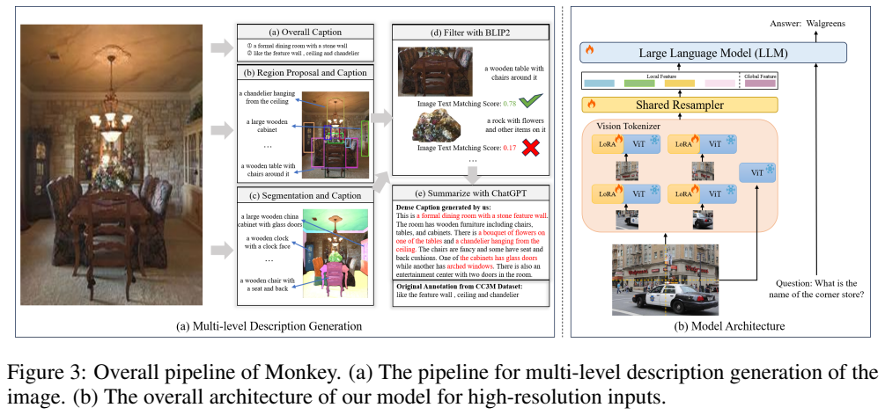
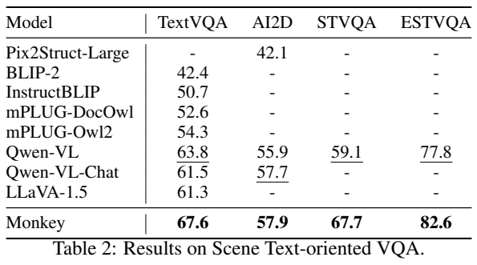
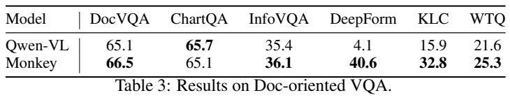
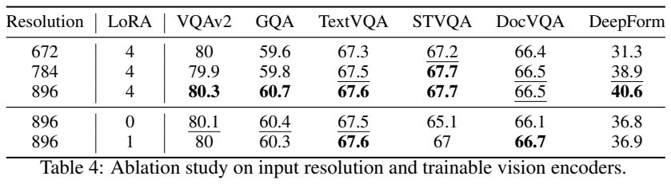
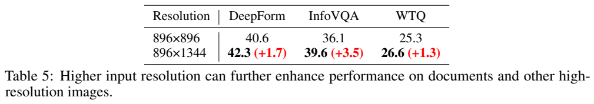
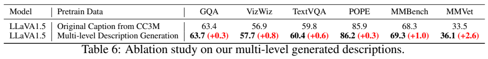
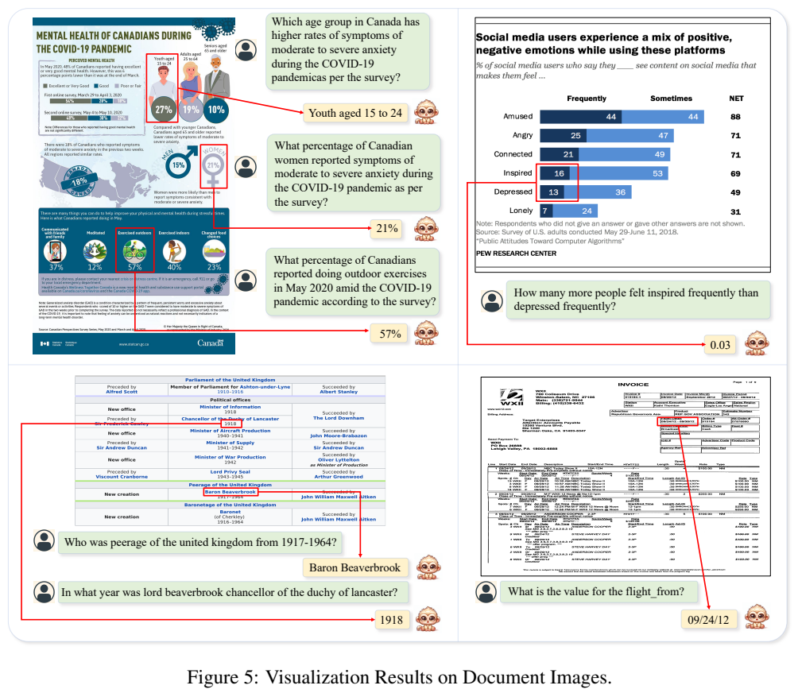

<!-- article-header:start -->
[项目首页](../../../README.md) › [模型系列](../../../reports/model-family-index.md) › [Monkey / TextMonkey](../README.md)
<!-- article-header:end -->

# Monkey：让高分辨率图像与细粒度描述共同发挥作用

<!-- article-toc:start -->

**本篇目录** · [论文定位](#paper-info) · [快速概览](#overview) · [整体架构](#architecture) · [核心原理](#principles) · [数据构建](#data) · [训练流程](#training) · [实验结果](#experiments)
<!-- article-toc:end -->

## 1. 论文信息与模型定位

| 项目 | 信息 |
|---|---|
| 论文 | Monkey: Image Resolution and Text Label Are Important Things for Large Multi-modal Models |
| 作者 | Zhang Li、Biao Yang、Qiang Liu、Zhiyin Ma 等 |
| 机构 | 华中科技大学、Kingsoft |
| 本文固定版本 | [arXiv:2311.06607v1](https://arxiv.org/abs/2311.06607v1)，2023-11-11，18 页 |
| 项目 | [Yuliang-Liu/Monkey](https://github.com/Yuliang-Liu/Monkey) |
| 主干 | 基于已训练 Qwen-VL 的 ViT-BigHuge 和语言模型；报告总参数约 9.8B |
| 模型定位 | 图像理解、细节描述、场景文字与文档问答；输入图像和文本、输出文本 |

Monkey 是独立方法条目，虽继承 Qwen-VL 组件，原论文和新增设计均属于 Monkey。它不从头进行大规模多模态预训练，而以图像分块、局部 LoRA 与丰富 caption 在指令阶段增强已有模型；不能把这里“省去预训练”理解成基础视觉和语言主干未经预训练。

## 2. 快速概览

论文同时处理两个瓶颈：低分辨率缩放会让小字、小物体消失，而简短标签即便配高清图片，也可能不监督那些细节。架构将大图的局部块与整体缩略图一起编码；数据流程则汇集全局 caption、区域描述、分割对象和 OCR，再形成包含位置与关系的细致描述。

常规实验用 896 像素方图，原视觉编码窗口仍为 448×448。最大示例扩展到 896×1344，对文档任务继续改善。Monkey 的 TextVQA 为 67.6、STVQA 为 67.7；相对 Qwen-VL 的 63.8 / 59.1 有提升，但 ChartQA 65.1 低于 Qwen-VL 的 65.7。它的证据更适合说明细节感知和多类问答改善，而非“所有任务胜过原模型”。

## 3. 整体架构

**Figure 3，PDF 第 4 页。** 左边是描述生成流程，右边是模型：局部图分别经冻结 ViT 与各自 LoRA，整图缩放后的全局图另经视觉编码；共享 resampler 将特征压缩，局部和全局 token 一起进入 LLM。火焰标出 LoRA、resampler 与语言模型训练，雪花标出原 ViT 冻结。局部并不是独立预训练四个 1.9B 视觉主干，而是在基础视觉能力之上学习不同适配。

给图像 $`I\in\mathbb R^{H\times W\times3}`$，以 $`H_v=W_v=448`$ 的窗口划出局部视图，同时把整图 resize 到同样尺寸保留结构。标准四局部加一全局配置既看文字细节，也给语言模型“这些局部在同一场景”的背景。原文说明更大的矩形输入也被支持，但未完整列出所有长宽比的窗口步长、补边及 LoRA 分配规则，不据标准示意图补写最大分辨率的精确 token 数。

视觉 resampler 使用 256 个可学习查询，以跨注意力从图像特征提取固定表示。语言模型约 7.7B、视觉编码器约 1.9B、resampler 90M、新增 LoRA 117M，报告总计约 9.8B；各分项均为近似数，简单相加不必与总数最后一位完全一致。语言最大序列长为 2048，因此提高视觉信息密度仍受上下文预算限制。

| 模块 | 输入与输出 | 公开机制 |
|---|---|---|
| 局部与全局视图 | 高分图 → 448×448局部图及缩略整图 | 局部保细节，全局保结构；标准示意为四局部加一全局。 |
| 冻结视觉器与局部LoRA | 各视图 → 细节特征 | 继承Qwen-VL视觉模型，局部适配使用不同LoRA。 |
| 共享Resampler | 视图特征 → 查询摘要 | 256可学习查询以跨注意力压缩，限制进入LLM的序列。 |
| 语言模型 | 多视图摘要、指令 → 答案 | 约7.7B主干参与指令训练；最大语言序列2048。 |
| 离线多级标签流水线 | 全局/区域/文字/坐标 → 详细caption | 多工具证据筛选后由ChatGPT组织，不进入在线推理。 |

[模块依据：v1 §2.1–2.3、§3.1，PDF第4–5页](https://arxiv.org/pdf/2311.06607v1)。

## 4. 核心创新与数学原理

### 4.1 局部可见性与全局结构互补

 若把整张大图压到 448 像素，字符可能只剩少数像素，后续网络无法恢复已丢失的观察。分块把每个局部以基础编码器熟悉的尺寸输入，再保留缩略图作为总体语义。代价是多次视觉编码和更多 token；论文强调训练效率，但没有完整 FLOPs 和端到端延迟表，不应解释为提高分辨率完全不增加成本。

局部裁块解决的是缩图后细节不可见，全局缩略图解决的是裁块后上下文分散，两者互补而非重复。一个局部文字片段可更清晰，但其所属对象或页面位置需要整图提供背景。标准尺寸复用已有视觉器，降低重新预训练高分辨率主干的需求，却没有消除多视图编码和序列预算的开销。 [§2.1，PDF第4页](https://arxiv.org/pdf/2311.06607v1)

### 4.2 共享预训练能力上的区域适配

 原文给 attention rank 16、MLP rank 32。便于理解，可把适配投影记为 $`W'=W+BA`$，其中低秩乘积提供局部更新、原 $`W`$ 冻结。这是对通用 LoRA 的解释记号，原文没有单独列出带缩放系数的公式或完整初始化参数，不能补写其 alpha。不同区域对应不同 LoRA，使模型能在共有主干上学习局部特征差异。

不同局部适配器让共享的视觉基础可为各区域调整特征，而非把整套基础视觉权重复制成独立训练任务。原文直接沿用预训练视觉语言模型进入指令阶段，因此LoRA和resampler承担新分辨率接口的适配。它仍依赖训练图像与描述覆盖相应局部细节，不能由低秩参数本身推断具备未监督的识字精度。 [§2.1、§3.1，PDF第4–5页](https://arxiv.org/pdf/2311.06607v1)

### 4.3 固定查询预算下汇聚高分辨率特征

 若 $`F`$ 为某视图视觉特征，$`Q`$ 为可学习查询，跨注意力可理解为 $`\mathrm{softmax}(QK^\top/\sqrt d)V`$，$`K,V`$ 来源于 $`F`$。这是解释原文所述 cross-attention 的标准形式，并非论文给出的新方程。其作用是让语言模型读取压缩后的细节，而非未经限制的全部 patch 特征；固定查询也意味着被压缩细节可能丢失。

查询摘要把大量局部patch的处理与语言主干的序列长度分开：视觉器保留网格，resampler再选择性聚合。这个瓶颈使多视图信息可以送进有限2048上下文，但也把原始空间细节压入固定查询，存在信息竞争；原文未给出查询与物体逐一对应的约束，不能把每个查询解释为确定实体槽位。 [§2、§3.1，PDF第4–5页](https://arxiv.org/pdf/2311.06607v1)

### 4.4 多级标签把新增像素转化为监督

 分辨率只增加可见信息，详细 caption 才为物体属性、位置、文字及联系提供监督。作者用多级生成器把这两者联系起来：全局主题、局部对象、文字和坐标共同交给 ChatGPT 汇总。这里的 ChatGPT 是训练数据生成环节，不是推理时必须调用的在线模块，也没有为 Monkey 本身添加实时 OCR 工具链。

作者并非把所有工具输出直接拼给学生。GRIT提供区域及名称，SAM分割后裁块由BLIP-2描述，PPOCR补文字，BLIP-2还评估区域与描述匹配并滤掉低分对，最后将全局与局部证据和坐标交给ChatGPT。筛选能降低工具误差传播，却不能保证其汇总推理正确；因此详细标签是监督密度提升，也带来教师工具覆盖的边界。 [§2.2，PDF第5页](https://arxiv.org/pdf/2311.06607v1)

## 5. 数据构建与处理

描述生成先用 BLIP2 写全局 caption，同时保留 CC3M 原注释。GRIT 给区域提议、对象名称和属性 / 行为 / 数量描述；PPOCR 抽取文字；SAM 切出物体或对象部件，裁剪后再由 BLIP2 描述。不同模型可能出现错识和幻觉，因此 BLIP2 对局部图与描述进行匹配评分，滤掉低分结果。

筛选后的全局与局部文字、OCR、对象信息及空间坐标送入 ChatGPT API，生成能体现对象关系的详细 caption。原文用“for fine-tuning”描述这一步，但没有给出对 ChatGPT 权重训练的实现、超参或数据规模；从流程可核验的是 API 汇总生成，因此不宣称作者另训练了一个 ChatGPT 模型。报告没有公布统一匹配阈值、ChatGPT 版本、完整提示与人工复核率，生成描述仍可能含误差。

约 **400K CC3M 图文对**被重新标注。最终多任务指令数据共 **1.45M** 样本，包含这些详细描述、COCO 原 caption 以及视觉问答和文档任务。训练对每类图像量作限制以避免严重失衡，但没有完整列出全部任务样本数和抽样比例。

简短描述与详细描述分别用 `Generate the caption in English:`、`Generate the detailed caption in English:`；问答统一为 `User: question Assistant: answer`。统一格式方便学习任务意图，同时并不能单凭格式推断模型具备任意多轮对话能力。

## 6. 训练流程与目标

Monkey 直接继承已训练 Qwen-VL，不重新进行从头预训练。指令调优冻结原视觉主干，训练图上标明的局部 LoRA、共享 resampler 和语言模型。窗口尺寸 448×448、resampler 查询 256、最大序列 2048；attention / MLP 的 LoRA rank 分别 16 / 32。

优化器 AdamW，学习率 1e-5，cosine schedule，$`\beta_1=0.9,\beta_2=0.95`$，warmup 100 steps，batch 1024，weight decay 0.1。原文没有完整披露总 epoch、GPU 数、混合精度和每类监督 loss mask。文本回答和 caption 提供生成监督，但没有新的显式损失方程，也未报告 RLHF、DPO 或独立视觉重建目标，因此不套用其他模型的训练阶段来补齐。

数据质量消融需要另看：作者在 **LLaVA1.5（336 ViT-L、Vicuna-13B）** 上，把原预训练数据中的 400K 标签替换为生成描述，再保持其 SFT 数据不变。这个实验不是 Monkey 自己又多做一轮预训练，也不是对 Monkey 参数规模的消融；它专门验证标注方式能否迁移到另一架构。

## 7. 实验设置与主要结果

Table 1 比较 caption 和五类通用 VQA。TextCaps 的 Monkey / Qwen-VL 为 93.2 / 65.1，属于图像描述评价；VQAv2 为 80.3 / 79.5、OKVQA 61.3 / 58.6、GQA 60.7 / 59.3、ScienceQA 69.4 / 67.1、VizWiz 61.2 / 35.2。GQA 仍低于该表 LLaVA1.5 的 62.0。不同 caption 与问答指标不能混成一个准确率。

**Table 2—4，PDF 第 7 页。** Table 2 的文字相关问答列和 Table 3 的文档问答列各有自己的指标口径；此处按原表分数比较：

| 测试 | Qwen-VL | Monkey |
|---|---:|---:|
| TextVQA | 63.8 | 67.6 |
| AI2D | 55.9 | 57.9 |
| STVQA | 59.1 | 67.7 |
| ESTVQA | 77.8 | 82.6 |
| DocVQA | 65.1 | 66.5 |
| ChartQA | 65.7 | 65.1 |
| InfoVQA | 35.4 | 36.1 |
| DeepForm | 4.1 | 40.6 |
| KLC | 15.9 | 32.8 |
| WTQ | 21.6 | 25.3 |

DeepForm 的提升大，DocVQA 与 InfoVQA 较小，ChartQA 略有下降，反映训练数据和任务结构会影响收益。原表未充分统一各基线输入分辨率、解码预算、是否获得额外 OCR 和数据重叠检查，不能将数字视作纯架构的等成本比较。

Table 4 将方形输入从 672 / 784 / 896 增大，DeepForm **31.3→38.9→40.6**，TextVQA 67.3→67.5→67.6，显示文档收益更明显。固定 896 输入时，0 / 1 / 4 LoRA 的 STVQA 为 **65.1 / 67.0 / 67.7**，DeepForm 36.8 / 36.9 / 40.6；但 DocVQA 为 66.1 / 66.7 / 66.5，一 LoRA 反而略高，不能概括为增加适配器每项都更好。

**Table 5、6，PDF 第 8 页。** Table 5 的 896×896→896×1344 将 DeepForm 40.6→42.3、InfoVQA 36.1→39.6、WTQ 25.3→26.6；三个数字来自最大分辨率实验，不能替换全套默认结果为“统一最大配置”。Table 6 在 LLaVA1.5 上替换详细描述，使 GQA 63.4→63.7、VizWiz 56.9→57.7、TextVQA 59.8→60.4、POPE 85.9→86.2、MMBench 68.3→69.3、MM-Vet 33.5→36.1。它支持生成标签质量可迁移，但没有在此控制所有训练 token 总量。

**Figure 5，PDF 第 10 页。** 四组原图覆盖 infographic 定位、柱状图计算、Wiki 表格关系和密集发票字段。右上图 16% 与 13% 的差写成 0.03，体现不同数值表示；定性案例提供读图路径，不能证明对所有金额与单位都可靠。正文与附录还展示详细 caption，部分句子存在重复，报告没有系统测量冗余和幻觉率。

这些结果支持分块保留细节、用细致标注教模型利用细节的联合方向。完整可重复的训练成本、独立数据审计、不同长宽比预算和系统性生成可信度仍披露有限；更高分辨率与更长 caption 的效果需要结合任务而判断。

<!-- article-footer:start -->
---

[← 上一篇：Florence-2](../../florence/arxiv-2311.06242/README.md) · [按发表时间浏览](../../../reports/paper-reading-guide.md#year-2023) · [下一篇：LVIS-Instruct4V →](../../lvis-instruct4v/arxiv-2311.07574/README.md)

[返回本篇目录](#article-toc) · [返回模型系列](../README.md)
<!-- article-footer:end -->
