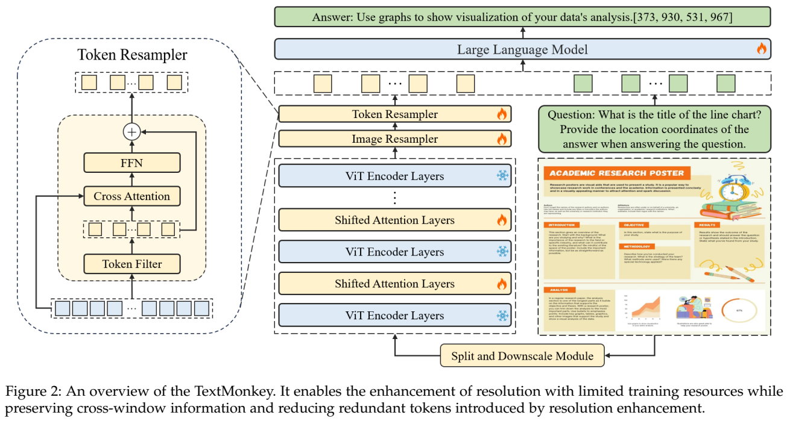
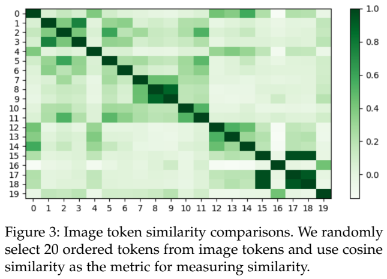
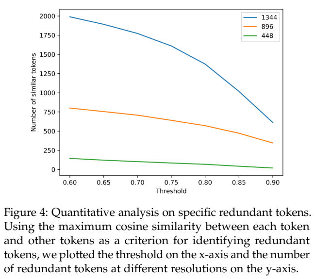
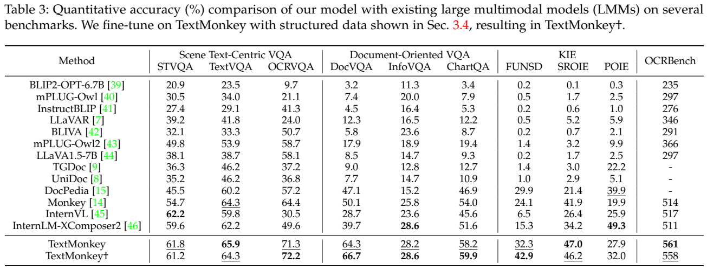
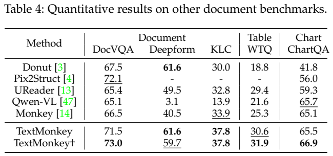
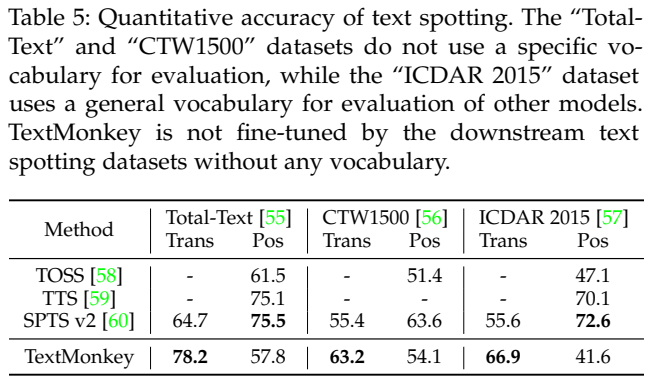
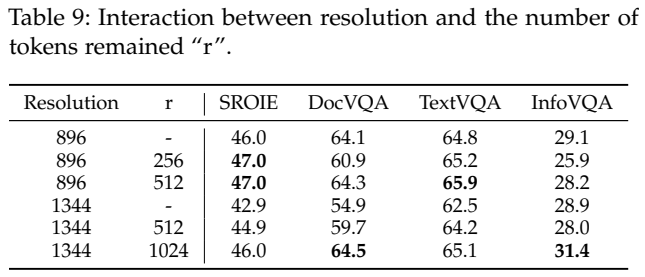
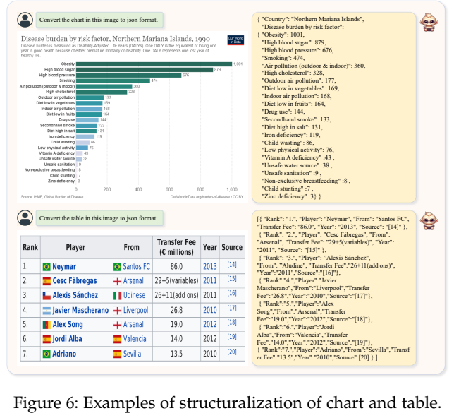
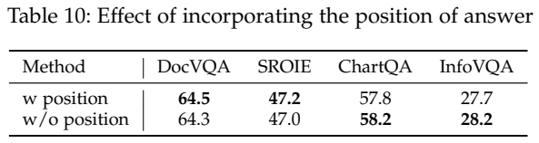
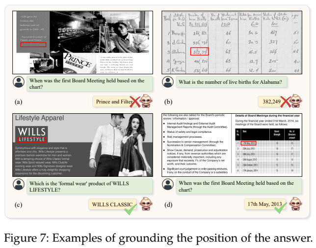

<!-- article-header:start -->
[项目首页](../../../README.md) › [模型系列](../../../reports/model-family-index.md) › [Monkey / TextMonkey](../README.md)
<!-- article-header:end -->

# TextMonkey：高分辨率文档理解、视觉 token 压缩与文字定位

<!-- article-toc:start -->

**本篇目录** · [论文定位](#paper-info) · [快速概览](#overview) · [整体架构](#architecture) · [核心原理](#principles) · [数据构建](#data) · [训练流程](#training) · [实验结果](#experiments)
<!-- article-toc:end -->

## 1. 论文信息与模型定位

| 项目 | 内容 |
|---|---|
| 论文 | *TextMonkey: An OCR-Free Large Multimodal Model for Understanding Document* |
| 作者与机构 | Yuliang Liu、Biao Yang、Qiang Liu、Zhang Li、Zhiyin Ma、Shuo Zhang、Xiang Bai；华中科技大学、金山 |
| 固定版本 | [arXiv:2403.04473v1](https://arxiv.org/abs/2403.04473v1)，2024 年 3 月 7 日，11 页 |
| 官方项目 | [Yuliang-Liu/Monkey](https://github.com/Yuliang-Liu/Monkey) |
| 家族 | Monkey/TextMonkey；以 Qwen-VL 的预训练视觉与语言组件为起点 |
| 模型定位 | 文档、图表、表格、场景文字的视觉问答、文字识别与定位；输出文字、坐标和结构化文本 |

“OCR-Free”表示推理流水线不先调用外部 OCR 引擎获得文本再问答，并非模型不做文字识别。TextMonkey 直接从图像特征学习阅读和定位，并将它们统一为语言生成任务。原文没有单独列出系统精确总参数，本介绍不以 Qwen 家族通用配置补造该版本的参数表。

它针对 Monkey 分块高分辨率处理中的两类问题：词语可能被窗口边界切断；分辨率提高后视觉 token 太多且有重复。解决办法是增加移位窗口连接，再从映射到语言空间的特征中选取较独特的 token 作为重采样查询。

## 2. 快速概览

| 问题 | 设计 | 证据与边界 |
|---|---|---|
| 小字在低分辨率图像中难读 | 448×448 子窗口，高分辨率主设置 896 | 分辨率越大不一定越好，1344 无压缩反而退化 |
| 分块切断词和上下文 | 插入 Shifted Window Attention | 连接邻接窗口，并非一次全图全局注意力 |
| 扩展视觉前缀过长 | 相似度过滤选择查询，再对全部特征做 cross-attention | 非简单删除重复字符；仍有选择和重采样成本 |
| 回答难以追溯依据 | 同时训练阅读、spotting、grounding 与 VQA | 坐标可揭示错误，但不能当成正确性证明 |
| 表格和图表需要机器可用输出 | 追加结构化数据训练得到 TextMonkey† | 各任务有得失，OCRBench 561→558，并非全项提高 |

主要报告数值为 OCRBench 561；统一包含式准确率下 DocVQA 64.3、TextVQA 65.9、ChartQA 58.2。它们和原数据集的 ANLS、relaxed accuracy 等不是同一指标，读者不能把不同表格中的同名任务分数直接合并。

## 3. 整体架构

*原文 Figure 2，PDF 第 3 页图表区域裁切；保留原始 ViT 的冻结标记、移位层与两级 resampler 的训练标记。*

模型使用 Qwen-VL 预训练的 ViT-BigG 与 LLM。高分辨率图像划分成非重叠 448×448 窗口，每个窗口再按 14×14 划分，得到 32×32=1024 个 patch token。普通 CLIP 层分别处理窗口，间隔插入可训练的移位注意力层，让原本分属不同窗口的邻近文字交换信息。

同时把整图缩放成 448×448，提取全局特征；局部窗口与全局分支通过共享 Image Resampler 对齐至语言空间。该模块有 256 个可学习查询。后续 Token Resampler 从已有特征中挑选查询，使用原始特征作为 key/value 聚合，再由 FFN 与残差得到压缩视觉序列。图像表示与文字问题一起进入语言模型生成答案。

896 设置的剩余 token 数 r=512，1344 设置为 1024；正文一度把 r 称为 ratio，但 Algorithm 1 和 Table 9 明确表示数量，不能写成 512 倍压缩比例。局部窗口统计中，896 为 4×256=1024 个 resampler token，1344 为 9×256=2304；全局分支另有其特征，论文的冗余分析数字不宜未经说明当作整条输入序列的全部计数。

## 4. 核心创新与数学原理

移位窗口把窗口网格循环移到左上方，再使用 mask 限定合法窗口内部的注意力。原先落在不同窗口的相邻特征可以在移位后相遇；mask 用于避免循环移位把图像相反边缘误当邻居。这与一次全局注意力不同，跨更远距离的信息需要多层传播。原文没有给出所有插入层号、shift 步长和完整 mask 代码，本介绍不指定这些实现细节。

报告 Eq. (1) 写成 $`x=BA\hat x`$，其中 A 高斯初始化，B 零初始化，用于新增分支的平稳起点。开始时 $`BA\hat x=0`$，减少新增路径对预训练特征的即时扰动。其梯度解释是：B 可以先获得梯度，A 的该路径梯度初始可能为零，随后 B 更新后再传播；这属于标准零初始化分支的数学解释。论文受到 LoRA 启发，但没有披露 A/B 的低秩大小，不能因此称模型使用某个 rank 的 LoRA，也不能将所有 CLIP 输出理解为被置零。

*原文 Figure 3、Figure 4、Algorithm 1，PDF 第 4 页图表区域裁切；热图、色条、阈值曲线、坐标与算法行完整保留。*

算法用一个 token 与其余 token 的最大余弦相似度衡量重复程度。设已映射特征为 $`z_i`$，可以整理为：

$$
u_i=1-\max_{j\ne i}\frac{z_i^\top z_j}{\Vert z_i\Vert \Vert z_j\Vert },\qquad
\mathcal S=\mathrm{TopR}(u,r).
$$

必须排除自身，否则每个 token 与自己相似度为 1，独特性分数就会失去意义。选中集合随后按原始顺序重排，以保留视觉序列的空间组织。这里“独特”是特征空间判断，不等于已经测得对答案的因果贡献；背景异常也可能独特。

选出的 token 用作查询 Q，而所有输入特征形成 K/V，可用标准注意力形式解释为 $`\mathrm{softmax}(QK^\top/\sqrt d)V`$，随后加入 FFN 与残差。此式是架构解释，非原文新编号公式。未选 token 仍可通过 K/V 影响输出，因此它比只保留 r 个向量更有机会保留信息，但不保证无损。

冗余分析使用阈值 0.8，448、896、1344 对应 68/256、571/1024、1373/2304 个相似 token，约 26.6%、55.8%、59.6%；正文将最后一个显示为 59.5% 并有一处把 1344 写成 1334。本方法不是在 0.8 阈值下直接删 token，实际压缩控制由 r 和排序选择决定。Figure 3 只抽取 20 个 token 展示相似性，不能据此声称每篇文档都具有同样冗余率。

复杂度上，局部窗口降低高分辨率视觉层的全局注意力开销，但两两相似度的直接计算仍约为 $`O(L^2D)`$，重采样注意力约为 $`O(rLD)`$。LLM 前缀缩短有利于后续推理，不能推出整套方法随分辨率严格线性增长或筛选成本可以忽略。

位置任务将坐标规范化到 0–1000。按常规横纵轴，可写为 $`\tilde x\approx1000x/W`$、$`\tilde y\approx1000y/H`$，取整规则需和实现一致；原文用 x/Hr 的记号，宽高符号存在歧义，本介绍不据此断言代码错误。任务要求文字与其坐标严格对应，可输出 `<ref>`、`<box>` 形式。坐标是模型预测的可审查依据，不是外部事实验证器。

## 5. 数据构建与处理

训练只采用公开数据，共 409.1K 对话条目、约 2.1M 问答。对话可含多个任务或问答，因此不能把两项数目相加理解成独立图片总量。

| 类别 | 数据与对话样本数 |
|---|---|
| 场景文字 | COCOText 16.2K、TextOCR 42.7K、HierText 59.9K、TextVQA 42.6K、MLT 11.6K |
| 文档与图表 | IIT-CDIP 154.6K、DocVQA 22.7K、ChartQA 36.6K、InfoVQA 10.9K、DeepForm 1.4K、KLC 5.2K、WTQ 4.7K |

任务包括阅读全部文字、OCR with grounding、普通 VQA、给定文字找位置、给定框识别文字、带答案位置的 VQA。报告强调文字先于对应坐标，避免内容与位置关联混乱；这些任务不仅增加问题量，还训练空间接口。

TextMonkey† 在已有模型上继续使用前阶段约 10% 数据与额外结构化文档、表格、图表数据。图像来自公开数据集，依据其结构信息生成监督；原文没有披露这一新增集合的精确总量和完整抽样比例。另一个独立扩展用 Rico 15K 点击数据进行下游训练，用于预测截图坐标，不能混成基础文档模型已经接受的统一数据。

## 6. 训练流程与目标

Figure 2 显示原 ViT 编码层冻结，新增移位层、Image Resampler、Token Resampler 与 LLM 可训练。正文没有逐阶段给出所有参数冻结名单，介绍以图中范围为依据，不额外宣称采用全量 ViT 微调或语言 LoRA。

报告使用 AdamW，初始阶段 LR 1e-5、后续阶段 5e-6，cosine、β=(0.9,0.95)、150 步 warmup、batch 128、weight decay 0.1。其描述为单 epoch 累计约 12 A800 days；该单位是设备天的作者记载，不意味着 12 张卡各训练 12 天。未给出每阶段独立时长、训练精度和所有新增模块参数量。

原文 Eq. (2) 用最大化对数似然表达下一 token 训练。以标准无泄漏的答案记号整理为：

$$
\max_\theta\sum_{t=1}^{M}\log p_\theta(y_t\mid I,Q,y_{<t}),
\quad\text{等价于最小化其负值。}
$$

这里坐标、识别文本、JSON 字段都作为生成序列监督；并未披露独立框回归损失、IoU 损失或奖励模型。原式输入/输出符号和 `s1:i` 写法不够清楚，本式说明标准 teacher forcing 应以此前 token 为条件，而非把当前答案作为可见输入。正文也没有逐 token 展开 prompt mask，不能补造精确实现。

## 7. 实验设置与主要结果

*原文 Table 3、Table 4、Table 5，PDF 第 6 页图表区域裁切；保留全部模型行、各指标、词典与评测条件说明。*

| 指标（Table 3） | Monkey | TextMonkey | TextMonkey† |
|---|---:|---:|---:|
| TextVQA | 64.3 | 65.9 | 64.3 |
| OCRVQA | 64.4 | 71.3 | 72.2 |
| DocVQA | 50.1 | 64.3 | 66.7 |
| ChartQA | 54.0 | 58.2 | 59.9 |
| FUNSD | 24.1 | 32.3 | 42.9 |
| SROIE | 41.9 | 47.0 | 46.2 |
| OCRBench | 514 | 561 | 558 |

Table 3 将回答包含 ground truth 视为正确，OCRBench 单列综合分数。Table 4 改用 DocVQA ANLS、DeepForm/KLC F1、WTQ accuracy、ChartQA relaxed accuracy：TextMonkey 的 DocVQA 为 71.5、ChartQA 65.5，† 为 73.0/66.9。这些数值不能替换 Table 3 的 64.3/58.2；任务相同但评测规则不同。

Spotting 同时报告 Trans 和 Pos：Total-Text 为 78.2/57.8，CTW1500 为 63.2/54.1，ICDAR2015 为 66.9/41.6。Trans 是答案包含该词的规则，Pos 要考虑定位，且作者承认段落输出与其他方法的逐词粒度不同，不能严格照搬标准协议。其识别表现较高并不意味着定位优于专用方法，例如 SPTS v2 的 Total-Text Pos 为 75.5。原文所称超过 10.8 更接近部分任务差值平均，不能当成某一固定标准 spotting F1。

组件消融中，加入移位注意力使 DocVQA 62.6→64.1、TextVQA 62.4→64.8；再加 Token Resampler 为 64.3/65.9。零初始化增益较小，ChartQA 57.6→58.2。随机查询替换特征查询后 DocVQA 46.7，而完整方法为 64.3；只筛 token 不做聚合为 63.5；不按原顺序排列为 62.1。它们支持独特性查询、聚合和序列顺序的作用，不能把不同对照差异全归因于一个组件。

*原文 Table 9、Table 10、Figure 6、Figure 7，PDF 第 8 页图表区域裁切；保留所有消融配置和完整输入/输出。*

无 Token Resampler 时，896→1344 使 DocVQA 64.1→54.9，下降 9.2 个百分点；为 1344 配置 r=1024 后恢复到 64.5，InfoVQA 为 31.4，高于 896/r512 的 28.2。但 TextVQA 65.1低于 65.9、SROIE 46.0低于47.0。增加分辨率与压缩容量需要随任务取舍，不能仅凭最大分辨率排序模型优劣。

Figure 6 展示图表和表格转成 JSON 的能力，属于定性例子，并无完整 JSON 合法率或字段正确率。Figure 7 更能说明定位的价值：有回答定位到空白区域、定位正确却读错文字、定位错而答案碰巧正确，也有内容位置都正确的例子。可见坐标能暴露错因，不能当作概率置信度或幻觉消失的证明。

Table 10 带坐标回答使 DocVQA/SROIE 各提高 0.2 个百分点，却使 ChartQA 58.2→57.8、InfoVQA 28.2→27.7。截图点击扩展只提供 Figure 8 定性展示，未给多步 APP 任务成功率或真实执行协议；输出点击坐标不等于已验证自主手机操作。本文未运行模型、JSON 解析或点击动作。

<!-- article-footer:start -->
---

[← 上一篇：Claude 3](../../claude/document-d746d75f8685/README.md) · [按发表时间浏览](../../../reports/paper-reading-guide.md#year-2024) · [下一篇：DeepSeek-VL →](../../deepseek/arxiv-2403.05525/README.md)

[返回本篇目录](#article-toc) · [返回模型系列](../README.md)
<!-- article-footer:end -->
