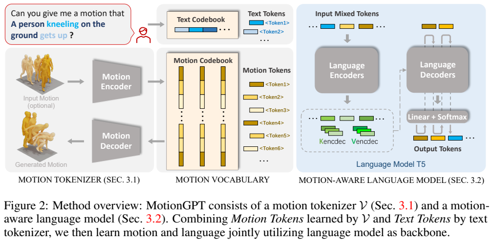
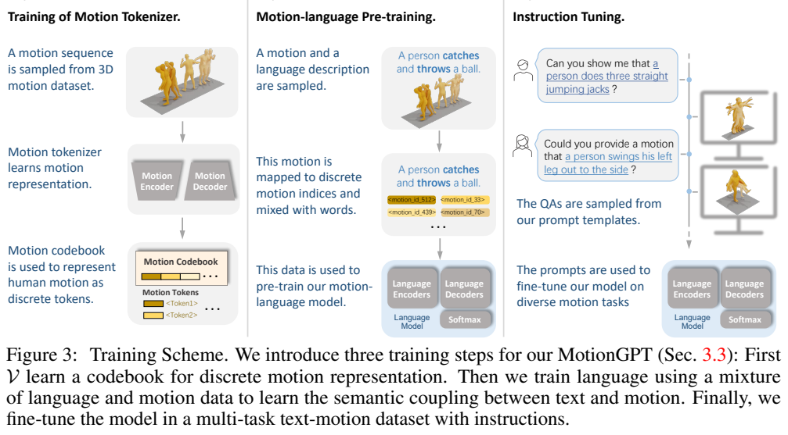
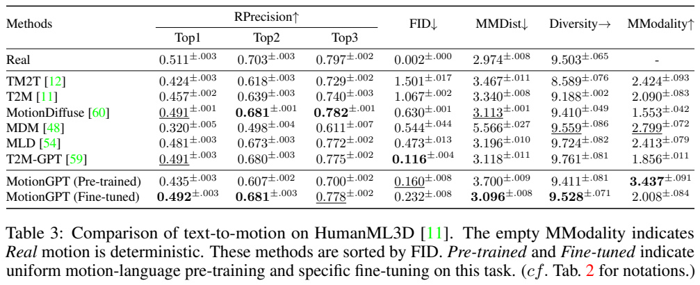
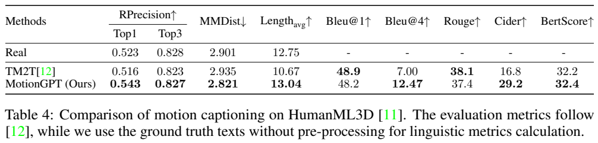
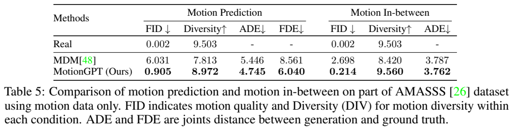
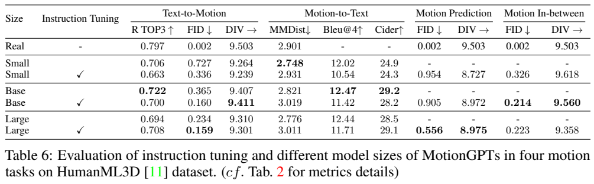

<!-- article-header:start -->
[项目首页](../../../README.md) › [模型系列](../../../reports/model-family-index.md) › [MotionGPT](../README.md)
<!-- article-header:end -->

# MotionGPT：把人体动作作为另一种语言进行理解与生成

<!-- article-toc:start -->

**本篇目录** · [论文定位](#paper-info) · [快速概览](#overview) · [整体架构](#architecture) · [核心原理](#principles) · [数据构建](#data) · [训练流程](#training) · [实验结果](#experiments)
<!-- article-toc:end -->

## 1. 论文信息与模型定位

《MotionGPT: Human Motion as a Foreign Language》由 Biao Jiang、Xin Chen、Wen Liu、Jingyi Yu、Gang Yu、Tao Chen 提出，作者来自复旦大学、腾讯 PCG 和上海科技大学。本文依据 [arXiv 2306.14795v1](https://arxiv.org/pdf/2306.14795v1)（2023 年 6 月 26 日）；官方代码为 [OpenMotionLab/MotionGPT](https://github.com/OpenMotionLab/MotionGPT)。

它是人体动作与语言的统一生成模型，核心模型采用 Flan-T5，而非名为 GPT 的特定商用模型。输入可以是文字、动作序列或二者混合，输出可以是动作或文字。研究对象是三维人体运动数据，不能将其理解成直接观看任意视频后控制真实机器人的系统。主实验使用 220M 模型，另外研究 60M 和 770M 规模。

## 2. 快速概览

| 环节 | 主要设计 |
| --- | --- |
| 把连续动作变为语言模型可处理的对象 | VQ-VAE 建立 512 个条目的动作码本 |
| 缩短长动作序列 | 时间下采样率为 4，一串动作 token 对应更长的原始帧序列 |
| 统一动作和文字 | 扩展原 T5 词表，加入动作索引与动作边界标记 |
| 学习两种“语言”的关系 | 遮蔽片段恢复和动作—文字双向翻译 |
| 用自然语言选择任务 | 将动作生成、描述、续写、补全等组织成指令问答 |

“动作是一门外语”是一种建模视角：离散动作索引和文字 token 可共享序列建模流程，并不表示每个码本条目都有一个固定、可解释的自然语言词义。模型用统一接口覆盖多任务，但任务专门微调仍会改变不同指标之间的权衡。

## 3. 整体架构

Figure 2 左边是动作编码器和解码器，中间黄色条目表示动作码本，蓝色条目表示文本词表，右边是 T5 编码器—解码器。文字请求经过文本分词；已有动作经过一维时间卷积编码、量化，变成动作索引。两类 token 组成输入，由同一个模型预测输出 token。若输出是动作索引，动作解码器将其还原为连续三维运动；若输出是文字，则按正常文本解码。

动作输入不是图像 patch，而是描述人体运动的逐帧特征，包括关节位置、速度、旋转等，采用与 HumanML3D 相关基线一致的表示。编码器沿时间压缩，令 M 帧变成 $L=M/4$ 个潜在位置。主配置的码本为 512×512，即 512 个可选择向量，每个向量 512 维；这两个 512 分别表示词表大小与嵌入维度，含义不同。

语言骨干的 Base 配置在编码器和解码器各使用 12 层，隐藏维度 768，前馈维度 3072。它是带条件输入的 encoder-decoder 模型，并非仅用一条 decoder 序列的架构。开始、结束动作标记使模型分辨文字区域和动作区域，也让不同生成任务使用相同的词表及输出头。[PDF 第 4–7 页](https://arxiv.org/pdf/2306.14795v1#page=4)

## 4. 核心创新与数学原理

连续动作不能直接作为普通词表索引。原文式（1）先将编码器输出 $\hat z_i$ 映射到最近的码本向量：

$$z_i=Q(\hat z_i)=\arg\min_{z_k\in Z}\|\hat z_i-z_k\|_2.$$

编码器与动作解码器学习有效的连续表示，量化把它转成有限集合中的选择，语言模型实际预测的是这些向量的索引。压缩后的动作序列因此可以采用与文字相同的类别预测机制。动作生成的运动质量仍受量化误差和动作解码器重建能力限制。

分词器损失在原文写作 $\mathcal L_V=\mathcal L_r+\mathcal L_e+\mathcal L_c$，分别是重建、嵌入和 commitment 项。重建使用 smooth L1 与速度正则，后者使逐帧变化也参与约束；EMA 和码本重置用于改善条目利用率。报告没有在本文完整列出每一项的权重，因此这里不补造带具体系数的损失式。[PDF 第 5 页](https://arxiv.org/pdf/2306.14795v1#page=5)

动作与文字合并为 $V=V_t\cup V_m$。给定输入序列 $x_s$，T5 自回归预测目标序列，原文式（2）为：

$$\mathcal L_{LM}=-\sum_i\log p_\theta(x_t^i\mid x_t^{<i},x_s).$$

该目标不区分“当前词是动作还是文字”，二者都属于扩展词表。任务区别来自输入指令和目标序列的组成。预训练中的片段恢复随机遮蔽约 15% 输入 token，并用 sentinel 标记各个缺失片段；模型预测被移除的内容。与直接输入描述、预测动作的监督翻译结合后，模型同时学习序列内部结构和跨模态对应。

指令微调再把“描述这段动作”和“根据文字生成动作”等要求显式化，让相同输入模态可以对应不同目标。它改变任务选择和数据分布，没有加入奖励模型或强化学习训练。输出动作采用离散类别逐步采样，再解码成运动，报告不是基于动作扩散采样的主架构。

## 5. 数据构建与处理

主要数据是 HumanML3D 和 KIT。HumanML3D 包含 14,616 段动作与 44,970 条序列级文字描述，动作来源与 AMASS 相关；KIT 包含 3,911 段动作与 6,353 条描述。它们是有限规模的动作语料，不能把使用预训练 T5 等同于新增数十亿配对动作数据。

模型先将动作转换为码本索引，再构建双向翻译样本：文字到动作、动作到文字。指令数据在这些基础语料上加入任务模板，覆盖带长度要求的动作生成、动作描述、长度推断、无条件动作或描述、动作续写和中间段补全等。Table 13 展示了同一任务的多种表达方法，例如用帧数或秒数约束时长，以及要求描述动作 token 所代表的运动。[PDF 第 6、7、20 页](https://arxiv.org/pdf/2306.14795v1#page=20)

正文称定义 15 个核心任务、衍生超过一千种提示任务，而附录 G 称当前协议含 14 个核心任务。两处口径不同；超过一千指的是提示形式的扩展，不是超过一千个独立采集的数据集。原文也没有明确披露最终指令样本总量、模板间采样比例和完整过滤阈值。

动作预测以约前 20% 序列作为条件；与 MDM 比较中间补全时，附录明确固定前后各 25%，生成中间 50%。正文有“随机遮蔽约 50%”的概括，与最终比较协议应区分。评测采用既有划分和特征编码器，不能由模板数量推断对全新交互场景的泛化能力。

## 6. 训练流程与目标

Figure 3 按左到右分为动作分词器、混合动作语言预训练、指令微调。第一阶段让连续动作得到可重建的离散表示；第二阶段让原本只接触文字的 T5 学习动作 token；第三阶段把不同需求映射为带提示的输入输出。完成第一阶段后，动作分词器在后续流程中保持不变。

| Base 配置 | batch | 迭代数 | 学习率 |
| --- | ---: | ---: | ---: |
| 动作分词器 | 256 | 150K | 1e−4 |
| 动作语言预训练 | 16 | 300K | 2e−4 |
| 指令微调 | 16 | 300K | 1e−4 |

主文给出 AdamW。附录 Table 14 区分三种规模：Small/Base/Large 的 batch 为 64/16/4，指令微调分别 200K/300K/400K 迭代；预训练均为 300K。不能把 Base 的 300K 微调配置直接套给全部模型。

计算资源的披露存在版本内不一致：第 7 页称所有模型使用 8 张 Tesla V100，第 21 页 Table 14 说明使用 64 张 V100。报告没有解释两者对应的运行范围，因此本文保留该差异，不合并成确定总 GPU 小时；训练总时长、精度、完整优化器超参没有据此推算。

统一指令模型与任务专门微调模型也应区分。Table 10 中，进一步做 text-to-motion 微调后 Top-1 检索从 0.435 提升到 0.492，但 FID 从 0.160 变为 0.232，反而升高。更贴近文字条件不保证总体动作分布距离同时更好。[PDF 第 7、17、21 页](https://arxiv.org/pdf/2306.14795v1#page=17)

## 7. 实验设置与主要结果

Table 3 的 R-Precision 衡量文字与生成动作的检索匹配，越高越好；FID 衡量特征分布距离，越低越好；Diversity 应接近真实数据，不能一味追求更高；MModality 衡量相同描述下生成多种动作的变化。text-to-motion 比较做 20 次重复运行并报告 95% 置信区间，多数基线数值来自其论文或已有评测。

| HumanML3D 文字到动作 | Top-1 ↑ | FID ↓ | 多模态距离 ↓ |
| --- | ---: | ---: | ---: |
| T2M-GPT | 0.491 | 0.116 | 3.118 |
| MotionGPT 统一模型（Table 3 的 Pre-trained 行） | 0.435 | 0.160 | 3.700 |
| MotionGPT 任务微调 | 0.492 | 0.232 | 3.096 |

任务微调版本有较强匹配能力，但 FID 没有超过 T2M-GPT。KIT 上 Top-1 为 0.366，低于 T2M-GPT 的 0.416 和 MLD 的 0.390；该模型也不能称所有数据集、所有指标第一。Table 3 的 Pre-trained 行与 Table 10 的统一指令模型相对应，不能简单理解为从未进行指令训练。

动作描述的 Table 4 使用未去除时态和复数的真实文本进行语言指标计算。MotionGPT 的 BLEU-4 为 12.47，TM2T 为 7.00；CIDEr 为 29.2 对 16.8。但 BLEU-1 为 48.2 对 48.9，ROUGE 为 37.4 对 38.1，部分指标仍稍低。

Table 5 的动作预测 FID 是 0.905，对照 MDM 为 6.031；ADE 是 4.745 对 5.446，FDE 是 6.040 对 8.561。中间补全 FID 为 0.214 对 2.698，ADE 为 3.762 对 3.787。ADE/FDE 是关节位置误差，分别汇总整个序列及末帧；本文不为表中未明确标注单位的这两项添加毫米等单位。

Table 6 显示 Base 指令训练使 text-to-motion FID 从 0.365 降到 0.160，Top-3 检索却从 0.722 降到 0.700，BLEU-4 从 12.47 降到 11.42。指令训练扩展任务能力，同时可能削弱部分单任务指标。Large 的中间补全 FID 0.223 也略逊 Base 的 0.214，有限动作数据下规模收益并非单调。

附录还提供 30 条测试描述的动作偏好比较、15 名用户参与的描述选择，以及码本和采样消融。FPS 表报告 Base 为 222.69，但该段正文写 8 张 V100、表注写单张 V100，本文不将其推广为确定的单卡速度。现有模型不充分覆盖精细手脸、动物及人与物体、环境交互。这里呈现的是论文已报告的研究结果，未重新运行模型。

<!-- article-footer:start -->
---

[← 上一篇：KOSMOS-2](../../kosmos/arxiv-2306.14824/README.md) · [按发表时间浏览](../../../reports/paper-reading-guide.md#year-2023) · [下一篇：Shikra →](../../shikra/arxiv-2306.15195/README.md)

[返回本篇目录](#article-toc) · [返回模型系列](../README.md)
<!-- article-footer:end -->
