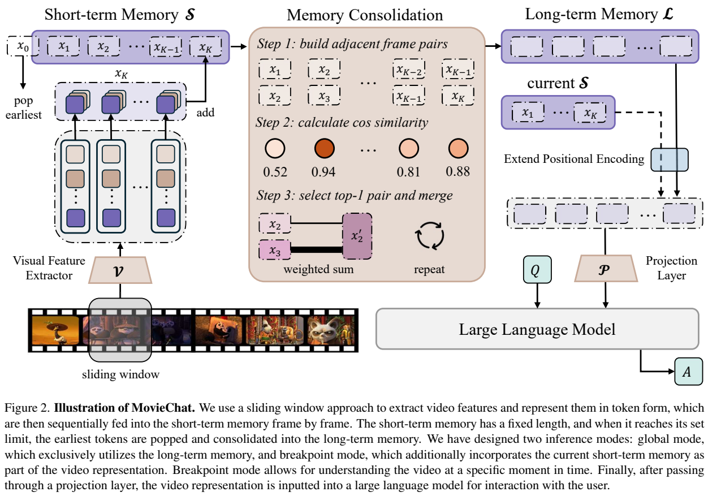
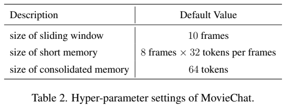
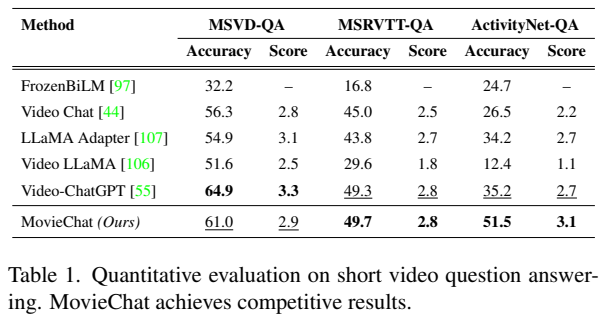
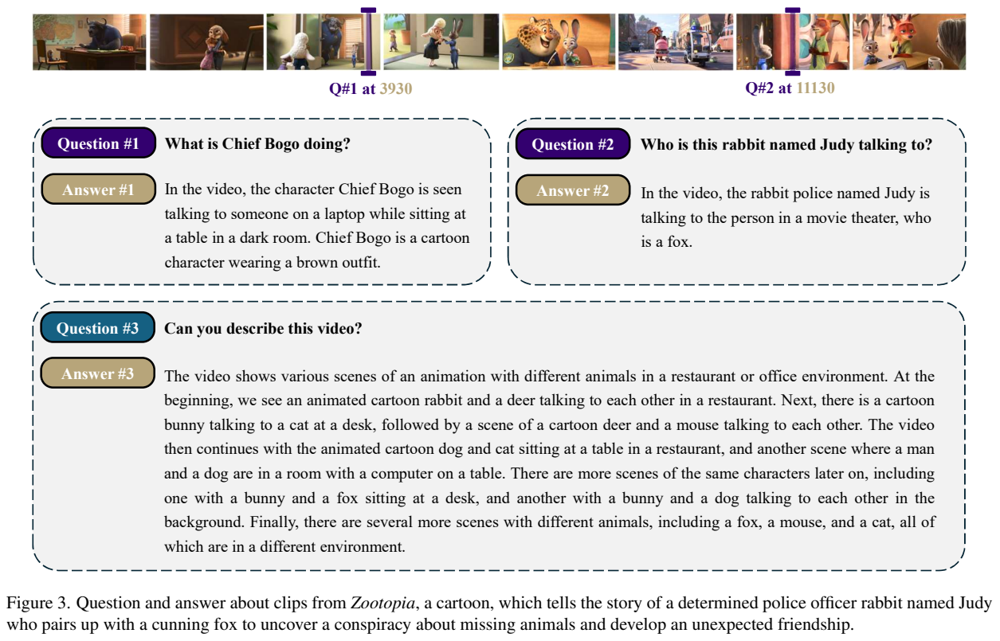
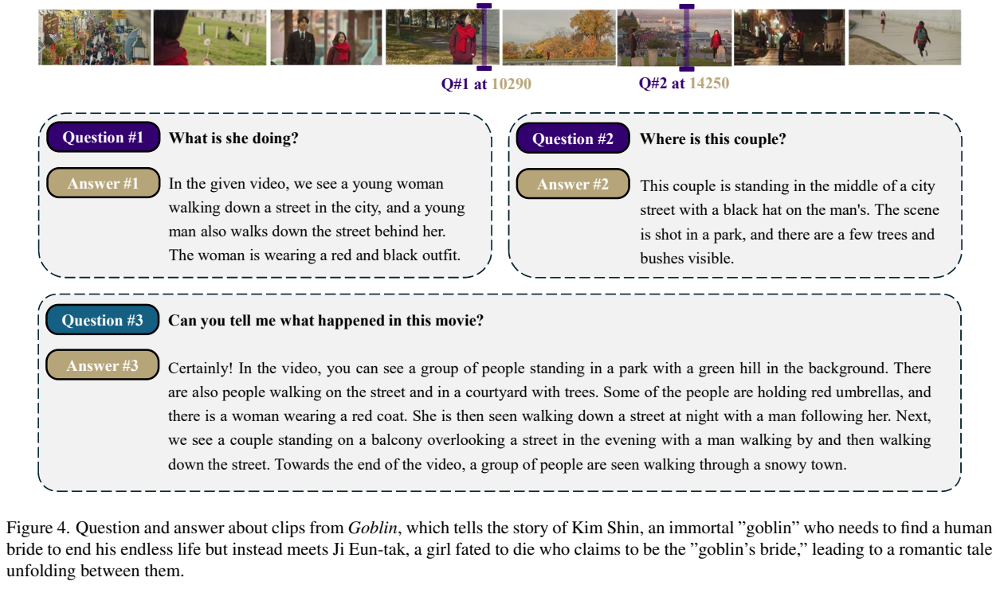

<!-- article-header:start -->
[项目首页](../../../README.md) › [模型系列](../../../reports/model-family-index.md) › [MovieChat](../README.md)
<!-- article-header:end -->

# MovieChat：把密集视频 token 转成短期与长期记忆

<!-- article-toc:start -->
<a id="article-toc"></a>

**本篇目录** · [论文定位](#paper-info) · [快速概览](#overview) · [整体架构](#architecture) · [核心原理](#principles) · [数据构建](#data) · [训练流程](#training) · [实验结果](#experiments)
<!-- article-toc:end -->

<a id="paper-info"></a>

## 1. 论文信息与模型定位

| 项目 | 信息 |
|---|---|
| 论文 | MovieChat: From Dense Token to Sparse Memory for Long Video Understanding |
| 作者 | Enxin Song、Wenhao Chai、Guanhong Wang 等 |
| 机构 | 浙江大学、华盛顿大学、微软亚洲研究院、香港科技大学（广州） |
| 固定版本 | [arXiv:2307.16449v1](https://arxiv.org/abs/2307.16449v1)，2023-07-31，13 页 |
| 官方项目页 | [MovieChat](https://rese1f.github.io/MovieChat) |
| 定位 | 通过压缩视觉记忆支持长视频问答与概述的框架 |
| 输入 / 输出 | RGB 视频与问题输入，文本回答；本版不把音频纳入模型链路 |

本介绍依据最初 v1，不能将后续 MovieChat 版本的新数据集、训练或长视频基准放进来。原文明确视觉组件为 EVA-CLIP ViT-G/14 与 BLIP-2 Q-Former，但没有完整给出语言主干型号、参数数与对齐训练配置，因此不凭项目印象填写。

<a id="overview"></a>

## 2. 快速概览

逐帧堆积全部视觉 token 会迅速增加存储与语言模型上下文需求。MovieChat 保留一段近期密集表示作为短期记忆，把旧帧中相邻且相似的表示合并成长期记忆。这样，新事件仍有细节，早期事件则用更稀疏的形式留下。

系统提供 Global 与 Breakpoint 模式：前者回答整段视频的问题，仅使用长期记忆；后者在指定时刻结合长期、当前短期与当前片段特征。它不是用每帧 caption 拼接长文本，也不是查询数据库获得整部电影剧情。

原文给出超过 10K 帧在 24GB 显卡上的视觉推理展示，以及 ActivityNet-QA 51.5 的问答准确率。但前者是资源测试，后者属于作者称为短视频问答的量化表，不能据此宣称万帧视频上的所有细节都能精确恢复。

<a id="architecture"></a>

## 3. 整体架构



**Figure 2，PDF 第 3 页。** 从左下的视频开始看：滑动窗口逐批提取视觉 token，进入固定长度 Short-Term Memory；旧表示推出时进入 Memory Consolidation，合并相似相邻内容并写到 Long-Term Memory。右侧长期记忆及当前记忆按模式组成表示，经位置编码扩展和投影供 LLM 回答。

视觉特征以图像模型逐帧产生，而非先由一个整体视频 Transformer 对所有帧做注意力。$`x_i`$ 表示一个窗口中帧的 token，局部缓存让系统不必同时把全部原帧保存在 GPU 和 RAM。短期记忆的 FIFO 更新优先保留近期上下文；长期记忆减少重复画面的成本。

Global 使用 $`\mathcal L`$；Breakpoint 将 $`\mathcal L`$、$`\mathcal S`$ 和当前 $`x`$ 拼接。文本问题 $`Q`$ 与投影视觉表示送入 LLM，原文 Equation 4 可写为 $`A=LLM(Q,P(V))`$。正文还提到 Q-Former 与线性投影，具体两个 Q-Former 调用位置和权重连接未完整展开，不能把示意图当成详细实现清单。

<a id="principles"></a>

## 4. 核心创新与数学原理

**相邻相似表示合并。** 原文 Equation 3 用同位置 token 的平均余弦相似度衡量相邻帧：

```math
s_i=\frac1N\sum_{j=1}^{N}\cos(x_i^j,x_{i+1}^j).
```

$`N`$ 为每帧 token 数，$`j`$ 为对应 token 位置。Algorithm 1 重复寻找相邻对中最大的 $`s_i`$，将那一对合并，删除其中一个，再重新计算，直到达到目标容量。原图以 weighted sum 示意合并，但没有完整展开所有权重更新规则，不假定固定简单平均。

这一设计保留时间邻接约束：它不会因片头与片尾同一个对象相似，就直接把相隔很远的帧合为一个。连续重复背景被压缩，新场景较难合并。局限是短暂而关键事件也可能因与邻帧整体相似而丢失；平均余弦相似度并不理解用户未来会问什么。

**双层记忆的尺度区别。** 短期缓存维持详细局部信息，长期缓存留下各次压缩结果。默认“64 token consolidated memory”是合并容量参数，不能据此断言无论视频多长，全部长期记忆总量永远只有 64 token。原文强调长期表示仍会超过原位置编码上限。

**扩展绝对位置编码。** 作者借用层次分解方法，把长度 $`n`$ 的绝对位置编码扩展到 $`n^2`$，服务长期 token 位置。它扩展可寻址位置而不创造遗失的视觉细节；报告没有给出完整分解公式、取值系数与消融，不能替它补写 RoPE 或位置插值实现。

原文 Equation 1 的窗口索引上界排成 $`\lceil C/T\rceil`$，与“总帧 $`T`$、窗口 $`C`$”说明存在次序疑点。本介绍按滑动窗口过程说明算法，不把该索引直接作为可执行分块代码。

<a id="data"></a>

## 5. 数据构建与处理

本版没有披露专门新建的训练图文、视频或指令数据规模，相关工作列出的 YouCook、HowTo100M、MovieNet 等也不能自动视为 MovieChat 的训练集。它的公开处理重点在视频窗口、视觉 token 和记忆压缩。

默认窗口为 10 帧，视觉编码后每帧 32 token；短期记忆为 8 帧×32 token，consolidated memory 为 64 token。窗口 10 与短期保留 8 是不同层次参数，不能把它们当成互相矛盾的同一个容量。原文没有统一说明实际视频帧率和抽帧步长，因此“10K 帧”也不能直接换算成固定分钟数。

资源图实验明确为 **224×224、visual-only、without frame sampling**。长视频案例来自《疯狂动物城》与《鬼怪》的片段，问题标注在帧位置，如 3930、11130、10290、14250；这些数字是时刻位置，不是样本数。

<a id="training"></a>

## 6. 训练流程与目标

MovieChat v1 的公开技术主体是记忆推理机制，没有完整的新增训练 recipe：未给出训练集构建、冻结参数表、投影层训练步数、学习率、batch、优化器或训练损失。视觉编码器和 Q-Former 使用预训练组件，可以确认；是否重新调优各模块和怎样对齐语言主干则未充分说明。



**Table 2，PDF 第 12 页。** 三行仅给窗口、短期容量和压缩容量，属于推理配置；同页正文另述问答评估协议，并非训练目标。不能把 cosine similarity 合并写成需要反向传播优化的损失，Algorithm 1 是按相似度选择合并的程序。

运行时先按窗口扫描并更新记忆，在用户给定模式后构成 $`V`$，进行投影和文本生成。Global 有利于摘要，Breakpoint 为局部问题保留更多近期信息。本文没有实际加载模型或运行该过程，亦不声称已复现资源曲线。

<a id="experiments"></a>

## 7. 实验设置与主要结果



**Table 1，PDF 第 6 页。** 每个数据集有 Accuracy 与 Score 两列；后一列为 0—5 的回答相似评分，不能混为百分制正确率。

| 模型 | MSVD-QA Acc / Score | MSRVTT-QA Acc / Score | ActivityNet-QA Acc / Score |
|---|---:|---:|---:|
| Video Chat | 56.3 / 2.8 | 45.0 / 2.5 | 26.5 / 2.2 |
| Video LLaMA | 51.6 / 2.5 | 29.6 / 1.8 | 12.4 / 1.1 |
| Video-ChatGPT | 64.9 / 3.3 | 49.3 / 2.8 | 35.2 / 2.7 |
| MovieChat | 61.0 / 2.9 | 49.7 / 2.8 | 51.5 / 3.1 |

MovieChat 相对 Video-ChatGPT 在 ActivityNet-QA 增加 16.3 个百分点，但 MSVD-QA 低 3.9，MSRVTT-QA只高 0.4，不能概括全面领先。

评估采用 ChatGPT 辅助：把问题、正确答案、预测答案交给 judge 判断语义匹配并评分，允许同义改写。附录 Figure A1 指定 `gpt-3.5-turbo`，每问约 250 tokens。提示一处要求整数分数，另一处示例却为 4.8，报告没有解释最终解析和取整方式。基线数字取自 Video-ChatGPT 项目，并未证明每个模型都在完全相同抽帧、上下文和解码预算下重新测量。

Figure 1 报告视觉推理显存随帧数增长：MovieChat 平均增量约 **21.3KB/frame**，Video-ChatGPT 为 25.6MB/frame，Video-LLaMA 187MB/frame，VideoChat 227MB/frame。图中“约 10000×”主要对应约 200MB 的比较对象，而非对所有模型相同倍率，也不是整个模型总显存减少 10000 倍。24GB 显卡处理超过 10K 帧说明资源可扩展，不提供实际扫描速度、完整问答时延或长片正确率。





**Figure 3、4，PDF 第 5 页。** 紫色位置标记对应 Breakpoint 问题，下面的第三问要求整体概述。输出能提到人物和场景，也有宽泛、重复及未经独立标注验证的细节。两组案例展示交互形式，不能作为标准长视频 benchmark。

本版没有给出短期长度、64-token 压缩率、合并策略和位置编码方法的系统消融，也没有报告不确定度或长距离事件检索准确率。它提供了一条把长视频存储与语言上下文解耦的工程方向，但压缩后是否保存所有关键细节，需要更完整的长视频量化检验。

<!-- article-footer:start -->
---

[← 上一篇：UnIVAL](../../unival/arxiv-2307.16184/README.md) · [按发表时间浏览](../../../reports/paper-reading-guide.md#year-2023) · [下一篇：LISA →](../../lisa/arxiv-2308.00692/README.md)

[返回本篇目录](#article-toc) · [返回模型系列](../README.md)
<!-- article-footer:end -->
