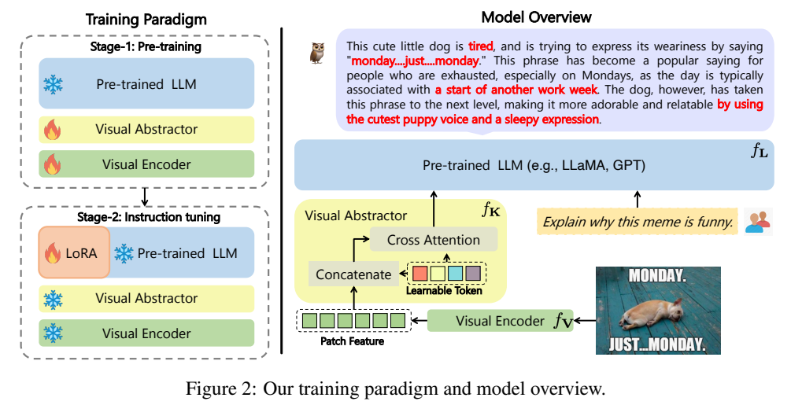
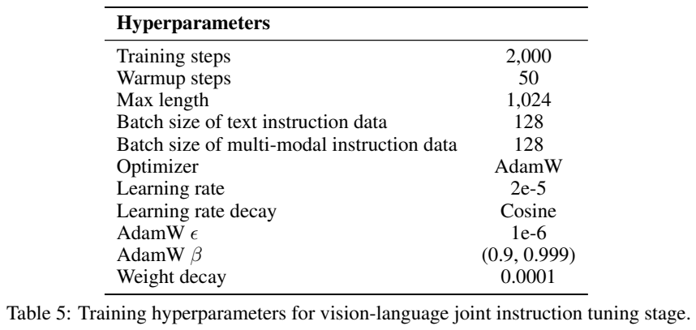
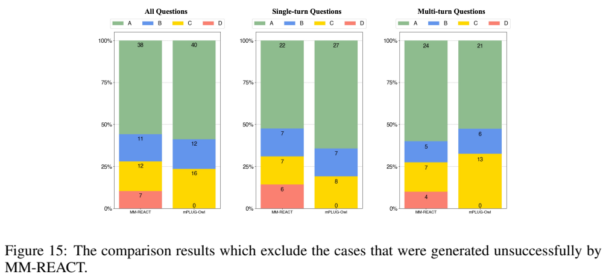
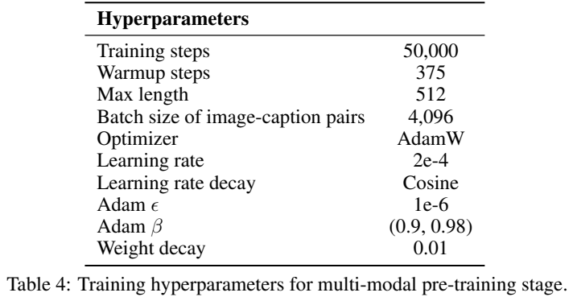
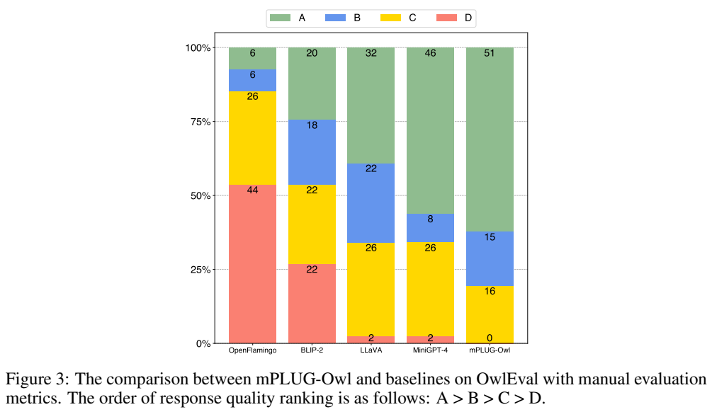
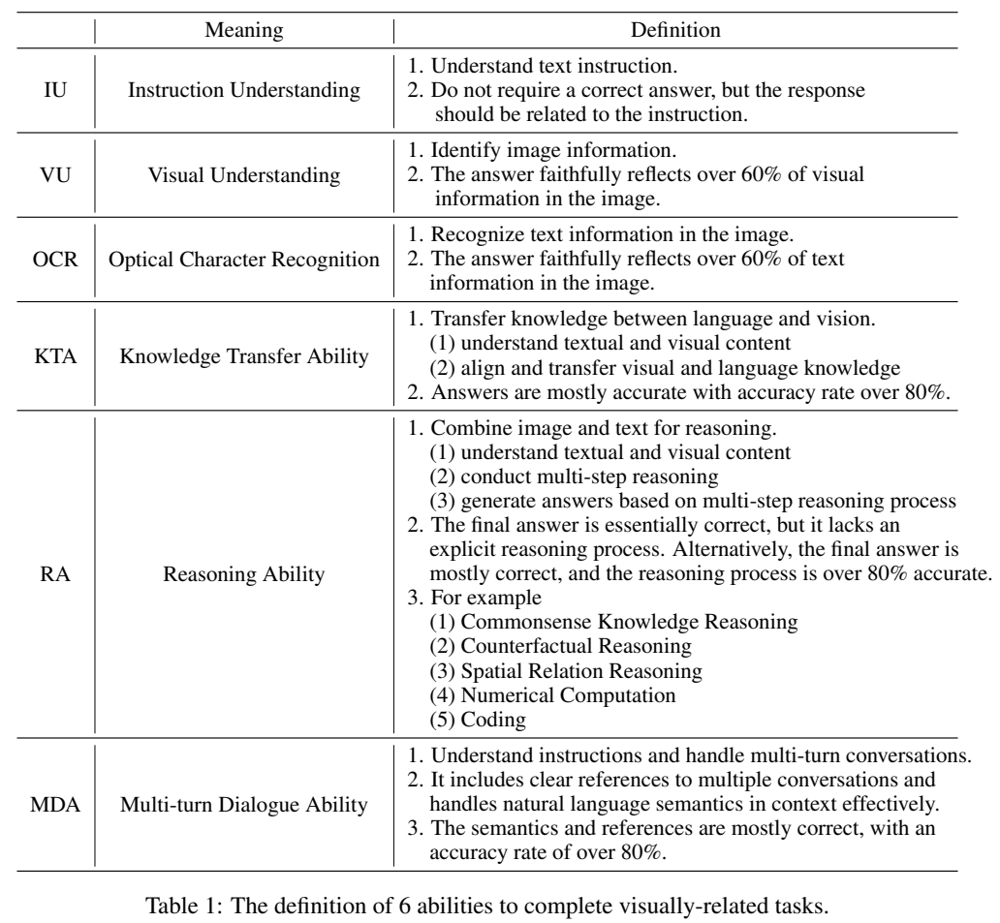
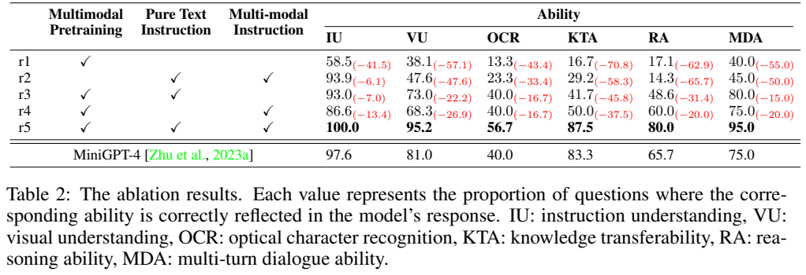

<!-- article-header:start -->
[项目首页](../../../README.md) › [模型系列](../../../reports/model-family-index.md) › [mPLUG](../README.md)
<!-- article-header:end -->

# mPLUG-Owl：以视觉模块学习和图文联合指令训练连接 LLaMA

<!-- article-toc:start -->

**本篇目录** · [论文定位](#paper-info) · [快速概览](#overview) · [整体架构](#architecture) · [核心原理](#principles) · [数据构建](#data) · [训练流程](#training) · [实验结果](#experiments)
<!-- article-toc:end -->

## 1. 论文信息与模型定位

| 项目 | 内容 |
|---|---|
| 论文 | *mPLUG-Owl: Modularization Empowers Large Language Models with Multimodality* |
| 作者 | Qinghao Ye、Haiyang Xu、Guohai Xu、Jiabo Ye、Ming Yan 等 |
| 机构 | 阿里巴巴达摩院 |
| 固定版本 | [arXiv:2304.14178v1](https://arxiv.org/abs/2304.14178v1)，2023 年 4 月 27 日，21 页 |
| 官方仓库 | [X-PLUG/mPLUG-Owl](https://github.com/X-PLUG/mPLUG-Owl) |
| 模型规模 | 原始 LLaMA-7B 语言骨干；报告给出系统约 7.2B 参数 |

mPLUG-Owl 的定位是图像条件下的文字生成与多轮对话。它选择尚未指令微调的 LLaMA，再让视觉组件与该语言空间对齐，而不是直接使用 Vicuna 的成熟对话能力。重点是两阶段组件更新方式与纯文本、图文指令的联合学习。

报告中“多模态生成”主要指视觉条件下生成文字，不是训练图像生成器。多图关联、多语言和文档理解只有早期定性证据，原文也展示失败例子；没有音频接口、视频训练配方或图像输出器，不能按标题中的广义多模态表述扩大能力范围。

## 2. 快速概览

| 模块或步骤 | 做法 | 实际作用 |
|---|---|---|
| 视觉知识模块 | CLIP ViT-L/14 初始化，第一阶段可训练 | 调整视觉表示，使其适合语言生成监督 |
| Visual Abstractor | 学习查询、cross-attention 聚合稠密视觉特征 | 将长 patch 序列转为较紧凑的视觉语义前缀 |
| 语言骨干 | 原始 LLaMA-7B，第一阶段冻结 | 提供既有语言知识和生成空间 |
| 联合指令训练 | 同时使用纯文字与图文对话，以 LoRA 更新语言接口 | 兼顾文字指令与图像条件回答 |
| 评测 | OwlEval：50 张图片、82 个开放问题，人工等级与能力标注 | 小规模人工评测，不能等同于大规模通用 VQA 排行榜 |

完整模型在 OwlEval 获得 51 个 A、15 个 B、16 个 C、0 个 D；MiniGPT-4 为 46/8/26/2。A+B 为 66/82，而“没有 D”不是所有答案都正确。原文另给 80 个纯文本问题的 ChatGPT 相对评分，联合微调的收益较小，且需要保留评分协议的限制。

## 3. 整体架构

*原文 Figure 2，PDF 第 4 页图表区域裁切；保留可学习 token、cross-attention 和两个阶段的冻结/训练图标。*

视觉模块是 24 层 ViT-L/14，隐藏维度 1024，来自 CLIP 对比预训练权重。训练图像为 224×224，patch 网格为 16×16，即 256 个空间 patch。Visual Abstractor 用若干可学习 token 查询图像信息；图中将 patch 特征与查询表示接入 cross-attention，输出语义视觉表示，再与用户文字一起送入 LLaMA。

该设计让进入 LLM 的图像表示可由少量查询承载，而非直接送入全部 patch。v1 没有披露查询个数、abstractor 完整层数、所有注意力 mask、映射维度细节，本介绍不借后续代码版本填入这些数字。学习查询的压缩仍可能遗漏小字与细节；“高语义”并不是对信息无损的保证。

第一阶段图中视觉编码器和 abstractor 可训练，LLM 冻结。第二阶段 LLM 原权重冻结，LoRA 更新，视觉编码器冻结。但 abstractor 的第二阶段状态存在来源冲突：摘要、引言写与 LoRA 联合训练，Figure 2 却画成冻结，方法正文也说冻结整个模型后仅加 LoRA。因此不能从这一 v1 唯一确定 abstractor 是否继续更新；本介绍明确保留差异，避免把一个版本的概括写成无歧义实现清单。

## 4. 核心创新与数学原理

报告没有编号数学公式，以下用于解释模块运算与目标，不冒充作者提出的新损失。令图像特征为 $`F=f_V(I)`$，查询向量为 Q，abstractor 输出 $`Z=f_K(Q,F)`$。文字问题嵌入与 Z 共同作为语言模型条件：

$$
p(Y\mid I,T)=\prod_{t=1}^{M}p(y_t\mid Z,T,y_{<t}).
$$

冻结 LLM 不等于停止所有反向传播。答案损失仍通过语言模型对输入嵌入的导数传回 Z，再更新视觉模块和 abstractor；语言模型权重自身不更新。这样既能使视觉表示适应语言生成，又避免第一阶段直接修改既有语言权重。其好处是训练设计动机，不能仅由冻结就推断生成质量绝不会变化。

视觉聚合可借标准 cross-attention 解释：$`\mathrm{Attn}(Q,K,V)=\mathrm{softmax}(QK^\top/\sqrt d)V`$。query 数比 patch 少时，输出视觉序列缩短，有利于减少 LLM 的前缀成本；但 encoder、abstractor 和全部 patch 的处理仍有成本，本文没有报告端到端推理倍速。原图中的拼接表示也不意味着已经给出所有 query 自注意力细节。

语言更新采用 LoRA。标准形式为 $`W'=W+\Delta W`$，$`\Delta W=BA`$，其中 B/A 的中间维度为 r，新增参数约为 $`r(d_{in}+d_{out})`$，小于完整矩阵的 $`d_{in}d_{out}`$ 时可减少训练更新量。v1 未披露具体 r、α、注入哪些线性层或训练参数比例，不能套用其他 mPLUG 版本的超参。LoRA 保留基础权重，不代表输出行为完全不变，也不等于所有推理计算都低秩化。

纯文本与多模态 batch 梯度共同累积，标准混合目标可以解释为两个数据分布上的答案 NLL：$`\mathcal L=\lambda_T\mathbb E_{D_T}[\mathcal L_T]+\lambda_V\mathbb E_{D_V}[\mathcal L_V]`$。报告描述多批次梯度累积并给出每类 batch=128，但未明确全部归一化与权重实现，因此 $`\lambda`$ 是解释性记号，不是已披露的固定损失系数。其思想是让语言行为与图像回答共同约束适配器，而非单纯增加图文数据量。

## 5. 数据构建与处理

第一阶段采用 LAION-400M、COYO-700M、Conceptual Captions、MSCOCO 的图像描述对。数据集名中的 400M、700M 是源集合规模，论文没有给出实际有效下载、过滤和去重后的图片总数及混合比例，不能据此认定训练用了全部 1.1B 图像。输入图像随机 resize 到 224，文字采用 SentencePiece tokenizer。

第二阶段文字指令来源按报告记载为 Alpaca 102K、Vicuna 90K、Baize 50K，共 242K；另有 LLaVA 多模态指令约 150K。Alpaca 的 102K 是本文给出的来源统计，不以常见的另一版 Alpaca 条数替作者改写。v1 没有详细解释各集合如何增广、清洗与去重。

数据统一组织成 Vicuna 风格的对话片段，损失计算在助手 response 上。这里使用模板不表示模型骨干就是 Vicuna。文字与图文 batch 分别累计梯度，不能将不同来源规模自然等同于训练采样比例；附录每类 batch 128 表明两类 batch 在优化步骤中的配额相等，而不是每个来源的每条样本曝光次数相等。

OwlEval 是独立的小型人工评测集：50 张图片来自 MiniGPT-4 21 张、MM-REACT 13 张、BLIP-2 9 张、GPT-4 3 张、作者收集 4 张，人工设计 82 个问题。涵盖自然图像、图表流程图、OCR、创作、知识和指代交互。它借用已有展示图片，不能视为从真实使用分布随机抽取的大规模独立测试。

## 6. 训练流程与目标

*原文 Table 4、Table 5、Figure 15，PDF 第 18 页图表区域裁切；所有参数、分组图例和结果计数完整保留。*

| 设置 | 第一阶段：附录 Table 4 | 第二阶段：附录 Table 5 |
|---|---|---|
| 步数 | 50,000 | 2,000 |
| batch | 图文对 4096 | 文字 128 + 图文 128 |
| 最大长度 | 512 | 1024 |
| LR | 2e-4 | 2e-5 |
| warmup | 375 步 | 50 步 |
| 优化器 | AdamW，β=(0.9,0.98)、ε=1e-6 | AdamW，β=(0.9,0.999)、ε=1e-6 |
| weight decay | 0.01 | 0.0001 |
| 调度 | cosine | cosine |

第一阶段正文另写 LR=1e-4、weight decay=0.1、warmup=2000，与附录 2e-4、0.01、375 不一致。这不是可以自行取平均的超参；复现前需要核对对应代码配置或更正，本文保留两套来源记载。

正文称 batch 约 2.1M token、50K 步约 104B token；4096×512×50,000 为 104.86B 最大长度位置，能解释该统计量级。但它不是 104B 张图片，也不证明所有位置都是未填充的有效文字 token。完整 batch 情况下约 204.8M 图文样本呈现，也不等于这么多去重图片。第二阶段 2000×256=512K 样本呈现，不应直接写成固定一个 epoch。

训练只用语言建模目标、在离散输出 token 上计算损失：$`\mathcal L=-\sum_{t\in\mathcal A}\log p(y_t\mid Z,T,y_{<t})`$，$`\mathcal A`$ 为回答监督位置。这是标准解释；没有独立图像重建目标、CLIP 对比损失、人工奖励模型或 DPO。CLIP 的对比学习描述针对初始化权重，不能当作本次训练新增的并行目标。

该 v1 未披露训练 GPU 数量、精度、实测训练时长，以及 LoRA 的完整设置。报告主要比较回答质量，无法由“低秩更新”单独估计其总训练预算或移动部署性能。

## 7. 实验设置与主要结果

*原文 Figure 3，PDF 第 6 页图表区域裁切；保留 A/B/C/D 图例、各柱计数和完整问题集说明。*

| 模型 | A | B | C | D | A+B |
|---|---:|---:|---:|---:|---:|
| OpenFlamingo | 6 | 6 | 26 | 44 | 12 |
| BLIP-2 | 20 | 18 | 22 | 22 | 38 |
| LLaVA | 32 | 22 | 26 | 2 | 54 |
| MiniGPT-4 | 46 | 8 | 26 | 2 | 54 |
| mPLUG-Owl | 51 | 15 | 16 | 0 | 66 |

等级由人工参考 Self-Instruct 标注，A>B>C>D，66/82 约 80.5% 被评为 A 或 B。早期基线包括在线演示系统和不同骨干，推理设置与输入方式未形成完全统一的受控实验。该样本量不足以推出“所有视觉任务领先”，报告也未给评审人数、一致性和置信区间。

单轮子集 50 个问题，多轮子集 52 个问题；它们由 82 个问题重新组织，不是两个互斥划分，不应相加为 102 个新增测试问题。附录对 MM-REACT 排除生成失败案例后，留下 68 个回答：MM-REACT 为 A/B/C/D=38/11/12/7，mPLUG-Owl=40/12/16/0。该协议是在成功返回条件下的比较，不能当成包含工具故障的总体成功率；多轮子图中 MM-REACT 的 A 计数还高于 mPLUG-Owl，优势并非每个等级都一致。

*原文 Table 1、Table 2，PDF 第 8 页图表区域裁切；保留每项能力判定条件、训练勾选与所有结果。*

人工能力标注为指令理解 IU、视觉理解 VU、OCR、知识迁移 KTA、推理 RA、多轮 MDA。完整方法为 100.0/95.2/56.7/87.5/80.0/95.0。IU 不要求答案正确，只要求与指令相关；VU/OCR 的定义是反映超过 60% 相关信息。它们不能写成标准 OCR 字符准确率或所有问题事实正确率。

只做预训练的 IU/RA 为 58.5/17.1，跳过视觉预训练但做两类指令为 93.9/14.3；完整两阶段为 100.0/80.0，支持视觉知识与指令学习的互补性。预训练后仅文字指令为 IU93.0/RA48.6，仅图文指令为 IU86.6/RA60.0；两者联合效果较好。但这不是专门控制“视觉骨干冻结与否”的消融，不能将全部收益归因于可训练 ViT。

80 个文字问题上，完整模型 ChatGPT 相对分数 86.71%，无多模态微调版本 86.07%，Vicuna 89.47%。该“比例”是评审分数比，不是赢率或覆盖 ChatGPT 的能力百分比；各行 ChatGPT 参照分也不同，差值较小且无统计区间。Table 3 将无多模态版本标 r4，而 Table 2 的 r4 实际勾选多模态、r3 才是纯文字，故不依据这一编号混淆消融来源。

原文定性分析主动指出：把 VGA 误读成 USB、数字读错导致计算失败、多图关联出现幻觉、多语言问题未必用同种语言回答、文档代码解释与应用指引有不可用回答。创作输出也不能证明可靠商品属性或正确代码执行。mPLUG-Owl 的主要价值是把视觉知识学习、紧凑接口和混合指令训练组合为可研究的模块化流程；这份 v1 的小型评测和配方冲突仍需保留。本文未运行模型或示例代码。

<!-- article-footer:start -->
---

[← 上一篇：MiniGPT-4](../../minigpt/arxiv-2304.10592/README.md) · [按发表时间浏览](../../../reports/paper-reading-guide.md#year-2023) · [下一篇：LLaMA-Adapter V2 →](../../llama-adapter/arxiv-2304.15010/README.md)

[返回本篇目录](#article-toc) · [返回模型系列](../README.md)
<!-- article-footer:end -->
