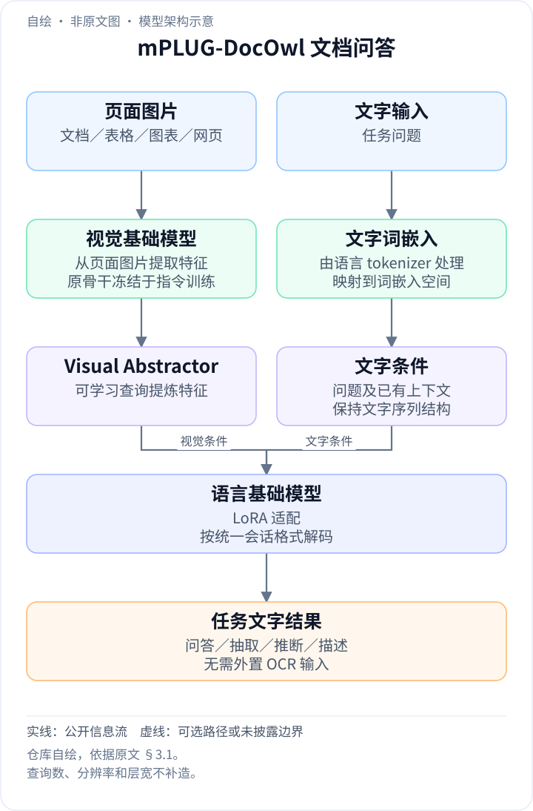
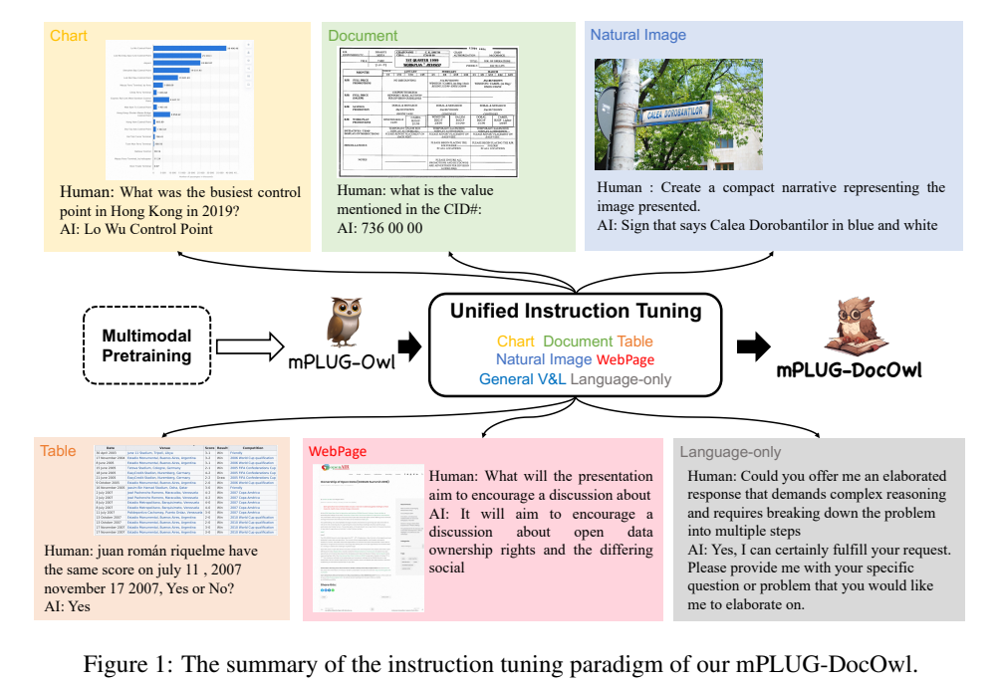
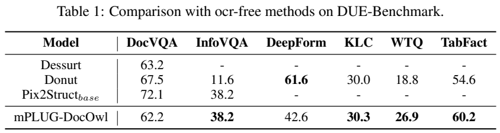
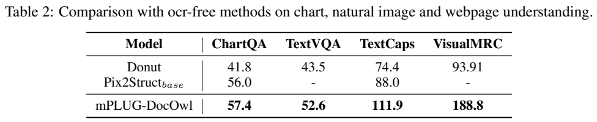
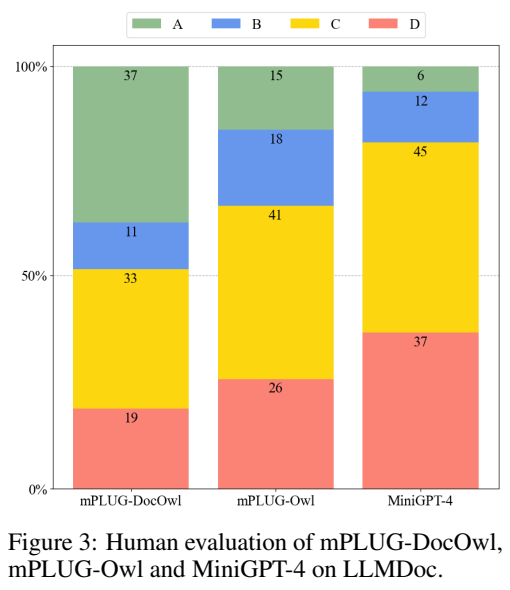
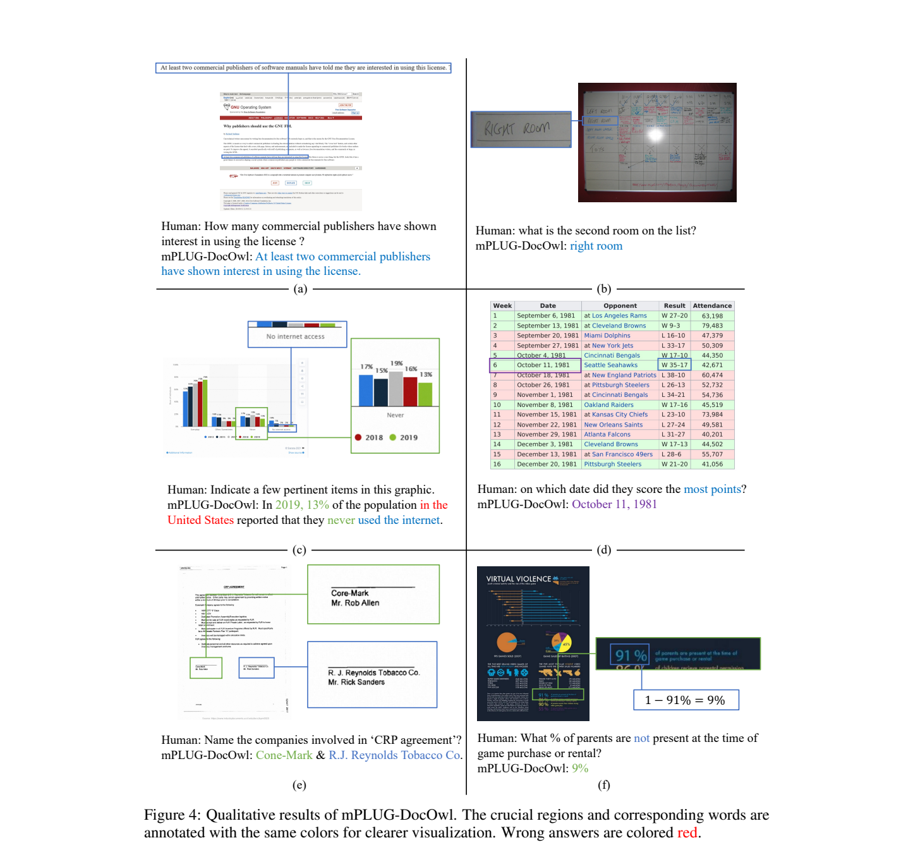
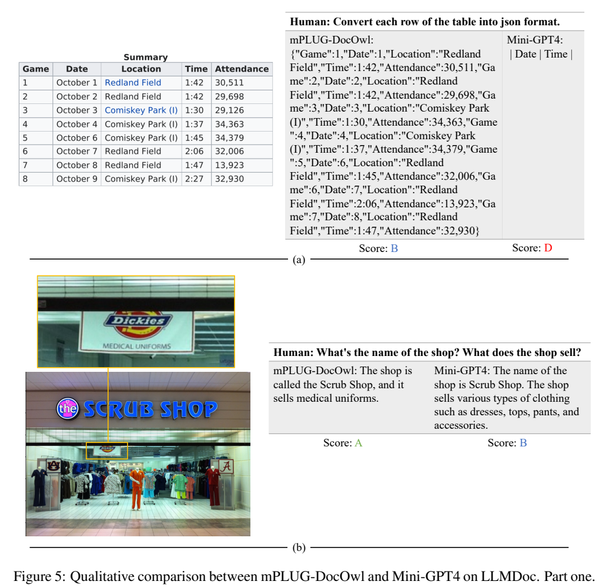

<!-- article-header:start -->
[项目首页](../../../README.md) › [模型系列](../../../reports/model-family-index.md) › [mPLUG](../README.md)
<!-- article-header:end -->

# mPLUG-DocOwl：以统一指令微调实现无需外部 OCR 的文档理解

<!-- article-toc:start -->
<a id="article-toc"></a>

**本篇目录** · [论文定位](#paper-info) · [快速概览](#overview) · [整体架构](#architecture) · [核心原理](#principles) · [数据构建](#data) · [训练流程](#training) · [实验结果](#experiments)
<!-- article-toc:end -->

<a id="paper-info"></a>

## 1. 论文信息与模型定位

论文为 **mPLUG-DocOwl: Modularized Multimodal Large Language Model for Document Understanding**，由阿里巴巴达摩院 Jiabo Ye、Anwen Hu、Haiyang Xu、Qinghao Ye、Ming Yan 等作者提出。本介绍依据 **arXiv 2307.02499v1，2023 年 7 月 4 日**，共 13 页。[固定版本 PDF](https://arxiv.org/pdf/2307.02499v1)；[官方仓库](https://github.com/X-PLUG/mPLUG-DocOwl)。

DocOwl 是基于 **mPLUG-Owl** 的文档理解模型，目标覆盖扫描文档、表格、图表、网页截图和含文字的自然图像。输入是图片与文字指令，输出是文本答案；它不需要先在推理管线中调用外部 OCR，再把识别文本拼入语言模型。

本报告介绍的是早期 DocOwl，而非后来同家族更高分辨率、多页或新压缩模块的版本。主要贡献是统一任务数据和模块化微调方案，同时构造 **LLMDoc** 人工评测集；不能将后续型号的架构与分数补入本文。

<a id="overview"></a>

## 2. 快速概览

普通多模态模型有时能读出图中大字，却容易忽略密集文本和复杂布局。DocOwl 用各类文档任务训练视觉接口和语言 LoRA，使模型既识别细节，又按用户要求抽取、判断、解释或生成回答。

训练分两步：先用文档数据 **10 epoch**，更新视觉 abstractor 和语言 LoRA；随后冻结 abstractor，只训练 LoRA **3 epoch**，加入纯语言与通用视觉语言指令，并把这些新增数据**上采样六倍**。视觉 Transformer 与语言模型原始参数始终冻结。

标准结果包括 DocVQA **62.2**、ChartQA **57.4**、TextVQA **52.6**。人工 LLMDoc 的 100 个请求中，DocOwl 有 **37 个 A 级回答**，高于 mPLUG-Owl 的 15 个和 MiniGPT-4 的 6 个；但另有 52 个 C/D 级回答，说明复杂文档交互仍存在较多错误。

<a id="architecture"></a>

## 3. 整体架构

<!-- derived-architecture:start -->


*自绘模型架构示意（非原文图）。依据下述公开资料归纳；方框表示功能组件，不代表逐层实现。*

依据：[§3.1–3.2，PDF p.3](https://arxiv.org/pdf/2307.02499v1)。
<!-- derived-architecture:end -->



**Figure 1，PDF 第 3 页** 中央展示由预训练 mPLUG-Owl 经统一指令训练得到 DocOwl；周围不同颜色的例子分别为图表、文档、自然图像、表格、网页和纯语言请求。这是任务与训练范式图，不是精确到层数的网络结构图。应关注多个任务共享同一回答接口，而不是每个领域各训练一个独立模型。

Section 3.1 披露三个模块：视觉基础模型提取图片特征；**visual abstractor** 用一组可学习 token 提炼特征；语言基础模型接收这些视觉表示与文字嵌入的拼接序列并生成回答。LoRA 为语言模型提供少量可训练适配参数。

视觉 abstractor 的作用是让文档中更重要的细粒度视觉文本信息进入语言模型，不等于先输出一个完整 OCR 文本清单。固定版本没有单列视觉/语言底座的精确型号、总参数、输入分辨率、查询 token 数或上下文上限，本文不从 mPLUG 家族其他报告推填具体配置。

一次文档问答先把页面作为图片送入视觉骨干；abstractor 的可学习查询从页面特征中提取较紧凑的视觉表示，再与问题的词嵌入串联，交由语言模型预测回答。视觉骨干负责读取版式与字符外观，abstractor 负责筛取和连接信息，语言模型负责按任务提示组织结果。本文沿用 `<image>Human:{question} AI:{answer}` 的统一接口，把问答、抽取、推断和描述转换成文本目标；文档任务并不各自调用一个新网络头。原文没有充分披露查询数、分辨率和各层宽度，示意只表达这些确定的组件关系。[原文 §3.1–3.2，PDF 第 3 页](https://arxiv.org/pdf/2307.02499v1#page=3)


<a id="principles"></a>

## 4. 核心创新与数学原理

第一项设计是把不同任务改写成统一条件生成：


```math
\text{图片}+\text{任务指令}\longrightarrow\text{文字回答}.
```


视觉问答直接用原问题；信息抽取把字段值作为回答、把“该字段是什么”作为问题；表格自然语言推断把陈述变为 Yes/No 请求；图像描述则配合随机选择的描述提示。这样同一个语言解码器可以处理不同标签形式，避免只学习某个固定领域输出头。

第二项设计是**文档接口适配与通用对话恢复分阶段进行**。第一阶段让可训练 abstractor 学会把文档线索提供给语言模型，LoRA 同时适配答案形式。第二阶段锁住视觉接口，再用混合指令调整语言 LoRA。这个安排有助于将领域学习与一般指令跟随结合，但本篇没有提供冻结策略的完整受控消融，因此不能把其动机写成已证明的最优方案。

可用 $`z=A_\phi(E(I))`$ 概括视觉编码器 $`E`$ 与 abstractor $`A_\phi`$，并以


```math
\mathcal L=-\sum_t\log p_{\theta,\Delta\theta}(y_t\mid y_{\lt t},z,q)
```


解释条件文本监督。其中基础语言参数 $`\theta`$ 冻结，$`\Delta\theta`$ 是 LoRA 更新。**这是对生成训练与冻结关系的数学解释，原文没有给出这套符号，也没有披露独立 OCR 分类、版面回归或视觉重建损失。** LoRA 的低秩形式可理解为 $`\Delta W=BA`$，具体 rank 与目标层没有在本版报告完整列出。

OCR-free 的准确含义是最终模型从视觉输入直接回答，没有推理时的外部 OCR 服务。它仍然通过有标签的文档和文字任务学习识别能力，也会犯文字读取错误；这个用语不能等同于没有文字监督或天然拥有完整 OCR 引擎。

<a id="data"></a>

## 5. 数据构建与处理

原文将任务统一成图像、Human 问题、AI 回答格式，主要数据如下。

| 任务形式 | 来源 | 转换方式 |
|---|---|---|
| 视觉问答 | ChartQA、DocVQA、InfoVQA、WTQ、TextVQA、VisualMRC | 保留问题与答案 |
| 信息抽取 | DeepForm、Kleister Charity（KLC） | 每个固定字段生成值查询；缺失时回答 None |
| 表格事实判断 | TabFact | 陈述加 Yes/No；Entailed→Yes，Refuted→No |
| 图像描述 | TextCaps | 描述作回答，搭配不同描述指令 |
| 通用交互 | LLaVA；Alpaca、Vicuna、Baize | 加入视觉语言及纯语言指令 |

这些数据来自各自**训练集**，标准评测使用测试集。报告没有公布所有数据数量、完整混合占比、去重规则、最大文本长度或页面采样策略；不能由 10/3 epoch 推算训练 token。

LLMDoc 是另建的**测试集**，从 TabFact、ChartQA、DocVQA、TextVQA、VisualMRC 五种场景各取 **20 张测试图片**。每种场景中 10 张沿用原问题，10 张由人设计更强的总结、推理或计算要求，总计 **100 个样本**。它不是文档训练语料，也不代表所有数据集测试图片都被人工重写。

<a id="training"></a>

## 6. 训练流程与目标

训练从已有 mPLUG-Owl 开始。**第一阶段**冻结视觉 Transformer 与语言主干，更新 visual abstractor 和语言 LoRA，仅用文档理解数据，训练 **10 epoch**。它主要强化从图中读取文字、利用布局和回答领域问题。

**第二阶段**继续冻结视觉与语言主干，并额外冻结 abstractor，只更新 LoRA；混入纯语言与通用视觉语言指令，这两类数据**上采样六倍**，训练 **3 epoch**。上采样改变的是混合数据出现频率，不表示将所有文档样本也统一重复六次。

其余训练超参数只说明沿用 mPLUG-Owl，没有在本报告逐项给出学习率、batch、GPU、精度、LoRA rank、上下文长度与 optimizer。本文保留明确披露的冻结配置与轮数，不用其他版本代码填入数值，也不声称完整复现过配方。

这是一套监督指令适配流程。原文没有奖励模型或 RLHF/DPO 描述，人工 LLMDoc 评价用于测量模型，不应被误认为人类偏好强化学习的训练阶段。

<a id="experiments"></a>

## 7. 实验设置与主要结果







**Table 1–2，PDF 第 5 页** 对照 Dessurt、Donut 和 Pix2Struct-base 等 OCR-free 方法。DocOwl 在 DUE 中 DocVQA **62.2**、InfoVQA **38.2**、DeepForm **42.6**、KLC **30.3**、WTQ **26.9**、TabFact **60.2**。它并非每项最好：DocVQA 低于 Pix2Struct 的 **72.1**，DeepForm 低于 Donut 的 **61.6**；WTQ、TabFact 则高于 Donut 的 18.8、54.6。

其他任务中 ChartQA 为 **57.4**，略高于 Pix2Struct 的 **56.0**；TextVQA **52.6**，高于 Donut **43.5**；TextCaps **111.9**、VisualMRC **188.8** 是原表的任务评分，**不是百分比准确率**。本版没有完整重述所有指标公式，不能将四列统一当成准确率或直接求无权平均。

报告“无需对每个数据集单独微调”的含义，是共享一个混合训练的模型，而不是这些任务训练集从未参与学习。Section 3.2 已明确使用其训练数据，不能把 Table 1–2 全部标成严格零样本结果。

同页 **Figure 3** 用 A/B/C/D 评价：A 是正确且令人满意，B 有轻微问题但可接受，C 回应了请求却有明显错误，D 无关或无效。DocOwl 为 **37/11/33/19**，mPLUG-Owl 为 **15/18/41/26**，MiniGPT-4 为 **6/12/45/37**。DocOwl A+B 为 48/100，仍有过半请求为 C/D。这个小规模人工集可比较交互质量，但不能代表所有文档任务总体准确率。



**Figure 4，PDF 第 6 页** 的颜色由作者标注，用来对应证据区域与答案，不是模型自动输出的注意力或定位框。网页抽取、手写表格与补集计算例子展示细节读取和简单计算；图表摘要中的红字“美国”则是图片未支持的幻觉。这说明读出一个百分数与准确限定其人群、地区背景是两种能力。



**Figure 5，PDF 第 7 页** 上部要求把表格行转为 JSON。DocOwl 尝试输出字段，却漏掉最后一行；原图的字符串还存在重复键、未规范引用的时间/数字等形式问题，不能因为正文称“JSON 格式”就说已得到可直接解析的合法 JSON。下部则通过小招牌识别商店卖的是医护制服，比只看店名的泛化回答更具体。

报告其余失败案例还包括多人计数遗漏用户自身、跨元素平均数计算错误，以及把“写新闻”变成简单读取表中文字。它的价值是较早把多种文档任务融入开放指令接口；主要不足在细粒度识别、关系推理、计算和结构化输出可靠性。本介绍核对全文及四页原图，没有运行模型或执行 JSON 生成测试。

<!-- article-footer:start -->
---

[← 上一篇：LLaVAR](../../llavar/arxiv-2306.17107/README.md) · [按发表时间浏览](../../../reports/paper-reading-guide.md#year-2023) · [下一篇：Lynx →](../../lynx/arxiv-2307.02469/README.md)

[返回本篇目录](#article-toc) · [返回模型系列](../README.md)
<!-- article-footer:end -->
