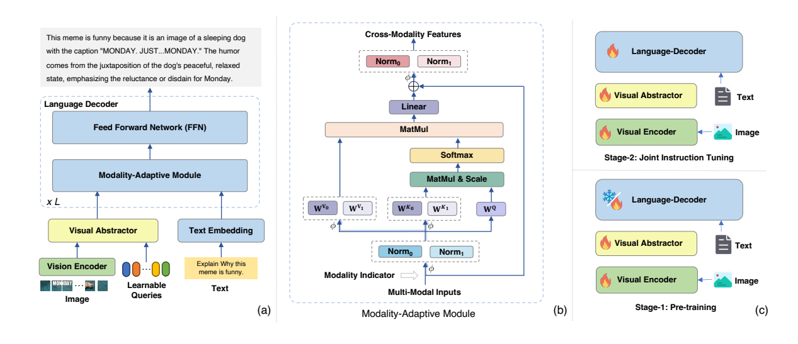
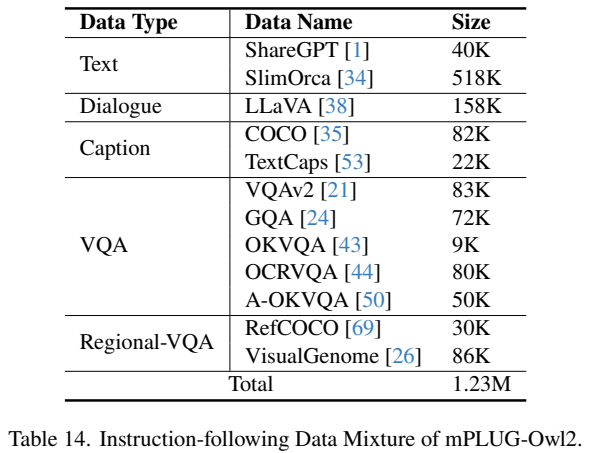
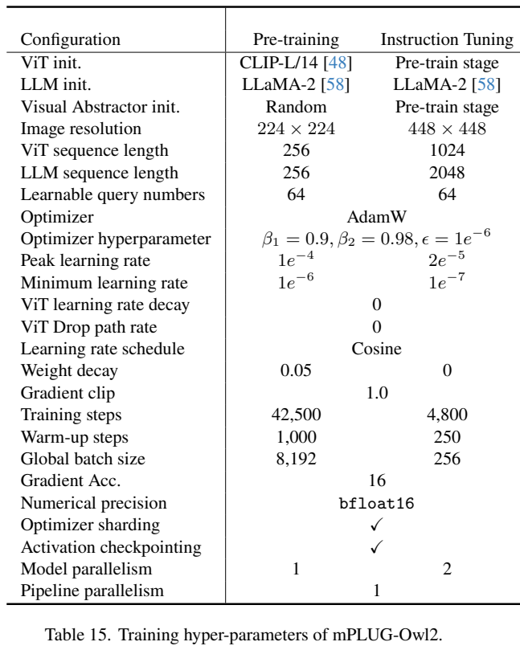
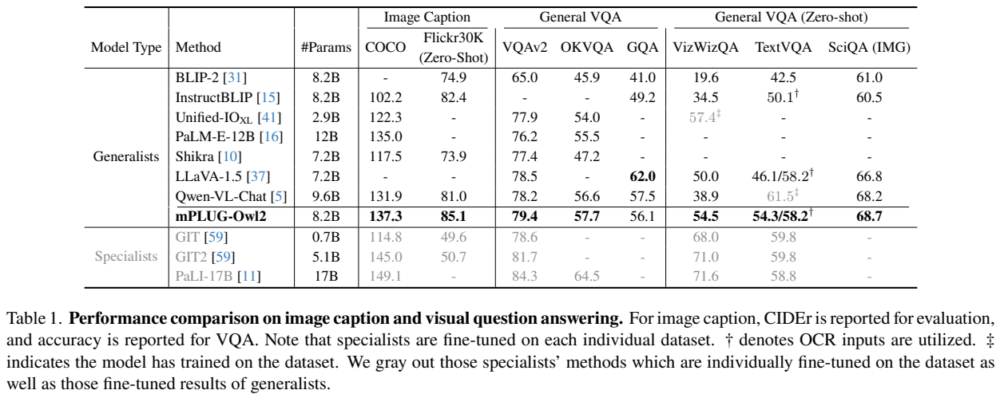
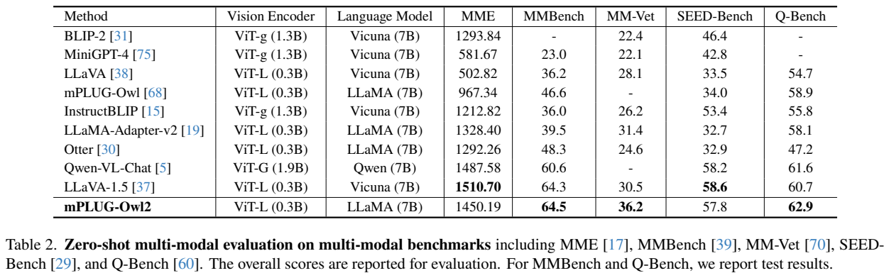
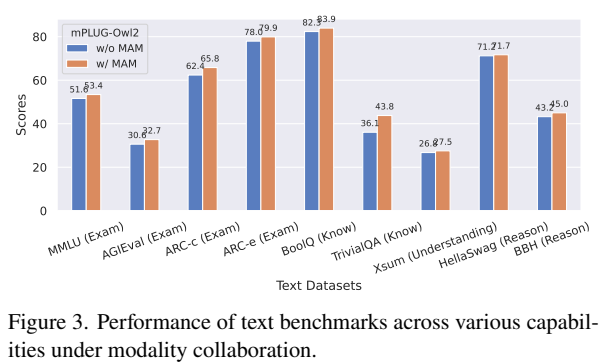
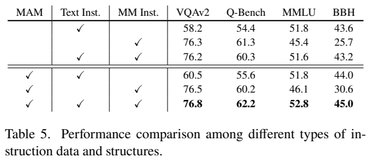
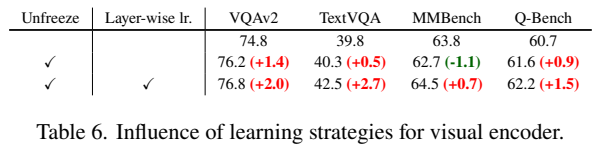
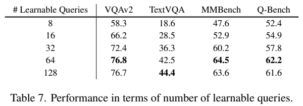

# mPLUG-Owl2：以模态专属 K/V 与共享模块促进协作

## 1. 论文信息与模型定位

| 项目 | 信息 |
|---|---|
| 论文 | mPLUG-Owl2: Revolutionizing Multi-modal Large Language Model with Modality Collaboration |
| 作者 | Qinghao Ye、Haiyang Xu、Jiabo Ye、Ming Yan 等 |
| 机构 | Alibaba Group |
| 固定版本 | [arXiv:2311.04257v1](https://arxiv.org/abs/2311.04257v1)，2023-11-07，18 页 |
| 项目 | [X-PLUG/mPLUG-Owl2](https://github.com/X-PLUG/mPLUG-Owl/tree/main/mPLUG-Owl2) |
| 组件与规模 | CLIP ViT-L/14、Visual Abstractor、LLaMA-2-7B，报告总参数 8.2B |
| 定位 | 同一模型支持纯文本与图像任务，并考察视频零样本迁移；文本输出 |

相较前代 mPLUG-Owl，本版重点在语言解码器内部怎样既共享知识又保留模态差别。它没有将视觉 token 完全当成普通词 embedding，也不把视觉与文本分成两套完整语言模型。本文只介绍该 v1，不将后续 Owl3 等版本的架构或数据混入。

## 2. 快速概览

论文把多模态学习的难点分为协作与干扰：图像提供对象和关系知识，可能帮助文字任务；但直接对所有 token 使用同一参数，也可能让纯文本能力退化。**Modality-Adaptive Module（MAM）**为两类 token 设置专属归一化、key 与 value 投影，同时共享 query 和 FFN。

视觉侧通过六层 abstractor 用 64 个查询压缩 patch 特征，语言侧联合学习纯文本与视觉指令。预训练和指令调优均允许视觉编码器学习，辅以分层学习率策略。原文报告纯文本 MMLU 53.4、BBH 45.0，图像 MM-Vet 36.2；MME 1450.19 却低于同表 LLaVA-1.5 的 1510.70。

这是一份具有架构、数据、训练和消融信息的报告，但部分表间配置存在差异。TextVQA 54.3 / 58.2 分别为无 / 有额外 OCR 输入；MMBench 64.5 与 65.4 分别来自 test 与 dev 相关表，不能简单当作互相矛盾的统一结果。

## 3. 整体架构

**Figure 2，PDF 第 4 页。** 左侧图像经过 ViT、Visual Abstractor 后与文字 embedding 合并，进入由 MAM 和共享 FFN 构成的解码器。中间图明确 K、V 由两模态不同矩阵产生，Q 是共有矩阵；右侧火焰 / 雪花展示第一阶段训练视觉和新参数，第二阶段全模型训练。这里的“协作”来自专属映射后的共同注意力和 FFN，不是对两个模型回答投票。

输入 $H\times W$ 图像以 14×14 patch 编码，patch 数 $P=(H/14)(W/14)$。224 与 448 输入分别产生 256 / 1024 个视觉 patch token；abstractor 都压到 **64 token**。语言模型仍能读取图像细节，但精细信息需要通过有限查询，因此压缩率与 OCR 能力存在权衡。

Abstractor 的查询 $V^0=Q$ 反复从原图特征 $I$ 和已有查询状态中收集信息。原文 Equation 1、2 为：

$$
C^i=\operatorname{Attn}(V^i,[I;V^i],[I;V^i]),
\qquad V^{i+1}=\operatorname{SwiGLU}(C^iW_1)W_2.
$$

视觉与查询特征加正弦位置 embedding，以保留空间线索。压缩后的视觉 token 与文本连接，统一自回归生成。原文将操作称 self-attention，按其 query 与 key/value 形式理解即可，不应把它误写为 BERT Q-Former 的完整训练程序。

## 4. 核心创新与数学原理

MAM 用模态标识 $M$ 区分视觉与文本。Equation 3 定义选择操作 $\phi(X,M,m)=X\odot\mathbf1\{M=m\}$；Equation 4 对两类特征分别归一化后再组合为 $\tilde H$。因此同一层仍有共同序列结构，模态差别保存在参数选择中。

忽略层索引以便阅读，Equation 5—8 的主要结构为：

$$
H^Q=\tilde H W^Q,
\quad H^K=\phi(\tilde H,M,0)W^{K0}+\phi(\tilde H,M,1)W^{K1},
$$

$$
H^V=\phi(\tilde H,M,0)W^{V0}+\phi(\tilde H,M,1)W^{V1},
\quad C=\operatorname{softmax}(H^Q(H^K)^\top/\sqrt d)H^V.
$$

共享 Q 让视觉、文字查询在同一关系计算中工作；不同 K 影响怎样被检索，不同 V 决定被检索到的内容怎样进入上下文；后续共享 FFN 促进知识协作。原文也对归一化作模态区分，不能只概括成“两个额外投影层”。

这种设计没有禁止跨模态 attention，也不是把所有参数按视觉 / 文字隔离。它通过部分共享取得平衡，是否改善仍需实验支持，不能从参数结构直接推导出永远消除干扰的保证。

Abstractor 将语言解码器注意力长度从 $P+L$ 变成 $K+L$，其平方项复杂度由 $O((P+L)^2)$ 变为 $O((K+L)^2)$，$K=64$。这只比较 LLM 侧注意力，不包含视觉编码和 abstractor 自身计算。论文没有提供统一端到端 FLOPs 和时延，不应将该式当作全模型计算节省比例。

## 5. 数据构建与处理

预训练从 CC3M/CC12M、COCO、Laion-en、COYO、DataComp 等公共图文数据随机选取约 **400M 对**。实际 42500 steps×8192 batch 约为 348M 对，两者分别是候选集合和训练消耗；不混写成 400M 全部训练一次。图像用随机 resized crop、0.5 概率水平翻转。

**Table 14、15，PDF 第 17 页。** 上表分文本、对话、caption、VQA 和区域 VQA，总计 **1.23M**。ShareGPT 为 40K、SlimOrca 518K、LLaVA 158K，COCO / TextCaps 82K / 22K；VQAv2 83K、GQA 72K、OKVQA 9K、OCRVQA 80K、A-OKVQA 50K；RefCOCO 30K、VisualGenome 86K。正文提到 ShareGPT-80K，但最终表列 40K，本介绍按表记录最终混合量，不自行解释删减过程。

VQAv2 选最高置信答案，把同图问答组合；GQA、OKVQA、OCRVQA 也做同图合并。A-OKVQA 通过调整选项顺序增强多选题鲁棒性；caption 每图随机选一个参考，区域问答补充定位能力。数据复用既有任务标注和生成指令，报告没有完整公开去重阈值、训练与测试污染审计及来源授权明细。

## 6. 训练流程与目标

**第一阶段视觉语言预训练。** 训练 ViT、随机初始化六层 abstractor、新增 MAM 参数，冻结原 LLaMA-2 参数。MAM 从语言模型参数初始化。输入分辨率 224×224，LLM 序列长度 256，42500 steps，global batch 8192，峰值 / 最低学习率 1e-4 / 1e-6，warmup 1000，weight decay 0.05。

**第二阶段联合指令调优。** 纯文本与视觉指令一起训练整模型，分辨率增为 448×448、序列长 2048。正文称一个 epoch，附录列 4800 steps、batch 256；峰值 / 最低学习率 2e-5 / 1e-7，warmup 250，weight decay 0。两阶段均使用 AdamW，$\beta_1=0.9,\beta_2=0.98,\epsilon=10^{-6}$，cosine schedule、梯度裁剪 1、BF16，梯度累计 16，并使用 Megatron 并行、优化器分片和 activation checkpointing。

正文强调 ViT layer-wise LR decay 为 **0.9**，Table 15 的“ViT learning rate decay”却列 **0**，没有解释两者的关系；这里保留原文差异，不能把表中的 0 自动改成 weight decay 或唯一有效配置。视觉编码器学习率层次控制的作用由 Table 6 消融支持。

两阶段使用语言建模生成监督，把任务转为文字回答。报告未给出完整 token loss mask 与对话模板规则，也没有引入偏好优化或 RL 目标。全模型联合学习的收益应通过“相同数据、有无 MAM”实验判断，而不能只将其归因于新增多模态数据量。

## 7. 实验设置与主要结果

**Table 1、2，PDF 第 5 页。** Caption 报告 CIDEr，VQA 是各数据集得分；灰字 specialist 单独针对任务调优，不能与统一模型直接作同训练条件比较。Table 1 的 Owl2：COCO / Flickr30K 为 **137.3 / 85.1**，VQAv2 79.4、OKVQA 57.7、GQA 56.1、VizWiz 54.5、ScienceQA-IMG 68.7。TextVQA 无 OCR 为 **54.3**，加 OCR 为 **58.2**。前者高于 LLaVA-1.5 无 OCR 的 46.1，但 GQA 低于其 62.0，也低于 Qwen-VL-Chat 的 57.5。

Table 2 使用 MMBench 和 Q-Bench test：MME **1450.19**、MMBench **64.5**、MM-Vet **36.2**、SEED **57.8**、Q-Bench **62.9**。MM-Vet 和 Q-Bench 优于同表 LLaVA-1.5 的 30.5 / 60.7，MME 和 SEED 却低于其 1510.70 / 58.6。附录 Table 10 为 MMBench dev 65.4，与 test 64.5 的 split 不同；分辨率消融 Q-Bench 62.6 也未解释与主表 62.9 的全部配置差别。

纯文本 Table 3 采用 MMLU 5-shot，BBH、AGIEval、ARC 为 0-shot。Owl2 的 **MMLU 53.4、BBH 45.0、AGIEval 32.7、ARC-c 65.8、ARC-e 79.9**，同表 Vicuna-v1.5 为 51.1 / 41.2 / 21.2 / 56.6 / 72.8。它说明最终模型保留且改善部分文字任务，但模型间指令数据并未完全统一。

**Figure 3、Table 5—7，PDF 第 7 页。** Table 5 在混合指令数据下加入 MAM，使 VQAv2 **76.2→76.8**、MMLU **51.6→52.8**、BBH **43.2→45.0**，但这组 MMLU 52.8 与主表 53.4 不同，应逐表报告。只有视觉指令、无 MAM 时 MMLU / BBH 为 45.4 / 25.7，说明语言能力下降不能只靠图像任务平均掩盖。

Table 6 冻结 / 解冻 / 解冻加分层 LR，TextVQA 为 **39.8 / 40.3 / 42.5**；单纯解冻使 MMBench 63.8→62.7，加分层 LR 后回到 64.5，支持控制视觉更新强度。Table 7 从 8→64 查询使 VQAv2 58.3→76.8；128 查询 TextVQA 更高至 44.4，但 MMBench 63.6 低于 64 查询 64.5，64 是综合取舍而非所有指标极值。Table 8 的 224→448 输入提高 TextVQA **42.5→54.3**，凸显文字细节依赖像素。

视频 Table 4 分 exact match 与 GPT-assisted。Owl2 在 MSRVTT / MSVD / TGIF 的 exact-match accuracy 为 **23.6 / 42.4 / 61.6**；GPT-assisted 为 **46.7 / 65.4 / 67.1**，relevance score 为 2.9 / 3.5 / 3.7。MSRVTT 的 GPT accuracy 低于 Video-ChatGPT 49.3，不能按“全部领先”转述正文。报告未统一披露抽帧预算，不据图像分辨率推导视频总 token 数。

附录 MMHal-Bench 分数 2.17、幻觉率 0.56，POPE random / popular / adversarial F1 为 87.85 / 85.60 / 83.80；random F1 低于 InstructBLIP 的 89.27。Figure 5 的彩虹案例输出含 white、漏 red，尽管作者称识别正确，不能将该案例当作事实保证。报告整体支持部分共享与专属参数的协作方向，其结论仍依赖数据、分辨率和任务设置。