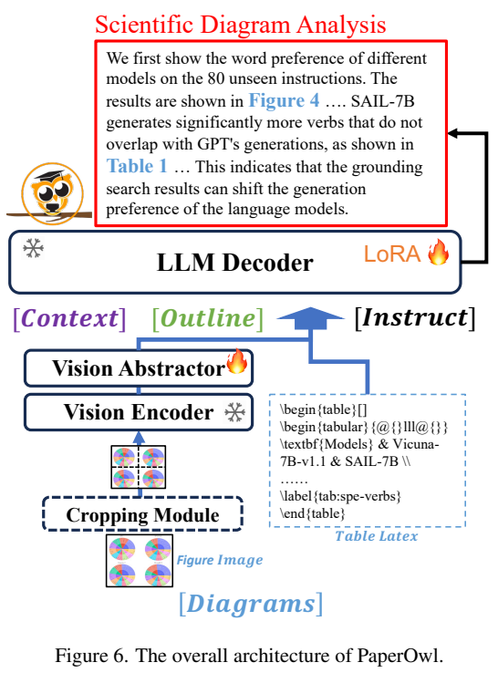
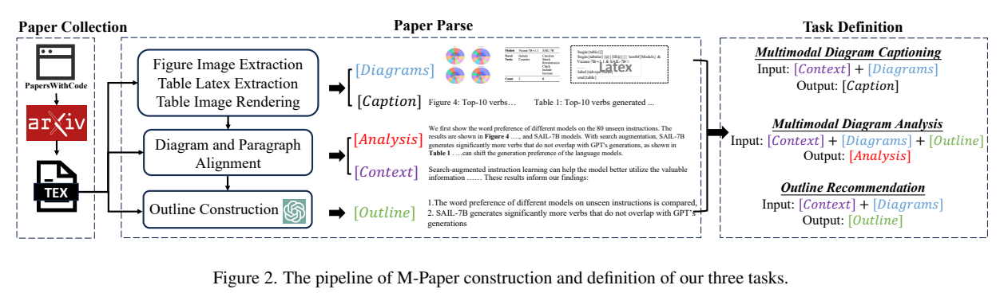
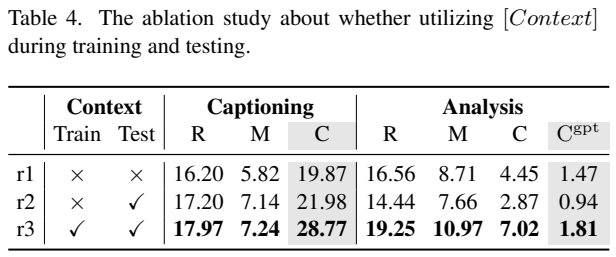
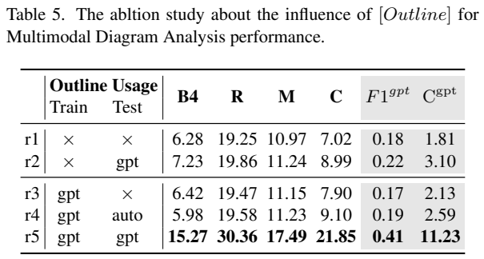
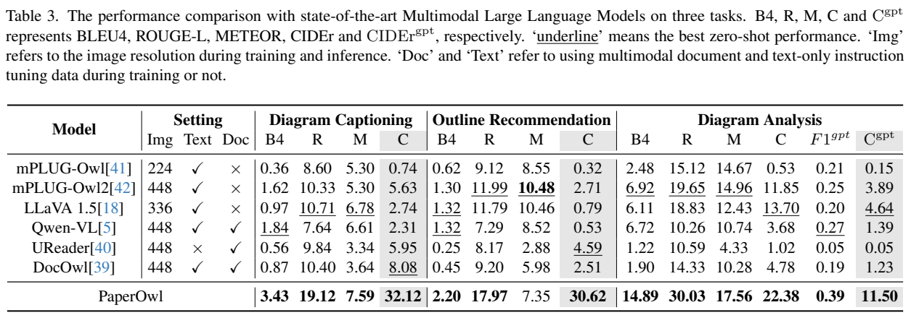
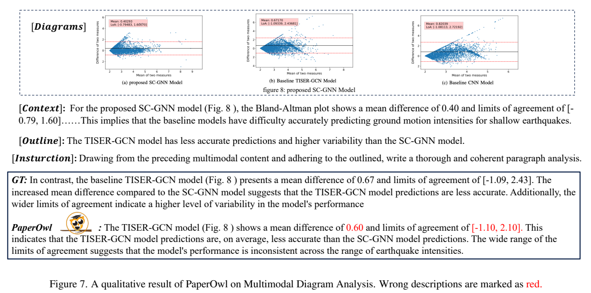
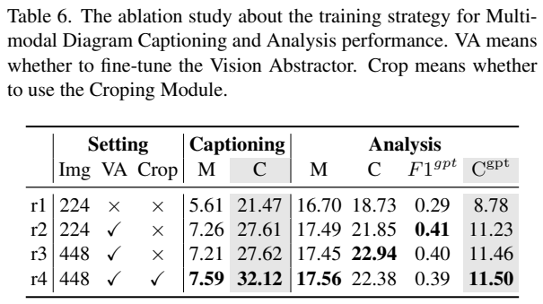

<!-- article-header:start -->
[项目首页](../../../README.md) › [模型系列](../../../reports/model-family-index.md) › [mPLUG](../README.md)
<!-- article-header:end -->

# mPLUG-PaperOwl：用上下文和提纲控制科学图表分析

<!-- article-toc:start -->

**本篇目录** · [论文定位](#paper-info) · [快速概览](#overview) · [整体架构](#architecture) · [核心原理](#principles) · [数据构建](#data) · [训练流程](#training) · [实验结果](#experiments)
<!-- article-toc:end -->

## 1. 论文信息与模型定位

| 项目 | 内容 |
|---|---|
| 论文 | *mPLUG-PaperOwl: Scientific Diagram Analysis with the Multimodal Large Language Model* |
| 作者与机构 | Anwen Hu、Yaya Shi、Haiyang Xu、Jiabo Ye、Qinghao Ye、Ming Yan 等；阿里巴巴 |
| 固定版本 | [arXiv:2311.18248v1](https://arxiv.org/abs/2311.18248v1)，2023 年 11 月 30 日，20 页 |
| 官方代码与数据 | [mPLUG-DocOwl/PaperOwl](https://github.com/X-PLUG/mPLUG-DocOwl/tree/main/PaperOwl) |
| 基础模型 | mPLUG-DocOwl；视觉 ViT-L/14、视觉 abstractor、LLaMA-7B 架构语言解码器 |
| 定位 | 生成论文图表标题、科学图表分析段落、写作提纲；支持多图、图表混合、表格 LaTeX 输入 |

PaperOwl 研究的并非“看图回答一句话”，而是如何把论文中的多张图、表格、前文和作者意图组织成分析段落。主要贡献是 M-Paper 数据集、可作为控制信号的 Outline，以及兼顾参考文本词汇与语义要点的 CIDErGPT 评测。

输出是文字段落和提纲；图中数值、关系和术语仍可能读错。该版本主动展示了内容流畅但数值错误、仅改写提纲而没有读出额外图表信息的失败案例，因此不应定位为自动核验论文事实的系统。

## 2. 快速概览

| 元素 | 核心做法 |
|---|---|
| M-Paper | 从 2012–2023 的计算机科学论文 LaTeX 中对齐图、表、caption 与引用段落 |
| Context | 提供首次引用图表之前的完整段落，正文上限 512 token |
| Outline | 用户给定或模型推荐的分析要点；训练提纲由 GPT-3.5 根据原分析段落生成 |
| 图像接口 | 每张 448×448 图裁为四张 224×224 子图，分别编码与聚合 |
| 更新范围 | 视觉编码器和 LLaMA 原权重冻结，视觉 abstractor 和 rank=8 的语言 LoRA 更新 |
| 主结果 | 标题 CIDEr 32.12、提纲 CIDEr 30.62、分析 CIDErGPT 11.50 |

主实验是在该任务数据上指令微调的 PaperOwl 对比已有模型的零样本表现，反映任务训练带来的适应性，不是同数据同训练预算的架构胜负。尤其是分析任务可提供从参考分析提取的 GPT 提纲，分数应按这个条件理解，不能写成完全自主读图分析准确率。

## 3. 整体架构

*原文 Figure 6，PDF 第 6 页图表区域裁切；保留 Context/Outline/Instruction、图像/LaTeX 路径和冻结、训练标记。*

图像走无参数 Cropping Module，将 448×448 切成四张 224×224。每个子图由 ViT-L/14 编码，视觉编码器为 24 层、16 个注意力头、隐藏宽度 1024。一个子图包含 16×16=256 个空间 patch。裁图保留了比直接缩小更清楚的局部细节，但原文没有加入跨窗口视觉注意力；多个子图的关系主要由后续序列与语言解码器整合。

Vision Abstractor 有 6 层、8 头、宽度 1024，采用 64 个可学习查询 Q；cross-attention 的 key/value 是视觉特征 V 与 Q 的拼接 $[V:Q]$，聚合成 64 个向量。每张原图四个子图可带来 4×64=256 个视觉向量；报告在多图场景提到最多 16 个子图、1024 个压缩视觉 token。这里的 1024 是 abstractor 后的序列，不是单个子图的原始 patch 数。

LaTeX 表格作为文字直接进入语言路径，不需要先生成表格截图再编码。Context、Outline、Instruction、视觉前缀与 LaTeX 可以交错输入。LLaMA-7B 结构的解码器逐 token 生成标题、提纲或分析段落。架构没有额外检索器、论文知识库或独立数值验证器；前文是给定输入，不等于运行时搜索全文。

## 4. 核心创新与数学原理

其第一项方法是将写作任务分成可控制的条件生成：

$$
p(A\mid C,D,O,I)=\prod_t p(a_t\mid C,D,O,I,a_{<t}),
$$

其中 C 为前文、D 为图像或 LaTeX 图表、O 为提纲、I 为指令。此式是标准自回归解释，原文没有新增编号的训练公式。提纲先约束讨论方向，图表提供具体证据和数值，前文提供专名与背景。没有提纲时，模型可能给出与图表相符但偏离作者目标的讨论；提供提纲时，也可能只把提示改写成流畅段落。这两个问题都需要通过实际结果区分。

视觉 abstractor 的标准注意力可解释为 $\operatorname{softmax}(QK^\top/\sqrt d)V_{kv}$，K/V 来自图像与查询的联合表示。查询压缩降低送入 LLM 的 token 数，但每张图裁成四块也增加了视觉前缀。多图理解并不等于把几张图各自描述后拼接，语言模型还需保持图表编号、指标与论述对象的一致性。

论文新增的评测设计是 CIDErGPT：先用 GPT-3.5 提取预测段落与参考段落的要点，再逐对判断语义匹配，得到语义 precision/recall/F1。其含义可用标准形式展开为：$P=\#\text{匹配预测要点}/\#\text{预测要点}$，$R=\#\text{匹配参考要点}/\#\text{参考要点}$，$F_1=2PR/(P+R)$。这是对精确率与召回率的解释；原文没有细化所有多对多匹配和去重规则，不能擅自宣称采用最大二分匹配。

最终将 CIDEr 与语义 F1 相乘。CIDEr 衡量带 TF-IDF 权重的 n-gram 相似性，语义 F1 注重是否覆盖参考讨论要点；二者希望同时保留专名细节与整体意义。Figure 3 的例子中，A 的 CIDEr 为 13.52、F1=0.66、组合分约 8.92，而 B 有较高 CIDEr 14.11 却语义 F1=0，组合分为 0。

CIDErGPT 是参考段落相似度指标，不直接验证图中事实。GPT 的评审输入是预测与参考文字，未把原图作为事实核验依据。它可能惩罚合理但参考未讨论的结论，也可能对语义近似却数值错误的输出给分。汇总表的 CIDErGPT 不等于表中平均 CIDEr×平均 F1；逐样本乘积再汇总即可出现这种差异，原文未完整展开聚合细节，不能用均值乘积擅自更正报告数值。

## 5. 数据构建与处理

*原文 Figure 2，PDF 第 4 页图表区域裁切，保留论文采集、图表渲染、段落对齐、提纲生成与任务输入输出。*

研究首先通过 PapersWithCode 收集约 48K arXiv ID，再下载 LaTeX，最终 M-Paper 含 48,688 篇，覆盖 15 个以上深度学习与计算机科学方向。把社区收录视为质量筛选是作者的经验选择，不代表全部论文已通过同行评审或内容无误。

LaTeX 转 XML 后，用 `ref` 与 `label` 对齐图表和分析段落。图像通过 `includegraphics` 获得；表格同时保留 LaTeX 和图片。为了准确渲染表格，修改源码使单表独占一页，删除 caption，编译后用 Canny 检测边界裁出图像。这避免直接从复杂 PDF 版面裁表时坐标不准，也减少图表标题任务从图片 caption 泄漏答案。

文本清洗将引用替换为 `<cite>`，丢弃包含超过 40 字符长公式的段落。任务并不训练完整方程推导或引文推荐；这项过滤也意味着模型数据较少覆盖数学密集分析。Context 取首次引用图表之前的未截断段落，保留背景而不把目标分析整段复制作为输入。

| 任务 | 训练样本/论文 | 验证样本 | 测试样本 |
|---|---|---:|---:|
| 图表标题 | 346,864 / 46,725 | 1,132 | 1,133 |
| 图表分析 | 267,869 / 40,671 | 1,200 | 1,195 |
| 提纲推荐 | 78,233 / 2,548 | 3,425 | 3,442 |

作者声明每项任务的 train/val/test 没有论文重叠，但未附跨任务整体拆分审计，不能扩大为整个三任务库之间的完全互斥保证。分析任务超过 25% 样本含多个图表，混合图像、表格图片与 LaTeX；测试集稍作类型均衡。

提纲由 GPT-3.5 读取原分析段落后生成，含简短写作目标和最多约三个关键点两种形式。平均提纲 51 token、分析 140 token，前者约为后者 36.4%。短并不意味着没有目标结论信息：诸如“某方法更准确、变异更小”已经给出结论方向，因此给定提纲评测应看成有作者意图支持的生成任务。另有无提纲样本，用于降低模型只依赖提纲的风险。

## 6. 训练流程与目标

PaperOwl 从已训练的 DocOwl 继续指令微调；并非本文重新从头训练视觉编码器或语言模型。三项任务混合训练，同时加入分析任务的移除提纲变体。Table 1 三项 train 相加为 692,966；报告最终训练数为 765,293，包含新增变体，但没有完整逐项配额，因此不能从表格反推出每个变体的确切抽样比例。

| 项目 | 披露设置 |
|---|---|
| 视觉编码器 | 冻结 |
| 视觉 abstractor | 可训练 |
| LLaMA 原始权重 | 冻结 |
| 语言适配 | LoRA rank=8 |
| 训练轮次、LR、batch | 10 epoch、1e-4、256 |
| 成本 | 作者记载 64 A100 days，属于累计设备天 |

没有披露 LoRA α、完整注入层名单、优化器、warmup、weight decay、训练精度和全局序列上限，不以基础 DocOwl 的外部默认值补充。64 A100 days 不能写成 64 张 A100 各自训练 64 天，也不包含整个基础模型的历史预训练成本。

训练目标可按标准生成式监督解释为：$\mathcal L=-\sum_t\log p_\theta(y_t\mid C,D,O,I,y_{<t})$，目标 y 分别为 caption、analysis、outline。正文未逐 token 说明所有 prompt mask 和任务权重；此式说明任务形式，不是报告新增的数学损失。CIDErGPT 用于评测，没有作为强化学习奖励训练模型；GPT-3.5 参与提纲构建与评审，也不等于 PaperOwl 运行时调用 GPT。

## 7. 实验设置与主要结果

*原文 Table 3、Table 4、Table 5，PDF 第 7 页图表区域裁切，保留模型设置、全部指标、训练/测试提纲来源。*

| 指标 | DocOwl 零样本 | LLaVA-1.5 零样本 | PaperOwl 任务微调 |
|---|---:|---:|---:|
| 图表标题 CIDEr | 8.08 | 2.74 | 32.12 |
| 提纲 CIDEr | 2.51 | 0.79 | 30.62 |
| 分析 CIDEr | 4.78 | 13.70 | 22.38 |
| 分析语义 F1 | 0.19 | 0.20 | 0.39 |
| 分析 CIDErGPT | 1.23 | 4.64 | 11.50 |

这些值证明 M-Paper 微调能适应任务，不是“分析正确率 11.50%”。标题与提纲使用 BLEU4、ROUGE-L、METEOR、CIDEr；分析另加入语义 F1 与 CIDErGPT。PaperOwl 的提纲 METEOR 7.35 仍低于 Owl2 的 10.48，主结果也不是所有单项最好。

上下文消融以 Owl 为底座，不是最终 PaperOwl 所有组件的直接对照。训练和测试都无 Context 时分析组合分 1.47；仅测试时加入降至 0.94；训练和测试均使用增至 1.81。背景信息需要在训练中学会利用，临时加更多文本未必更好。

提纲消融尤其重要：无提纲训练、无提纲测试为 1.81；有 GPT 提纲训练但无提纲测试为 2.13；模型自动提纲为 2.59；训练和测试均给 GPT 提取提纲为 11.23。大幅收益主要处在有参考分析生成的提纲条件下。自动推荐的收益小得多，不能把 11.23 宣称为模型完全独立得出结论的水平。

*原文 Figure 7、Table 6，PDF 第 8 页图表区域裁切；保留三张图、Context/Outline、GT/预测和红色错误标记。*

冻结 abstractor 时分析 CIDErGPT 为 8.78，解冻为 11.23；224 直接增至 448 为 11.46，再裁图为 11.50。标题 CIDEr 则从 27.61 增至 32.12。裁图更明显地帮助标题，但分析提升很小；语义 F1 0.41→0.39，还体现多图与长前缀的负担，不能说更高分辨率全面提升。

Figure 7 的原参考均值差为 0.67、一致性界限 [-1.09,2.43]，模型却写 0.60、[-1.10,2.10]。方向性评价符合提纲，但具体数值不可靠，说明语言流畅度与科学事实精确性需要分别核查。附录 Figure 12 还展示只改写提纲、遗漏误差条与五次随机种子实验信息的案例。

表格格式对照中，LaTeX 比图片更易写标题，CIDEr 107.37 vs 44.24；分析语义 F1 却为 0.40 vs 0.41，组合分 5.10 vs 11.43。更多可读数值不必然更符合参考分析的重点，参考相似度下降也不自动证明输出事实错误。PaperOwl 的价值在于建立有明确控制输入的图表写作任务与基线；其结论依赖输入提纲、参考段落和 GPT 评审，不能替代独立科学核验。本文未运行模型或重新评测。

<!-- article-footer:start -->
---

[← 上一篇：LL3DA](../../ll3da/arxiv-2311.18651/README.md) · [按发表时间浏览](../../../reports/paper-reading-guide.md#year-2023) · [下一篇：VTimeLLM →](../../vtimellm/arxiv-2311.18445/README.md)

[返回本篇目录](#article-toc) · [返回模型系列](../README.md)
<!-- article-footer:end -->
