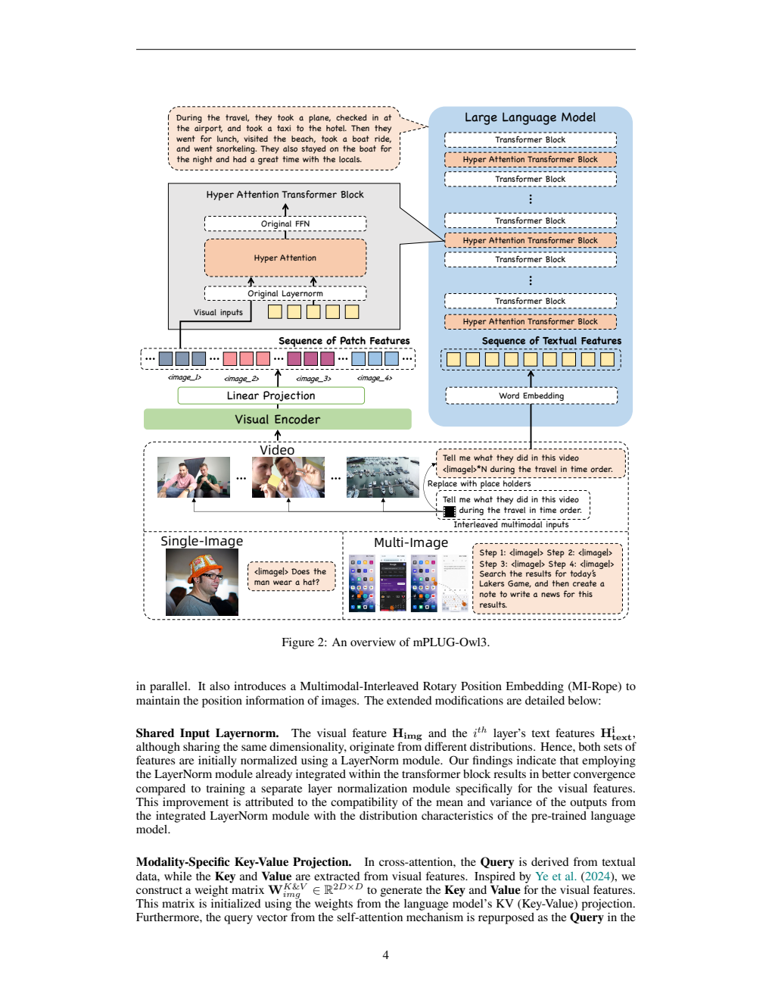
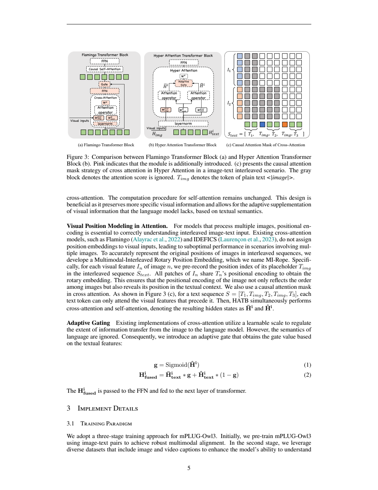
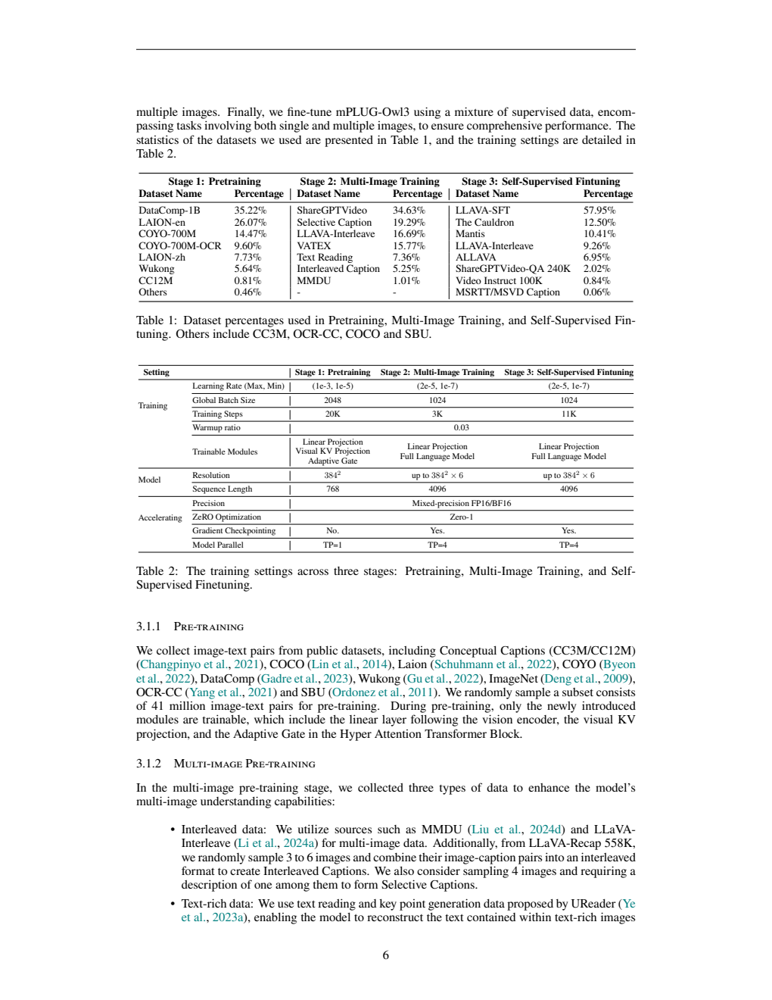
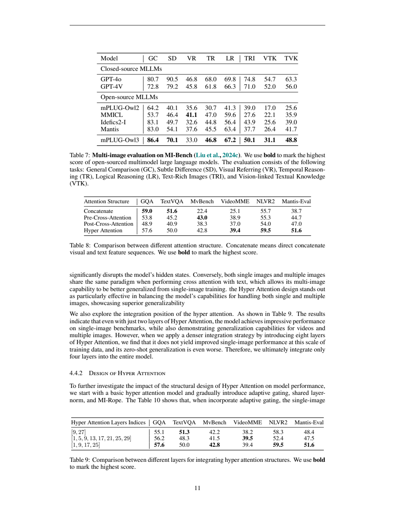

# mPLUG-Owl3：用稀疏 Hyper Attention 读取长图像序列

## 1. 论文信息与模型定位

**论文**：*mPLUG-Owl3: Towards Long Image-Sequence Understanding in Multi-Modal Large Language Models*；**作者**：Jiabo Ye、Haiyang Xu、Haowei Liu、Anwen Hu、Ming Yan、Qi Qian、Ji Zhang、Fei Huang、Jingren Zhou；**机构**：阿里巴巴；**版本**：[arXiv:2408.04840v1](https://arxiv.org/abs/2408.04840v1)，2024 年 8 月 9 日；**项目**：[X-PLUG/mPLUG-Owl](https://github.com/X-PLUG/mPLUG-Owl)。本文依据首版 24 页 PDF。

模型面向单图、多图、交错图文和视频理解，重点解决视觉序列变长后，直接拼接全部视觉 token 占满语言上下文并增加推理开销的问题。主模型使用 SigLIP-400m 与 Qwen2，结果表按约 8B 级模型比较；它在部分 Transformer 层中加入 Hyper Attention，让文字并行读取视觉特征。[原文 §2，PDF 第 3–5 页](https://arxiv.org/pdf/2408.04840v1#page=3)

视频被处理为抽样图像帧，报告主要研究图像内容与文字回答，没有加入声音编码器或生图解码器。长图像序列可用于检索增强、交错历史和长视频，但支持输入很多图片不意味着能持续无损记住全部细节。

## 2. 快速概览

| 要点 | 首版披露 |
|---|---|
| 视觉表示 | SigLIP-400m 特征，经线性投影形成视觉 KV 来源 |
| 语言输入 | 文字序列保留图像占位符，视觉 patch 在交叉注意力路径读取 |
| Hyper Attention | 复用文字 query，视觉专用 KV，共享输入 LayerNorm，自适应门控 |
| 图文位置 | MI-RoPE：每张图的 patch 使用其文字占位符位置，配合因果视觉掩码 |
| 插入层 | 主文为 [0,9,17,25]；消融表的四层为 [1,9,17,25]，版本标注不同 |
| 训练 | 41M 图文预训练，多图预训练，监督指令微调 |
| 主结果 | NLVR2 90.8、Mantis-Eval 63.1、Video-MME 无字幕 53.5 |
| 长序列边界 | 50 图干扰准确率 43.09，400 图为 28.58，容量与正确率须分别看 |

主模型采用 Qwen2，但架构消融采用 **Qwen1.5-7B** 与 LLaVA-1.5 的数据训练策略。消融的 57.6 GQA 等数值不能直接与主模型 65.0 合并成同一训练配置的成绩。[原文 §4.4，PDF 第 10 页](https://arxiv.org/pdf/2408.04840v1#page=10)

## 3. 整体架构

**读图方式**：左侧视觉编码器产生各图 patch 特征，右侧语言模型处理文字及图像占位符。橙色 Hyper Attention 层将视觉信息注入文字状态，其余层继续使用原 Transformer。图像特征没有在每个语言层都以普通文字 token 的形式参加自注意力。

以交错输入 \([T_1,I_1,T_2,I_2,T_3]\) 为例，文字侧成为 \([T_1,T_{img},T_2,T_{img},T_3]\)，视觉侧单独存放投影后的两张图特征。Hyper Attention 同时做文字自注意力和文字到图像的交叉注意力，再融合并送入原 FFN。主模型稀疏选择四层，避免每层都加完整独立视觉分支。[原文 §2.1](https://arxiv.org/pdf/2408.04840v1#page=3)

高分辨率单图根据宽高比选择 (2,2)、(1,3)、(1,4)、(3,1)、(4,1)、(2,3)、(3,2) 等网格，并保留整图。在 SFT 中，文字丰富图像 100% 裁块，普通单图 20%，多图和视频不裁块；评测只对单图启用裁块。Table 2 写最多 384²×6，而正文还说保留全局图、网格最多六块，首版未明确两者计数口径，本文不强行统一为确定的六张或七张。[原文 §3.2，PDF 第 7 页](https://arxiv.org/pdf/2408.04840v1#page=7)

视频默认每条抽取 **8 帧**，在文字中以对应数量的图像占位符表示。定性长视频演示另有更大帧数配置，不能把它替换为默认训练和基准配置。

## 4. 核心创新与数学原理

**读图方式**：粉色表示新增模块。Hyper Attention 的两条 attention operator 共享文字查询，分别读取文字与图像；右侧灰格是被禁止访问的视觉位置。图像占位符之前的文字不能读取后来的图像，保留交错序列的因果关系。

视觉特征与文字隐藏状态先通过已有输入 LayerNorm。视觉 KV 使用专门权重，初始化自语言模型 KV；文字 self-attention query 被复用为视觉 cross-attention query。这比为交叉注意力建立全部独立查询、归一化与 FFN 更轻，也使视觉读取随语言语义变化。[原文 §2.2，PDF 第 4–5 页](https://arxiv.org/pdf/2408.04840v1#page=4)

MI-RoPE 为每张图记录占位符在文字序列中的位置，其所有 patch 共享该交错位置的旋转编码。它表达“这是哪张图、位于哪段文字附近”，并不是为每个 patch 新建二维空间坐标，也不是视频绝对秒数编码。视觉特征本身已有编码器的空间信息，MI-RoPE 补充的是跨图与图文交错位置。

原文将交叉、自注意力输出记为 \(\bar H^i\)、\(\hat H^i\)，Eq. (1)–(2) 为：

\[
g=\operatorname{Sigmoid}(\hat H^i),\qquad
H^i_{fused}=\bar H^i_{text}\odot g+\hat H^i_{text}\odot(1-g).
\]

\(\odot\) 表示逐元素加权。门值随文本状态改变，可在需要图像细节时让交叉分支提供更多信息。首版公式没有展开额外门控权重矩阵，而训练表将 Adaptive Gate 列为可训练模块；本文保留其披露层次，不自行写成一个具体参数化门控网络。[原文 Eq. (1)–(2)](https://arxiv.org/pdf/2408.04840v1#page=5)

该机制减少文字自注意力的序列长度，但视觉特征仍须保存、被交叉注意力读取。图像越多，视觉 KV 和交互计算仍增长；它并不是把几百张图压为零成本的单一向量。稀疏插入有助于限制附加开销，最终容量取决于设备、并行和输入组织。

## 5. 数据构建与处理

**读表方式**：上表给每阶段的来源百分比，下表给学习率、全局 batch、步数与可训练模块。第三阶段表头写 Self-Supervised Finetuning，但 §3.1.3 明确称 Supervised-Finetuning 并使用指令监督数据；本文按正文解释为监督微调。

第一阶段从公开图文来源抽 **41M** 对。主要比例为 DataComp-1B 35.22%、LAION-en 26.07%、COYO-700M 14.47%、COYO-OCR 9.60%、LAION-zh 7.73%、Wukong 5.64%，其余为 CC12M 及较小来源。这些名称是采样来源，不代表用完整 1B、700M 数据训练。[原文 §3.1.1、Table 1](https://arxiv.org/pdf/2408.04840v1#page=6)

第二阶段包括交错图文、文字丰富图像和视频。交错数据使用 MMDU、LLaVA-Interleave；从 LLaVA-Recap 随机取 **3–6 张图**拼接描述，形成 Interleaved Captions；Selective Captions 则给 **4 张图**、只要求描述其中一张。后者直接训练从多个候选里按指令选图。文字数据沿用 UReader 的文字读取及关键点任务，使模型把裁块内容还原成文本结构。视频使用 ShareGPTVideo 与中英文 VATEX，每条采样 8 帧。[原文 §3.1.2，PDF 第 6–7 页](https://arxiv.org/pdf/2408.04840v1#page=6)

该阶段数据比重为 ShareGPTVideo 34.63%、Selective Caption 19.29%、LLaVA-Interleave 16.69%、VATEX 15.77%、Text Reading 7.36%、Interleaved Caption 5.25%、MMDU 1.01%。论文介绍相关视频来源含 900K caption 和 240K QA，但这不等于本阶段独立总样本量。

第三阶段混合 LLaVA-SFT 57.95%、The Cauldron 12.50%、Mantis 10.41%、LLaVA-Interleave 9.26%、ALLaVA 6.95%、ShareGPTVideo-QA 2.02%、Video Instruct 0.84%、MSR-VTT/MSVD Caption 0.06%。报告公开了配比，却未完整给出每阶段去重后条目数、所有数据清洗阈值与污染审计。MI-Bench 评测排除可能含已见 mini-ImageNet 图像的细粒度分类项目，是特定测试处理，不能代替全部来源的污染检查。[原文 §3.1.3、§4.3](https://arxiv.org/pdf/2408.04840v1#page=7)

## 6. 训练流程与目标

第一阶段只更新新增的视觉后线性投影、视觉 KV 和门控，冻结原语言模型与视觉编码器。第二阶段和第三阶段更新线性投影与完整语言模型，视觉编码器仍冻结。作者将未微调视觉编码器与部分文字丰富和低层视觉任务的局限联系起来。[原文 §3.1、§4.2–4.3](https://arxiv.org/pdf/2408.04840v1#page=6)

| 配置 | 图文预训练 | 多图预训练 | SFT |
|---|---:|---:|---:|
| 最大学习率 / 最小值 | 1×10⁻³ / 1×10⁻⁵ | 2×10⁻⁵ / 1×10⁻⁷ | 2×10⁻⁵ / 1×10⁻⁷ |
| 全局 batch | 2048 | 1024 | 1024 |
| 步数 | 20K | 3K | 11K |
| 文字序列长度 | 768 | 4096 | 4096 |
| Tensor parallel | 1 | 4 | 4 |
| 梯度检查点 | 不启用 | 启用 | 启用 |

三阶段 warmup ratio **0.03**，混合精度 FP16/BF16、ZeRO-1。张量并行后正文称单 GPU 显存约 **32–40GB**，但未明确完整训练集群 GPU 型号、总数、总 GPU 时或全部优化器参数；不能由 TP=4 推断整个实验只有四张 GPU。[原文 Table 2、§3.1.2，PDF 第 6–7 页](https://arxiv.org/pdf/2408.04840v1#page=6)

任务学习的含义是根据图像、交错文字与指令生成目标 caption 或答案。首版没有完整写出训练损失和 token 掩码，本文不补写未披露的独立对比损失、图像重建或专门定位目标。Distractor Resistance 是评测构造，不是额外训练阶段。本仓库整理配置，没有运行或复现模型。

## 7. 实验设置与主要结果

主报告评单图、多图与视频。单图 VQAv2/OK-VQA/GQA/VizWizQA/TextVQA 为 **82.1/60.1/65.0/63.5/69.0**；TextVQA 仍低于表中 Idefics2 70.4。MMBench-EN/CN **77.6/74.3**、MM-Vet **40.1**、POPE **88.2**、AI2D **73.4**。正文称 MM-Vet 达同规模最佳，但 Table 4 的 LLaVA-NeXT 是 **43.9**；本文以表为准。AI2D 也低于 MiniCPM 的 78.4。[原文 Table 3–4，PDF 第 8–9 页](https://arxiv.org/pdf/2408.04840v1#page=8)

多图 NLVR2 **90.8**、Mantis-Eval **63.1**、MathVerse-mv **65.0**、SciVerse-mv **86.2**，高于表中 LLaVA-Interleave；BLINK **50.3** 与 Q-Bench2 **74.0** 则低于其 52.6/74.2，显示细节与低层视觉感知并未全面领先。MathVerse/SciVerse 使用 LLaVA-Interleave 发布的多图版本，不应与其他论文的单图原版本直接比数值。[原文 Table 6，PDF 第 10 页](https://arxiv.org/pdf/2408.04840v1#page=10)

视频默认 8 帧设置下，NextQA **78.6**、MVBench **54.5**、Video-MME **无字幕 53.5**、LongVideoBench-val **52.1**。MVBench 低于表中 Video-LLaMA2 54.6；这里不能把无字幕结果与使用字幕的结果混比。[原文 Table 5](https://arxiv.org/pdf/2408.04840v1#page=9)

**读表方式**：Table 7 是 MI-Bench，不是前述六项多图基准的同一个总分。Table 8、9 采用 Qwen1.5 消融配置，衡量结构泛化；不能把主模型 Qwen2 的结果直接归给这些行。

MI-Bench 一般比较 **86.4**，高于表中 GPT-4o 80.7；但细微差异 70.1、时间推理 46.8、文字丰富图像 50.1 仍明显低于 GPT-4o 90.5/68.0/74.8。视觉指代 33.0 还低于开放模型 MMICL 41.1，体现能力并不均匀。

消融的 Hyper Attention 相比直接拼接，在 GQA/TextVQA 为 **57.6/50.0**，略低于拼接 59.0/51.6；MVBench/Video-MME 则为 **42.8/39.4**，高于拼接 22.4/25.1。它在该训练条件下改善多图与视频泛化，同时保留较强单图能力，不能说所有任务都更高。加入 MI-RoPE 后 NLVR2 从 54.9 到 59.5、Mantis 从 46.1 到 51.6，但 GQA 从 58.1 到 57.6，仍有单项权衡。[原文 Table 8–10](https://arxiv.org/pdf/2408.04840v1#page=11)

长序列 Distractor Resistance 将 MMBench dev 的目标图放入 1、5、10、20、50、100、200、400 图序列，其他图随机作为干扰。CircularEval 要求不同选项顺序和干扰条件下都答对才算正确。**50 图 43.09、400 图 28.58**，体现容量扩展伴随明显准确率损失，不是普通 MMBench 单图成绩。[原文 §4.5，PDF 第 12–13 页](https://arxiv.org/pdf/2408.04840v1#page=12)

定性长视频对比在 V100-32GB 上让本文输入 **128 帧**、LLaVA-Interleave **8 帧**，是固定设备容量下的系统展示，不是相同视觉信息量的纯模型对照。作者也记录了人数计数错误、珊瑚礁误认为海滩、白天活动被夜景干扰。首版未给出完整吞吐与延迟协议、置信区间或集群成本，结论宜限定为长序列结构与公开任务中的实际改善，而不扩大为无损长期记忆。[原文 §4.6，PDF 第 13–17 页](https://arxiv.org/pdf/2408.04840v1#page=13)
