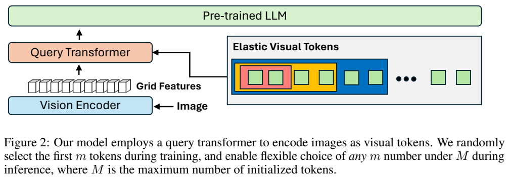
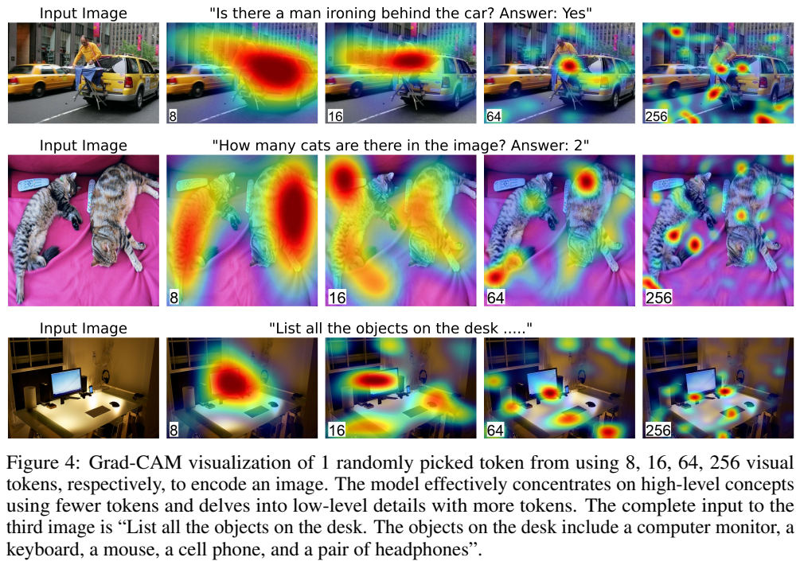
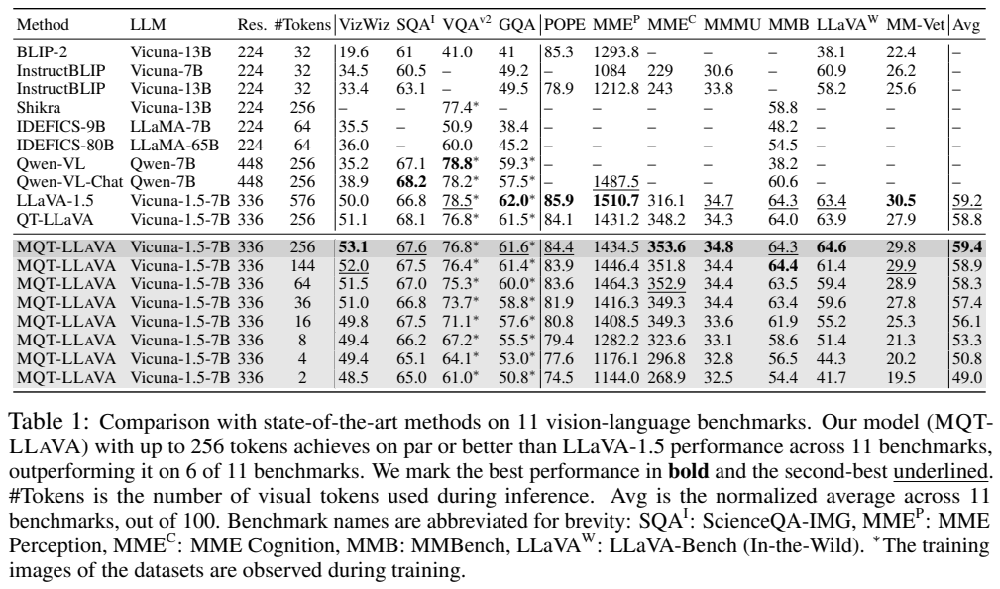
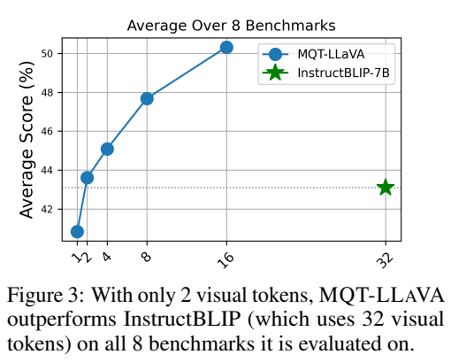
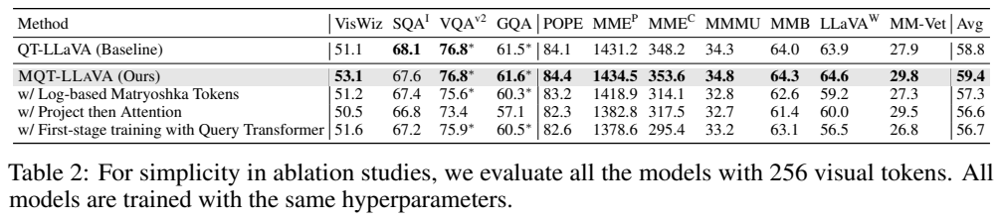

# MQT-LLaVA：用嵌套查询实现可调视觉 token 预算

## 1. 论文信息与模型定位

| 项目 | 信息 |
| --- | --- |
| 论文 | Matryoshka Query Transformer for Large Vision-Language Models |
| 作者与机构 | Wenbo Hu、Zi-Yi Dou、Liunian Harold Li、Amita Kamath、Nanyun Peng、Kai-Wei Chang；UCLA |
| 本文依据 | [arXiv 2405.19315v1](https://arxiv.org/abs/2405.19315v1)，2024-05-29，14 页 |
| 项目 | [MQT-LLaVA](https://github.com/gordonhu608/MQT-LLaVA) |
| 定位 | 基于 LLaVA-1.5 的视觉 token 压缩与弹性推理方法；图像、文本输入，文本输出 |

这里的 Matryoshka 指俄罗斯套娃式的嵌套表示：前面的少量查询本身就是可用的图像表示，追加查询则提高信息容量。它并未发布一个重新预训练的通用语言模型家族，而是在 CLIP 与 Vicuna 之间改变图像信息进入语言模型的方式。评测覆盖图像问答、知识推理、感知和幻觉，未验证视频、音频或图像生成。以下页码均为该版本 PDF 页码。

## 2. 快速概览

LLaVA-1.5 在 336 分辨率下向语言模型输入 576 个图像 token；问题简单时，也要支付这一固定预算。MQT 将图像网格压缩为最多 256 个查询 token，并在指令训练中随机保留查询的前缀，使同一模型支持 2、16、64、144、256 等不同预算。

区别于固定长度的 Query Transformer，MQT 的重点是训练出可独立使用的短前缀。每步仅训练一个随机选出的长度，既建立嵌套表示，也避免在同一步计算许多长度配置的完整损失。推理时由使用者选择预算，论文没有提出自动判断任务难度的调度器。

Table 1 中 256-token 模型的 11 项归一化平均分为 59.4，LLaVA-1.5 为 59.2；64-token 为 58.3。作者按 MMBench 计算的 16-token 配置约使用八分之一 TFLOPs，MMBench 从基线 64.3 降为 61.9。这是计算量比较，不能直接解释为所有硬件上实测响应速度提高八倍。

## 3. 整体架构

**读图：**从下往上是图像、视觉编码器、网格特征、Query Transformer、预训练语言模型。右侧不同长度的彩色矩形共用左侧的前缀，表示一次训练的查询集合来自同一个有序序列，不是从图像网格中随机抽取若干 patch。

视觉编码器为 CLIP ViT-L/14，输入 336×336，得到 24×24 网格共 576 个特征。连接器是一层交叉注意力 Query Transformer，最多有 256 个可学习查询；查询对网格执行 cross-attention，随后通过线性投影匹配 Vicuna-v1.5-7B 的隐藏维度。压缩后的视觉序列与文本一起进入语言模型。

关键顺序是先选择前 $m$ 个查询，再用这些查询读取网格。它并非先计算完整的 256 个输出，再在语言模型输入端丢弃尾部。网格仍由视觉编码器完整提取，减少的主要是连接器输出和语言模型处理的视觉序列长度。论文的结构消融支持“注意力后投影”优于“投影后注意力”，不能把两种连接器配置视为等价实现。

## 4. 核心创新与数学原理

设网格为 $G=[g_1,\ldots,g_{HW}]$，可学习查询为 $Z=[z_1,\ldots,z_M]$，最大长度 $M=256$。选择预算 $m$ 后，原文的视觉表示可写为

$$
V_m=Q(Z_{1:m},G).
$$

这里 $Q$ 是查询变换器；末端线性投影负责对齐语言模型维度。常规 Matryoshka Representation Learning 对若干嵌套配置同时优化 $\sum_m c_m\mathcal L(f_m(x),y)$，往往需要每步做多个配置的前向与反向。MQT 改为每步抽一个 $m$，原文 Eq. 2 使用

$$
\mathcal L_m=c_m\mathcal L\bigl(\mathrm{LM}(V_m,q),y\bigr),\qquad c_m=1.
$$

$q$ 为问题，$y$ 为答案。用期望 $\mathbb E_{m\sim p(m)}\mathcal L_m$ 理解整个训练过程，是对随机训练的解释；它不意味着论文每步同时计算全部长度。第二阶段从 $2,4,\ldots,256$ 中线性均匀抽样，保留**前缀**，不是随机删除任意查询。前部查询更频繁地参与梯度更新，因此要承担低预算下的基本信息表达；后部查询能补充细节。

**读图：**每行是一个问题，从左至右为原图和 8、16、64、256 个 token 下的热图。桌面样例随预算增大呈现更多局部物体。需要注意，图注说明每幅热图针对一个随机选中的 token，并非所有 token 的平均注意力，也不是每个查询对应一个物体的标注证据。它说明表示关注范围可能变化，不能据此证明每个 token 都具有稳定、可解释的语义。

短序列对知识题的影响较小，细节题往往下降更多；但这并不证明模型只凭语言知识作答。论文未提供完全移除图像的对应因果实验，预算与能力之间也不保证对每个问题单调。

## 5. 数据构建与处理

MQT 沿用 LLaVA 的两阶段数据。第一阶段使用约 558K 图文对做对齐，第二阶段使用约 665K 视觉指令样本；文章没有另行构建新的大规模图像语料，也没有独立公布一套新增标注或复杂清洗流程。

图像经过 CLIP 的 336 分辨率编码；查询前缀的随机长度才是本工作的训练处理重点。这种扰动在连接器上改变视觉信息容量，不能等同于随机图像裁剪或训练不同输入分辨率。训练和评测中使用的图像分辨率保持一致。

Table 1 的 VQAv2 与 GQA 分数带星号，图注明确相应数据集的训练图像在训练中可见。因此这些结果属于论文指定协议，不能统称为对完全未见过图像的数据集做零样本评测。附录还测试了训练抽样集合中没有的奇数长度 77，验证的是长度配置泛化，而非全新模态或新数据来源泛化。

## 6. 训练流程与目标

| 阶段 | 数据与预算 | 更新范围 | 原文配置 |
| --- | --- | --- | --- |
| 图文对齐 | 558K；固定全部 256 个查询 | 训练 Query Transformer，冻结视觉编码器与语言模型 | 1 epoch，batch 256，学习率 $10^{-3}$ |
| 指令微调 | 665K；每步随机偶数查询前缀 | Query Transformer 与语言模型，视觉编码器冻结 | 2 epochs，batch 128，学习率 $2\times10^{-5}$ |

两阶段均使用语言生成损失完成图像到文本的对齐；第二阶段通过随机前缀将这一损失分摊到多种推理预算。原文没有提出独立的查询排序监督、蒸馏教师或新的视觉重建损失。文中把第一阶段可训练模块统称为 Query Transformer，未把连接器末端投影的冻结状态另列，本文不进一步推断。

作者报告使用 8 张 NVIDIA A6000，两个阶段分别约 4 与 30 小时；这些是作者环境数据，未在本仓库复现。论文没有给出足以复原全部训练细节的优化器、调度与序列长度清单。第一阶段始终保留全部查询也有消融依据：在尚未对齐时就加入弹性预算，会削弱高质量的基础视觉表示。

## 7. 实验设置与主要结果

**读表：**同一个 MQT 模型按不同 token 数分行；横向为 11 个基准。MME 感知与认知是原始分数，其他指标也并非全都同一种评分；最后 Avg. 是归一化到 100 后的平均，不能把 MME 原始分直接与准确率相加。Figure 3 是与 InstructBLIP 在共同的八项任务上的平均比较，与 Table 1 的 11 项 Avg. 范围不同。

| 模型/预算 | VizWiz | ScienceQA-IMG | MMMU | MMBench | MM-Vet | 11 项 Avg. |
| --- | ---: | ---: | ---: | ---: | ---: | ---: |
| LLaVA-1.5 / 576 | 50.0 | 66.8 | 34.7 | 64.3 | 30.5 | 59.2 |
| 固定 QT / 256 | 51.1 | 68.1 | 34.3 | 64.0 | 27.9 | 58.8 |
| MQT / 256 | 53.1 | 67.6 | 34.8 | 64.3 | 29.8 | 59.4 |
| MQT / 144 | 52.0 | 67.5 | 34.4 | 64.4 | 29.9 | 58.9 |
| MQT / 64 | 51.5 | 67.0 | 34.4 | 63.5 | 28.9 | 58.3 |
| MQT / 16 | 49.8 | 67.5 | 33.6 | 61.9 | 25.3 | 56.1 |
| MQT / 2 | 48.5 | 65.0 | 32.5 | 54.4 | 19.5 | 49.0 |

256-token 配置总体接近基线且平均略高，但不是全面超过：VQAv2 76.8 对 78.5、GQA 61.6 对 62.0、POPE 84.4 对 85.9、MME 感知 1434.5 对 1510.7、MM-Vet 29.8 对 30.5 均较低。64-token 平均比 LLaVA 低 0.9 分，说明中等预算有较好整体折中；2-token 的综合表现则明显下降。ScienceQA-IMG 从 MQT-256 的 67.6 降至 65.0，MMMU 从 34.8 降至 32.5，相对细节任务更耐压缩，但不应将原文的概括百分数当作百分点。

计算量测算以 MMBench 为例，256、144、16 个 token 分别约为 LLaVA 的二分之一、三分之一、八分之一 TFLOPs。论文未给出对应完整的墙钟延迟、吞吐、KV 缓存和能耗测量，因此部署收益仍取决于硬件与实现。附录 Table 3 中未训练过的 77-token 配置 Avg. 58.3、MMBench 64.0，支持在最大 256 以内灵活选长度；没有证据支持直接外推到更多查询。

**读表：**所有消融都固定用 256 个视觉 token 评测。完整 MQT 的 Avg. 59.4；改成偏向小长度的对数采样为 57.3，先投影后注意力为 56.6，在第一阶段也实施弹性训练为 56.7。分别下降 2.1、2.8、2.7 个归一化分。最后一行名称容易与常规第一阶段 Query Transformer 训练混淆，应结合第 4.3 节理解为提前加入 Matryoshka 训练，而不是说主模型没有第一阶段对齐。

这项研究提供的是可调的计算与质量曲线。低预算能减少语言模型的视觉序列负担，高预算通常有利于细节；实际应用还需要按任务验证预算，原文没有给出统一的自动预算策略。
