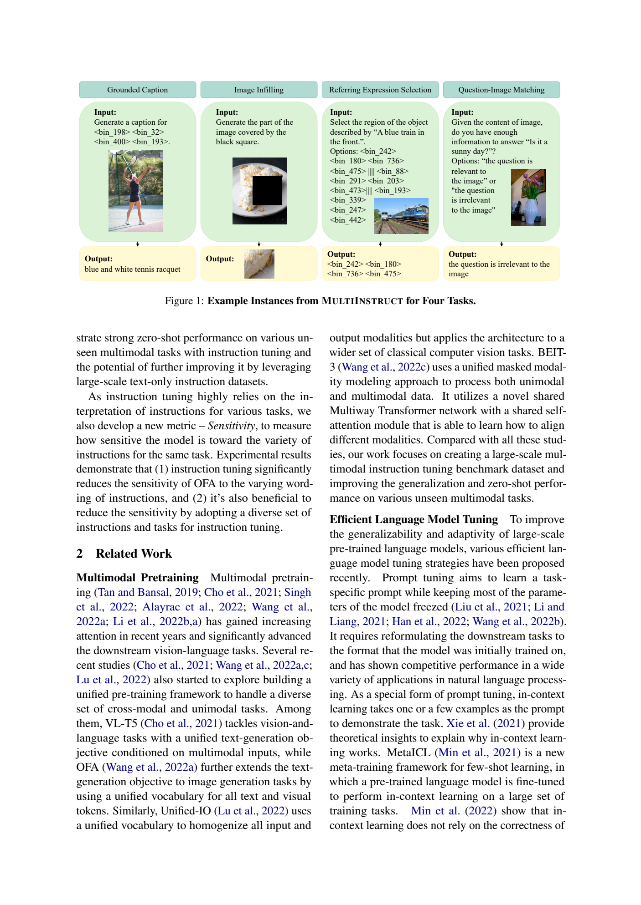
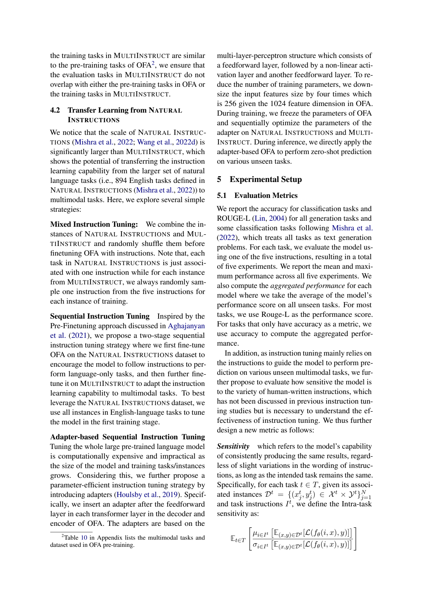
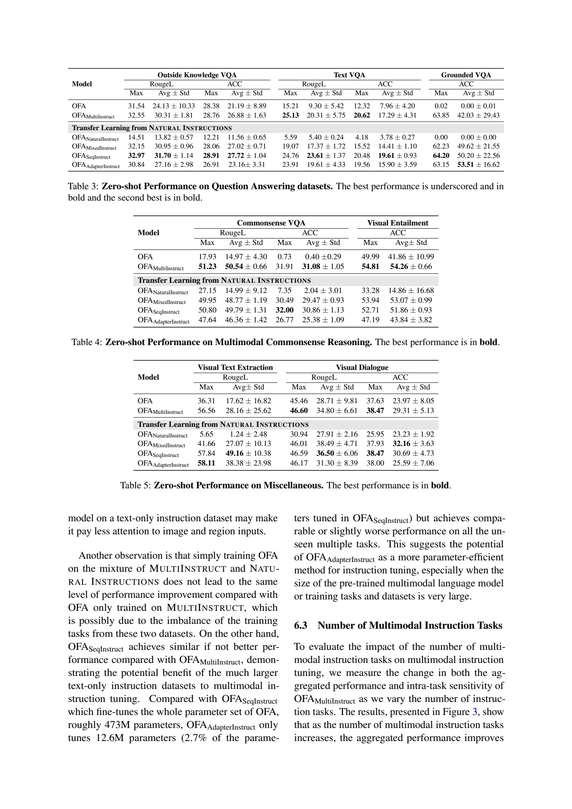
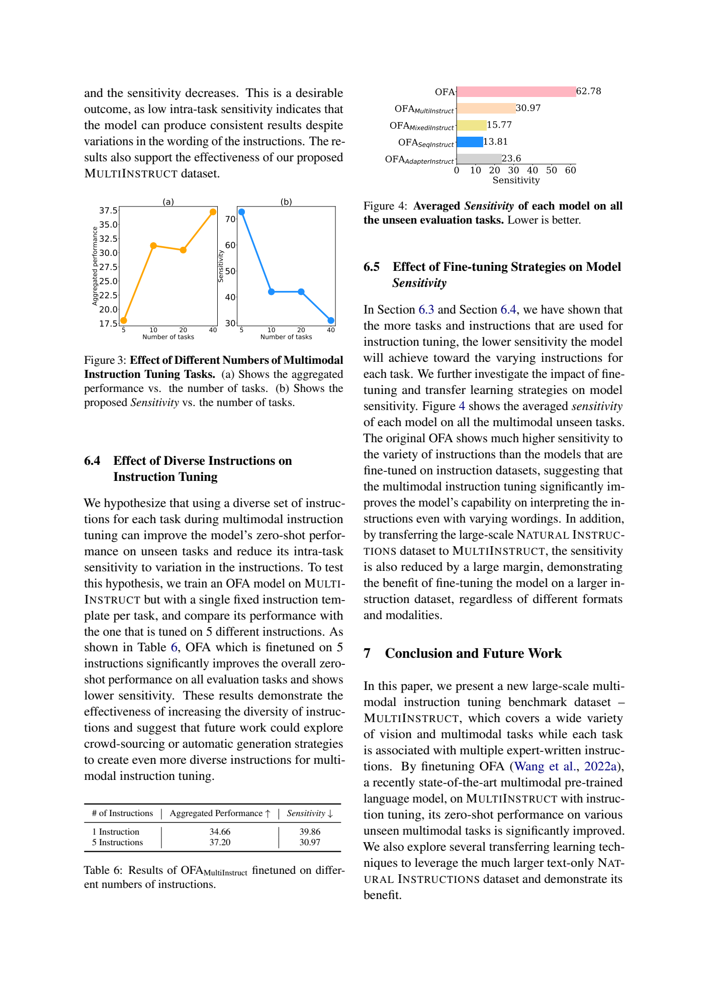

# MultiInstruct：以多任务指令微调改善多模态零样本泛化

## 1. 论文信息与模型定位

| 项目 | 信息 |
|---|---|
| 原文 | [MultiInstruct: Improving Multi-Modal Zero-Shot Learning via Instruction Tuning](https://arxiv.org/abs/2212.10773) |
| 作者与机构 | Zhiyang Xu、Ying Shen、Lifu Huang；Virginia Tech，前两位共同一作 |
| 本文依据 | arXiv **2212.10773v1**，2022 年 12 月 21 日，16 页 |
| 工作类型 | 多模态指令数据集、跨任务评测及迁移学习方法 |
| 实验模型 | 约 **472M** 参数的 OFA-large；正文另一处约记为 473M |

MultiInstruct 的研究问题是：已经能处理图像、文字和区域的预训练模型，能否通过自然语言指令学习一批任务，再直接执行没有在指令训练中见过的新任务？它采用 OFA 的编码器—解码器结构，新增重点是任务组织、专家编写的指令、文本指令迁移和评测协议。这里的“零样本”指未针对七个评测任务做指令微调，并不意味着没有预训练知识，也不是今天以数十亿参数聊天模型为主体的产品发布报告。

## 2. 快速概览

数据集包含 **47 个任务、11 个类别**，每个任务有 **5 个专家编写的指令模板**。作者报告这些任务来自 54 个数据集，既包括已有视觉任务，也将已有标注重组为区域匹配、候选选择等新任务。训练使用 40 个任务，评测保留 7 个任务，训练时每个任务最多采样 10,000 个实例。

关键发现有三点。第一，仅在 MultiInstruct 上微调，就能让 OFA 更好地按指令输出答案或位置 token，例如 Grounded VQA 平均准确率由接近零升到 42.03。第二，直接只做文本指令微调可能削弱多模态表现；先文本、再多模态的顺序训练，在 OCR 等任务上更有效。第三，同一任务提供不同表述的指令，能提高跨任务平均表现，但并不能保证每个任务的所有表述都同样可靠。

**读图：**Figure 1 依次展示区域描述、图像补全、指代表达区域选择和问题—图像匹配。第三例的目标直接是四个位置 token；第四例要判断图像能否支持问题，而不是凭语言先验回答天气。它说明统一指令接口必须表达不同的输出类型，不能仅训练“看图生成一句话”。图像补全也确实在训练任务中，但七个下游评测任务并没有系统测量生成图像质量。

## 3. 整体架构

OFA 的 Transformer 编码器接收填入具体数据的任务指令，以及可选图像；解码器自回归地产生目标序列。文本采用 BPE。对于**目标图像**，论文沿用 VQ-GAN 将图像量化为离散图像 token；区域框的四个角点坐标离散为 1,000 个位置桶，例如 `<bin_242>`。这些类型共用词表和序列生成接口。本报告没有重新披露完整 OFA 视觉编码器规格，因此不根据其他版本补入层数、图像分辨率或特征提取器配置。

分类也用生成方式表达：模板中的 `[Options]` 标记候选开始，`||||` 分隔选项，模型生成所选候选内容。没有输入图像的文本任务使用黑色占位图，保持统一调用形式。统一词表不等于所有输入图像都先经过 VQ-GAN；本文明确将图像量化用于目标图像，输入图像的预处理则引用 OFA。

迁移实验保留同一基础网络，比较三种训练路径：把文本与多模态样本混合；先文本微调，再多模态微调；或冻结 OFA，只顺序训练附加的 Adapter。Adapter 安装在编码器和解码器各 Transformer 层的前馈层之后，以 **1024→256→1024** 的瓶颈 MLP 降低可训练参数量。它不是通过低秩分解修改权重的 LoRA，论文报告其可训练参数约 **12.6M，约占原模型 2.7%**。

## 4. 核心创新与数学原理

第一项机制是将“任务身份”从固定输出头转成自然语言条件。设训练任务为 \(t\)，指令模板集合为 \(I_t\)，样本为 \((x,y)\)。本文用下式解释其监督学习流程，**这是标准自回归目标的整理，并非原文编号公式**：

\[
\mathcal L_{\rm IT}(\theta)=
\mathbb E_{t,(x,y),\,i\sim\mathrm{Uniform}(I_t)}
\left[-\sum_{j=1}^{|y|}\log p_\theta(y_j\mid y_{<j},x,i)\right].
\]

其中 \(x\) 可以包含图像、区域和候选，\(y\) 可以是文字、框坐标或图像代码。随机抽取指令，使模型不能始终依赖某个固定句式。每个训练批次对实例抽取一套模板，并不等于将全部实例固定复制五遍。不同任务共享网络也不等于任务难度、类别分布已完全平衡。

第二项机制是将复杂标注拆成相关的简单任务。已有区域描述可以重组为“给区域选描述”和“给描述选区域”，让模型学习区域与语言之间的双向对应，而无需另行采集完整标注。正文第 3.1 节对 Visual Grounding 的例子描述与附录任务定义有混用，本文采用附录的明确区分：区域描述输出文字，视觉定位输出框。

第三项贡献是考察**指令敏感度**。令 \(s_{t,i}\) 为任务 \(t\) 使用指令 \(i\) 的评测分数，\(\mu_t\)、\(\sigma_t\) 分别为五套指令分数的均值与标准差。第 6 页打印的公式实际上是：

\[
S_{\mathrm{printed}}=\mathbb E_t[\mu_t/\sigma_t].
\]

**核对说明：**图中分子确为均值、分母确为标准差；第 7 页又明确 \(\mathcal L\) 表示准确率或 ROUGE-L 等评测指标。可是正文和 Figure 4 将较小值解释为更稳定。当均值不变、标准差变小时，打印的 \(\mu/\sigma\) 会变大，因此公式与“越低越好”的说明存在实质矛盾。通常用于相对波动的变异系数是 \(\sigma/\mu\)，但这只是解释这种矛盾的标准统计定义，**不能据此声称作者实现已得到核验，也不能悄悄把原文改成倒数**。均值或标准差为零时还需要额外数值处理，报告未披露。本文保留作者报告的敏感度数值，同时将这一复现问题明确记录。

## 5. 数据构建与处理

作者先收集 26 类已有任务，再派生 21 类相关任务，按问答、图像描述、区域生成、图文匹配、区域匹配、视觉关系、属性、图像生成、常识推理、时间顺序和其他任务组织。基础数据涉及 COCO、Visual Genome、VQAv2、GQA、RefCOCO、COCO-Text、VCR、SNLI-VE 等；WikiHow 的图文步骤被重组为下一步生成、下一步选择和前后顺序判断。每个派生任务原始实例规模为约 5,000–5M，实际训练则应用每任务 10,000 条的上限，所以不能把来源数据全部相加当作训练量。

指令由两位 NLP 专家完成。每人阅读任务目标、格式和随机抽取的 10 个实例，各写 2–3 个模板；随后互审是否能单凭指令识别任务，再共同消除重复、冲突和歧义，最后保留五套模板。这些是人工任务说明，不是通过大模型批量生成图像描述。模板中的 `<TEXT>`、`<REGION>`、`<OPTION>` 在样本格式化时替换为具体内容。

训练任务选取与 OFA 预训练相似、或被专家判断为较基础的技能；测试任务则强调组合与复杂技能。七个评测任务为：OK-VQA 外部知识问答、TextVQA、Visual7W 的区域问答、VCR 常识问答、SNLI-VE 视觉蕴含、从 Hateful Memes 图像提取文字，以及 Visual Dialogue。作者强调**任务**不与 OFA 预训练及 MultiInstruct 训练任务重合；这不是完整的图像 ID 或网络数据去重证明。附录 Table 9 将文字提取标为新任务，而 Table 2 将七个评测任务均计为已有任务，统计归类也有小处不一致。

文本迁移数据使用 Natural Instructions 中 **894 个英语任务**，顺序训练第一阶段使用其全部英语实例。实验中的这个数字不同于相关工作部分提到的早期 61 任务版本。文本任务各只有一个说明，多模态任务各有五套，因此混合时两种数据不仅模态不同，任务数与指令多样性也不同。

## 6. 训练流程与目标

| 设置 | 实际训练路径 |
|---|---|
| OFA | 直接使用预训练模型，作为未指令微调基线 |
| MultiInstruct | 混合、打乱 40 个多模态训练任务，随机选模板做微调 |
| NaturalInstruct | 仅做文本指令微调 |
| MixedInstruct | 混合文本和多模态实例后微调 |
| SeqInstruct | 先 Natural Instructions，再 MultiInstruct，全模型微调 |
| AdapterInstruct | 同样顺序训练，但 OFA 冻结，只更新 Adapter |

正文公开的共同配置为：**8 张 Nvidia A100、每 GPU batch size 8、学习率 \(10^{-5}\)、float16、各设置和数据集训练 3 个 epoch**，最大输入长度 1024、最大目标长度 512。每卡批量相加得到每次并行前向的 64 个实例，但报告没有说明梯度累积，因此不将 64 强写成最终有效全局批量。顺序训练的两种数据按报告设置分别训练，不能理解为全部过程合计只有三个 epoch。

报告没有完整给出优化器、权重衰减、学习率调度、随机种子和具体图像预处理尺寸，而是引用 OFA 原论文。实验是监督式生成训练，没有引入奖励模型、DPO 或强化学习。为避免只做文本微调的模型被新格式 token 额外影响，作者对 NaturalInstruct 基线测试模板去掉 `[Options]` 和 `||||`；这项协议调整应随结果一并理解。

## 7. 实验设置与主要结果

每个测试任务分别使用五套指令运行评测，Table 3–5 给出最大值和均值±标准差。这里的标准差是**五种指令表述之间的变化**，不能当作五个训练随机种子的置信程度。分类主要用准确率，生成用 ROUGE-L，部分分类同时报告两者；综合分数对任务取平均，优先使用 ROUGE-L，仅有准确率的任务使用准确率，因此它是异质任务指标的平均，并非统一的总正确率。

| 任务／指标，五指令平均 | OFA | MultiInstruct | SeqInstruct | AdapterInstruct |
|---|---:|---:|---:|---:|
| OK-VQA 准确率 | 21.19 | 26.88 | 27.72 | 23.16 |
| TextVQA 准确率 | 7.96 | 17.29 | 19.61 | 15.90 |
| Grounded VQA 准确率 | 0.00 | 42.03 | 50.20 | 53.51 |
| VCR 常识问答准确率 | 0.40 | 31.08 | 30.86 | 25.38 |
| 视觉蕴含准确率 | 41.86 | 54.26 | 51.86 | 43.84 |
| 图中文字提取 ROUGE-L | 17.62 | 28.16 | 49.16 | 38.38 |
| Visual Dialogue 准确率 | 23.97 | 29.31 | 30.69 | 25.59 |

**读表：**多模态指令微调提升了所有上述平均指标，但提升不等于输出已普遍可靠。Grounded VQA 的 MultiInstruct 为 **42.03±29.43**，最佳模板为 63.85，显示极强的表述依赖；视觉文字提取为 **28.16±25.62**。顺序文本迁移在文字提取上升到 49.16±10.38，然而视觉蕴含低于只用 MultiInstruct 的结果。只训练 Adapter 的区域问答平均最好，其他若干任务却明显下降，所以参数效率存在任务取舍。

仅文本微调也不能直接替代多模态训练。例如 NaturalInstruct 的 OK-VQA 准确率为 11.56，TextVQA 为 3.78，视觉蕴含为 14.86，均低于原 OFA。作者提出视觉—语言对齐变化、图像关注减少等可能解释，但没有用干预实验逐项证实。混合文本和多模态实例同样未全面胜过顺序训练，不能把“文本任务更多”直接当作必然更强。

**读图：**Figure 3 比较 5、10、20、40 个训练任务，40 个任务总体表现最高；10→20 的性能有小幅下降，曲线不是严格单调。Table 6 将固定一套模板与五套模板比较，综合表现由 **34.66→37.20**，作者报告的敏感度由 **39.86→30.97**。Figure 4 报告 OFA、MultiInstruct、混合、顺序和 Adapter 的敏感度分别为 **62.78、30.97、15.77、13.81、23.6**。这些趋势支持多样指令与迁移训练的价值，但敏感度公式方向问题仍须通过代码验证，较低敏感度也不能单独证明较高任务正确率。

这项工作提供了重要的早期证据：统一多模态预训练能力需要通过任务指令明确转成可执行接口，而新任务表现同时依赖训练技能覆盖和指令表述。其结论限定于 OFA-large、这套任务划分及公开评测协议；本文未运行模型，也未将报告结果扩展为对现代聊天大模型的性能保证。
