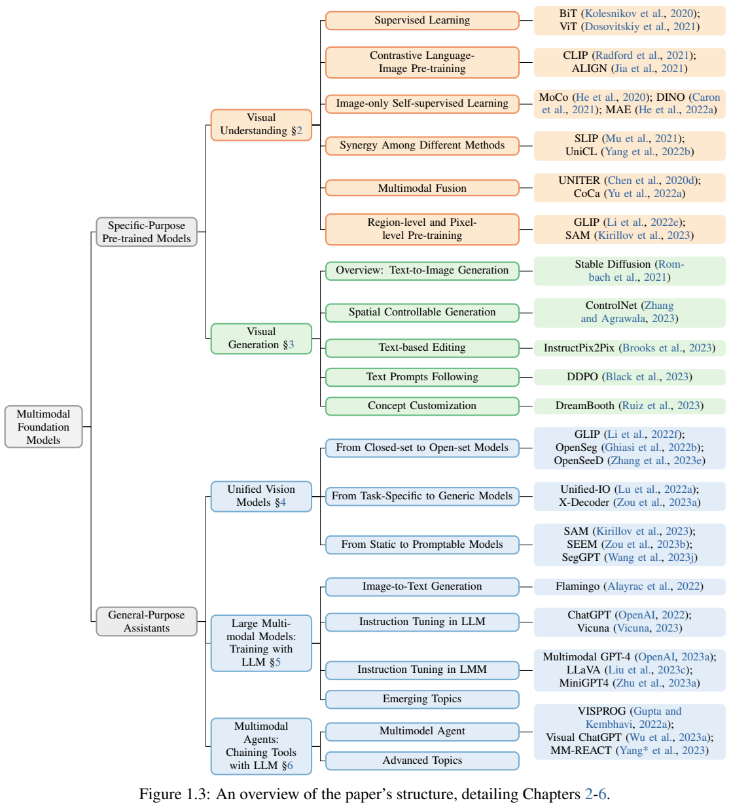
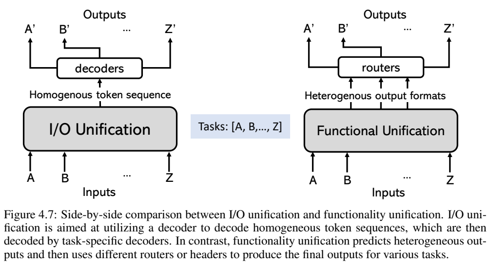
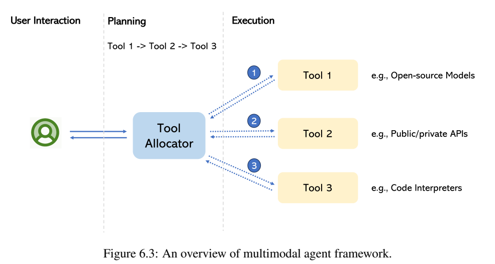
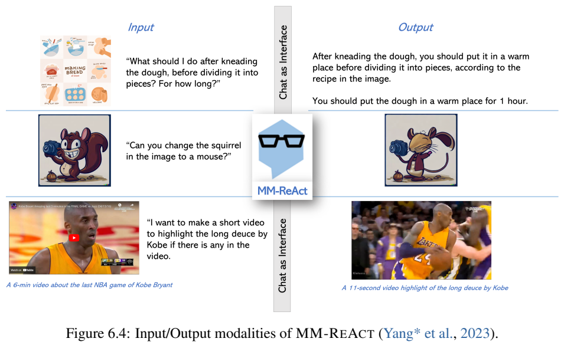
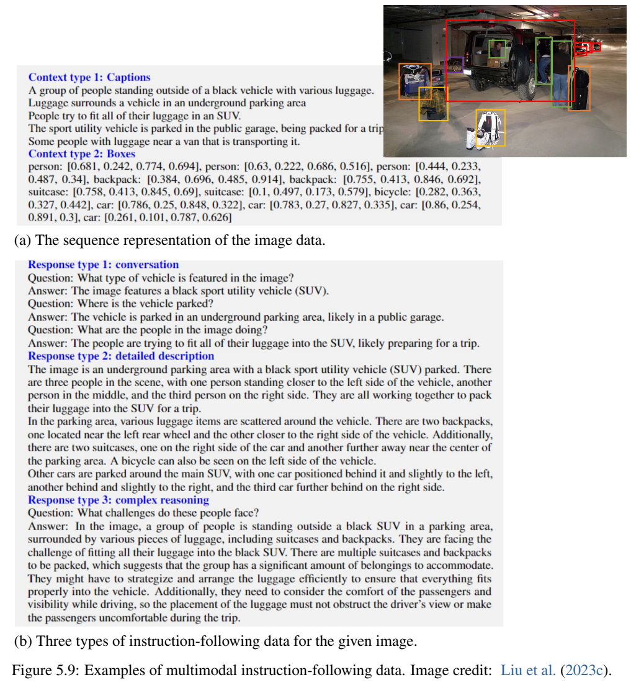
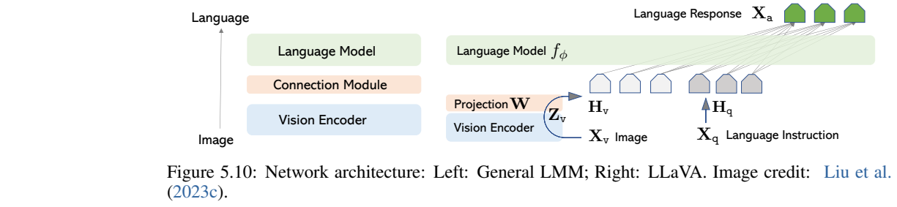

<!-- article-header:start -->
[项目首页](../../../README.md) › [模型系列](../../../reports/model-family-index.md) › [Multimodal Foundation Models Survey](../README.md)
<!-- article-header:end -->

# Multimodal Foundation Models：从视觉专用模型到通用多模态助手

<!-- article-toc:start -->

**本篇目录** · [论文定位](#paper-info) · [快速概览](#overview) · [整体架构](#architecture) · [核心原理](#principles) · [数据构建](#data) · [训练流程](#training) · [实验结果](#experiments)
<!-- article-toc:end -->

## 1. 论文信息与模型定位

| 项目 | 内容 |
| --- | --- |
| 原文题名 | Multimodal Foundation Models: From Specialists to General-Purpose Assistants |
| 作者 | Chunyuan Li、Zhe Gan、Zhengyuan Yang、Jianwei Yang、Linjie Li、Lijuan Wang、Jianfeng Gao |
| 团队与日期 | 原文署名 Microsoft，2023 年 9 月 18 日；个别作者的后续任职见原文脚注 |
| 本文依据 | [arXiv 2309.10020v1，119 页 PDF](https://arxiv.org/pdf/2309.10020v1) |
| 文献性质 | 面向视觉与视觉语言领域的长篇综述，结合 CVPR 2023 教程；没有发布名为“Multimodal Foundation Models”的新模型 |
| 定位 | 解释视觉理解、生成、统一视觉模型、视觉指令微调和多模态工具代理之间的关系 |

这篇文献适合作为仓库的技术路线入口。它讨论的“基础模型”不只包括聊天式视觉语言模型，也包括 CLIP、图像自监督骨干、扩散生成模型和可提示分割模型。作者把这些专长组件放入一个更大的问题：怎样让系统根据人的意图，在开放环境中完成多种视觉任务？全文主体见第 5–91 页，后面主要是参考文献。本文保留 2023 年的时间背景，不把其中“当前”“最新”的判断解释为今天的排行榜结论。[PDF 第 1、5–11 页](https://arxiv.org/pdf/2309.10020v1#page=5)

## 2. 快速概览

综述采用“两类、五个主题”的组织方式：

| 大类 | 主题 | 核心问题 | 文中代表 |
| --- | --- | --- | --- |
| 专用基础模型 | 视觉理解 | 怎样学到可迁移的图像、区域和像素表示？ | CLIP、MAE、GLIP、SAM |
| 专用基础模型 | 视觉生成 | 怎样生成符合描述、布局、编辑要求和特定主体的图像？ | Stable Diffusion、ControlNet、InstructPix2Pix、DreamBooth |
| 通用助手 | 统一视觉模型 | 怎样把不同任务、输出粒度和交互提示放入同一模型？ | Unified-IO、X-Decoder、SEEM、SegGPT |
| 通用助手 | 与 LLM 联合训练 | 怎样让语言模型理解图像并遵循视觉任务指令？ | Flamingo、BLIP-2、LLaVA、MiniGPT-4 |
| 通用助手 | 用 LLM 串联工具 | 怎样让语言模型规划、调用视觉专家并整合结果？ | VISPROG、Visual ChatGPT、MM-ReAct |

**读图方式。** Figure 1.3 左侧先分专用预训练模型与通用助手；右侧依次展开监督信号、生成控制方式、任务统一方式、指令训练与工具调用。颜色标的是主题类别，连线标的是论述层级，没有实验性能轴。它提示读者：基础能力、自然语言接口和执行工具是不同层次，同一个系统可以组合多个层次。[PDF 第 10 页](https://arxiv.org/pdf/2309.10020v1#page=10)

全文最有价值的判断是，**会描述图像、会按指令做事、会输出空间结果、会调用工具，并不自动相互包含**。例如 CLIP 的跨模态相似度不能替代精细分割；一个会聊天的模型也可能无法准确定位对象；工具系统能完成视频剪辑，并不表示其语言模型自己生成了视频。作者将这些能力的结合视为研究方向，同时承认视觉数据、任务形式和标注成本比纯语言更不均匀。[PDF 第 23–26、42–43、59–60、85 页](https://arxiv.org/pdf/2309.10020v1#page=59)

## 3. 整体架构

**视觉理解从监督信号展开。** 标签监督把图像映射到预设类别；图文对比学习把图像与文本分别编码，学习共享语义空间；图像自监督则从两种增强视图或被遮挡内容中构造学习信号。它们通常先产生视觉骨干，再通过跨模态融合、区域对齐或像素任务适配细粒度应用。因此，预训练方式与最终的问答、检测、分割接口需要分开看。[PDF 第 12–26 页](https://arxiv.org/pdf/2309.10020v1#page=12)

**生成模型有内容表示和条件注入两条路径。** 以综述中的 Stable Diffusion v1 为例，VAE 把 RGB 图像压到连续潜变量，文本编码器产生条件，U-Net 在潜空间逐步去噪，再由 VAE 解码。控制布局时，可以把坐标写成附加 token，也可以加入边缘、深度、姿态等二维条件；编辑还要利用输入图像的信息。本文讨论的 v1 配置不能直接外推到 SDXL 等其他版本。[PDF 第 29–35 页](https://arxiv.org/pdf/2309.10020v1#page=30)

**统一视觉模型有两种不同架构目标。**

Figure 4.7 左侧将各任务转成同类 token 序列，再由相应解码器恢复文本、框或稠密图；右侧保留语义嵌入、空间结果等异质输出，用路由或任务头组合结果。箭头从下向上，表示输入经过统一模块再转为任务输出。“统一”不意味着所有任务必须采用同一个输出表示。前者便于复用序列建模，代价是视觉离散化及长序列；后者可以保留空间结构，代价是更复杂的模块、路由和训练设计。[PDF 第 49–55 页](https://arxiv.org/pdf/2309.10020v1#page=50)

Unified-IO 先学习不同任务的 VQ-VAE，再把 90 个数据集联合用于 Transformer 编码器—解码器训练。X-Decoder 则让潜在查询和文本查询共享解码器，输出像素掩码和语义嵌入，依任务采用不同路由。可提示接口进一步允许点击、框、涂画、参考图等输入；SEEM 用视觉采样器取出指定位置的特征，视觉上下文学习则利用示例图及对应标注告诉模型“这次要做什么”。[PDF 第 52–59 页](https://arxiv.org/pdf/2309.10020v1#page=53)

**视觉语言模型与工具代理的连接位置不同。** 前者把视觉表示接到语言模型，训练它直接产生条件化文本；后者让语言模型作为工具分配器，调用外部模型、API 或代码，把返回的观察用于下一步规划和回答。

Figure 6.3 中央是 Tool Allocator，右侧是开源模型、API 和代码解释器；虚线双向箭头表示调用及结果返回。下方 Figure 6.4 展示问答、图像编辑、视频片段生成等系统级案例。图像和视频输出由工具链完成，不能据此推断语言模型权重具有相同生成能力。MM-ReAct 中，文件路径充当图像占位符，OCR、检测、描述等工具提取的信息被序列化为文本，再交给当时仅接收语言输入的 ChatGPT。[PDF 第 79–83 页](https://arxiv.org/pdf/2309.10020v1#page=80)

## 4. 核心创新与数学原理

本文的贡献主要是分类和关系梳理，以下公式解释它所综述的机制，均不表示作者提出一个新模型训练目标。

**开放词汇识别：把固定分类器变成概念文本编码。** 原文公式 (4.1)–(4.2) 将传统类别权重 $`w_c`$ 替换为文本编码器输出。可写为：

$$
P(y=c\mid u)=\frac{\exp(v_c^\top u)}{\sum_i\exp(v_i^\top u)},
\qquad
v_c=\mathrm{Enc}_{text}(\mathrm{Concept}_c).
$$

$`u`$ 是视觉特征，概念集合可以在推理时由文字提供。关键是大规模图文对齐让文本特征具备可迁移语义，不是简单更换分类器名字。不过，整图语义对齐缺少定位监督，检测和分割仍要建立区域或像素与短语的对应关系。原文也区分严格开放词汇评测与允许训练、测试类别重叠的泛化评测，二者不能混称“完全未见类别”。[PDF 第 44–46 页](https://arxiv.org/pdf/2309.10020v1#page=44)

**掩码建模：相同框架可以学习不同层次。** MAE 用像素重建，BEiT 用离散视觉 token，部分方法回归 CLIP 或动量教师的特征。下面是便于对照的概念式，并非原文统一编号公式：

$$
\mathcal L_{\mathrm{mask}}=\sum_{i\in M}\ell(\hat t_i,t_i).
$$

掩码位置集合 $`M`$、目标 $`t_i`$ 和损失 $`\ell`$ 决定实际方法：离散目标常用交叉熵，连续像素或特征常用回归或余弦损失。原文举 MAE 约 75% 掩码和视频 MAE 高达 90% 的实例，不将其规定为全领域的固定比例；同时提醒，普通 MIM 并不必然直接学到强全局图像表示，添加全局自蒸馏与扩大数据规模都需要具体验证。[PDF 第 19–23 页](https://arxiv.org/pdf/2309.10020v1#page=20)

**语言生成的统一目标取决于输出如何编码。** 原文公式 (4.3)：

$$
\mathcal L(\theta)=-\sum_{t=1}^{T}\log p(s_t\mid s_{<t},v;\theta).
$$

当 $`s_t`$ 是自然语言，它对应图像描述或回答；当序列同时包含类别及量化坐标，可以表示检测或定位；稠密图需要更合适的视觉 tokenizer。相同的自回归损失并不保证相同能力，区别在于视觉输入、目标表示、任务提示与数据覆盖。输入框坐标本身也不能消除量化误差和视觉编码瓶颈。[PDF 第 50–53、61–63 页](https://arxiv.org/pdf/2309.10020v1#page=50)

**生成对齐不等同于拟合图文数据分布。** 在扩散模型中，原文公式 (3.1)：

$$
\mathrm{Attention}(Q,K,V)
=\mathrm{softmax}\left(\frac{QK^\top}{\sqrt d}\right)V.
$$

视觉潜特征产生 $`Q`$，文本特征产生 $`K,V`$，注意力矩阵联系空间位置与词语。Prompt-to-Prompt 修改对应词的注意力，实现局部编辑；Attend-and-Excite 在推理时提高最被忽略主体的注意力，减少漏画对象。ControlNet 则增加可训练条件分支，通过零初始化连接器逐步注入控制信号；这些分别属于推理操控和额外模型学习，不能统称“无需训练”。[PDF 第 31–37 页](https://arxiv.org/pdf/2309.10020v1#page=31)

文本概念定制又有另一层约束。Textual Inversion 冻结生成模型，学习特定概念的 token 嵌入；DreamBooth 更新更多参数，同时加入同类别生成样本的先验保持，缓解只会画某个主体而丢失普通类别生成能力。综述还讨论 DDPO：用视觉语言模型给生成图写描述，再与输入提示计算 BERTScore 奖励，从而对扩散策略进行微调。这是被引用工作的奖励方案，不是本文实施的一次统一 RL 实验。[PDF 第 37–39 页](https://arxiv.org/pdf/2309.10020v1#page=37)

## 5. 数据构建与处理

**综述没有一套自己的训练数据，数据应按监督层次理解。** 图像标签适合学习识别骨干；网页图文对提供更广语义，但对应关系较弱；区域框、短语和掩码给出更细定位，成本也更高。原文 Table 2.1 列 ImageNet-1K 约 120 万图像、JFT-3B 30 亿图像等例子；第 49 页指出 LAION 等图文数据规模可达十亿级，而 Objects365 约 170 万图像。数据量级不同，是统一训练面临的结构性问题，而不是本文宣布了一个新增巨型数据集。[PDF 第 15–16、45、49 页](https://arxiv.org/pdf/2309.10020v1#page=49)

可用的数据处理策略包括：重写噪声短文本、引入实体定义、借教师生成区域—短语伪标注、混合不同粒度的已有标注，以及构建网页中交错的图文序列。交错序列保留“示例图—文字—下一张图”的关系，使模型有机会学会多模态上下文模式；它与把所有图文拆成独立配对并不相同。[PDF 第 16–17、22、45、62 页](https://arxiv.org/pdf/2309.10020v1#page=16)

Figure 5.9 上半部分把图像的 captions 与带坐标的 objects 转成文字，随后生成对话、详细描述和复杂推理三类指令回答。这里的教师是**语言版 GPT-4**，它读取符号描述，不是直接看原图。下方 Figure 5.10 展示视觉编码器经投影矩阵接入语言模型。读图时要区分“教师用于制作数据”和“训练后学生接收图像”两个阶段。[PDF 第 68–69 页](https://arxiv.org/pdf/2309.10020v1#page=68)

综述引用早期 LLaVA 共 158K 指令样本，SVIT 扩展到 320 万；还介绍负向指令、OCR 特定数据、合成图像和改写数据。它同时举 InstructionGPT-4 从原先 3,500 条中选 200 条高质量数据的实例，说明数量并非唯一因素。InstructBLIP 则将 26 个已有数据集转成指令格式，以 13 个作为训练、13 个作为留出评测。每种统计属于各自研究，不能合计为本文的总训练规模。[PDF 第 68、72–74 页](https://arxiv.org/pdf/2309.10020v1#page=72)

生成任务的数据还需要“变化对应”。InstructPix2Pix 先让语言模型根据原描述生成编辑指令与新描述，再用 Prompt-to-Prompt 产生修改前后图像对；综述记载超过 450K 样本。主体定制需要同主体参考图及描述，稠密控制需要图像与对应控制图。工具代理则侧重工具名称、输入输出格式、调用示例和执行轨迹。由此可见，统一人机接口并不会自动统一数据生产过程。[PDF 第 35、38–41、81–82 页](https://arxiv.org/pdf/2309.10020v1#page=35)

## 6. 训练流程与目标

本文没有统一的 GPU 数、学习率、步数、数据混合比例或冻结表；这些参数应查每个被引用模型的原始报告。综述可归纳出的训练路线如下：

| 路线 | 典型过程 | 目标与边界 |
| --- | --- | --- |
| 视觉骨干 | 标签分类、图文对比或图像自监督预训练，再适配下游 | 学通用表示；全局语义与局部定位并不相同 |
| 统一视觉 | 定义任务 token/查询、输出编码及路由，混合不同任务监督 | 自回归解码或适合掩码、位置、语义的任务目标 |
| 视觉语言模型 | 利用已有视觉与语言模块，训练连接或跨注意力，再进行视觉指令微调 | 条件文本生成；基础模型和数据共同限制能力 |
| 图像生成 | 大规模图文生成预训练，再学习控制、编辑、概念定制或奖励对齐 | 重建/去噪能力与严格遵循人意图分别优化 |
| 工具代理 | 定义工具接口及少量调用示例，规划—执行—观察—回答 | 可在不更新权重的条件下搭建；调用可靠性仍需评估 |

综述明确给出若干不同冻结实例：BLIP-2 固定已有视觉编码器和语言模型，训练轻量 Q-Former；Flamingo 连接冻结模块，学习重采样与门控跨注意力；早期 LLaVA 第一阶段只更新投影矩阵，第二阶段更新投影与 LLM。**第 68 页所谓 end-to-end 不表示这套 LLaVA 配方更新所有视觉参数**，原文列出的更新对象是连接与语言模块。[PDF 第 62–63、68 页](https://arxiv.org/pdf/2309.10020v1#page=62)

对齐阶段的重点是让模型识别明确任务意图。普通图文配对告诉模型“图中是什么”，指令数据还告诉它“用户希望怎样回答”。作者也提醒，模仿强模型的回答风格不等于获得强模型的事实知识；基础 LLM 的能力仍是约束。参数高效适配及量化降低训练门槛，但不能将小规模评测上的接近直接解释为全场景能力相同。[PDF 第 65–68、74 页](https://arxiv.org/pdf/2309.10020v1#page=65)

工具链的无训练构建依赖已有 LLM 与专家，不能解读成整套系统所有模型都未训练。MM-ReAct 用约定关键词及正则匹配解析调用，再将工具观察反馈到上下文；代码生成提供另一种执行接口。后续可以加入自评估、保存成功轨迹、构造指令—API 数据并微调。需要同时检查规划和专家输出，错误工具或噪声观察会传播到最终答案。[PDF 第 77–88 页](https://arxiv.org/pdf/2309.10020v1#page=85)

## 7. 实验设置与主要结果

**本文是综述，没有统一重训各模型或共同硬件上的新排行榜。** 以下是文中引用的早期结果及其评测含义：

| 被综述的证据 | 原文记载 | 正确解读 |
| --- | --- | --- |
| LLaVA-Bench COCO | 30 张未见 COCO 图、90 条指令；相对分数 85.1% | GPT-4 对自由文本评分后的相对分数，不是 85.1% 答题准确率 |
| LLaVA-Bench In-the-Wild | 24 图、60 问；LLaVA 73.5%，Bard 77.8%，BingChat 71.5% | 2023 年特定模型/服务快照、少量开放问答；Bard 为 7 月 19 日，BingChat 为 6 月 29 日版本 |
| ScienceQA | LLaVA 90.92%；与语言 GPT-4 协同判定最终答案 92.53% | 92.53% 属于组合系统，不能归为 LLaVA 独立得分 |
| InstructBLIP | 26 数据集分为 13 个训练、13 个留出 | 以任务留出测试指令泛化，具体分数需查对应论文 |
| OCR 能力观察 | LLaVA 在研究所用 24 数据集中的 21 个超过 MiniGPT-4 | 被引用的 OCR 实证研究；多数数据集上监督专用模型仍更强，不证明通用聊天模型替代全部 OCR |

前两项的参考回答来自人工改写 GPT-4 输出，再用语言 GPT-4 对回答给 1–10 分。教师、参考和评判的关系可能影响结果，样本数也限制泛化结论。ScienceQA 采用科学问题域的进一步微调，不能把该成绩看作所有日常视觉推理的零样本表现。[PDF 第 68–70、74 页](https://arxiv.org/pdf/2309.10020v1#page=69)

Table 5.2 展示不同基准测量不同能力：MME 关注感知和认知的判断题，MMBench 使用选择题及循环评测，SEED-Bench 覆盖图像和视频，LLaVA-Bench 与 MM-Vet 借助 LLM 评自由回答，LAMM 还保留传统视觉任务指标。该表是 2023 年的规格记录，后续版本可能变化。比如正文讨论 24 个 OCR 数据集，而表中 OCR-Bench 记 23 个相关任务，二者统计单位不同，本文不强行合并为一个数字。[PDF 第 74–75 页](https://arxiv.org/pdf/2309.10020v1#page=75)

多模态代理还需要两层验证：工具是否选对、参数是否正确，以及系统最终是否解决了任务。单个成功案例或多步演示无法估计整体成功率；会接工具也不保证能够可靠自我纠错。综述借 API-Bank 讨论调用评测，借 MM-Vet 讨论识别、OCR、知识、空间、数学与语言能力的组合；这两类测量对象不能互换。[PDF 第 85–88 页](https://arxiv.org/pdf/2309.10020v1#page=87)

作者最后强调的困难包括开放环境中的长尾视觉场景、不同粒度数据的规模差异、视觉 tokenizer 的信息保留、统一模型的计算成本，以及规划和工具调用可靠性。第 90 页 Table 7.1 是路线优劣的定性比较；其中对工具链“无新涌现能力”的概括与前文系统级新应用案例使用的“emerging capabilities”处于不同层次，宜理解为组合既有能力能开放新场景，不能据此声称工具调用给语言模型权重训练出新能力。本文提供的是研究地图及证据边界，具体模型的复现配置和后续进展仍需逐篇查证。[PDF 第 59–60、89–91 页](https://arxiv.org/pdf/2309.10020v1#page=90)

<!-- article-footer:start -->
---

[← 上一篇：大规模视觉指令微调](../../an-empirical-study-of-scaling-instruction-tuned-large-m-805afa2bda72/arxiv-2309.09958/README.md) · [按发表时间浏览](../../../reports/paper-reading-guide.md#year-2023) · [下一篇：DreamLLM →](../../dreamllm/arxiv-2309.11499/README.md)

[返回本篇目录](#article-toc) · [返回模型系列](../README.md)
<!-- article-footer:end -->
