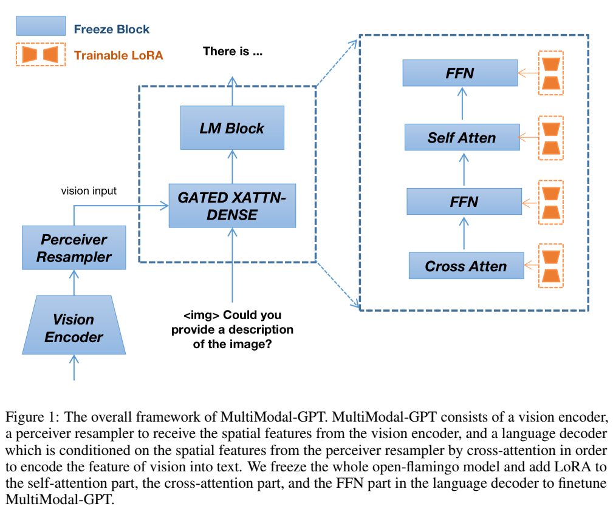
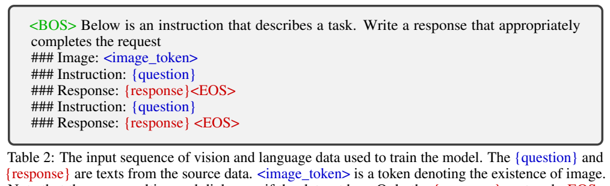
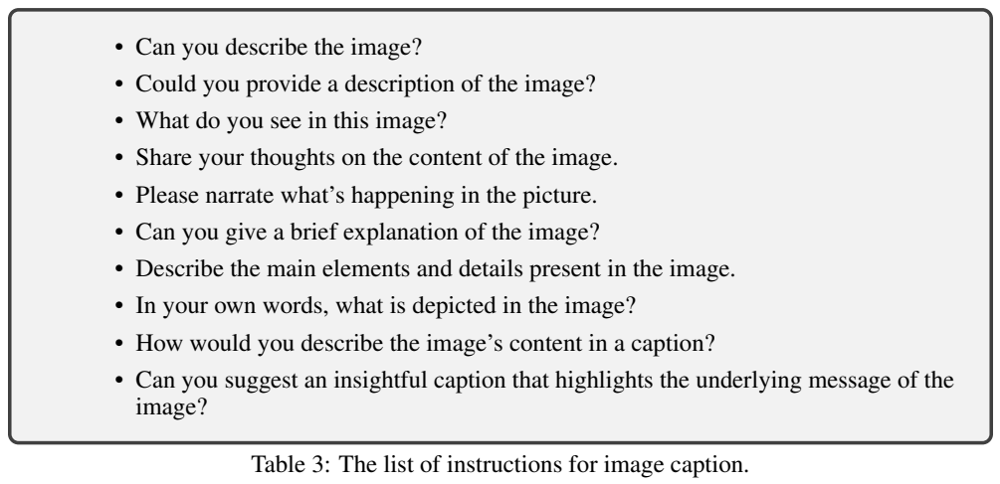
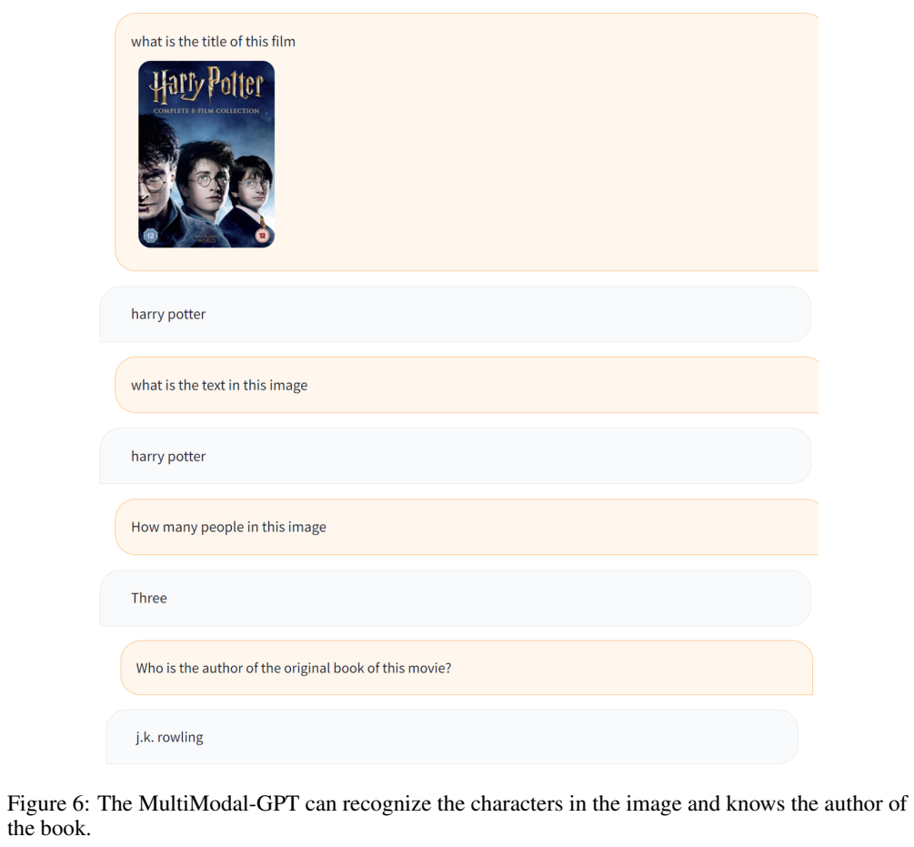

<!-- article-header:start -->
[项目首页](../../../README.md) › [模型系列](../../../reports/model-family-index.md) › [MultiModal-GPT](../README.md)
<!-- article-header:end -->

# MultiModal-GPT：在 OpenFlamingo 上联合训练图文与纯文本指令

<!-- article-toc:start -->
<a id="article-toc"></a>

**本篇目录** · [论文定位](#paper-info) · [快速概览](#overview) · [整体架构](#architecture) · [核心原理](#principles) · [数据构建](#data) · [训练流程](#training) · [实验结果](#experiments)
<!-- article-toc:end -->

<a id="paper-info"></a>

## 1. 论文信息与模型定位

| 项目 | 信息 |
| --- | --- |
| 原文 | MultiModal-GPT: A Vision and Language Model for Dialogue with Humans |
| 团队 | Tao Gong、Chengqi Lyu、Shilong Zhang 等；上海人工智能实验室、香港大学、天津大学 |
| 版本 | [arXiv 2305.04790v1](https://arxiv.org/abs/2305.04790v1)，2023-05-08，11 页 |
| 代码 | [open-mmlab/Multimodal-GPT](https://github.com/open-mmlab/Multimodal-GPT) |
| 模型定位 | OpenFlamingo 的参数高效指令微调，图像与文字输入、多轮文字回答 |

该项目与 OpenAI 的 GPT 系列没有模型血缘关系。名字中的 GPT 描述生成式对话用途；实际底座是 OpenFlamingo、CLIP 视觉编码器与 LLaMA 语言解码器。该版本没有明确列出所用底座的参数规模、CLIP 具体变体和输入分辨率，本文不把后续仓库配置反填为论文已披露信息。下文页码均对应固定 v1 PDF。

<a id="overview"></a>

## 2. 快速概览

论文要解决的是预训练图文模型能完成视觉任务，却未必能按人的指令持续对话。作者采用两个简洁选择：冻结原有 OpenFlamingo，在语言解码器的自注意力、交叉注意力和前馈模块添加 LoRA；把纯语言指令与图文指令转换成相近格式后联合训练。

一个有价值的观察是回答长度会受到训练分布影响。短答案视觉问答数据虽有明确标注，但如果大量用于开放式聊天微调，模型可能对需要解释的问题也只答一两个词。因此最终数据选取更重视可用于对话的回答，并减少或去除部分短答案数据。

这是一份早期方法与展示论文。它报告训练资源和若干对话案例，没有提供 VQAv2、GQA、OCR、综合多模态基准的定量测试表，也没有联合训练相对视觉训练的受控数值对比。对话能力的判断需要以这些公开证据的范围为准。

<a id="architecture"></a>

## 3. 整体架构



**读图：** 蓝色为冻结的原模块，橙色为添加的可训练 LoRA。图像由视觉编码器处理，再由 Perceiver Resampler 整理视觉空间特征；文字进入语言解码器，在 gated cross-attention 模块中读取视觉表示，然后继续经过原语言块生成文本。右侧将交叉注意力、前馈、自注意力及其 LoRA 展开。

这种架构通过交叉注意力把视觉信息提供给语言隐藏状态，而不是仅将全部图像网格当成普通文本 token 直接拼接进原自注意力序列。Perceiver Resampler 的作用是压缩和组织视觉输入；本文未披露其具体查询数、层数或输出长度，不能据此计算图像 token 压缩倍数。

原有视觉编码器、重采样器和语言模型权重均冻结，适配器改变解码器的信息处理方式。摘要主要强调 gated cross-attention 与 self-attention，Figure 1 和第 3.2 节进一步明确 FFN 也添加 LoRA，因此不能把方法概括成只调整注意力。论文没有给出逐矩阵的插入清单、LoRA rank、缩放系数或可训练参数占比。

<a id="principles"></a>

## 4. 核心创新与数学原理

论文没有推导新的注意力公式。其方法由参数高效适配和带掩码的指令学习组成。为解释 LoRA，可用标准形式表示冻结线性映射的更新：

```math
h=W_0x+BAx,\qquad A\in\mathbb R^{r\times d_{in}},\quad B\in\mathbb R^{d_{out}\times r}.
```

这是对论文采用的 LoRA 原理的说明，并非论文给出的编号公式。训练只调整低秩矩阵，原权重 $`W_0`$ 不变；实际 rank、缩放与初始化并未在该版本报告。低秩假设减少要优化的权重数量，但论文没有显存或训练速度基准支持某个精确节省比例。

语言与视觉指令共享“指令—输入—回答”的结构，图文序列额外包含图像标记。生成损失只作用于回答及结束符。用 $`R`$ 表示这些监督位置，可写出对应的标准目标：

```math
\mathcal L=-\sum_{t\in R}\log p_\theta(y_t\mid y_{<t},\mathrm{instruction},\mathrm{image}).
```

纯文本样本没有图像条件；图文样本通过冻结视觉底座与可训练解码器适配器使用图像。提示、问题和输入字段不作为需要复述的目标。统一格式使两类样本遵循相似的生成习惯，多轮图文样本则在同一序列里连续包含多个问答。这是联合监督，不涉及图像重建、对比损失、强化学习或偏好排序目标。

<a id="data"></a>

## 5. 数据构建与处理





**读表：** Table 2 用图像标记声明图像输入，多轮数据继续追加问题与回答；红色回答及 EOS 才进入损失。Table 3 展示将 caption 转成指令任务的不同提问方式。它是模板示例，不能把十种措辞视为十个独立新增数据集。

| 数据来源 | 原文的使用范围 |
| --- | --- |
| Dolly 15k、Alpaca GPT4 | 使用全部文本语料 |
| LLaVA、Mini-GPT4 | 使用来源中全部图文对 |
| A-OKVQA | 随机抽取 5,000 个图文对 |
| COCO Caption | 随机抽取 512 对，借助 GPT-4 生成适合 caption 的指令 |
| OCR VQA | 随机抽取 512 对 |

来源数据不是全部重新由 GPT-4 标注。文中对 COCO Caption 的 GPT-4 使用明确针对指令生成，而不是宣称每幅图像都由 GPT-4 直接看图形成长答案。文章未报告上述全部样本之和、去重比例、许可处理、人工审核或训练测试泄漏检查，也没有列出最终多轮长度分布。

作者曾尝试 VQA v2.0、OKVQA、GQA、CLEVR、NLVR，发现短回答倾向影响开放式对话，最终排除这些来源。这是相对于该对话目标的数据选择结论，并不说明这些数据集本身不适合视觉问答。另一方面，保留的 A-OKVQA 等也控制抽样量，说明方案并非完全禁用短答案，而是调整它们的影响。

<a id="training"></a>

## 6. 训练流程与目标

训练直接从预训练 OpenFlamingo 出发，采用图文和纯文本联合指令微调，原底座全部冻结。作者报告 8 张 A100、1 epoch、学习率 $`10^{-5}`$ 与 cosine 调度。每张 GPU 的每种数据 batch 为 1，每次迭代各取一个图文对和一条纯文本指令，累积 16 次后更新 LoRA。

其总体 batch 为 $`8\times16\times(1+1)=256`$，包含两类样本各 128；不能将它误写成每种数据各 256。这个迭代配比说明两种数据均参与更新，但并未披露不同长度样本的 token 级损失权重与完整调度细节。

文章没有公布训练时长、优化器种类、warmup、weight decay、最大序列长度、LoRA 超参或阶段性验证曲线，也没有另一个对齐阶段的完整 recipe。对 OpenFlamingo 原始预训练的引用不等于本项目又执行了该预训练。损失范围依据 Table 1/2 与第 3.2 节限定到所有回答片段及 EOS，而不是对整段指令做 next-token 监督。

<a id="experiments"></a>

## 7. 实验设置与主要结果



**读图：** 输入为 Harry Potter 影片封面；模型依次回答标题、图中文字、人物数量和原著作者。这里先读取视觉线索，再结合常识回答后续问题，展示了连续追问接口与视觉知识联合使用。截图中出现的三个主要人物与模型回答一致；它没有测量任意复杂场景的计数可靠性，也不能仅靠封面标题证明具备稳定的通用 OCR 能力。

第 4.3 节与 Figure 2–8 还展示食物识别后给出做法、人物识别、女性人数、影片知识、旅行建议和场景描述等。例子说明模型可以输出长回答并沿用上下文，但其中常识部分可能由语言模型知识完成。文中没有区分视觉证据与语言先验的受控消融，也未披露样例如何抽选、总测试数、失败率或人工评分标准。

“数据质量影响对话”和“联合训练改善聊天”均是作者依据初步实验提出的观察，原文未列基线分数或统计检验。该版本没有可抄录的标准评测成绩，因此本文不填造准确率，不把图文训练数据集名称放入一张虚构的测试结果表。联合训练是否改善纯文本能力、LoRA 各插入位置的贡献、视觉与纯文本配比以及短答案影响程度，也都缺少定量消融。

它的公开贡献更适合作为早期多模态指令调优实践：在现成视觉语言底座上，通过统一输入格式、回答损失掩码、参数高效适配与数据选择形成多轮助手。实际能力边界仍需要后续标准化评测，本文未运行模型或复现训练。

<!-- article-footer:start -->
---

[← 上一篇：X-LLM](../../x-llm/arxiv-2305.04160/README.md) · [按发表时间浏览](../../../reports/paper-reading-guide.md#year-2023) · [下一篇：VideoChat →](../../videochat/arxiv-2305.06355/README.md)

[返回本篇目录](#article-toc) · [返回模型系列](../README.md)
<!-- article-footer:end -->
