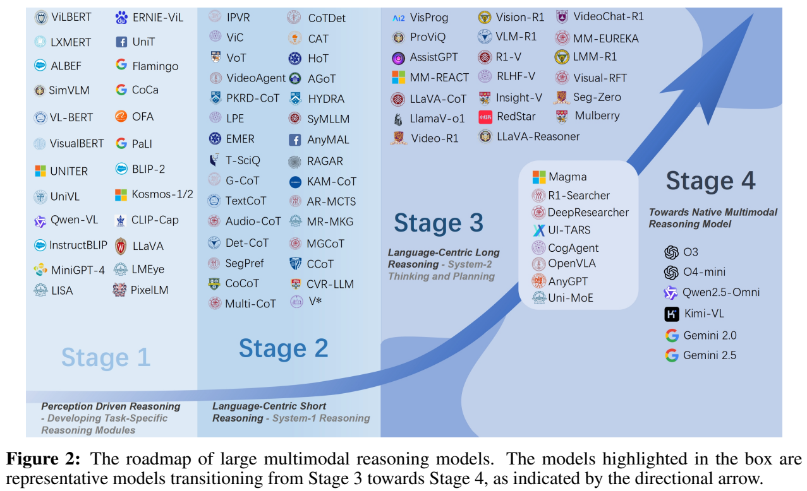
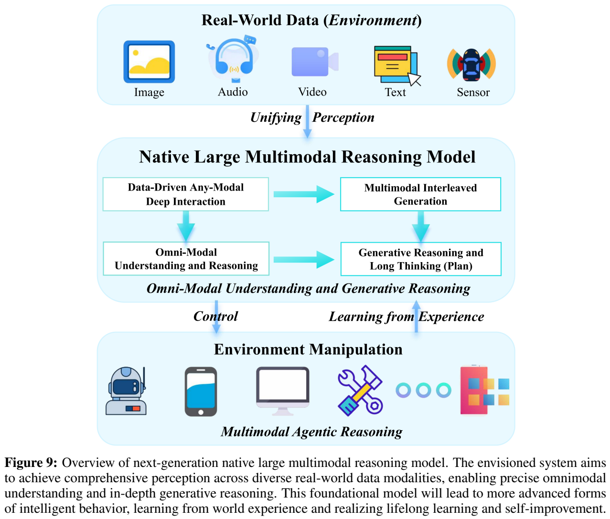
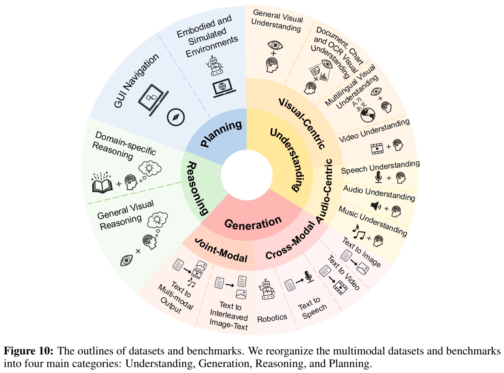
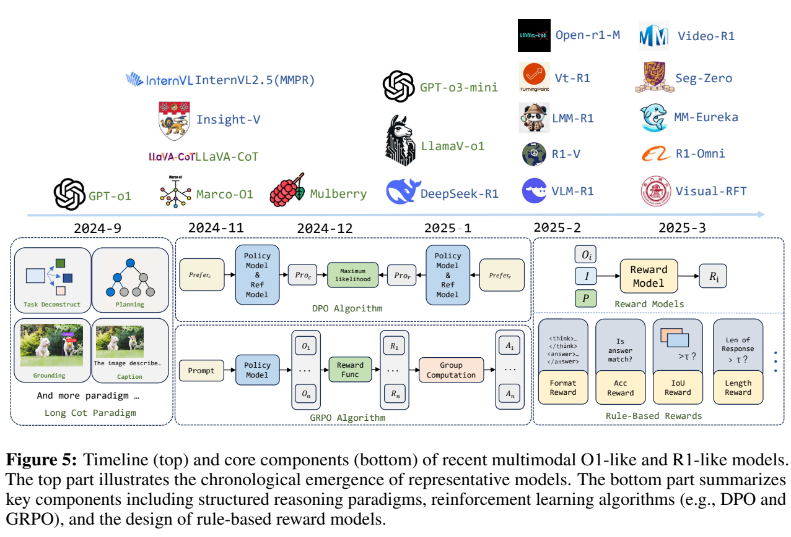

<!-- article-header:start -->
[项目首页](../../../README.md) › [模型系列](../../../reports/model-family-index.md) › [Large Multimodal Reasoning Survey](../README.md)
<!-- article-header:end -->

# 感知、推理、思考与规划：大规模多模态推理模型研究路线综述

<!-- article-toc:start -->
<a id="article-toc"></a>

**本篇目录** · [论文定位](#paper-info) · [快速概览](#overview) · [整体架构](#architecture) · [核心原理](#principles) · [数据构建](#data) · [训练流程](#training) · [实验结果](#experiments)
<!-- article-toc:end -->

<a id="paper-info"></a>

## 1. 论文信息与模型定位

| 项目 | 信息 |
|---|---|
| 原文 | *Perception, Reason, Think, and Plan: A Survey on Large Multimodal Reasoning Models* |
| 作者 | Yunxin Li、Zhenyu Liu、Zitao Li 等；通讯作者 Baotian Hu |
| 机构 | Harbin Institute of Technology, Shenzhen |
| 固定版本 | [arXiv 2505.04921v1](https://arxiv.org/pdf/2505.04921v1)，2025-05-08，75 页 |
| 原项目 | [HITsz-TMG/Awesome-Large-Multimodal-Reasoning-Models](https://github.com/HITsz-TMG/Awesome-Large-Multimodal-Reasoning-Models) |
| 资料性质 | 综述与研究路线分析；覆盖 540 余篇文献，数据集整理声明更新至 2025 年 4 月 |
| 研究对象 | Large Multimodal Reasoning Models，简称 LMRMs；进一步讨论原生多模态推理 N-LMRMs 的前瞻方向 |

这篇论文没有发布一个作者自行训练的新基础模型，也没有统一的新模型参数表。它的作用是解释多模态推理如何从任务模块，发展到语言主导的短思维链，再到长思考、强化学习和交互式规划。因此，下文“整体架构”介绍研究分类框架，“训练流程”介绍被归纳的方法，“实验结果”区分引用的基准表现与作者案例观察。（原文 §1–2，PDF 第 1–6 页）

本文固定在 v1 的历史范围；后续公开模型、排行榜和原仓库持续更新不自动进入这篇介绍。引用中的“领先”或“尚未解决”都应在该时间范围理解。

<a id="overview"></a>

## 2. 快速概览

综述的核心判断是：能够识别图像内容、生成较长解释，与能够可靠地解决复杂任务之间仍有距离。尤其当问题同时依赖音频、视频、空间关系和外部工具时，单纯增加文本思维链长度并不保证感知正确、推理忠实或行动成功。

| 路线阶段 | 主要组织方式 | 代表能力与边界 |
|---|---|---|
| Stage 1：感知驱动的模块推理 | 表示、对齐、融合、专门推理模块 | 适合规定任务；推理常隐含在网络计算里 |
| Stage 2：语言中心的短推理 | 提示式 MCoT、结构化流程、外部增强 | 显式分步解释与局部处理；复杂组合和规划仍受限 |
| Stage 3：语言中心的长推理 | 跨模态中间步骤、o1 风格监督、R1 风格优化 | 自检、搜索和较长思考；泛化与环境闭环仍不足 |
| Stage 4：原生多模态推理愿景 | 全模态理解/生成与智能体交互结合 | 是前瞻框架，不是作者已经训练并验证的统一系统 |

论文正文一方面称前三阶段为历史路线，另一方面用四阶段讨论把前瞻方向纳入。两者并不需要读成两个不同分类。System-1 / System-2 是作者用来组织方法的概念类比，不能把某种结构直接认定为人的认知机制，也不能据此得到严格的能力分界。（§2–3）

<a id="architecture"></a>

## 3. 整体架构



**原文 Figure 2，PDF 第 3 页。** 图中左侧到右侧依次是模块、短推理、长推理和原生推理方向；高亮框中的方法处于向第四阶段发展的讨论范围。箭头表达作者的研究路线，不代表所有后期模型都在每个任务上优于早期模型，也不是一条可以直接实施的训练流水线。

**模块阶段**把图像/视频特征、问题表示和答案选择拆开。NMN 动态组装任务模块，SANs 迭代关注视觉区域，MAC 用记忆与控制单元进行组合计算。预训练 VLM 又通过双流交互或共享 Transformer 将对齐与融合学进网络；视觉编码器连接 LLM 的路线则把感知表示接到语言生成能力上。该阶段的“隐式推理”是指没有必要生成可阅读的中间链条，并不意味着完全不存在多步计算。（§3.1，PDF 第 6–9 页）

**短链阶段**按三条路径展开。提示式方法利用“观察—思考—确认”等指令诱导解释；结构化方法把生成分成固定任务步骤；外部增强方法使用搜索、工具、检索或视觉专家。以 TextCoT 为例，全局概览帮助确定问题范围，粗定位找到相关区域，细观察补充局部信息。Visual Sketchpad 用 thought、action、observation 组织工具操作。它们把一次回答拆为可检查的过程，但错误的最初定位仍会向后传播。（§3.2，PDF 第 10–15 页）

**长链阶段**进一步区分跨模态推理、Multimodal-O1 和 Multimodal-R1。跨模态推理让裁图、视觉中间表示、程序运行或生成子目标成为推理的一部分；O1 类路线强调多阶段推理数据与搜索，R1 类路线强调通过奖励或偏好优化探索解题路径。这是综述对研究策略的归类，不是要求所有模型采用同一种模块、思维链格式或训练算法。（§3.3，PDF 第 15–19 页）



**原文 Figure 9，PDF 第 25 页。** 上方是图像、音频、视频、文本与传感器等环境数据，中间连接统一感知、全模态理解和交错生成，底部是环境操作。向下的控制箭头与向上的经验学习箭头构成闭环。该图是概念设计，没有提供层数、参数规模、实现代码或新模型实测成绩。

N-LMRMs 在这里需要把两类能力结合：一类是全模态理解与生成，例如同一问题联合听觉和视觉证据；另一类是智能体推理，能够分解任务、调用工具、观察结果并修正计划。作者认为当前模型通常只覆盖其中部分能力。统一表示与 MoE 专家是可能路径，而不是这篇已经实现的网络规格。（§4.2–4.3）

| 模块 | 输入与输出 | 公开机制 |
|---|---|---|
| 感知与模块推理（分类） | 视觉、问题 → 特征/模块状态/答案 | NMN、SAN、MAC等在网络中组合计算，不必输出可读推理链 |
| 显式短链与外部观察 | 问题、视觉证据 → 分步解释及工具结果 | 提示、固定步骤或专家工具组织过程；错误定位可继续传播 |
| 长链轨迹与搜索 | 已有轨迹/候选分支 → 更完整推理 | SFT学习范式，Best-of-N/Beam/MCTS扩展或选择路径，预算不同 |
| 偏好与奖励学习 | 回答对/组内奖励 → 策略更新 | 综述列DPO、GRPO、RLOO、PPO等不同算法，不能混为统一损失 |
| 原生多模态闭环（展望） | 全模态观察、行动 → 新观察与计划 | 统一感知/生成/环境交互是概念目标，本文没有给实现参数 |

模块为综述比较维度，最后一行是前瞻概念，不是已训练模型配置。

<a id="principles"></a>

## 4. 核心创新与数学原理

综述的主要创新是分类和研究问题的组织。它把“推理发生在哪里”区分为模块内部、显式语言链、跨模态链与环境闭环；又把“能力从何获得”区分为提示、监督、搜索和奖励优化。这两条轴让读者可以比较方法的控制方式，而不只比较某个排行榜分数。

### 4.1 推理载体决定能否重新取得感知证据

语言链先把视觉证据压成文字后再操作，跨模态链则可重新裁图、读取工具输出或生成视觉中间状态，改变后续步骤可获得的信息。区别不只是链条长短，而是中间状态是否包含新的观察入口；新入口也会带入工具与定位错误，因此可读过程仍需独立验证。[原文 §3.2–3.3、Table 4](https://arxiv.org/pdf/2505.04921v1#page=17)

**显式链不等于忠实链。** 为解释短链与跨模态链的差别，令 $`x`$ 是输入，$`r=(r_1,\ldots,r_L)`$ 是中间步骤，$`a`$ 是答案，可以抽象为：

```math
p_\theta(a,r\mid x)=\left[\prod_{t=1}^{L}p_\theta(r_t\mid x,r_{\lt t})\right]p_\theta(a\mid x,r).
```

这是本文的**解释性表示，不是综述提出的新公式**。当 $`r_t`$ 只包含文本时，视觉证据可能被压缩为不准确的描述；当它包含局部图像、程序输出或工具观察时，可以重新获取信息。不过，最终答案正确仍不能证明每个中间步骤都正确，更不能证明显示的解释完整反映模型内部机制。论文的案例恰好提示了这种区分。（§3.2–3.3、§4.1）

### 4.2 轨迹学习与推理时选择不能合并比较

多阶段Summary/Caption/Thinking/Answer为模型提供结构化监督，搜索则在生成过程中分配额外计算并依赖评分器。完整候选采样、部分序列束搜索和树状扩展保留的信息不同，成绩相近也可能具有不同调用成本。综述列出的O1方法横跨这些选择，应同时看训练数据与推理预算。[原文 §3.3.2、Table 5，PDF 第 17–18 页](https://arxiv.org/pdf/2505.04921v1#page=18)

**监督推理与搜索的作用不同。** SFT 学习已有解题轨迹，Best-of-N 在多份完整答案里选择，Beam Search 保留较有希望的部分序列，MCTS 用树搜索展开与评估不同路径。综述讨论了 LLaVA-CoT 的阶段化生成和 Mulberry 的 CoMCTS；后者并不是简单把同一答案重复采样。搜索引入额外模型调用和评分依赖，因此更高成绩应同时报告推理预算和选择器质量。（§3.3.2，PDF 第 17–18 页）

### 4.3 奖励来源约束了能够优化的行为

偏好对可比较整体回答，规则奖励可检查最终答案、框位置或格式；它们对中间视觉证据的覆盖并不相同。组内相对优势需要奖励差异才有学习信号，任务只奖励最终选项时并不会直接验证每一步观察。原文Table 6同时列出多种策略算法与规则/奖励模型，说明R1是研究路线而非单一GRPO实现。[原文 §3.3.3、Table 6，PDF 第 18–19 页](https://arxiv.org/pdf/2505.04921v1#page=19)

**偏好与奖励优化。** Figure 5 和 Table 6 分别呈现 DPO、GRPO、PPO、RLOO 等路线。用通用 DPO 损失作解释性说明，优选回答 $`y^+`$ 和劣选回答 $`y^-`$ 的概率差相对参考策略进行调整：

```math
\mathcal L_{\rm DPO}=-\mathbb E\log\sigma\!\left(\beta\left[
\log\frac{\pi_\theta(y^+\mid x)}{\pi_{\rm ref}(y^+\mid x)}-
\log\frac{\pi_\theta(y^-\mid x)}{\pi_{\rm ref}(y^-\mid x)}\right]\right).
```

这是为帮助理解被综述算法补充的通用表达，原文没有提出这个损失或给出各模型的统一 $`\beta`$。DPO 用偏好对学习，不等同于在线生成并验证每一条新轨迹；综述把它和强化学习相关方法并列讨论时，不应抹掉这一差别。

GRPO 的核心是对同一问题生成一组输出，以组内奖励构造相对优势。解释性地写为 $`A_i=(R_i-\bar R)/(\mathrm{std}(R)+\epsilon)`$：同组中较好的输出得到正向信号。完整策略更新还涉及概率比、裁剪和可能的 KL 约束，不能只把这个归一化式当作完整训练算法。组内奖励完全一样时，没有差异可供学习；奖励只检查格式、长度或最终选项时，也可能鼓励形式正确而过程错误。

可验证奖励根据任务变化：数学答案可以匹配标准解，定位可以使用 IoU，格式奖励检查输出标记，学习式奖励模型可覆盖开放回答。IoU 更高并不证明逻辑解释可靠，长度更长也不等于解题更好。正文将一些工作统称为采用 GRPO，但 Table 6 明确列 MM-EUREKA 为 RLOO、LMM-R1 为 PPO，因此本文保留表中的算法差别，避免把 R1 类方法全部归为 GRPO。（PDF 第 18–19 页）

<a id="data"></a>

## 5. 数据构建与处理

这篇没有构建一个统一的新训练数据集；数据部分整理已有训练资源与评测。四个能力类别分别是理解、生成、推理和规划，并进一步按视觉/音频、跨模态/联合生成、通用/领域推理、GUI/具身环境展开。（Table 9、§5，PDF 第 26–35 页）



**原文 Figure 10，PDF 第 28 页。** 内圈是四种能力，中圈按信息处理方式细分，外圈展开为具体任务。它说明评估全模态推理需要多种证据，不能用单个视觉数学指标替代语音、生成和交互式规划。

| 能力类别 | 代表资源 | 数据与评估应关注什么 |
|---|---|---|
| 理解 | DocVQA、TextVQA、Video-MME；LibriSpeech、FLEURS、AudioCaps | 文档布局、跨帧事件、语言和声学信息；识别正确与答题正确要分开 |
| 生成 | 图文对、MagicBrush、GenEval、VBench、InterleavedEval | 对齐、对象关系、编辑约束、时间一致性及交错内容连贯性 |
| 推理 | CLEVR、ScienceQA、MathVista、Mulberry-260K、LLaVA-CoT | 中间证据与答案一致，组合推理是否真的依赖输入而非记忆 |
| 规划 | Mind2Web、OSWorld、MineDojo、Habitat、CALVIN | 动作轨迹、可交互状态、跨应用或物理环境中的任务完成 |

表中资源可能有训练集、测试集或不同用途；同名数据集出现在两类中不表示作者将评测集拿来训练。综述的目录也混合了模型、方法、训练语料和基准名称，因此不能直接把目录中所有名称都视为独立可下载数据集。

推理监督的代表规模在 Table 5–6 给出：LLaVA-CoT-100K、Mulberry-260K、MMPR 约 3M 偏好数据，ShareGPT4o-reasoning-dpo 约 6.6K 等；这些是被引用工作的资源，不能相加成为综述训练量。训练样本的答案正确不保证推理链正确，教师生成的解释与工具结果需要核验其事实来源和局部证据。（PDF 第 17–18 页）

对于未来数据合成，作者指出已有工作偏重单模态或简单跨模态任务，三种以上模态对齐、交互式思维链、动态多步规划、多工具串联与并行调用仍欠充分探索。经验反馈可以形成新的轨迹和验证数据，但如何筛选、去重、避免错误自强化以及保证持续学习稳定性，在该文仍属于开放问题，没有公布统一清洗阈值或处理脚本。（§4.3，PDF 第 26 页）

<a id="training"></a>

## 6. 训练流程与目标

本文能够提炼出几类训练路线，不能把它们拼成作者实施的一次统一训练：

1. **感知与对齐学习。** 早期模块常用任务监督；预训练 VLM 使用对比、生成或掩码建模等目标，之后进行任务适配。不同路线学习的表示和融合机制不同。
2. **推理轨迹监督。** 从教师、人工或搜索获得中间步骤，学习描述、定位、分解、思考与答案。LLaVA-CoT、LlamaV-o1、Mulberry 等属于相关讨论；具体阶段和数据并不完全一致。
3. **偏好与可验证奖励优化。** DPO 类路线使用优劣对，GRPO/PPO/RLOO 类路线根据采样与奖励更新策略。Table 6 同时记录 cold start、规则/奖励模型、模态、任务和框架，说明是否先有监督启动需要逐模型确认。
4. **推理时扩展。** Best-of-N、Beam Search、MCTS、检索和工具交互改变解题过程，不一定更新模型权重；其成本与训练成本分别计算。
5. **环境经验学习的前瞻路线。** 作者讨论在线交互与离线验证的循环，将行动、反馈和可迁移经验纳入学习。这是面向 N-LMRMs 的研究方向，未在该文形成新训练实验。



**原文 Figure 5，PDF 第 16 页。** 上半部给出代表工作的时间线，下半部把长链组织、偏好优化、组内奖励计算和规则奖励放在一起。右下角的格式、准确性、IoU、长度奖励是可选设计，不是每个模型都同时采用的固定目标；DeepSeek-R1 等文本工作也在图中充当方法背景，不能因此把它们认作直接接收图像的模型。

综述提醒，当前可验证奖励主要推动数学、定位、分类、情感识别等规定任务，尚不能据此断言长思考会自动泛化为通用能力。面对多模态负迁移，可以考虑统一表示、模态专家和跨模态融合，但训练如何平衡、怎样验证改进仍需具体论文证据。该文没有自己的学习率、batch size、训练 GPU 数或参数冻结方案。（§3.3.3、§4.3）

<a id="experiments"></a>

## 7. 实验设置与主要结果

这里的证据有两类：**基准成绩来自综述转述的既有研究；o3 的图示案例是作者的初步观察。** 论文没有在相同硬件、提示、版本和工具环境下对所有模型做一次统一重测，也没有作者新模型的消融表。下列数字只表达 v1 所记录的结果，不是本仓库的复现实测或当前排行榜。

| 观察来源 | 综述记录的结果 | 可支持的判断与限制 |
|---|---|---|
| OmniMMI | Gemini-1.5-Pro、GPT-4o 的平均准确率低于 20% | 流式视频与交互式任务困难；不能推为这些模型所有视觉任务都低于 20% |
| WorldSense | Claude 3.5 Sonnet 平均约 35%，最佳开源模型约 25% | 音视频联合问答的差距明显；原文这里没有重列全部输入转换与提示条件 |
| BrowseComp | GPT-4o 0.6%；加浏览工具 1.9%；o1 9.9%；Deep Research 51.5% | 专门搜索训练与工具循环很重要；模型、系统和计算预算不同，不是单因素消融 |
| BabelBench、OmnixR 等 | 综述指出模态数量增加后表现下降，没有给出一张统一成绩表 | 多模态融合是瓶颈，不能自行补出具体退化百分点 |

这些结果位于 §4.1、PDF 第 19–20 页；Table 7 是基准名称、任务和模态的整理，并不是包含上述百分数的排行榜。BrowseComp 本身以网页搜索为主，不能把其准确率称为纯图像推理准确率。

**作者的案例观察。** Figure 6（PDF 第 21 页）展示一道公务员考试图形题，o3 在所展示记录中经过裁图尝试与任务分解，用时 8 分 13 秒后得到正确答案。这只是单例：没有足够样本、重复试验、置信区间或统一采样预算，不能说明所有问题都会因更长思考获益，也不是独立审计模型内部全部思维过程。

Figure 7–8（PDF 第 22–23 页）还展示地点定位、谜题、媒体创作、视觉判断和文件处理。失误包括把六指图像按熟悉手势识别、解析简历电话号码出错、混用候选人的项目经历，以及生成内容没有满足小熊猫指令。作者指出工具和代码环境网络限制也会造成处理问题，因此这些是模型与系统共同表现；不能全部归因为网络架构。某些正确答案伴随错误解释，支持“解释可能不忠实”的有限观察，不能由少数案例推导模型具有主观欺骗意图。

**评测方法决定结论。** §5.5（PDF 第 35 页）把评测分为 Exact/Fuzzy Match、选项匹配、LLM/MLLM 评分和智能体评估。短答案匹配可以检查答案，但忽略解释可靠性；选项评测容易受选项顺序影响，CircularEval 通过轮换安排检查稳定性；开放生成需要评分规范和评审模型，仍可能受评审偏差影响；工具和多智能体评估可以扩大检查范围，却也引入额外调用成本与错误来源。

由此，研究多模态推理至少需要分别检查感知、解题、解释与行动：输入证据是否读对，中间操作是否与证据一致，最终答案是否正确，以及在真实环境中能否完成任务。对 N-LMRMs 的统一感知、交错生成、长程规划和经验学习，本文提供的是明确研究问题和路线图，尚未提供一个全部实现并受统一实验验证的新模型。

<!-- article-footer:start -->
---

[← 上一篇：VITA-Audio](../../vita/arxiv-2505.03739/README.md) · [按发表时间浏览](../../../reports/paper-reading-guide.md#year-2025) · [下一篇：Seed1.5-VL →](../../seed/arxiv-2505.07062/README.md)

[返回本篇目录](#article-toc) · [返回模型系列](../README.md)
<!-- article-footer:end -->
